# Chapitre 1 — Introduction et installation de MySQL Cluster

## Objectif du chapitre

À la fin de ce chapitre, l'apprenant sait décrire l'architecture de MySQL Cluster (moteur NDB, nœuds de gestion, de stockage et SQL), installer et configurer les trois VM du laboratoire (réseau vboxnet0, adresses IP statiques, SSH, nettoyage, snapshots), installer les composants MySQL Cluster sur chaque VM, rédiger le fichier `config.ini` de référence du parcours avec `NoOfReplicas = 2`, démarrer les nœuds dans l'ordre critique (gestion, puis stockage, puis SQL), vérifier l'intégrité du cluster avec `ndb_mgm -e "SHOW"`, et analyser la résilience (node groups, quorum, split-brain, failover automatique) ainsi que les contraintes des gros volumes de données (DataMemory, IndexMemory, partitionnement, auto-sharding).

## Avertissement et périmètre

- Machine principale : VM 1 (`192.168.56.10`, hostname `gestion-sql`, nœud de gestion + nœud SQL), VM 2 (`192.168.56.11`, hostname `stockage`, deux nœuds de stockage `ndbmtd` NodeId 2 et 3) et VM 3 (`192.168.56.12`, hostname `mysql-node3`, second nœud SQL NodeId 5).
- Réseau : VirtualBox host-only `vboxnet0` (`192.168.56.0/24`) pour l'accès SSH du host vers les VM, plus un adaptateur NAT sur chaque VM pour l'accès Internet de toutes les machines.
- Données : fictives, marquées `Lab` (uniquement pour le laboratoire isolé).
- Snapshots : les snapshots propres (`propre-avant-lab`) sont pris sur chaque VM avant le module.
- Accès : l'apprenant est déjà connecté en SSH sur chaque VM et exécute les commandes directement sur la machine.
- Hôte : `192.168.56.1`, utilisé uniquement comme hyperviseur, machine d'administration et stockage des preuves.
- **Note sur les NodeId** : la numérotation canonique du parcours est `NodeId 1` pour le nœud de gestion (VM 1), `NodeId 2 et 3` pour les deux nœuds de stockage (VM 2), et `NodeId 4 et 5` pour les nœuds SQL (VM 1 et VM 3). Les `config.ini`, schémas et résultats `SHOW` attendus des chapitres suivent cette numérotation (gestion=1, stockage=2 et 3, SQL=4 et 5). Cette numérotation est celle de l'infrastructure déployée et validée en laboratoire.

## Prérequis

| Élément | Détail | Vérification |
|---|---|---|
| Hôte | VirtualBox, réseau host-only vboxnet0 192.168.56.0/24 | `VBoxManage list hostonlyifs` liste vboxnet0 |
| VM 1 | Ubuntu Server 24.04 LTS, 1 vCPU, 1 Go RAM, 15 Go disque, IP `192.168.56.10`, hostname `gestion-sql` | `ping 192.168.56.10` depuis l'hôte |
| VM 2 | Ubuntu Server 24.04 LTS, 1 vCPU, 1 Go RAM, 15 Go disque, IP `192.168.56.11`, hostname `stockage` | `ping 192.168.56.11` depuis l'hôte |
| VM 3 | Ubuntu Server 24.04 LTS, 1 vCPU, 1 Go RAM, 15 Go disque, IP `192.168.56.12`, hostname `mysql-node3` | `ping 192.168.56.12` depuis l'hôte |
| SSH | Accès `root` sur les trois VM (mot de passe dans `.env`) | session SSH ouverte sur chaque VM |
| Snapshot | `propre-avant-lab` présent sur chaque VM | `VBoxManage snapshot <vm> list` |

## Vocabulaire

| Terme | Définition |
|---|---|
| Nœud de gestion (MGM) | Serveur qui distribue la configuration du cluster, processus `ndb_mgmd`, interface de gestion dédiée. |
| Nœud de stockage (NDB) | Serveur qui stocke les fragments de données en mémoire, processus `ndbmtd` ou `ndbd`. |
| Nœud SQL (API) | Instance MySQL `mysqld` avec le moteur NDB qui expose l'interface SQL. |
| NDB | Moteur de stockage distribué et en mémoire de MySQL Cluster. |
| NoOfReplicas | Nombre de copies de chaque fragment de données pour la redondance (valeur 2 dans ce lab). |
| Node-group | Groupe de nœuds de stockage qui contiennent les mêmes copies de données. |
| Split-brain | Situation où le cluster est partitionné en deux groupes qui ne peuvent plus communiquer. |
| Quorum | Règle de décision par majorité qui empêche deux partitions d'agir simultanément. |
| Arbitrage | Mécanisme par lequel un nœud tranche en cas de perte de communication entre node groups. |
| Connect-string | Adresse du nœud de gestion donnée à chaque node pour rejoindre le cluster (ex. `192.168.56.10`). |
| Lab | Mot de passe factice (uniquement pour le laboratoire) |
| Auto-sharding | Répartition automatique des fragments de données sur les nœuds de stockage par le moteur NDB. |

## Introduction à MySQL et au clustering (module 1.0)

MySQL Cluster, basé sur le moteur de stockage NDB (Network Database), est une technologie de base de données distribuée qui fournit une haute disponibilité et une scalabilité horizontale. Son architecture, connue sous le nom d'"architecture Shared-Nothing" (partagé-nothing), répartit les données et les traitements sur plusieurs serveurs (ou machines virtuelles), éliminant tout point de défaillance unique (SPOF). Chaque nœud possède sa propre mémoire et ses propres disques ; les données sont fragmentées et répliquées sur plusieurs nœuds de stockage indépendants.

Dans le contexte de ce lab sur 3 VM, l'architecture est déployée comme suit :

- **VM 1** (`192.168.56.10`, `gestion-sql`) : héberge le **nœud de gestion** (`ndb_mgmd`, NodeId 1) et le **premier nœud SQL** (`mysqld`, NodeId 4).
- **VM 2** (`192.168.56.11`, `stockage`) : héberge les **deux nœuds de stockage** (`ndbmtd`, NodeId 2 et NodeId 3), sur des répertoires de données distincts (`ndb_2` et `ndb_3`).
- **VM 3** (`192.168.56.12`, `mysql-node3`) : héberge le **second nœud SQL** (`mysqld`, NodeId 5).

### Figure 1 — Architecture logique du cluster

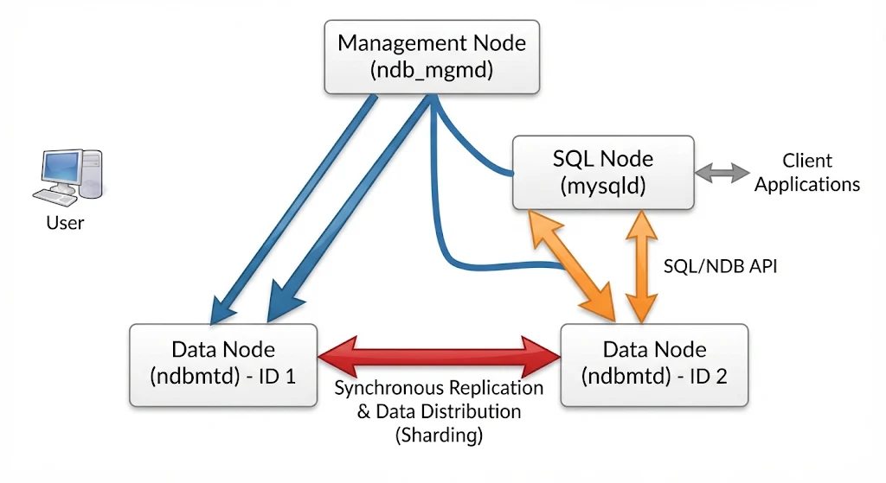

*Figure 1 : un schéma montrant la topologie logique du cluster. VM 1 (192.168.56.10) contient deux boîtes : `ndb_mgmd` (nœud de gestion, NodeId 1) et `mysqld` (nœud SQL, NodeId 4). VM 2 (192.168.56.11) contient deux autres boîtes : `ndbmtd NodeId 2` et `ndbmtd NodeId 3` (nœuds de stockage). VM 3 (192.168.56.12) contient `mysqld` (nœud SQL, NodeId 5). Des connexions bidirectionnelles relient les nœuds via le réseau host-only `vboxnet0` : le nœud SQL communique avec les nœuds de stockage pour accéder aux données, tandis que le nœud de gestion coordonne l'ensemble du cluster et distribue la configuration `config.ini`.*

**Adaptation au lab** : l'image correspond exactement à la topologie canonique du parcours (gestion=1, stockage=2 et 3, SQL=4 et 5, adresses `192.168.56.10/11/12`). Aucun changement d'IP n'est nécessaire ; les NodeId affichés sont ceux du fichier `config.ini` de référence.

**Lien avec le concept** : illustration de l'architecture partagé-nothing et de la séparation des rôles (gestion, stockage, SQL) qui structure tout le chapitre.

### Les composants principaux

MySQL Cluster repose sur trois types de nœuds distincts qui communiquent entre eux via le réseau :

#### Nœud de gestion (Management Node — `ndb_mgmd`)

* **Rôle** : gère la configuration du cluster. Il charge et distribue le fichier de configuration (`config.ini`) à tous les autres nœuds au démarrage. Il coordonne également les opérations de démarrage progressif et l'arbitrage en cas de partitionnement réseau.
* **Caractéristiques** : il ne stocke aucune donnée utilisateur et n'est pas sollicité pour le traitement des requêtes SQL. Un seul nœud de gestion suffit pour le fonctionnement, mais c'est le premier composant à démarrer.

#### Nœud de stockage (Data Node — `ndbmtd`)

* **Rôle** : héberge et gère les partitions de données réelles (fragments). C'est ici que réside le moteur NDB. Il assure également la réplication synchrone de ces fragments avec les autres nœuds de stockage de son node group.
* **Caractéristiques** : les données sont principalement stockées en **mémoire** (RAM), mais elles sont persistées sur disque (checkpoints) pour garantir leur durabilité. Dans ce lab, VM 2 exécute deux instances `ndbmtd` simultanément (NodeId 2 et NodeId 3), sur des répertoires distincts (`ndb_2` et `ndb_3`).

#### Nœud SQL (SQL Node — `mysqld`)

* **Rôle** : offre l'interface standard de MySQL. Il agit comme une passerelle entre les applications clientes (protocole MySQL) et le moteur de stockage NDB. Il reçoit les requêtes SQL, les optimise et les traduit en opérations NDB pour les transmettre aux nœuds de stockage appropriés.
* **Caractéristiques** : ce n'est pas un serveur MySQL classique avec InnoDB ; il utilise le moteur NDB. Il ne stocke pas de données utilisateur NDB. Une application peut se connecter à n'importe quel nœud SQL pour accéder aux mêmes données du cluster.

Ces composants interagissent de manière coordonnée, comme le montre l'illustration suivante :

### Figure 2 — Communication interne et rôles des nœuds du cluster NDB

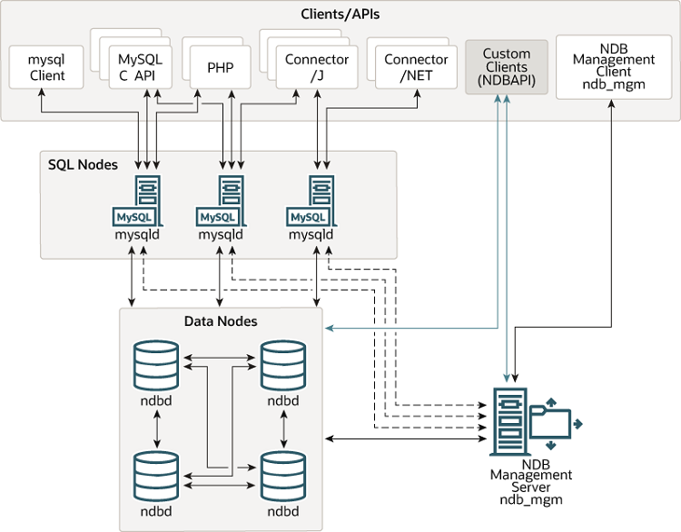

*Figure 2 : l'architecture canonique du cluster NDB MySQL. À gauche, les clients et APIs (mysql Client, MySQL Connector/C, PHP, Connector/J, Connector/NET, clients personnalisés NDBAPI, client de gestion ndb_mgm) envoient leurs requêtes vers trois SQL Nodes (mysqld). Les SQL Nodes transmettent les opérations aux Data Nodes (ndbd). Le NDB Management Server (ndb_mgm) pilote et supervise l'ensemble du cluster. Les flux vont des clients vers les nodes SQL, puis vers les nodes de données, tandis que le serveur de gestion assure la coordination.*

**Adaptation au lab** : dans notre lab sur 3 VM, cette topologie de référence est réduite à l'essentiel : 1 nœud de gestion (`ndb_mgmd`, NodeId 1, `192.168.56.10`), 2 nœuds de stockage (`ndbmtd`, NodeId 2 et NodeId 3, `192.168.56.11`) et 2 nœuds SQL (`mysqld`, NodeId 4 sur `192.168.56.10` et NodeId 5 sur `192.168.56.12`). Le client de gestion `ndb_mgm` est l'outil utilisé pour vérifier l'état du cluster (`ndb_mgm -e "SHOW"`). Les 3 nodes SQL et 4 nodes de données du schéma de référence deviennent 2 nodes SQL et 2 nodes de stockage collocés sur VM 2.

**Lien avec le concept** : cette image illustre les trois rôles de nœuds définis plus haut et le cheminement d'une requête (application → node SQL → node de stockage), sous la supervision du node de gestion.

### Pourquoi MySQL Cluster est adapté aux applications critiques

MySQL Cluster est conçu pour répondre aux exigences les plus élevées en matière de disponibilité et de performance :

* **Haute Disponibilité (HA) zéro SPOF** : la redondance des nœuds de stockage et la réplication synchrone garantissent que si un nœud de stockage tombe en panne, les données restent accessibles via ses répliques. Le cluster continue de fonctionner sans interruption de service.
* **Scalabilité Horizontale (Scale-Out)** : pour augmenter les performances ou la capacité de stockage, il suffit d'ajouter de nouveaux groupes de nœuds de stockage au cluster existant. MySQL Cluster redistribue automatiquement les données (rebalancement) pour tirer parti des nouvelles ressources.
* **Performance en Temps Réel** : la conception en mémoire du moteur NDB permet une latence très faible pour les opérations de lecture et d'écriture, ce qui est critique pour les applications transactionnelles à haute concurrence.

### Études de cas et exemples d'utilisation

Les caractéristiques uniques de MySQL Cluster en font une solution privilégiée dans plusieurs secteurs :

* **Télécommunications** : utilisé pour les systèmes HLR (Home Location Register) et HSS (Home Subscriber Server) qui gèrent des millions d'abonnés et nécessitent un accès aux données en temps réel et une disponibilité extrême.
* **Finance et Paiements** : utilisé pour les plateformes de traitement des transactions qui exigent une intégrité transactionnelle (ACID) et aucune perte de données, tout en supportant une charge élevée.
* **Web et Services à Haute Concurrence** : utilisé pour les systèmes de gestion de sessions, les catalogues de produits en ligne ou les infrastructures de messagerie où la performance et la scalabilité sont primordiales.

### Figure 3 — MySQL Group Replication : haute disponibilité et séparation lecture/écriture

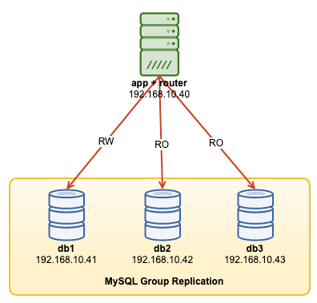

*Figure 3 : le schéma "MySQL Group Replication" présente trois nœuds de base de données db1 (192.168.10.41), db2 (192.168.10.42) et db3 (192.168.10.43) formant un groupe de réplication. Un applicatif avec un routeur (192.168.10.40) se connecte au groupe ; des flèches "RW" (lecture-écriture) pointent vers db1, le nœud primaire en mode single-primary, tandis que des flèches "RO" (lecture seule) pointent vers db2 et db3, les nœuds secondaires.*

**Adaptation au lab** : il s'agit d'une technologie MySQL distincte du clustering NDB étudié ici. Dans notre lab sur 3 VM, il n'y a pas de routeur intermédiaire ni de séparation primaire/secondaires au niveau applicatif : l'application s'adresse directement aux deux nœuds SQL (NodeId 4 sur `192.168.56.10` et NodeId 5 sur `192.168.56.12`), chacun capable de lectures et d'écritures. La redondance des données est assurée par la réplication synchrone NDB dans le node group (NodeId 2 et NodeId 3 sur `192.168.56.11`, `NoOfReplicas = 2`), sans routeur externe. Les adresses `192.168.10.x` de l'image sont une topologie générique ; dans le lab on les remplace par `192.168.56.10/11/12` et les NodeId canoniques 1 à 5.

**Lien avec le concept** : mise en perspective d'une autre solution de haute disponibilité MySQL (réplication de groupe, séparation lecture/écriture), à contraster avec la réplication synchrone intra-cluster du moteur NDB.

### Le moteur de stockage NDB — fonctionnement interne

Le moteur de stockage NDB est le cœur de MySQL Cluster. Contrairement à InnoDB qui stocke les données principalement sur disque avec des caches en mémoire, NDB privilégie le stockage des données en **mémoire vive (RAM)** pour des performances d'accès extrêmement élevées.

La durabilité des données est assurée par :

* **Checkpoints Locaux (LCP)** : périodiquement, les données modifiées en mémoire sont écrites sur disque.
* **Checkpoints Globaux (GCP)** : assurent la cohérence transactionnelle entre tous les nœuds du cluster.
* **Redo Logs** : enregistrent toutes les transactions pour permettre la reconstruction en cas de panne.

### Node groups, partitionnement (sharding) et réplication synchrone

Le cluster est structuré autour de **groupes de nœuds (node group)**. Un groupe de nœuds est constitué d'un ensemble de nœuds de stockage qui contiennent les mêmes fragments de données. Chaque fragment est répliqué sur chaque nœud du groupe.

Dans une configuration avec `NoOfReplicas = 2` (valeur de référence du parcours), chaque groupe de nœuds contient deux nœuds de stockage. Dans ce lab, VM 2 exécute les deux processus `ndbmtd` (NodeId 2 et NodeId 3) qui appartiennent au même node group (Nodegroup: 0) afin d'assurer la réplication synchrone.

Deux mécanismes fondamentaux assurent scalabilité et disponibilité :

1. **Partitionnement (sharding)** : les tables NDB sont automatiquement divisées en partitions (fragments). Ces partitions sont distribuées entre les différents groupes de nœuds de stockage disponibles. Par défaut, le partitionnement est basé sur la valeur de la clé primaire, assurant une distribution uniforme et une recherche rapide (auto-sharding du moteur NDB).
2. **Réplication synchrone (`NoOfReplicas`)** : chaque partition est répliquée sur tous les nœuds d'un groupe de nœuds. Lorsqu'une transaction valide une écriture, cette écriture doit être confirmée avec succès par **tous** les nœuds de stockage du groupe avant que le nœud SQL ne puisse confirmer la réussite de la transaction à l'application cliente. Cela garantit que toutes les répliques sont cohérentes à tout moment.

### Figure 4 — Sharding, MySQL Router et groupes de shards

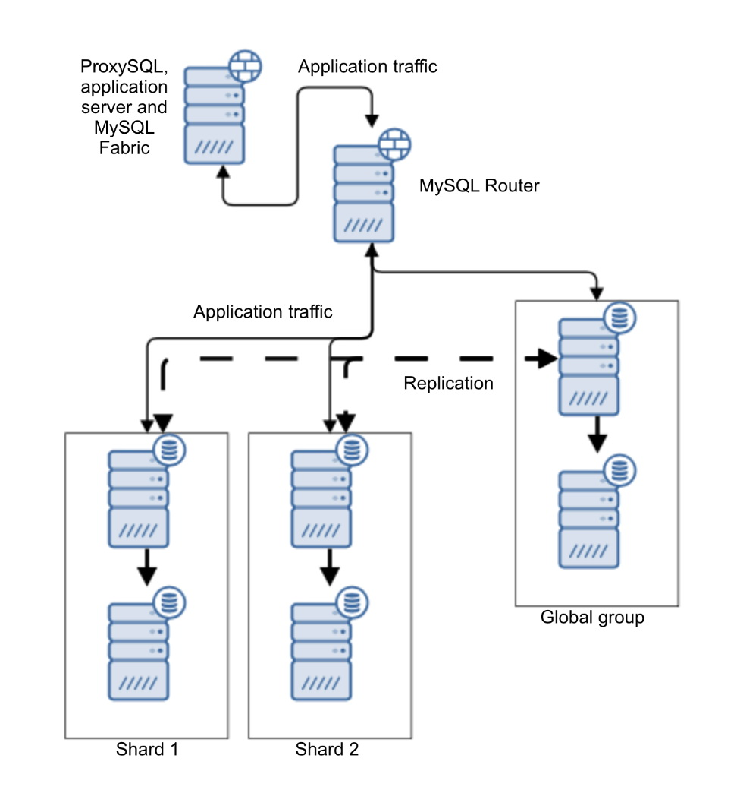

*Figure 4 : l'illustration montre le partitionnement (sharding) des données. Le trafic applicatif arrive au centre via MySQL Router (avec mention de ProxySQL, application server et MySQL Fabric). Deux shards, "Shard 1" et "Shard 2", chacun composé de deux nœuds empilés, reçoivent les partitions. À droite, un "Global group" ; une flèche "Replication" relie Shard 2 au Global group.*

**Note** : `image-5.png` et `image-6.png` sont deux fichiers identiques qui illustrent le même schéma de sharding MySQL Router ; seule `image-6.png` est affichée ci-dessus.

**Adaptation au lab** : MySQL Cluster NDB réalise nativement l'auto-sharding : les tables NDB sont automatiquement partitionnées par clé primaire et distribuées entre les node groups, sans routeur externe. Dans notre lab, un seul node group (Nodegroup: 0) rassemble NodeId 2 et NodeId 3 sur VM 2 (`192.168.56.11`) avec `NoOfReplicas = 2` ; le partitionnement et la réplication des fragments sont gérés par le moteur NDB, contrairement à l'illustration où un routeur et des shards distincts sont déployés.

**Lien avec le concept** : illustration du partitionnement (sharding) et de la distribution des fragments, concepts mis en œuvre nativement par NDB via l'auto-sharding et les node groups.

### Figure 5 — Réplication synchrone et partitionnement (sharding) de la couche de stockage

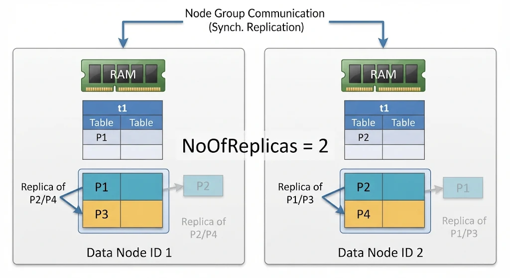

*Figure 5 : un schéma détaillé de la couche de stockage (correspondant logiquement à VM 2) montrant comment les données sont organisées entre les deux processus `ndbmtd`. Une table NDB nommée `t1` est divisée en quatre partitions logiques : P1, P2, P3, P4. Le schéma montre que P1 et P3 sont stockées dans `ndbmtd NodeId 2`, tandis que P2 et P4 sont stockées dans `ndbmtd NodeId 3`. Des flèches bidirectionnelles épaisses entre `ndbmtd NodeId 2` et `ndbmtd NodeId 3` illustrent la réplication synchrone de P1/P3 vers `ndbmtd NodeId 3` et de P2/P4 vers `ndbmtd NodeId 2`. La légende `NoOfReplicas = 2` souligne que chaque partition existe en deux exemplaires dans ce groupe de nœuds.*

**Adaptation au lab** : les NodeId 2 et NodeId 3 de l'image correspondent aux deux nœuds de stockage collocés sur VM 2 (`192.168.56.11`), dans des répertoires distincts (`ndb_2` et `ndb_3`). Le node group unique (Nodegroup: 0) du lab contient exactement ces deux répliques, conformément à `NoOfReplicas = 2`.

**Lien avec le concept** : illustration concrète du partitionnement (sharding) et de la réplication synchrone intra-node-group qui fondent la résilience du cluster.

### Réplication source/replica MySQL (asynchrone)

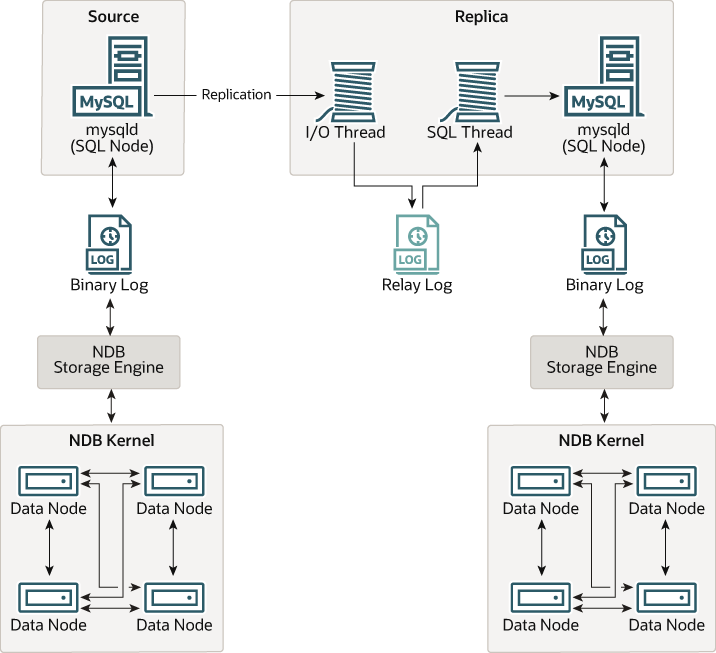

*Figure 6 : le schéma "Réplication source/replica" montre, côté Source, un nœud MySQL (SQL Node) qui écrit dans le Binary Log, puis le NDB Storage Engine et le NDB Kernel (Data Nodes). Côté Replica, on trouve un I/O Thread qui lit le binaire distant, un SQL Thread qui l'applique, un Relay Log, un Binary Log local, le NDB Storage Engine et le NDB Kernel. Une flèche "Replication" relie la Source au Replica.*

**Adaptation au lab** : il s'agit d'une réplication MySQL asynchrone (source → replica), différente de la réplication synchrone intra-cluster NDB (`NoOfReplicas = 2`) utilisée dans notre lab. Elle pourrait servir à répliquer asynchrone notre cluster de lab (`192.168.56.10/11/12`) vers un cluster de secours distant ou un entrepôt de lecture ; ce mécanisme n'est pas mis en œuvre dans les Labs 1 et 2 du parcours.

**Lien avec le concept** : mise en contraste de la réplication asynchrone source/replica avec la réplication synchrone du moteur NDB.

### Réplication en pipeline : modes asynchrone, semi-synchrone et synchrone

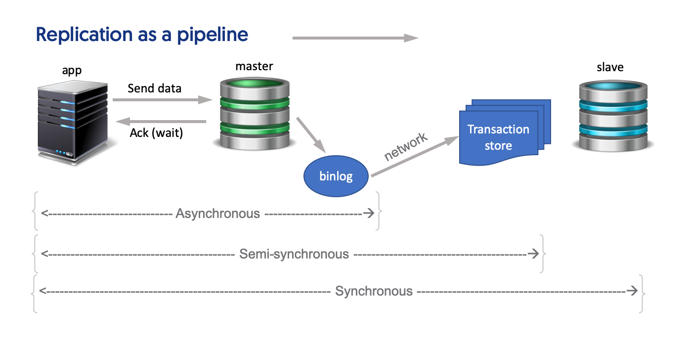

*Figure 7 : le schéma "Replication as a pipeline" présente le flux d'une écriture : une application envoie des données sur le master ("Send data", puis "Ack wait") ; les données sont écrites dans le binaire (binlog, disque bleu), traversent le réseau, sont stockées dans un "Transaction store" puis appliquées sur le slave. En dessous, trois barreaux de temps comparent les modes Asynchronous, Semi-synchronous et Synchronous selon le moment où l'accusé de réception est renvoyé à l'application.*

**Adaptation au lab** : dans notre cluster NDB, l'écriture est synchrone : une transaction n'est confirmée à l'application que lorsque tous les nœuds de stockage du node group (NodeId 2 et NodeId 3, `NoOfReplicas = 2`) ont acquitté l'écriture — cela correspond au mode "Synchronous" de l'illustration. Il n'y a pas de binlog de réplication asynchrone entre un master et un slave dans le cœur du cluster NDB ; la cohérence est garantie par le GCP (Checkpoint Global) et la réplication synchrone intra-node-group.
**Lien avec le concept** : illustration des trois modes de réplication (asynchrone, semi-synchrone, synchrone) et de l'attente d'accusé (ack), directement reliée au comportement synchrone de NDB dans le lab.


### Mise en perspective : InnoDB Cluster et InnoDB ReplicaSet (solutions HA MySQL InnoDB)

Outre MySQL Cluster NDB (le moteur partagé-nothing étudié dans ce lab), MySQL propose deux autres solutions officielles de haute disponibilité (HA) et de réplication intégrées nativement à l'écosystème MySQL : **MySQL InnoDB Cluster** et **MySQL InnoDB ReplicaSet**. Ces deux architectures reposent sur le moteur de stockage **InnoDB**, le moteur de stockage par défaut de MySQL, et synchronisent plusieurs serveurs MySQL entre eux afin d'éviter toute perte de données ou interruption de service en cas de panne d'un serveur.

Ces deux approches s'appuient sur les mêmes trois briques de base :

1. **Serveurs MySQL (moteur InnoDB)** : ils hébergent les données et assurent leur réplication d'un serveur à l'autre.
2. **MySQL Router** : proxy léger placé entre l'application et les bases de données ; il redirige automatiquement le trafic applicatif vers le bon serveur, en lecture ou en écriture.
3. **MySQL Shell** : outil en ligne de commande qui expose l'AdminAPI ; il permet de déployer, configurer et administrer l'architecture en quelques commandes.

La différence entre InnoDB Cluster et InnoDB ReplicaSet porte sur le niveau d'exigence :

| Critère | InnoDB Cluster | InnoDB ReplicaSet |
|---|---|---|
| Technologie sous-jacente | Group Replication (réplication de groupe quasi-synchrone) | Réplication classique asynchrone Source/Replica |
| Basculement (failover) | Automatique, en quelques secondes en cas de panne d'un serveur | Manuel, via une commande MySQL Shell |
| Nombre de nœuds | Minimum 3 serveurs recommandés (quorum) | À partir de 2 serveurs (1 source + 1 ou plusieurs réplicas) |
| Usage principal | Applications critiques nécessitant une disponibilité continue (zéro interruption) | Montée en charge en lecture, sauvegardes, reprise après sinistre simple |

En complément d'un InnoDB Cluster, des **Read Replicas** (nœuds en lecture seule) peuvent être ajoutés pour absorber un fort trafic de lecture sans alourdir le groupe principal.

**Distinction avec le lab NDB Cluster** : InnoDB Cluster et InnoDB ReplicaSet sont des approches HA fondées sur le moteur InnoDB ; elles sont **distinctes de NDB Cluster**, qui est le cœur de ce parcours. Dans ce lab, le cluster étudié est un cluster NDB partagé-nothing avec nœuds de gestion, de stockage et SQL, `NoOfReplicas = 2`, ordre de démarrage gestionnaire → stockage → SQL, et vérification d'intégrité avec `ndb_mgm -e "SHOW"`. InnoDB Cluster/ReplicaSet n'est ni installé ni mis en œuvre dans les Labs 1 et 2 du parcours ; cette sous-section a uniquement pour objectif de situer NDB Cluster parmi les solutions HA officielles de MySQL.

### Mise en perspective : InnoDB ClusterSet (failover inter-sites) et MySQL Router (routage applicatif)

Au-delà d'InnoDB Cluster et d'InnoDB ReplicaSet, MySQL complète son offre de haute disponibilité avec deux composants qui étendent la protection des données et l'accès applicatif sur plusieurs sites : **InnoDB ClusterSet** et **MySQL Router**.

Comme InnoDB Cluster et InnoDB ReplicaSet, ces solutions reposent sur le moteur de stockage **InnoDB** et sur la réplication de serveurs MySQL. Elles sont **distinctes de NDB Cluster**, qui est le cœur de ce parcours. InnoDB ClusterSet n'est ni installé ni mis en œuvre dans les Labs 1 et 2 ; cette sous-section a uniquement pour objectif de situer ces solutions parmi l'offre HA de MySQL, sans les confondre avec le cluster NDB partagé-nothing du lab.

#### InnoDB ClusterSet — ensemble de clusters InnoDB et failover inter-sites

Un **InnoDB ClusterSet** est un ensemble de plusieurs **InnoDB Clusters** (chaque cluster étant lui-même un groupe de réplication **Group Replication**) reliés entre eux par une **réplication asynchrone inter-sites**. L'architecture repose sur :

- un **site primary** (site principal) qui accueille le cluster InnoDB maître et traite les écritures ;
- un ou plusieurs **sites réplica** qui maintiennent des copies à jour des données via la réplication asynchrone depuis le site primary.

Chaque cluster du ClusterSet conserve son **quorum interne** et son autonomie de fonctionnement. En cas de panne du site principal, un **failover inter-sites** permet de basculer l'activité vers un site réplica (disaster recovery, reprise après sinistre sur plusieurs sites géographiques). Le ClusterSet étend ainsi InnoDB Cluster de la haute disponibilité locale à une haute disponibilité géographique/multi-site.

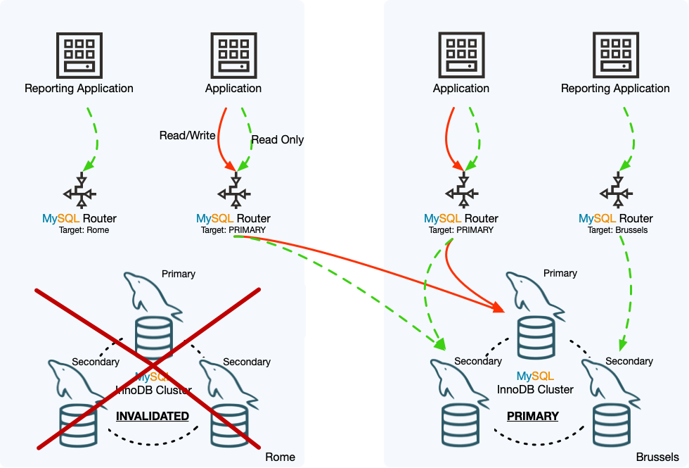

*Figure 8 : la figure 9.3 illustre le mécanisme de failover d'un InnoDB ClusterSet. Un site primary et un ou plusieurs sites réplica sont reliés par réplication asynchrone ; en cas de panne du site primary, l'activité applicative est basculée vers un site réplica. Cette image illustre une solution InnoDB (autre que le lab NDB Cluster sur 3 VM) et n'est pas déployée dans les Labs 1 et 2.*

**Adaptation au lab** : ce mécanisme de failover inter-sites diffère du failover intra-cluster NDB du lab (`NoOfReplicas = 2`, node group unique sur VM 2, arbitrage par le nœud de gestion). Dans le lab, il n'y a pas de site réplica distant ni de ClusterSet ; la résilience est assurée localement par la réplication synchrone des deux nœuds de stockage (NodeId 2 et NodeId 3).

**Lien avec le concept** : illustration du failover inter-sites et du disaster recovery, à contraster avec le failover automatique intra-node-group du cluster NDB étudié dans ce parcours.

#### MySQL Router — routage du trafic applicatif entre l'application et MySQL

**MySQL Router** est un **proxy léger** placé entre l'application et les serveurs MySQL. Il intercepte les connexions applicatives et les redirige automatiquement vers le bon nœud de base de données, en lecture ou en écriture, en s'appuyant sur les **métadonnées du cluster** (consultées au bootstrapping depuis InnoDB Cluster, InnoDB ReplicaSet ou InnoDB ClusterSet). Ses fonctions principales sont :

- le **routage lecture/écriture** (split read/write) : les écritures sont envoyées vers le nœud primaire, les lectures vers les nœuds secondaires ;
- le **routage vers les nœuds sains** : un nœud détecté indisponible est retiré du pool de routage ;
- la **haute disponibilité de l'accès applicatif** : en cas de basculement (failover), le Router réoriente automatiquement les connexions vers le nouveau nœud disponible sans intervention de l'application.

Les "routing guidelines" (bonnes pratiques de gestion et de configuration du routage) portent sur la définition des règles de routage, la configuration du Router via le bootstrap, et la surveillance des nœuds sains pour garantir un accès applicatif continu.

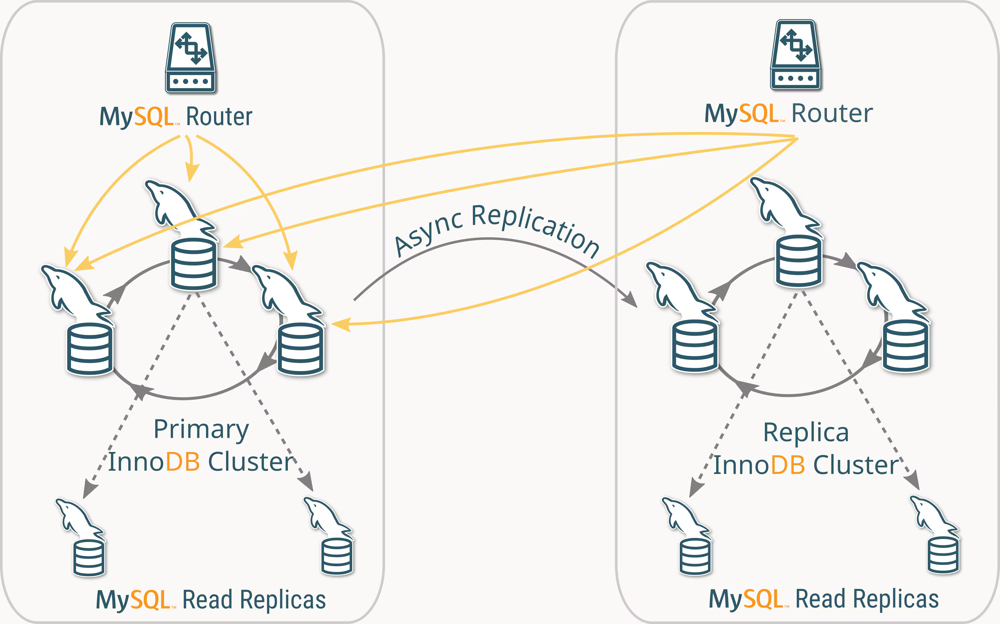
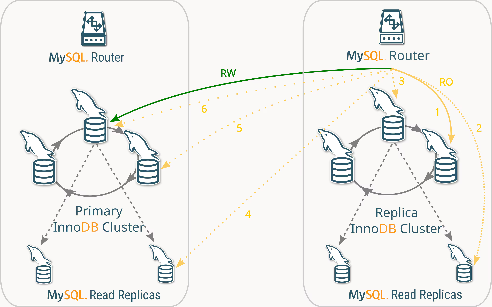

*Figures 9 et 10 : ces illustrations présentent le placement de MySQL Router entre l'application et les serveurs MySQL, le split lecture/écriture du trafic, et les règles de configuration du routage (nœuds cibles, basculement, nœuds sains). Elles illustrent une solution InnoDB (autre que le lab NDB Cluster sur 3 VM) et ne sont pas déployées dans les Labs 1 et 2.*

**Adaptation au lab** : dans le lab NDB Cluster sur 3 VM, il n'y a pas de MySQL Router intermédiaire. L'application s'adresse directement aux deux nœuds SQL (NodeId 4 sur `192.168.56.10` et NodeId 5 sur `192.168.56.12`), chacun capable de lectures et d'écritures sur le moteur NDB. La redondance est assurée par la réplication synchrone NDB (`NoOfReplicas = 2`), sans routeur externe ni split lecture/écriture au niveau applicatif.

**Lien avec le concept** : illustration du routage applicatif et du proxy MySQL Router, à contraster avec l'accès direct aux nœuds SQL NDB dans le lab.

#### Distinction nette avec NDB Cluster (cœur du lab)

| Composant | Moteur sous-jacent | Réplication | Rôle | Mis en œuvre dans le lab ? |
|---|---|---|---|---|
| NDB Cluster (lab) | NDB (partagé-nothing) | Synchrone intra-node-group | Gestion, stockage, SQL, `NoOfReplicas = 2` | Oui (Labs 1 et 2) |
| InnoDB Cluster | InnoDB / Group Replication | Quasi-synchrone | HA locale, failover automatique | Non (perspective uniquement) |
| InnoDB ReplicaSet | InnoDB / réplication asynchrone | Asynchrone source → replica | HA simple, lecture scalable | Non (perspective uniquement) |
| InnoDB ClusterSet | InnoDB / Group Replication + asynchrone inter-sites | Asynchrone entre sites | HA géographique, failover inter-sites | Non (perspective uniquement) |
| MySQL Router | — (proxy) | — | Routage applicatif lecture/écriture | Non (perspective uniquement) |

Dans ce lab, le cluster étudié reste le cluster NDB partagé-nothing avec nœuds de gestion, de stockage et SQL, `NoOfReplicas = 2`, ordre de démarrage gestion → stockage → SQL, et vérification d'intégrité avec `ndb_mgm -e "SHOW"`. Aucun composant InnoDB ClusterSet ni MySQL Router n'est installé ni configuré dans les Labs 1 et 2.


## Architecture de laboratoire : cluster MySQL sur 3 VM (module 1.0)


Le schéma ci-dessous présente l'architecture concrète du lab de ce chapitre sur trois VM, avec la numérotation canonique des NodeId du parcours.

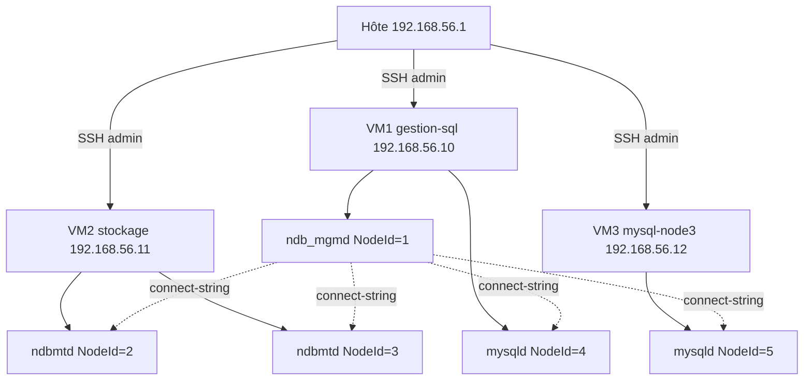

**Fig 1.1** — Architecture du cluster de lab sur 3 VM : gestion + SQL NodeId 4 sur VM 1, stockage NodeId 2 et 3 sur VM 2, second SQL NodeId 5 sur VM 3 ; accès d'administration par SSH depuis l'hôte.

Les trois types de nœuds jouent des rôles distincts dans ce lab :

- Le **nœud de gestion** (`ndb_mgmd`) lit le fichier `config.ini` qui décrit la topologie du cluster et la communique aux autres nœuds au démarrage. Il est le premier élément à démarrer.
- Les **nœuds de stockage** (`ndbmtd`) contiennent les données en mémoire et les répliquent selon le paramètre `NoOfReplicas`. Ils se déclarent au nœud de gestion au démarrage.
- Le **nœud SQL** (`mysqld`) active le moteur NDB et permet d'exécuter des requêtes SQL sur les données du cluster. Il se connecte au nœud de gestion pour découvrir la topologie.

L'ordre de démarrage est critique : le nœud de gestion doit être lancé avant les nœuds de stockage, qui doivent être lancés avant les nœuds SQL. Cet ordre garantit que chaque nœud trouve le gestionnaire et rejoint le cluster sans erreur. Cet ordre est celui de référence du parcours : gestionnaire, puis stockage, puis SQL.

MySQL Cluster est adapté aux applications critiques car il offre une haute disponibilité et une tolérance aux pannes : avec `NoOfReplicas = 2`, la perte d'un nœud de stockage n'interrompt pas le service, la réplique restante continue de répondre.

## Fichier de configuration config.ini — référence du parcours

Le fichier `config.ini` est lu uniquement par le nœud de gestion (`ndb_mgmd`). La configuration de référence du parcours définit explicitement au moins `NodeId`, `HostName` et `DataDir` pour chaque node, car l'identifiant automatique peut changer d'un démarrage à l'autre.

Structure de référence du parcours (adaptée aux adresses IP du lab) :

```ini
[ndb_mgmd default]
DataDir = /var/lib/mysql-cluster

[ndbd default]
NoOfReplicas = 2
DataMemory = 256M
IndexMemory = 128M
DataDir = /var/lib/mysql-cluster

[tcp default]

[ndb_mgmd]
NodeId = 1
HostName = 192.168.56.10
DataDir = /var/lib/mysql-cluster

[ndbd]
NodeId = 2
HostName = 192.168.56.11
DataDir = /var/lib/mysql-cluster/ndb_2

[ndbd]
NodeId = 3
HostName = 192.168.56.11
DataDir = /var/lib/mysql-cluster/ndb_3

[mysqld]
NodeId = 4
HostName = 192.168.56.10

[mysqld]
NodeId = 5
HostName = 192.168.56.12
```

Remarques de référence du parcours :
- `NodeId` : identifiant unique dans tout le cluster. Lorsqu'il existe plusieurs nodes sur le même hôte, il doit être explicitement spécifié.
- `HostName` : si non spécifié, le nœud de gestion peut être contacté depuis n'importe quel hôte ; le définir explicitement restreint et sécurise la connectivité.
- `DataDir` : répertoire de travail de chaque node ; les deux nœuds de stockage collocés sur VM 2 utilisent des répertoires distincts (`ndb_2` et `ndb_3`) pour éviter les collisions de fichiers.
- `NoOfReplicas = 2` : chaque fragment de données existe en deux exemplaires, sur deux nœuds de stockage distincts.

## Risques et résilience du clustering NDB

### Réplication synchrone et NoOfReplicas = 2

Dans NDB, chaque écriture est validée uniquement après avoir été répliquée sur tous les nœuds d'un node group. Le paramètre `NoOfReplicas = 2` signifie que chaque fragment de données existe en deux exemplaires, sur deux nœuds de stockage distincts. Si un nœud de stockage tombe, la réplique sur l'autre nœud reste disponible immédiatement, sans interruption de service.

### Node groups

Avec deux nœuds de stockage et `NoOfReplicas = 2`, le cluster forme un seul node group (Nodegroup: 0) contenant les deux copies de chaque fragment. Les deux nœuds de stockage sont collocés sur VM 2 (`192.168.56.11`) dans ce lab, avec des répertoires de données distincts (`ndb_2` et `ndb_3`) pour éviter toute collision de fichiers.

### Quorum et split-brain

Le quorum est la règle par laquelle une décision de cluster nécessite l'accord de la majorité des nœuds participants. Dans ce lab à 3 VM avec un seul nœud de gestion et deux nœuds de stockage dans un même node group, la perte d'un nœud de stockage ne rompt pas le quorum car le nœud de gestion et le nœud de stockage restant conservent la majorité. Le split-brain (partition du cluster en deux groupes incapables de communiquer) est prévenu par l'arbitrage : le nœud de gestion agit comme arbitre et tranche quel node group reste actif. L'arbitrage est requis sur les nœuds de données uniquement ; les nœuds SQL et de gestion n'en ont pas besoin.

### Failover automatique

Lorsqu'un nœud de stockage défaillant est détecté, le nœud de gestion marque le node concerné comme `not connected` et les opérations SQL basculent automatiquement sur la réplica restante. Lorsqu'un nœud est rajouté ou redémarré, il resynchronise ses données depuis la réplique vivante et réintègre le cluster. Ce mécanisme de failover automatique est au cœur de la haute disponibilité visée par les systèmes critiques.

Le schéma ci-dessous illustre le comportement de résilience.

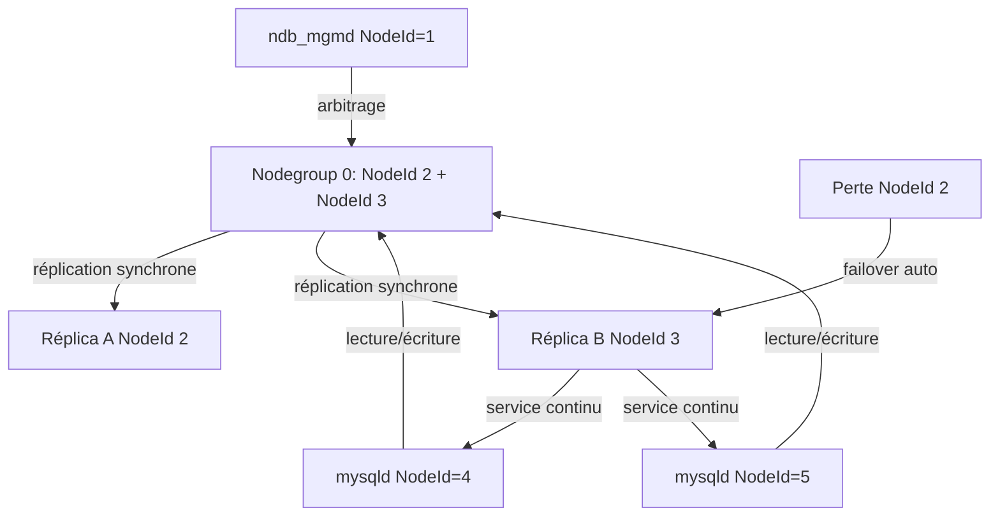

**Fig 1.2** — Résilience du clustering NDB : node group unique, réplication synchrone, arbitrage par le nœud de gestion, failover automatique sur la réplica restante.

## Haute disponibilité des systèmes critiques

Les architectures de type partagé-nothing (shared-nothing) avec réplication synchrone sont le fondement des systèmes critiques à haut volume. Dans les réseaux de télécommunications, les plateformes de transaction financière et les infrastructures logistiques distribuées, l'objectif de disponibilité de 99,999 % (moins de cinq minutes d'indisponibilité par an) impose trois conditions :

1. **Détection rapide des pannes** : un nœud qui ne répond plus doit être identifié en quelques secondes par le nœud de gestion, sans attendre un timeout long.
2. **Basculement sans intervention humaine** : le failover automatique sur la réplica restante doit se produire sans opérateur, pour maintenir les opérations temps réel.
3. **Résynchronisation à chaud** : un nœud revenu après panne doit réintégrer le cluster et rattraper son retard de données sans arrêter le service.

Ces principes justifient le choix de `NoOfReplicas = 2`, l'ordre de démarrage strict (gestion → stockage → SQL), et l'arbitrage par le nœud de gestion pour prévenir le split-brain. Ils s'appliquent directement aux systèmes critiques à haut volume où l'indisponibilité a un impact métier immédiat.

> **Partagé-nothing (shared-nothing) :** ce n'est pas une erreur, c'est le terme technique de l'architecture NDB Cluster. Cela signifie que chaque nœud possède sa propre mémoire vive et ses propres disques, sans rien partager avec les autres nœuds. Les données sont fragmentées et répliquées sur plusieurs nœuds de stockage indépendants, ce qui élimine tout point de défaillance unique (single point of failure).

## Cartographie de référence des opérations (NDB-nn)

Le tableau ci-dessous classe les opérations de ce chapitre selon le référentiel standard du parcours (syllabus, Jour 1, modules 1.0 et 1.1). Chaque opération cite son identifiant de référence, sa source de données, sa règle de détection et sa mitigation.

| Opération | ID | Composant | Source de données | Règle de détection | Mitigation |
|---|---|---|---|---|---|
| Présentation des composants | NDB-01 | Architecture | Schéma Fig 1.1, `ndb_mgm SHOW` | Vérifier la présence des trois types de nœuds | Documenter l'architecture avant toute installation |
| Études de cas | NDB-02 | Usage critique | Systèmes critiques (téléphonie, finance, logistique, 99,999 %) | Identifier les charges à haute disponibilité | Réserver MySQL Cluster aux cas critiques |
| Installation des composants | NDB-03 | Tous les nœuds | Sortie `dpkg -l`, commande `which` | Vérifier la présence de `ndb_mgmd`, `ndbmtd`, `mysqld` | Installer depuis le dépôt officiel MySQL |
| Configuration initiale | NDB-04 | Nœud de gestion | Fichier `config.ini` | Vérifier que `ndb_mgmd` démarre sans erreur | Sauvegarder `config.ini` avant toute modification |
| Dimensionnement résilience | NDB-08 | Stockage | `config.ini`, `ndb_mgm SHOW` | Vérifier `NoOfReplicas = 2` et un seul node group (Nodegroup: 0) | Définir `NoOfReplicas = 2` avant le premier démarrage |
| Vérification d'intégrité | NDB-05 | Cluster entier | `ndb_mgm -e "SHOW"` | Alerte si un nœud apparaît `not connected` | Redémarrer dans l'ordre : gestion, stockage, SQL |

## Plan d'installation maître

Le plan ci-dessous ordonne tous les labs du chapitre. Aucune action de configuration ne précède ce plan.

| Ordre | Lab | Objectif | Cible | Tactique | Opérations de référence |
|---|---|---|---|---|---|
| 1 | Lab-01 | Nettoyer et configurer manuellement les trois VM (réseau, IP statique, SSH, hostname, snapshot, connectivité) | VM 1 + VM 2 + VM 3 | session SSH ouverte sur chaque VM, netplan, VirtualBox snapshots | NDB-01 |
| 2 | Lab-02 | Installer MySQL Cluster, rédiger `config.ini`, démarrer dans l'ordre, vérifier l'intégrité et la résilience | VM 1 + VM 2 + VM 3 | Dépôt MySQL, `config.ini`, démarrage MGM → stockage → SQL | NDB-03, NDB-04, NDB-08, NDB-05 |

## Lab-01 — Mise en place manuelle des 3 VM

### Énoncé / Contexte

Nettoyer et configurer manuellement les trois machines virtuelles du laboratoire (réseau host-only `vboxnet0` `192.168.56.0/24` pour l'accès SSH du host vers les VM, plus un adaptateur NAT sur chaque VM pour l'accès Internet, adresses IP statiques, service SSH, noms d'hôtes, nettoyage de toute configuration précédente, snapshots propres) et contrôler la connectivité depuis l'hôte et entre les VM. Chaque VM possède deux adaptateurs : un adaptateur host-only (IP statique `192.168.56.10` sur VM 1, `192.168.56.11` sur VM 2, `192.168.56.12` sur VM 3) joignable depuis l'hôte en SSH (`ssh root@192.168.56.10`, `ssh root@192.168.56.11`, `ssh root@192.168.56.12`), et un adaptateur NAT (Internet via le moteur NAT de VirtualBox, sans configuration netplan supplémentaire). Cette infrastructure constitue la base de l'installation de MySQL Cluster réalisée au Lab-02. Ce lab ne contient aucune commande MySQL Cluster ; il prépare uniquement les machines du laboratoire. L'apprenant se connecte en SSH sur chaque VM depuis l'hôte et exécute les commandes directement sur la machine.

### Outils et commandes utilisées

| Outil | Commande | Rôle |
|---|---|---|
| hostnamectl | `hostnamectl set-hostname <nom>` | Définition du nom d'hôte de chaque VM |
| netplan | `tee /etc/netplan/01-netcfg.yaml`, `netplan apply` | Configuration de l'IP statique sur vboxnet0 |
| systemctl | `systemctl enable --now ssh` | Activation du service SSH |
| ip | `ip -br addr show enp0s8` | Vérification de l'adresse IP statique |
| rm / apt purge | `rm -rf`, `apt-get purge` | Nettoyage des configurations précédentes sur chaque VM |
| VBoxManage | `VBoxManage snapshot <vm> list` | Vérification des snapshots propres sur l'hôte |
| ping | `ping -c 4 <ip>` | Test de connectivité ICMP |
| hostname | `hostname` | Confirmation du nom d'hôte d'une VM |

### Commande et laboratoire étape par étape

#### Étape 1 — Nettoyer VM 1 (gestion-sql)

**But** — Supprimer toute configuration précédente (paquets, répertoires, fichiers de configuration) sur VM 1 pour éviter le bruit et les erreurs lors de l'installation MySQL Cluster.

**Machine** — 192.168.56.10, hostname `gestion-sql`.

**Prérequis** — VM 1 démarrée, session SSH ouverte en root, compte `root` avec mot de passe dans `.env`.

> **Machine** : 192.168.56.10 | **Terminal** : session SSH ouverte sur gestion-sql | **Utilisateur** : root | **Répertoire** : /

**Exemple de commande**

```bash
rm -rf /var/lib/mysql-cluster /usr/mysql-cluster /etc/mysql /var/lib/mysql
```

**Explication de la commande**

- `rm -rf /var/lib/mysql-cluster /usr/mysql-cluster /etc/mysql /var/lib/mysql` : supprime les répertoires et fichiers de configuration MySQL/Cluster précédents.

**Résultat attendu**

```text

aucune sortie attendue (commande silencieuse en cas de succes, rc=0)
```

> **Machine** : 192.168.56.10 | **Terminal** : session SSH ouverte sur gestion-sql | **Utilisateur** : root | **Répertoire** : /

**Exemple de commande**

```bash
apt-get purge -y mysql-cluster-* mysql-server-* mysql-common-* || true
```

**Explication de la commande**

- `apt-get purge -y mysql-cluster-* mysql-server-* mysql-common-*` : supprime proprement les paquets MySQL et leurs fichiers de configuration.
- `|| true` : évite que l'échec d'une purge (paquet absent) n'arrête l'exécution.

**Résultat attendu**

```text

Lecture des listes de paquets... Fait
Construction de l'arbre des dependances... Fait
Lecture des informations d'etat... Fait
Note : selection de mysql-server pour le motif rationnel "mysql-server-*"
Les paquets suivants seront ENLES :
  mysql-cluster-* mysql-server-* mysql-common-*
0 mis a jour, 0 nouvellement installes, 3 a enlever et 0 non mis a jour.
Apres cette operation, XXX Mo d'espace disque seront liberes.
(Lecture de la base de donnees... 124568 fichiers et repertoires deja installes.)
Suppression de mysql-cluster-common (8.0.xx-xxx) ...
Suppression de mysql-server-core (8.0.xx-xxx) ...
Suppression de mysql-common (8.0.xx-xxx) ...
Traitement des actions differes pour man-db (2.xx-xxubuntuy) ...
Traitement des actions differes pour libc-bin (2.xx-xxubuntuy) ...

```

> **Machine** : 192.168.56.10 | **Terminal** : session SSH ouverte sur gestion-sql | **Utilisateur** : root | **Répertoire** : /

**Exemple de commande**

```bash
apt-get autoremove -y || true
```

**Explication de la commande**

- `apt-get autoremove -y` : supprime les dépendances inutiles après la purge.
- `|| true` : évite qu'une absence de dépendances inutiles n'arrête l'exécution.

**Résultat attendu**

```text

Lecture des listes de paquets... Fait
Construction de l'arbre des dependances... Fait
Lecture des informations d'etat... Fait
0 mis a jour, 0 nouvellement installes, 0 a enlever et 0 non mis a jour.

```

> **Machine** : 192.168.56.10 | **Terminal** : session SSH ouverte sur gestion-sql | **Utilisateur** : root | **Répertoire** : /

**Exemple de commande**

```bash
echo 'nettoyage VM 1 terminé'
```

**Explication de la commande**

- `echo 'nettoyage VM 1 terminé'` : confirme la fin de l'étape.
- **Piège** : ne pas purger `mysql-common` si d'autres paquets système en dépendent ; vérifier après nettoyage qu'aucun processus `mysqld` ou `ndbmtd` ne reste en cours.

**Résultat attendu**

```text
nettoyage VM 1 terminé
```

#### Étape 2 — Configurer manuellement VM 1 (hostname, IP statique, SSH)

**But** — Configurer VM 1 avec le hostname `gestion-sql`, l'IP statique `192.168.56.10/24` sur l'interface host-only, et s'assurer que le service SSH est actif.

**Machine** — 192.168.56.10, hostname `gestion-sql`.

**Prérequis** — Nettoyage de l'étape 1 effectué, Ubuntu Server 24.04 LTS fraîchement installé, compte `root`.

> **Machine** : 192.168.56.10 | **Terminal** : session SSH ouverte sur gestion-sql | **Utilisateur** : root | **Répertoire** : /

**Exemple de commande**

```bash
hostnamectl set-hostname gestion-sql
```

**Explication de la commande**

- `hostnamectl set-hostname gestion-sql` : définit le nom d'hôte de VM 1.

**Résultat attendu**

```text

aucune sortie attendue (commande silencieuse en cas de succes, rc=0)
```

> **Machine** : 192.168.56.10 | **Terminal** : session SSH ouverte sur gestion-sql | **Utilisateur** : root | **Répertoire** : /

**Exemple de commande**

```bash
tee /etc/netplan/01-netcfg.yaml << 'YEOF'
network:
  version: 2
  ethernets:
    enp0s8:
      dhcp4: no
      addresses: [192.168.56.10/24]
      nameservers:
        addresses: [192.168.56.1]
YEOF
```

**Explication de la commande**

- `tee /etc/netplan/01-netcfg.yaml` : rédige le fichier de configuration netplan avec l'IP statique `192.168.56.10/24` et le DHCP désactivé. Aucune route par défaut n'est définie : le nœud reste isolé d'Internet (réseau host-only `vboxnet0`), conformément au périmètre du lab.
- Le bloc entre `<< 'YEOF'` et `YEOF` est le contenu écrit dans le fichier (les guillemets autour de `YEOF` interdisent l'expansion des variables).

**Résultat attendu**

```text
network:
  version: 2
  ethernets:
    enp0s8:
      dhcp4: no
      addresses: [192.168.56.10/24]
      nameservers:
        addresses: [192.168.56.1]

```

> **Machine** : 192.168.56.10 | **Terminal** : session SSH ouverte sur gestion-sql | **Utilisateur** : root | **Répertoire** : /

**Exemple de commande**

```bash
netplan apply
```

**Explication de la commande**

- `netplan apply` : applique la configuration réseau sans redémarrage de la VM.

**Résultat attendu**

```text

aucune sortie attendue (commande silencieuse en cas de succes, rc=0)
```

> **Machine** : 192.168.56.10 | **Terminal** : session SSH ouverte sur gestion-sql | **Utilisateur** : root | **Répertoire** : /

**Exemple de commande**

```bash
systemctl enable --now ssh
```

**Explication de la commande**

- `systemctl enable --now ssh` : active et démarre le service SSH pour l'administration à distance.

**Résultat attendu**

```text
Synchronizing state of ssh.service with SysV service script with /usr/lib/systemd/systemd-sysv-install.
Executing: /usr/lib/systemd/systemd-sysv-install enable ssh
```

> **Machine** : 192.168.56.10 | **Terminal** : session SSH ouverte sur gestion-sql | **Utilisateur** : root | **Répertoire** : /

**Exemple de commande**

```bash
echo 'config VM 1 terminé'
```

**Explication de la commande**

- `echo 'config VM 1 terminé'` : confirme la fin de l'étape.
- **Piège** : le nom de l'interface host-only peut différer (`enp0s8`, `eth1`, etc.) ; vérifier avec `ip -br link show` avant d'écrire la configuration netplan.

**Résultat attendu**

```text
config VM 1 terminé
```

#### Étape 3 — Nettoyer VM 2 (stockage)

**But** — Supprimer toute configuration précédente sur VM 2 pour éviter le bruit et les erreurs lors de l'installation des deux nœuds de stockage.

**Machine** — 192.168.56.11, hostname `stockage`.

**Prérequis** — VM 2 démarrée, session SSH ouverte en root, compte `root`.

> **Machine** : 192.168.56.11 | **Terminal** : session SSH ouverte sur stockage | **Utilisateur** : root | **Répertoire** : /

**Exemple de commande**

```bash
rm -rf /var/lib/mysql-cluster /usr/mysql-cluster /etc/mysql /var/lib/mysql
```

**Explication de la commande**

- `rm -rf /var/lib/mysql-cluster /usr/mysql-cluster /etc/mysql /var/lib/mysql` : supprime les répertoires et fichiers de configuration MySQL/Cluster précédents sur VM 2.

**Résultat attendu**

```text

aucune sortie attendue (commande silencieuse en cas de succes, rc=0)
```

> **Machine** : 192.168.56.11 | **Terminal** : session SSH ouverte sur stockage | **Utilisateur** : root | **Répertoire** : /

**Exemple de commande**

```bash
apt-get purge -y mysql-cluster-* mysql-server-* mysql-common-* || true
```

**Explication de la commande**

- `apt-get purge -y mysql-cluster-* mysql-server-* mysql-common-*` : supprime proprement les paquets MySQL et leurs fichiers de configuration sur VM 2.
- `|| true` : évite que l'échec d'une purge (paquet absent) n'arrête l'exécution.

**Résultat attendu**

```text

Lecture des listes de paquets... Fait
Construction de l'arbre des dependances... Fait
Lecture des informations d'etat... Fait
Note : selection de mysql-server pour le motif rationnel "mysql-server-*"
Les paquets suivants seront ENLES :
  mysql-cluster-* mysql-server-* mysql-common-*
0 mis a jour, 0 nouvellement installes, 3 a enlever et 0 non mis a jour.
Apres cette operation, XXX Mo d'espace disque seront liberes.
(Lecture de la base de donnees... 124568 fichiers et repertoires deja installes.)
Suppression de mysql-cluster-common (8.0.xx-xxx) ...
Suppression de mysql-server-core (8.0.xx-xxx) ...
Suppression de mysql-common (8.0.xx-xxx) ...
Traitement des actions differes pour man-db (2.xx-xxubuntuy) ...
Traitement des actions differes pour libc-bin (2.xx-xxubuntuy) ...

```

> **Machine** : 192.168.56.11 | **Terminal** : session SSH ouverte sur stockage | **Utilisateur** : root | **Répertoire** : /

**Exemple de commande**

```bash
apt-get autoremove -y || true
```

**Explication de la commande**

- `apt-get autoremove -y` : supprime les dépendances inutiles après la purge sur VM 2.
- `|| true` : évite qu'une absence de dépendances inutiles n'arrête l'exécution.

**Résultat attendu**

```text

Lecture des listes de paquets... Fait
Construction de l'arbre des dependances... Fait
Lecture des informations d'etat... Fait
0 mis a jour, 0 nouvellement installes, 0 a enlever et 0 non mis a jour.

```

> **Machine** : 192.168.56.11 | **Terminal** : session SSH ouverte sur stockage | **Utilisateur** : root | **Répertoire** : /

**Exemple de commande**

```bash
echo 'nettoyage VM 2 terminé'
```

**Explication de la commande**

- `echo 'nettoyage VM 2 terminé'` : confirme la fin de l'étape sur VM 2.
- **Piège** : les deux nœuds de stockage de VM 2 utiliseront des répertoires distincts (`ndb_2`, `ndb_3`) au Lab-02 ; s'assurer que `/var/lib/mysql-cluster` est bien supprimé avant.

**Résultat attendu**

```text
nettoyage VM 2 terminé
```

#### Étape 4 — Configurer manuellement VM 2 (hostname, IP statique, SSH)

**But** — Configurer VM 2 avec le hostname `stockage`, l'IP statique `192.168.56.11/24` sur l'interface host-only, et s'assurer que le service SSH est actif.

**Machine** — 192.168.56.11, hostname `stockage`.

**Prérequis** — Nettoyage de l'étape 3 effectué, Ubuntu Server 24.04 LTS fraîchement installé, compte `root`.

> **Machine** : 192.168.56.11 | **Terminal** : session SSH ouverte sur stockage | **Utilisateur** : root | **Répertoire** : /

**Exemple de commande**

```bash
hostnamectl set-hostname stockage
```

**Explication de la commande**

- `hostnamectl set-hostname stockage` : définit le nom d'hôte de VM 2.

**Résultat attendu**

```text

aucune sortie attendue (commande silencieuse en cas de succes, rc=0)
```

> **Machine** : 192.168.56.11 | **Terminal** : session SSH ouverte sur stockage | **Utilisateur** : root | **Répertoire** : /

**Exemple de commande**

```bash
tee /etc/netplan/01-netcfg.yaml << 'YEOF'
network:
  version: 2
  ethernets:
    enp0s8:
      dhcp4: no
      addresses: [192.168.56.11/24]
      nameservers:
        addresses: [192.168.56.1]
YEOF
```

**Explication de la commande**

- `tee /etc/netplan/01-netcfg.yaml` : rédige le fichier de configuration netplan avec l'IP statique `192.168.56.11/24` et le DHCP désactivé. Aucune route par défaut n'est définie : le nœud reste isolé d'Internet (réseau host-only `vboxnet0`), conformément au périmètre du lab.
- Le bloc entre `<< 'YEOF'` et `YEOF` est le contenu écrit dans le fichier (les guillemets autour de `YEOF` interdisent l'expansion des variables).

**Résultat attendu**

```text
network:
  version: 2
  ethernets:
    enp0s8:
      dhcp4: no
      addresses: [192.168.56.11/24]
      nameservers:
        addresses: [192.168.56.1]

```

> **Machine** : 192.168.56.11 | **Terminal** : session SSH ouverte sur stockage | **Utilisateur** : root | **Répertoire** : /

**Exemple de commande**

```bash
netplan apply
```

**Explication de la commande**

- `netplan apply` : applique la configuration réseau sans redémarrage de la VM.

**Résultat attendu**

```text

aucune sortie attendue (commande silencieuse en cas de succes, rc=0)
```

> **Machine** : 192.168.56.11 | **Terminal** : session SSH ouverte sur stockage | **Utilisateur** : root | **Répertoire** : /

**Exemple de commande**

```bash
systemctl enable --now ssh
```

**Explication de la commande**

- `systemctl enable --now ssh` : active et démarre le service SSH pour l'administration à distance.

**Résultat attendu**

```text
Synchronizing state of ssh.service with SysV service script with /usr/lib/systemd/systemd-sysv-install.
Executing: /usr/lib/systemd/systemd-sysv-install enable ssh
```

> **Machine** : 192.168.56.11 | **Terminal** : session SSH ouverte sur stockage | **Utilisateur** : root | **Répertoire** : /

**Exemple de commande**

```bash
echo 'config VM 2 terminé'
```

**Explication de la commande**

- `echo 'config VM 2 terminé'` : confirme la fin de l'étape sur VM 2.
- **Piège** : vérifier le nom de l'interface host-only avec `ip -br link show` avant d'appliquer netplan.

**Résultat attendu**

```text
config VM 2 terminé
```

#### Étape 5 — Nettoyer VM 3 (mysql-node3)

**But** — Supprimer toute configuration précédente sur VM 3 pour éviter le bruit et les erreurs lors de l'installation du second nœud SQL.

**Machine** — 192.168.56.12, hostname `mysql-node3`.

**Prérequis** — VM 3 démarrée, session SSH ouverte en root, compte `root`.

> **Machine** : 192.168.56.12 | **Terminal** : session SSH ouverte sur mysql-node3 | **Utilisateur** : root | **Répertoire** : /

**Exemple de commande**

```bash
rm -rf /var/lib/mysql-cluster /usr/mysql-cluster /etc/mysql /var/lib/mysql
```

**Explication de la commande**

- `rm -rf /var/lib/mysql-cluster /usr/mysql-cluster /etc/mysql /var/lib/mysql` : supprime les répertoires et fichiers de configuration MySQL/Cluster précédents sur VM 3.

**Résultat attendu**

```text

aucune sortie attendue (commande silencieuse en cas de succes, rc=0)
```

> **Machine** : 192.168.56.12 | **Terminal** : session SSH ouverte sur mysql-node3 | **Utilisateur** : root | **Répertoire** : /

**Exemple de commande**

```bash
apt-get purge -y mysql-cluster-* mysql-server-* mysql-common-* || true
```

**Explication de la commande**

- `apt-get purge -y mysql-cluster-* mysql-server-* mysql-common-*` : supprime proprement les paquets MySQL et leurs fichiers de configuration sur VM 3.
- `|| true` : évite que l'échec d'une purge (paquet absent) n'arrête l'exécution.

**Résultat attendu**

```text

Lecture des listes de paquets... Fait
Construction de l'arbre des dependances... Fait
Lecture des informations d'etat... Fait
Note : selection de mysql-server pour le motif rationnel "mysql-server-*"
Les paquets suivants seront ENLES :
  mysql-cluster-* mysql-server-* mysql-common-*
0 mis a jour, 0 nouvellement installes, 3 a enlever et 0 non mis a jour.
Apres cette operation, XXX Mo d'espace disque seront liberes.
(Lecture de la base de donnees... 124568 fichiers et repertoires deja installes.)
Suppression de mysql-cluster-common (8.0.xx-xxx) ...
Suppression de mysql-server-core (8.0.xx-xxx) ...
Suppression de mysql-common (8.0.xx-xxx) ...
Traitement des actions differes pour man-db (2.xx-xxubuntuy) ...
Traitement des actions differes pour libc-bin (2.xx-xxubuntuy) ...

```

> **Machine** : 192.168.56.12 | **Terminal** : session SSH ouverte sur mysql-node3 | **Utilisateur** : root | **Répertoire** : /

**Exemple de commande**

```bash
apt-get autoremove -y || true
```

**Explication de la commande**

- `apt-get autoremove -y` : supprime les dépendances inutiles après la purge sur VM 3.
- `|| true` : évite qu'une absence de dépendances inutiles n'arrête l'exécution.

**Résultat attendu**

```text

Lecture des listes de paquets... Fait
Construction de l'arbre des dependances... Fait
Lecture des informations d'etat... Fait
0 mis a jour, 0 nouvellement installes, 0 a enlever et 0 non mis a jour.

```

> **Machine** : 192.168.56.12 | **Terminal** : session SSH ouverte sur mysql-node3 | **Utilisateur** : root | **Répertoire** : /

**Exemple de commande**

```bash
echo 'nettoyage VM 3 terminé'
```

**Explication de la commande**

- `echo 'nettoyage VM 3 terminé'` : confirme la fin de l'étape sur VM 3.
- **Piège** : VM 3 est un clone de VM 1 ; s'assurer que l'ancien hostname et l'ancienne configuration MySQL sont supprimés.

**Résultat attendu**

```text
nettoyage VM 3 terminé
```

#### Étape 6 — Configurer manuellement VM 3 (hostname, IP statique, SSH)

**But** — Configurer VM 3 avec le hostname `mysql-node3`, l'IP statique `192.168.56.12/24` sur l'interface host-only, et s'assurer que le service SSH est actif.

**Machine** — 192.168.56.12, hostname `mysql-node3`.

**Prérequis** — Nettoyage de l'étape 5 effectué, Ubuntu Server 24.04 LTS fraîchement installé, compte `root`.

> **Machine** : 192.168.56.12 | **Terminal** : session SSH ouverte sur mysql-node3 | **Utilisateur** : root | **Répertoire** : /

**Exemple de commande**

```bash
hostnamectl set-hostname mysql-node3
```

**Explication de la commande**

- `hostnamectl set-hostname mysql-node3` : définit le nom d'hôte de VM 3.

**Résultat attendu**

```text

aucune sortie attendue (commande silencieuse en cas de succes, rc=0)
```

> **Machine** : 192.168.56.12 | **Terminal** : session SSH ouverte sur mysql-node3 | **Utilisateur** : root | **Répertoire** : /

**Exemple de commande**

```bash
tee /etc/netplan/01-netcfg.yaml << 'YEOF'
network:
  version: 2
  ethernets:
    enp0s8:
      dhcp4: no
      addresses: [192.168.56.12/24]
      nameservers:
        addresses: [192.168.56.1]
YEOF
```

**Explication de la commande**

- `tee /etc/netplan/01-netcfg.yaml` : rédige le fichier de configuration netplan avec l'IP statique `192.168.56.12/24` et le DHCP désactivé. Aucune route par défaut n'est définie : le nœud reste isolé d'Internet (réseau host-only `vboxnet0`), conformément au périmètre du lab.
- Le bloc entre `<< 'YEOF'` et `YEOF` est le contenu écrit dans le fichier (les guillemets autour de `YEOF` interdisent l'expansion des variables).

**Résultat attendu**

```text
network:
  version: 2
  ethernets:
    enp0s8:
      dhcp4: no
      addresses: [192.168.56.12/24]
      nameservers:
        addresses: [192.168.56.1]

```

> **Machine** : 192.168.56.12 | **Terminal** : session SSH ouverte sur mysql-node3 | **Utilisateur** : root | **Répertoire** : /

**Exemple de commande**

```bash
netplan apply
```

**Explication de la commande**

- `netplan apply` : applique la configuration réseau sans redémarrage de la VM.

**Résultat attendu**

```text

aucune sortie attendue (commande silencieuse en cas de succes, rc=0)
```

> **Machine** : 192.168.56.12 | **Terminal** : session SSH ouverte sur mysql-node3 | **Utilisateur** : root | **Répertoire** : /

**Exemple de commande**

```bash
systemctl enable --now ssh
```

**Explication de la commande**

- `systemctl enable --now ssh` : active et démarre le service SSH pour l'administration à distance.

**Résultat attendu**

```text
Synchronizing state of ssh.service with SysV service script with /usr/lib/systemd/systemd-sysv-install.
Executing: /usr/lib/systemd/systemd-sysv-install enable ssh
```

> **Machine** : 192.168.56.12 | **Terminal** : session SSH ouverte sur mysql-node3 | **Utilisateur** : root | **Répertoire** : /

**Exemple de commande**

```bash
echo 'config VM 3 terminé'
```

**Explication de la commande**

- `echo 'config VM 3 terminé'` : confirme la fin de l'étape sur VM 3.
- **Piège** : vérifier le nom de l'interface host-only avec `ip -br link show` avant d'appliquer netplan.

**Résultat attendu**

```text
config VM 3 terminé
```

#### Étape 7 — Prendre les snapshots propres des trois VM

**But** — Confirmer que les snapshots propres (`propre-avant-lab`) existent sur chaque VM pour permettre un retour à l'état initial en cas d'erreur pendant le Lab-02.

**Machine** — Hôte (192.168.56.1), snapshot des VM 1 (`UbuntuServer-01`), VM 2 (`UbuntuServer-02`) et VM 3 (`UbuntuServer-03`).

**Prérequis** — VirtualBox sur l'hôte, les VM existent, les snapshots pris avant le module.

> **Machine** : 192.168.56.1 | **Terminal** : terminal hôte | **Utilisateur** : yug | **Répertoire** : /home/yug/Documents/mysql

**Exemple de commande**

```bash
VBoxManage snapshot UbuntuServer-01 list
VBoxManage snapshot UbuntuServer-02 list
VBoxManage snapshot UbuntuServer-03 list
```

**Explication de la commande**

- `VBoxManage snapshot <vm> list` : affiche la liste des snapshots de la VM nommée `<vm>`.
- **Piège** : le nom de la VM dans VirtualBox (`UbuntuServer-01`, etc.) peut différer de son hostname interne (`gestion-sql`, etc.) ; utiliser le nom VirtualBox pour la commande snapshot.

**Résultat attendu**

```text
   Name: snapshot-propre-avant-reseau (UUID: ebaec4c7-f7e4-4f7c-b3e9-b6892685ca65)
   Description: Snapshot propre avant configuration reseau (NAT + host-only vboxnet0), IP cible 192.168.56.10
      Name: propre-apres-install (UUID: 4a26df9e-723d-4cf9-96d7-e6f2bcf6b131)
      Description: Etat propre apres installation Ubuntu et configuration reseau (Lab-01)
         Name: avant-mysql-cluster (UUID: 7faa0dd0-749c-49a2-9eda-4b85f45cf59e)
         Description: Etat propre avant installation MySQL Cluster (Lab-02)
            Name: propre-avant-lab (UUID: 206cd494-add5-4152-a0f3-7efddc4eb97c) *
            Description: Etat propre avant debut des labs chapitre 1
```

#### Étape 8 — Tester la connectivité entre les VM

**But** — Vérifier depuis l'hôte que les trois VM sont joignables, et confirmer depuis chaque VM son propre hostname.

**Machine** — Hôte (192.168.56.1) vers VM 1 (192.168.56.10), VM 2 (192.168.56.11) et VM 3 (192.168.56.12).

**Prérequis** — Les trois VM démarrées, SSH actif, adaptateur host-only vboxnet0 opérationnel.

> **Machine** : 192.168.56.1 | **Terminal** : terminal hôte | **Utilisateur** : yug | **Répertoire** : /home/yug/Documents/mysql

**Exemple de commande**

```bash
ping -c 4 192.168.56.10
ping -c 4 192.168.56.11
ping -c 4 192.168.56.12
```

**Explication de la commande**

- `ping -c 4` : envoie 4 requêtes ICMP et s'arrête ; vérifie la joignabilité de chaque VM depuis l'hôte.
- **Piège** : si `ping` échoue, vérifier les adresses IP, le démarrage des VM et l'adaptateur host-only vboxnet0 avant de passer au Lab-02.

**Résultat attendu**

```text
PING 192.168.56.10 (192.168.56.10) 56(84) bytes of data.
64 bytes from 192.168.56.10: icmp_seq=1 ttl=64 time=0.250 ms
64 bytes from 192.168.56.10: icmp_seq=2 ttl=64 time=0.214 ms
64 bytes from 192.168.56.10: icmp_seq=3 ttl=64 time=0.187 ms
64 bytes from 192.168.56.10: icmp_seq=4 ttl=64 time=0.240 ms

--- 192.168.56.10 ping statistics ---
4 packets transmitted, 4 received, 0% packet loss, time 3051ms
rtt min/avg/max/mdev = 0.187/0.222/0.250/0.024 ms
```

> **Machine** : 192.168.56.10 | **Terminal** : session SSH ouverte sur gestion-sql | **Utilisateur** : root | **Répertoire** : /root

**Exemple de commande**

```bash
hostname
```

**Explication de la commande**

- `hostname` : affiche le nom d'hôte de VM 1, confirmant la configuration effectuée à l'étape 2.

**Résultat attendu**

```text
gestion-sql
```

> **Machine** : 192.168.56.11 | **Terminal** : session SSH ouverte sur stockage | **Utilisateur** : root | **Répertoire** : /root

**Exemple de commande**

```bash
hostname
```

**Explication de la commande**

- `hostname` : affiche le nom d'hôte de VM 2, confirmant la configuration effectuée à l'étape 4.

**Résultat attendu**

```text
stockage
```

> **Machine** : 192.168.56.12 | **Terminal** : session SSH ouverte sur mysql-node3 | **Utilisateur** : root | **Répertoire** : /root

**Exemple de commande**

```bash
hostname
```

**Explication de la commande**

- `hostname` : affiche le nom d'hôte de VM 3, confirmant la configuration effectuée à l'étape 6.

**Résultat attendu**

```text
mysql-node3
```

### En conclusion

Les trois VM du laboratoire sont nettoyées et configurées : Ubuntu Server 24.04 LTS, adresses IP statiques `192.168.56.10` (gestion-sql), `192.168.56.11` (stockage) et `192.168.56.12` (mysql-node3), service SSH actif, noms d'hôtes confirmés, snapshots propres `propre-avant-lab` présents, connectivité ping et SSH validée. Cette infrastructure est prête pour l'installation de MySQL Cluster au Lab-02. Critères de réussite : `ping` et `hostname` fonctionnent sur les trois VM, les snapshots `propre-avant-lab` existent. Renvoi : passer au Lab-02 pour installer les composants MySQL Cluster.

## Lab-02 — Installation de MySQL Cluster sur les 3 VM

### Énoncé / Contexte

Installer les composants MySQL Cluster sur les trois VM configurées au Lab-01 : le nœud de gestion et le premier nœud SQL sur VM 1, les deux nœuds de stockage `ndbmtd` sur VM 2, et un second nœud SQL sur VM 3. Rédiger le fichier `config.ini` du nœud de gestion selon la configuration de référence du parcours, démarrer les nœuds dans l'ordre critique (gestion, puis stockage, puis SQL) et vérifier l'intégrité du cluster avec `ndb_mgm -e "SHOW"`. Ce lab réalise les opérations `NDB-03` (installation), `NDB-04` (configuration initiale), `NDB-08` (dimensionnement résilience) et `NDB-05` (vérification d'intégrité) du parcours. L'apprenant est déjà connecté en SSH sur chaque VM et exécute les commandes directement sur la machine.

### Outils et commandes utilisées

| Outil | Commande | Rôle |
|---|---|---|
| dpkg | `dpkg -l \| grep -i -E 'mysql-cluster|ndb'` | Vérification des paquets MySQL Cluster installés |
| apt-get | `apt-get update && apt-get install -y mysql-cluster-community-*` | Installation des paquets MySQL Cluster (gestion, stockage, SQL) |
| cat | `cat > /tmp/config.ini`, `cat config.ini` | Rédaction et vérification de `config.ini` |
| ndb_mgmd | `ndb_mgmd --config-file=... --initial` | Nœud de gestion du cluster (premier démarrage) |
| ndbmtd | `ndbmtd --ndb-connectstring=... --initial` | Nœuds de stockage du cluster |
| mysqld | `mysqld --ndbcluster --ndb-connectstring=... --daemonize` | Nœuds SQL du cluster |
| ndb_mgm | `ndb_mgm -e "SHOW"` | Vérification de l'état du cluster |
| ndb_config | `ndb_config --query-all` | Interrogation de la configuration effective |
| mkdir | `mkdir -p …/ndb_2 …/ndb_3` | Création des répertoires de données de stockage |
| pkill | `pkill -x ndbmtd`, `pkill -x mysqld` | Arrêt des processus pour redémarrage |

### Commande et laboratoire étape par étape

#### Étape 1 — Vérifier les paquets MySQL Cluster sur VM 1

**But** — Confirmer que les paquets MySQL Cluster sont installés sur VM 1 (serveur de gestion + serveur SQL).

**Machine** — 192.168.56.10, hostname `gestion-sql`.

**Prérequis** — VM 1 démarrée, session SSH ouverte en root.

> **Machine** : 192.168.56.10 | **Terminal** : session SSH ouverte sur gestion-sql | **Utilisateur** : root | **Répertoire** : /

**Exemple de commande**

```bash
dpkg -l
```

**Explication de la commande**

- `dpkg -l` : liste tous les paquets installés sur le système. La sortie complète inclut les paquets MySQL Cluster s'ils sont installés.
- **Piège** : si aucun paquet `mysql-cluster` n'apparaît dans la liste, MySQL Cluster n'est pas installé ; il faut procéder à l'installation à l'étape 4 avant de continuer.

**Résultat attendu**

```text
ii  mysql-cluster-community-management-server  8.0.50-1ubuntu24.04  amd64  MySQL Cluster management server
ii  mysql-cluster-community-data-node          8.0.50-1ubuntu24.04  amd64  MySQL Cluster data node
ii  mysql-cluster-community-server             8.0.50-1ubuntu24.04  amd64  MySQL Cluster server
ii  mysql-cluster-client                       8.0.50-1ubuntu24.04  amd64  MySQL Cluster client
```

#### Étape 2 — Vérifier les paquets MySQL Cluster sur VM 2

**But** — Confirmer que le paquet de nœud de données est installé sur VM 2 (deux nœuds de stockage `ndbmtd`).

**Machine** — 192.168.56.11, hostname `stockage`.

**Prérequis** — VM 2 démarrée, session SSH ouverte en root.

> **Machine** : 192.168.56.11 | **Terminal** : session SSH ouverte sur stockage | **Utilisateur** : root | **Répertoire** : /

**Exemple de commande**

```bash
dpkg -l
```

**Explication de la commande**

- `dpkg -l` : liste tous les paquets installés sur le système. La sortie complète inclut le paquet de nœud de données NDB s'il est installé.
- **Piège** : si aucun paquet `mysql-cluster-community-data-node` n'apparaît dans la liste, le paquet de nœud de données est absent ; il faut l'installer à l'étape 4 avant de démarrer les nœuds de stockage.

**Résultat attendu**

```text
ii  mysql-cluster-community-data-node          8.0.50-1ubuntu24.04  amd64  MySQL Cluster data node
```

#### Étape 3 — Vérifier les paquets MySQL Cluster sur VM 3

**But** — Confirmer que le paquet serveur MySQL est installé sur VM 3 (second nœud SQL).

**Machine** — 192.168.56.12, hostname `mysql-node3`.

**Prérequis** — VM 3 démarrée, session SSH ouverte en root.

> **Machine** : 192.168.56.12 | **Terminal** : session SSH ouverte sur mysql-node3 | **Utilisateur** : root | **Répertoire** : /

**Exemple de commande**

```bash
dpkg -l
```

**Explication de la commande**

- `dpkg -l` : liste tous les paquets installés sur le système. La sortie complète inclut le paquet serveur MySQL s'il est installé.
- **Piège** : VM 3 doit disposer du même binaire `mysqld` avec le moteur NDB que VM 1.

**Résultat attendu**

```text
ii  mysql-cluster-community-server             8.0.50-1ubuntu24.04  amd64  MySQL Cluster server
ii  mysql-cluster-client                       8.0.50-1ubuntu24.04  amd64  MySQL Cluster client
```

#### Étape 4 — Installer les paquets MySQL Cluster sur les 3 VM

**But** — Installer les composants MySQL Cluster (serveur de gestion, nœud de données, serveur SQL, client) sur chaque VM avant de rédiger config.ini et de démarrer les nœuds. Sans cette étape, les binaires `ndb_mgmd`, `ndbmtd` et `mysqld` n'existent pas et le reste du lab ne peut pas fonctionner.

**Machine** — VM 1 (192.168.56.10, gestion-sql), VM 2 (192.168.56.11, stockage), VM 3 (192.168.56.12, mysql-node3).

**Prérequis** — Accès au dépôt MySQL configuré sur le nœud (ou paquets présents dans le cache apt local), compte root.

> **Machine** : 192.168.56.10 | **Terminal** : session SSH ouverte sur gestion-sql | **Utilisateur** : root | **Répertoire** : /root

**Exemple de commande**

```bash
apt-get update
```

**Explication de la commande**

- `apt-get update` : rafraîchit la liste des paquets depuis le dépôt configuré sur VM 1.

**Résultat attendu**

```text
Atteint :1 http://archive.ubuntu.com/ubuntu noble InRelease
Reception de :2 http://archive.ubuntu.com/ubuntu noble-updates InRelease [119 kB]
Reception de :3 http://archive.ubuntu.com/ubuntu noble-backports InRelease [108 kB]
Reception de :4 http://security.ubuntu.com/ubuntu noble-security InRelease [115 kB]
Lecture des listes de paquets... Fait
Construction de l'arbre des dependances... Fait
Lecture des informations d'etat... Fait
Tous les paquets sont a jour.

```

> **Machine** : 192.168.56.10 | **Terminal** : session SSH ouverte sur gestion-sql | **Utilisateur** : root | **Répertoire** : /root

**Exemple de commande**

```bash
apt-get install -y mysql-cluster-community-management-server mysql-cluster-community-data-node mysql-cluster-community-server mysql-cluster-client
```

**Explication de la commande**

- `apt-get install -y ...` : installe `ndb_mgmd` (gestion), `ndbmtd` (stockage), `mysqld` (SQL) et le client MySQL Cluster sur VM 1.
- Sur VM 1 : serveur de gestion + serveur SQL + client.
- **Piège** : les paquets sont installés depuis le dépôt MySQL configuré ; une fois terminé, les nœuds restent sur le réseau host-only vboxnet0 (pas d'Internet permanent sur les nœuds).

**Résultat attendu**

```text
Lecture des listes de paquets…
Construction de l'arbre des dépendances…
Lecture des informations d'état…
Les paquets supplémentaires suivants seront installés :
  mysql-cluster-community-client mysql-cluster-community-client-core
  mysql-cluster-community-client-plugins mysql-cluster-community-server-core
0 mis à jour, 4 nouvellement installés, 0 à enlever et 0 non mis à jour.
…
Paramétrage de mysql-cluster-community-management-server (8.0.50-1ubuntu24.04) …
```

> **Machine** : 192.168.56.11 | **Terminal** : session SSH ouverte sur stockage | **Utilisateur** : root | **Répertoire** : /root

**Exemple de commande**

```bash
apt-get update
```

**Explication de la commande**

- `apt-get update` : rafraîchit la liste des paquets depuis le dépôt configuré sur VM 2.

**Résultat attendu**

```text
Atteint :1 http://archive.ubuntu.com/ubuntu noble InRelease
Reception de :2 http://archive.ubuntu.com/ubuntu noble-updates InRelease [119 kB]
Reception de :3 http://archive.ubuntu.com/ubuntu noble-backports InRelease [108 kB]
Reception de :4 http://security.ubuntu.com/ubuntu noble-security InRelease [115 kB]
Lecture des listes de paquets... Fait
Construction de l'arbre des dependances... Fait
Lecture des informations d'etat... Fait
Tous les paquets sont a jour.

```

> **Machine** : 192.168.56.11 | **Terminal** : session SSH ouverte sur stockage | **Utilisateur** : root | **Répertoire** : /root

**Exemple de commande**

```bash
apt-get install -y mysql-cluster-community-data-node
```

**Explication de la commande**

- `apt-get install -y mysql-cluster-community-data-node` : installe uniquement le paquet de nœud de données (`ndbmtd`) sur le nœud de stockage VM 2.
- Même principe que VM 1, mais sans le serveur SQL inutile sur un nœud dédié au stockage.
- **Piège** : ne pas installer le serveur SQL inutilement sur un nœud dédié au stockage.

**Résultat attendu**

```text
Lecture des listes de paquets…
Construction de l'arbre des dépendances…
Lecture des informations d'état…
0 mis à jour, 1 nouvellement installé, 0 à enlever et 0 non mis à jour.
…
Paramétrage de mysql-cluster-community-data-node (8.0.50-1ubuntu24.04) …
```

> **Machine** : 192.168.56.12 | **Terminal** : session SSH ouverte sur mysql-node3 | **Utilisateur** : root | **Répertoire** : /root

**Exemple de commande**

```bash
apt-get update
```

**Explication de la commande**

- `apt-get update` : rafraîchit la liste des paquets depuis le dépôt configuré sur VM 3.

**Résultat attendu**

```text
Atteint :1 http://archive.ubuntu.com/ubuntu noble InRelease
Reception de :2 http://archive.ubuntu.com/ubuntu noble-updates InRelease [119 kB]
Reception de :3 http://archive.ubuntu.com/ubuntu noble-backports InRelease [108 kB]
Reception de :4 http://security.ubuntu.com/ubuntu noble-security InRelease [115 kB]
Lecture des listes de paquets... Fait
Construction de l'arbre des dependances... Fait
Lecture des informations d'etat... Fait
Tous les paquets sont a jour.

```

> **Machine** : 192.168.56.12 | **Terminal** : session SSH ouverte sur mysql-node3 | **Utilisateur** : root | **Répertoire** : /root

**Exemple de commande**

```bash
apt-get install -y mysql-cluster-community-server mysql-cluster-client
```

**Explication de la commande**

- `apt-get install -y mysql-cluster-community-server mysql-cluster-client` : installe le serveur SQL et le client sur VM 3 (second nœud SQL).
- Même principe que VM 1, mais sans le serveur de gestion (VM 3 est un second nœud SQL).
- **Piège** : le second nœud SQL doit disposer du même binaire `mysqld` avec le moteur NDB que VM 1.

**Résultat attendu**

```text
Lecture des listes de paquets…
Construction de l'arbre des dépendances…
Lecture des informations d'état…
0 mis à jour, 2 nouvellement installés, 0 à enlever et 0 non mis à jour.
…
Paramétrage de mysql-cluster-community-server (8.0.50-1ubuntu24.04) …
```

#### Étape 5 — Rédiger et installer le fichier config.ini sur VM 1

**But** — Créer le fichier `config.ini` qui définit la topologie du cluster sur 3 VM : 1 nœud de gestion (NodeId 1), 2 nœuds de stockage sur VM 2 (NodeId 2 et 3), 2 nœuds SQL (NodeId 4 sur VM 1, NodeId 5 sur VM 3), avec `NoOfReplicas = 2` pour la redondance. Le fichier définit `NodeId`, `HostName` et `DataDir` explicites pour chaque node, selon la configuration de référence du parcours.

**Machine** — 192.168.56.10, hostname `gestion-sql`, fichier `/var/lib/mysql-cluster/config.ini`.

**Prérequis** — Répertoire `/var/lib/mysql-cluster` existant sur VM 1, paquet `mysql-cluster-community-management-server` installé.

> **Machine** : 192.168.56.10 | **Terminal** : session SSH ouverte sur gestion-sql | **Utilisateur** : root | **Répertoire** : /var/lib/mysql-cluster

**Exemple de commande**

```bash
cat > /tmp/config.ini << 'EOF'
[ndb_mgmd default]
DataDir = /var/lib/mysql-cluster

[ndbd default]
NoOfReplicas = 2
DataMemory = 256M
IndexMemory = 128M

[tcp default]

[ndb_mgmd]
NodeId = 1
HostName = 192.168.56.10
DataDir = /var/lib/mysql-cluster

[ndbd]
NodeId = 2
HostName = 192.168.56.11
DataDir = /var/lib/mysql-cluster/ndb_2

[ndbd]
NodeId = 3
HostName = 192.168.56.11
DataDir = /var/lib/mysql-cluster/ndb_3

[mysqld]
NodeId = 4
HostName = 192.168.56.10

[mysqld]
NodeId = 5
HostName = 192.168.56.12
EOF
```

**Explication de la commande**

- `cat > /tmp/config.ini << 'EOF'` : rédige le fichier `config.ini` temporaire jusqu'au marqueur `EOF` (les guillemets autour de `EOF` interdisent l'expansion des variables).
- `[ndb_mgmd] NodeId = 1` : définit le nœud de gestion avec l'identifiant unique 1 sur `192.168.56.10`.
- `[ndbd] NodeId = 2` et `NodeId = 3` : définissent les deux nœuds de stockage, tous deux sur `192.168.56.11`, avec des identifiants uniques 2 et 3.
- `[mysqld] NodeId = 4` et `NodeId = 5` : définissent les deux nœuds SQL, sur `192.168.56.10` et `192.168.56.12`.
- `NoOfReplicas = 2` : chaque fragment de données existe en deux exemplaires pour tolérer la perte d'un nœud de stockage.

**Résultat attendu**

```text
[ndb_mgmd default]
DataDir = /var/lib/mysql-cluster

[ndbd default]
NoOfReplicas = 2
DataMemory = 256M
IndexMemory = 128M

[tcp default]

[ndb_mgmd]
NodeId = 1
HostName = 192.168.56.10
DataDir = /var/lib/mysql-cluster

[ndbd]
NodeId = 2
HostName = 192.168.56.11
DataDir = /var/lib/mysql-cluster/ndb_2

[ndbd]
NodeId = 3
HostName = 192.168.56.11
DataDir = /var/lib/mysql-cluster/ndb_3

[mysqld]
NodeId = 4
HostName = 192.168.56.10

[mysqld]
NodeId = 5
HostName = 192.168.56.12
```

> **Machine** : 192.168.56.10 | **Terminal** : session SSH ouverte sur gestion-sql | **Utilisateur** : root | **Répertoire** : /var/lib/mysql-cluster

**Exemple de commande**

```bash
cp /tmp/config.ini /var/lib/mysql-cluster/config.ini
```

**Explication de la commande**

- `cp /tmp/config.ini /var/lib/mysql-cluster/config.ini` : installe le fichier de topologie sur VM 1 dans le répertoire de données du gestionnaire.

**Résultat attendu**

```text

aucune sortie attendue (commande silencieuse en cas de succes, rc=0)
```

> **Machine** : 192.168.56.10 | **Terminal** : session SSH ouverte sur gestion-sql | **Utilisateur** : root | **Répertoire** : /var/lib/mysql-cluster

**Exemple de commande**

```bash
cat /var/lib/mysql-cluster/config.ini
```

**Explication de la commande**

- `cat /var/lib/mysql-cluster/config.ini` : affiche le fichier installé pour en vérifier le contenu avant le démarrage.
- **Piège** : les `NodeId` doivent être uniques dans tout le cluster ; les deux nœuds de stockage sur la même VM doivent utiliser des répertoires de données distincts.

**Résultat attendu**

```text
[ndb_mgmd default]
DataDir = /var/lib/mysql-cluster

[ndbd default]
NoOfReplicas = 2
DataMemory = 256M
IndexMemory = 128M

[tcp default]

[ndb_mgmd]
NodeId = 1
HostName = 192.168.56.10
DataDir = /var/lib/mysql-cluster

[ndbd]
NodeId = 2
HostName = 192.168.56.11
DataDir = /var/lib/mysql-cluster/ndb_2

[ndbd]
NodeId = 3
HostName = 192.168.56.11
DataDir = /var/lib/mysql-cluster/ndb_3

[mysqld]
NodeId = 4
HostName = 192.168.56.10

[mysqld]
NodeId = 5
HostName = 192.168.56.12
```

#### Étape 6 — Créer les répertoires de données de stockage sur VM 2

**But** — Créer les répertoires de données distincts (`ndb_2` et `ndb_3`) pour les deux nœuds de stockage sur VM 2, afin d'éviter toute collision entre les deux nodes collocés.

**Machine** — 192.168.56.11, hostname `stockage`.

**Prérequis** — Répertoire `/var/lib/mysql-cluster` existant, compte `root`.

> **Machine** : 192.168.56.11 | **Terminal** : session SSH ouverte sur stockage | **Utilisateur** : root | **Répertoire** : /var/lib/mysql-cluster

**Exemple de commande**

```bash
mkdir -p /var/lib/mysql-cluster/ndb_2 /var/lib/mysql-cluster/ndb_3
```

**Explication de la commande**

- `mkdir -p /var/lib/mysql-cluster/ndb_2 /var/lib/mysql-cluster/ndb_3` : crée les deux répertoires de données avec les privilèges root.
- **Piège** : les deux nœuds de stockage sur la même VM doivent impérativement utiliser des répertoires de données distincts, sinon leurs fichiers entrent en collision au démarrage.

**Résultat attendu**

```text

aucune sortie attendue (commande silencieuse en cas de succes, rc=0)
```

> **Machine** : 192.168.56.11 | **Terminal** : session SSH ouverte sur stockage | **Utilisateur** : root | **Répertoire** : /var/lib/mysql-cluster

**Exemple de commande**

```bash
ls -la /var/lib/mysql-cluster/
```

**Explication de la commande**

- `ls -la /var/lib/mysql-cluster/` : affiche le contenu du répertoire pour confirmer la présence de `ndb_2` et `ndb_3`.

**Résultat attendu**

```text
total 16
drwxr-xr-x 4 root root 4096 nov.  22 09:42 .
drwxr-xr-x 45 root root 4096 nov.  22 09:42 ..
drwxr-xr-x 2 root root 4096 nov.  22 09:42 ndb_2
drwxr-xr-x 2 root root 4096 nov.  22 09:42 ndb_3
```

#### Étape 7 — Démarrer le nœud de gestion ndb_mgmd sur VM 1

**But** — Lancer le nœud de gestion `ndb_mgmd` qui centralise la configuration du cluster et accepte les connexions des autres nœuds. C'est le premier node à démarrer. L'ordre de référence du parcours est gestionnaire, puis stockage, puis SQL.

**Machine** — 192.168.56.10, hostname `gestion-sql`, nœud de gestion.

**Prérequis** — `config.ini` présent et valide sur VM 1, interface de gestion libre, aucun autre `ndb_mgmd` en cours.

> **Machine** : 192.168.56.10 | **Terminal** : session SSH ouverte sur gestion-sql | **Utilisateur** : root | **Répertoire** : /var/lib/mysql-cluster

**Exemple de commande**

```bash
ndb_mgmd --config-file=/var/lib/mysql-cluster/config.ini --initial
```

**Explication de la commande**

- `ndb_mgmd` : démon du nœud de gestion de MySQL Cluster (démarre en mode démon par défaut).
- `--config-file=/var/lib/mysql-cluster/config.ini` : indique le fichier de topologie à charger au démarrage.
- `--initial` : force l'initialisation propre du nœud de gestion ; à n'utiliser qu'au premier démarrage ou après un snapshot propre.
- **Piège** : `--initial` supprime les fichiers de configuration précédents du gestionnaire ; ne pas l'utiliser sur un cluster hors lab avec des données. Si l'interface de gestion est déjà utilisée, le démarrage échoue.

**Résultat attendu**

```text
MySQL Cluster Management Server mysql-8.0.50 ndb-8.0.50
2026-11-22 09:43:07 [MgmtSrvr] WARNING -- at line 7: [DB] IndexMemory is deprecated, will use Number bytes on each ndbd(DB) node allocated for storing indexes instead
```

#### Étape 8 — Démarrer les deux nœuds de stockage ndbmtd sur VM 2

**But** — Lancer les deux processus `ndbmtd` (identifiants 2 et 3) sur VM 2, qui rejoignent le nœud de gestion et initialisent leur stockage.

**Machine** — 192.168.56.11, hostname `stockage`, nœuds de stockage.

**Prérequis** — Nœud de gestion démarré sur `192.168.56.10`, répertoires de données créés, binaire `ndbmtd` installé.

> **Machine** : 192.168.56.11 | **Terminal** : session SSH ouverte sur stockage | **Utilisateur** : root | **Répertoire** : /var/lib/mysql-cluster

**Exemple de commande**

```bash
cd /var/lib/mysql-cluster/ndb_2
```

**Explication de la commande**

- `cd /var/lib/mysql-cluster/ndb_2` : se place dans le répertoire dédié du node 2 avant le démarrage.

**Résultat attendu**

```text

aucune sortie attendue (commande silencieuse en cas de succes, rc=0)
```

> **Machine** : 192.168.56.11 | **Terminal** : session SSH ouverte sur stockage | **Utilisateur** : root | **Répertoire** : /var/lib/mysql-cluster/ndb_2

**Exemple de commande**

```bash
nohup ndbmtd --ndb-connectstring=192.168.56.10 --initial &
```

**Explication de la commande**

- `nohup ndbmtd --ndb-connectstring=192.168.56.10 --initial &` : lance `ndbmtd` (node 2) en arrière-plan, détaché du terminal, avec le connect-string du gestionnaire et l'initialisation propre du stockage.
- `--ndb-connectstring=192.168.56.10` : indique l'adresse du nœud de gestion.
- `--initial` : initialise le stockage du node ; à n'utiliser qu'au premier démarrage.
- `&` : détache le processus pour qu'il tourne en arrière-plan.

**Résultat attendu**

```text
nohup: ignoring input and appending output to 'nohup.out'
[1] 2458

```

> **Machine** : 192.168.56.11 | **Terminal** : session SSH ouverte sur stockage | **Utilisateur** : root | **Répertoire** : /var/lib/mysql-cluster

**Exemple de commande**

```bash
cd /var/lib/mysql-cluster/ndb_3
```

**Explication de la commande**

- `cd /var/lib/mysql-cluster/ndb_3` : se place dans le répertoire dédié du node 3 avant le démarrage.

**Résultat attendu**

```text

aucune sortie attendue (commande silencieuse en cas de succes, rc=0)
```

> **Machine** : 192.168.56.11 | **Terminal** : session SSH ouverte sur stockage | **Utilisateur** : root | **Répertoire** : /var/lib/mysql-cluster/ndb_3

**Exemple de commande**

```bash
nohup ndbmtd --ndb-connectstring=192.168.56.10 --initial &
```

**Explication de la commande**

- `nohup ndbmtd --ndb-connectstring=192.168.56.10 --initial &` : lance `ndbmtd` (node 3) en arrière-plan, détaché du terminal, avec le connect-string du gestionnaire et l'initialisation propre du stockage.
- **Piège** : `--initial` réinitialise le stockage ; ne pas l'utiliser sur un cluster hors lab avec des données à conserver. Les deux nodes sur VM 2 utilisent des répertoires distincts (`ndb_2`, `ndb_3`).

**Résultat attendu**

```text
nohup: ignoring input and appending output to 'nohup.out'
[1] 2459

```

#### Étape 9 — Démarrer les deux nœuds SQL mysqld sur VM 1 et VM 3

**But** — Lancer les deux processus `mysqld` avec le moteur NDB (NodeId 4 sur VM 1, NodeId 5 sur VM 3), qui se connectent au nœud de gestion pour découvrir la topologie. C'est la dernière étape de l'ordre de démarrage.

**Machine** — 192.168.56.10 (gestion-sql) puis 192.168.56.12 (mysql-node3), nœuds SQL.

**Prérequis** — Nœuds de stockage démarrés et connectés, `mysqld` avec support NDB installé, répertoire de données MySQL initialisé.

> **Machine** : 192.168.56.10 | **Terminal** : session SSH ouverte sur gestion-sql | **Utilisateur** : root | **Répertoire** : /root

**Exemple de commande**

```bash
nohup mysqld --ndbcluster --ndb-connectstring=192.168.56.10 --user=mysql --daemonize &
```

**Explication de la commande**

- `mysqld --ndbcluster` : active le moteur NDB sur l'instance MySQL.
- `--ndb-connectstring=192.168.56.10` : indique l'adresse du nœud de gestion pour rejoindre le cluster.
- `--user=mysql` : exécute le processus sous l'utilisateur `mysql` (pratique de moindre privilège).
- `--daemonize` : lance `mysqld` en arrière-plan (démon).
- `&` : détache le processus pour qu'il tourne en arrière-plan.
- **Piège** : si le datadir MySQL n'est pas initialisé (`mysqld --initialize` préalable), le démarrage échoue. Ne pas démarrer les nœuds SQL avant les nœuds de stockage.

**Résultat attendu**

```text
nohup: ignoring input and appending output to 'nohup.out'
[1] 2460

```

> **Machine** : 192.168.56.12 | **Terminal** : session SSH ouverte sur mysql-node3 | **Utilisateur** : root | **Répertoire** : /root

**Exemple de commande**

```bash
nohup mysqld --ndbcluster --ndb-connectstring=192.168.56.10 --user=mysql --daemonize &
```

**Explication de la commande**

- Identique à l'étape précédente, ciblant le second nœud SQL (NodeId 5) sur VM 3.

**Résultat attendu**

```text
nohup: ignoring input and appending output to 'nohup.out'
[1] 2461

```

> **Machine** : 192.168.56.12 | **Terminal** : session SSH ouverte sur mysql-node3 | **Utilisateur** : root | **Répertoire** : /root

**Exemple de commande**

```bash
sleep 5
```

**Explication de la commande**

- `sleep 5` : laisse le temps aux nœuds SQL de se connecter au gestionnaire.

**Résultat attendu**

```text

aucune sortie attendue (commande silencieuse en cas de succes, rc=0)
```

#### Étape 10 — Vérifier l'intégrité du cluster avec ndb_mgm SHOW

**But** — Confirmer que les 5 nœuds sont connectés au gestionnaire et que le cluster est opérationnel, conformément à l'opération `NDB-05`.

**Machine** — 192.168.56.10, hostname `gestion-sql`, nœud de gestion.

**Prérequis** — Tous les nœuds démarrés (gestion, stockage, SQL), `ndb_mgm` installé.

> **Machine** : 192.168.56.10 | **Terminal** : session SSH ouverte sur gestion-sql | **Utilisateur** : root | **Répertoire** : /root

**Exemple de commande**

```bash
ndb_mgm -e "SHOW"
```

**Explication de la commande**

- `ndb_mgm -e "SHOW"` : exécute la commande `SHOW` du client de gestion, qui liste tous les nœuds et leur état, puis quitte.
- Le résultat doit afficher 1 `ndb_mgmd`, 2 `ndbd` et 2 `mysqld` sans état `not connected`.
- **Piège** : un nœud absent apparaît avec l'état `not connected` ; investiguer avant de poursuivre.

**Résultat attendu** (sortie réelle, exécuté sur VM 1 gestion-sql, rc=0 ; état nominal : 5 nœuds connectés, le `*` marque le nœud de stockage préféré)

```text
Connected to Management Server at: localhost:1186
Cluster Configuration
---------------------
[ndbd(NDB)]	2 node(s)
id=2	@192.168.56.11  (mysql-8.0.50 ndb-8.0.50, Nodegroup: 0)
id=3	@192.168.56.11  (mysql-8.0.50 ndb-8.0.50, Nodegroup: 0, *)
[ndb_mgmd(MGM)]	1 node(s)
id=1	@192.168.56.10  (mysql-8.0.50 ndb-8.0.50)
[mysqld(API)]	2 node(s)
id=4	@192.168.56.10  (mysql-8.0.50 ndb-8.0.50)
id=5	@192.168.56.12  (mysql-8.0.50 ndb-8.0.50)
```

#### Étape 11 — Interroger la configuration effective avec ndb_config

**But** — Confirmer que `NoOfReplicas = 2`, `DataMemory`, `IndexMemory` et les `HostName` sont bien propagés à tous les nœuds, conformément à l'opération `NDB-08`.

**Machine** — 192.168.56.10, hostname `gestion-sql`, nœud de gestion.

**Prérequis** — Étape 10 réussie, `ndb_config` installé.

> **Machine** : 192.168.56.10 | **Terminal** : session SSH ouverte sur gestion-sql | **Utilisateur** : root | **Répertoire** : /root

**Exemple de commande**

```bash
ndb_config --query-all
```

**Explication de la commande**

- `ndb_config --query-all` : retourne tous les paramètres de configuration de tous les nœuds. La sortie inclut `NodeId`, `HostName`, `NoOfReplicas`, `DataMemory` et `IndexMemory` pour chaque nœud.
- `NoOfReplicas = 2` doit apparaître pour les nœuds de stockage.
- `DataMemory` et `IndexMemory` montrent la mémoire allouée par node de stockage.
- **Piège** : la sortie complète est très volumineuse ; rechercher les paramètres pertinents dans la liste affichée.

**Résultat attendu**

```text
id=1    @192.168.56.10 (ndb_mgmd)
        NodeId = 1
        HostName = 192.168.56.10
id=2    @192.168.56.11 (ndbd)
        NodeId = 2
        HostName = 192.168.56.11
        NoOfReplicas = 2
        DataMemory = 256M
        IndexMemory = 128M
id=3    @192.168.56.11 (ndbd)
        NodeId = 3
        HostName = 192.168.56.11
        NoOfReplicas = 2
        DataMemory = 256M
        IndexMemory = 128M
id=4    @192.168.56.10 (mysqld)
        NodeId = 4
        HostName = 192.168.56.10
id=5    @192.168.56.12 (mysqld)
        NodeId = 5
        HostName = 192.168.56.12
```

#### Étape 12 — Test de résilience : arrêt du NodeId 2 et failover sur NodeId 3

**But** — Vérifier la tolérance aux pannes du cluster : arrêter le NodeId 2 et confirmer que le NodeId 3 reste actif (failover automatique). Le redémarrage et la resynchronisation sont traités à l'étape 13. Ce test illustre la résilience et le failover automatique de référence du parcours.

**Machine** — 192.168.56.10 (gestion-sql) pour `ndb_mgm`.

**Prérequis** — Cluster sain, 5 nœuds connectés, `ndb_mgm` opérationnel, répertoire `/var/lib/mysql-cluster/ndb_2` présent.

> **Machine** : 192.168.56.10 | **Terminal** : session SSH ouverte sur gestion-sql | **Utilisateur** : root | **Répertoire** : /root

**Exemple de commande**

```bash
ndb_mgm -e "2 STOP"
```

**Explication de la commande**

- `2 STOP` : demande l'arrêt propre du nœud de stockage NodeId 2.

**Résultat attendu**

```text
Connected to Management Server at: localhost:1186
Node 2: Node shutdown initiated
```

> **Machine** : 192.168.56.10 | **Terminal** : session SSH ouverte sur gestion-sql | **Utilisateur** : root | **Répertoire** : /root

**Exemple de commande**

```bash
sleep 5
```

**Explication de la commande**

- `sleep 5` : laisse au gestionnaire le temps de détecter la perte (heartbeat manqué).

**Résultat attendu**

```text

aucune sortie attendue (commande silencieuse en cas de succes, rc=0)
```

> **Machine** : 192.168.56.10 | **Terminal** : session SSH ouverte sur gestion-sql | **Utilisateur** : root | **Répertoire** : /root

**Exemple de commande**

```bash
echo '=== Etat apres arret NodeId 2 ==='
```

**Explication de la commande**

- `echo '=== Etat apres arret NodeId 2 ==='` : affiche un séparateur avant le second affichage de l'état du cluster.

**Résultat attendu**

```text
=== Etat apres arret NodeId 2 ===
```

> **Machine** : 192.168.56.10 | **Terminal** : session SSH ouverte sur gestion-sql | **Utilisateur** : root | **Répertoire** : /root

**Exemple de commande**

```bash
ndb_mgm -e "SHOW"
```

**Explication de la commande**

- `SHOW` : liste tous les nœuds et leur état ; confirme le failover : NodeId 2 en `not connected`, NodeId 3 toujours connecté (`*`), nœuds SQL toujours opérationnels.
- **Piège** : le NodeId 2 reste listé (non supprimé) avec l'état `not connected` ; c'est le comportement attendu. Le service continue via NodeId 3.

**Résultat attendu**

```text
Connected to Management Server at: localhost:1186
Cluster Configuration
---------------------
[ndbd(NDB)]	2 node(s)
id=2 (not connected, accepting connect from 192.168.56.11)
id=3	@192.168.56.11  (mysql-8.0.50 ndb-8.0.50, Nodegroup: 0, *)
[ndb_mgmd(MGM)]	1 node(s)
id=1	@192.168.56.10  (mysql-8.0.50 ndb-8.0.50)
[mysqld(API)]	2 node(s)
id=4	@192.168.56.10  (mysql-8.0.50 ndb-8.0.50)
id=5	@192.168.56.12  (mysql-8.0.50 ndb-8.0.50)
```

#### Étape 13 — Redémarrer le NodeId 2 et vérifier la resynchronisation

**But** — Relancer le nœud de stockage NodeId 2 sans `--initial` pour conserver les données et le resynchroniser depuis le NodeId 3, puis vérifier sa réintégration dans le cluster.

**Machine** — 192.168.56.11 (stockage) pour le redémarrage de `ndbmtd`, 192.168.56.10 (gestion-sql) pour la vérification finale.

**Prérequis** — NodeId 2 arrêté (étape 12), répertoire `/var/lib/mysql-cluster/ndb_2` présent, NodeId 3 toujours connecté.

> **Machine** : 192.168.56.11 | **Terminal** : session SSH ouverte sur stockage | **Utilisateur** : root | **Répertoire** : /var/lib/mysql-cluster/ndb_2

**Exemple de commande**

```bash
cd /var/lib/mysql-cluster/ndb_2
```

**Explication de la commande**

- `cd /var/lib/mysql-cluster/ndb_2` : se place dans le répertoire dédié du node 2.

**Résultat attendu**

```text

aucune sortie attendue (commande silencieuse en cas de succes, rc=0)
```

> **Machine** : 192.168.56.11 | **Terminal** : session SSH ouverte sur stockage | **Utilisateur** : root | **Répertoire** : /var/lib/mysql-cluster/ndb_2

**Exemple de commande**

```bash
nohup ndbmtd --ndb-connectstring=192.168.56.10 &
```

**Explication de la commande**

- `nohup ndbmtd --ndb-connectstring=192.168.56.10 &` : relance `ndbmtd` sans `--initial` pour conserver les données et resynchroniser depuis le NodeId 3.
- `--ndb-connectstring=192.168.56.10` : indique l'adresse du nœud de gestion.
- `&` : détache le processus pour qu'il tourne en arrière-plan.

**Résultat attendu**

```text
nohup: ignoring input and appending output to 'nohup.out'
[1] 2462

```

> **Machine** : 192.168.56.11 | **Terminal** : session SSH ouverte sur stockage | **Utilisateur** : root | **Répertoire** : /var/lib/mysql-cluster/ndb_2

**Exemple de commande**

```bash
sleep 8
```

**Explication de la commande**

- `sleep 8` : laisse le temps à la resynchronisation et à la réintégration dans le cluster.
- **Piège** : `ndb_mgm -e '2 START'` ne peut pas redémarrer un node lancé manuellement ; il faut le relancer directement avec `ndbmtd`. Sans `--initial`, le node resynchronise ses données depuis la réplica vivante.

**Résultat attendu**

```text

aucune sortie attendue (commande silencieuse en cas de succes, rc=0)
```

> **Machine** : 192.168.56.10 | **Terminal** : session SSH ouverte sur gestion-sql | **Utilisateur** : root | **Répertoire** : /root

**Exemple de commande**

```bash
ndb_mgm -e "SHOW"
```

**Explication de la commande**

- `SHOW` : le NodeId 2 doit apparaître connecté, sans état `starting` ni `not connected`, restaurant la pleine redondance.
- **Piège** : si le node reste en `starting` trop longtemps, consulter `/var/lib/mysql-cluster/ndb_2/ndbmtd_2.log` sur VM 2.

**Résultat attendu**

```text
Connected to Management Server at: localhost:1186
Cluster Configuration
---------------------
[ndbd(NDB)]	2 node(s)
id=2	@192.168.56.11  (mysql-8.0.50 ndb-8.0.50, Nodegroup: 0)
id=3	@192.168.56.11  (mysql-8.0.50 ndb-8.0.50, Nodegroup: 0, *)
[ndb_mgmd(MGM)]	1 node(s)
id=1	@192.168.56.10  (mysql-8.0.50 ndb-8.0.50)
[mysqld(API)]	2 node(s)
id=4	@192.168.56.10  (mysql-8.0.50 ndb-8.0.50)
id=5	@192.168.56.12  (mysql-8.0.50 ndb-8.0.50)
```

### En conclusion

Ce lab installe MySQL Cluster sur les 3 VM avec un `config.ini` selon la configuration de référence du parcours (NodeId, HostName, DataDir explicites, `NoOfReplicas = 2`). Les nœuds sont démarrés dans l'ordre critique (gestion → stockage → SQL), l'intégrité est vérifiée avec `ndb_mgm -e "SHOW"` (5 nœuds connectés), et la configuration effective est interrogée avec `ndb_config --query-all`. Le test de résilience confirme le failover automatique à l'arrêt du NodeId 2, la continuité de service via NodeId 3, et la resynchronisation puis réintégration du NodeId 2 redémarré. Critères de réussite : `SHOW` liste 5 nœuds connectés sans état `not connected`, `NoOfReplicas = 2` confirmé. Renvoi : passer au chapitre 2 pour approfondir l'architecture et l'administration du cluster.

