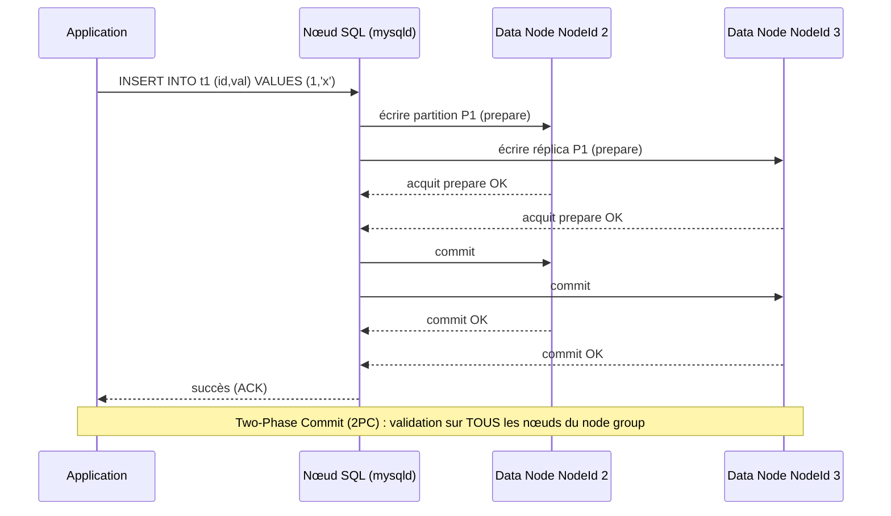
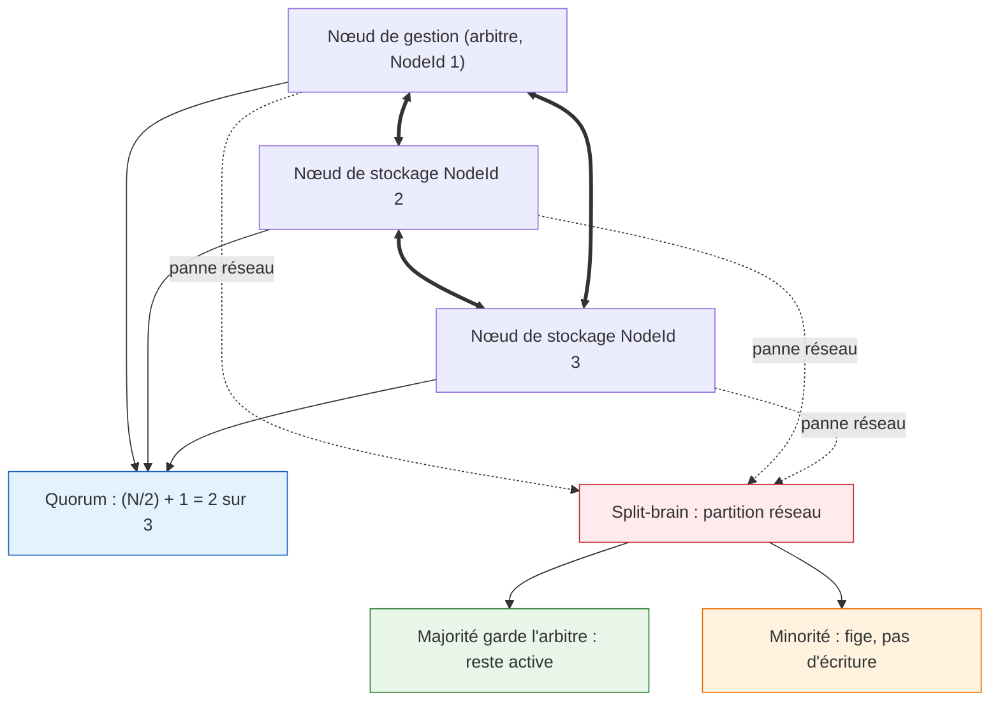
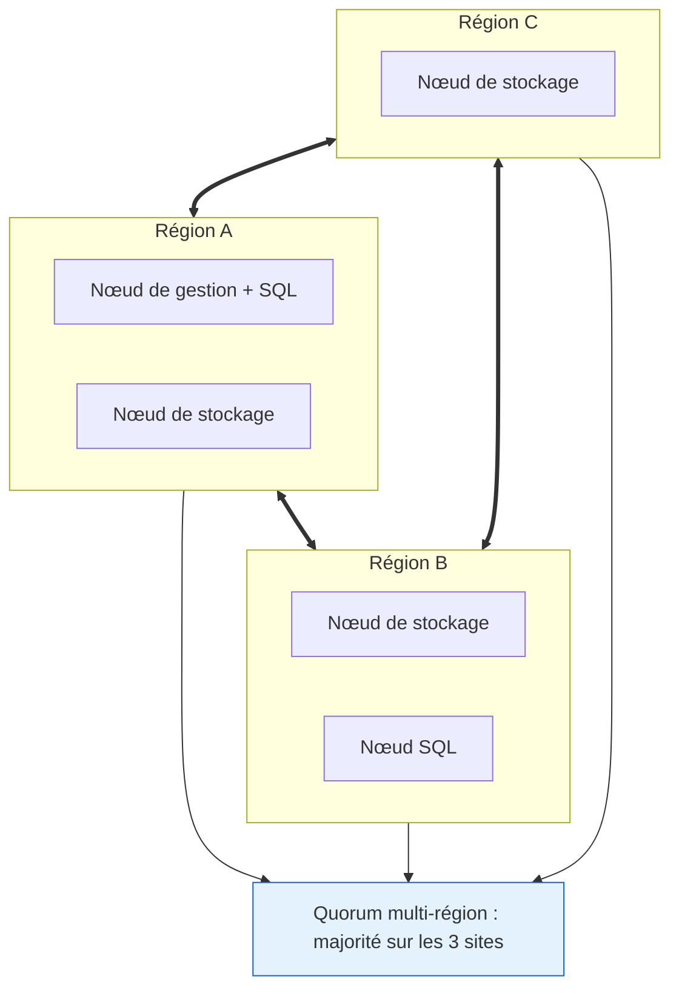
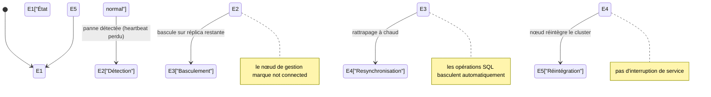
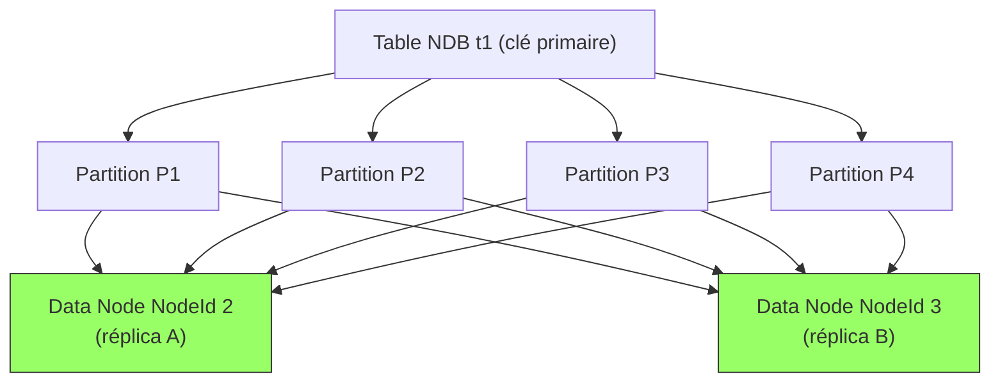
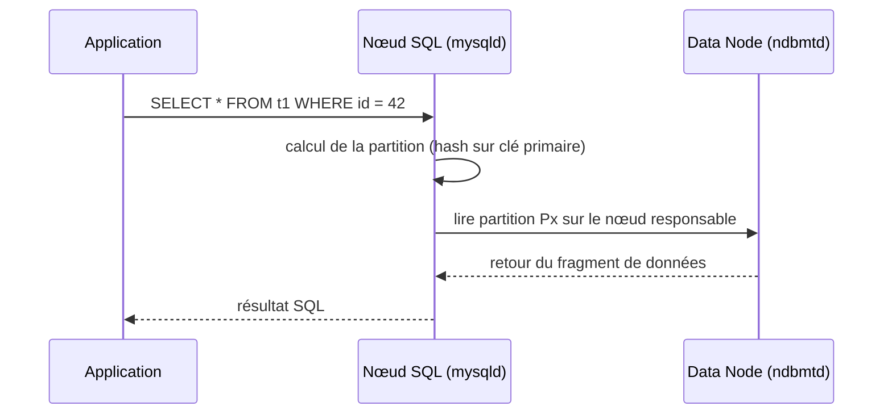
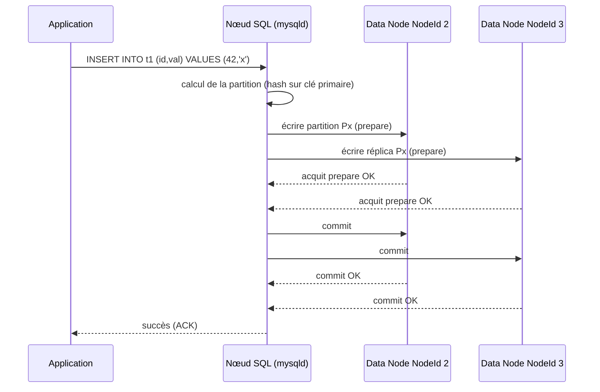
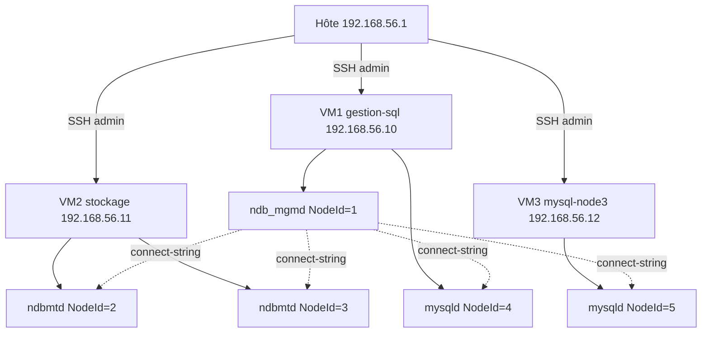

## Objectif du chapitre

À la fin de ce chapitre, l'apprenant sait décrire l'architecture de MySQL Cluster (moteur NDB, nœuds de gestion, de stockage et SQL), installer et configurer les trois VM du laboratoire (réseau vboxnet0, adresses IP statiques, SSH, nettoyage, snapshots), installer les composants MySQL Cluster sur chaque VM, rédiger le fichier `config.ini` de référence du parcours avec `NoOfReplicas = 2`, démarrer les nœuds dans l'ordre critique (gestion, puis stockage, puis SQL), vérifier l'intégrité du cluster avec `ndb_mgm -e "SHOW"`, et analyser la résilience (node groups, quorum, split-brain, failover automatique) ainsi que les contraintes des gros volumes de données (DataMemory, IndexMemory, partitionnement, auto-sharding).


## Vocabulaire

| Terme | Définition |
|---|---|
| Nœud de gestion (MGM) | Serveur qui distribue la configuration du cluster, processus `ndb_mgmd`, interface de gestion dédiée. |
| Nœud de stockage (NDB) | Serveur qui stocke les fragments de données en mémoire, processus `ndbmtd` ou `ndbd`. |
| Nœud SQL (API) | Instance MySQL `mysqld` avec le moteur NDB qui expose l'interface SQL. |
| NDB | Moteur de stockage distribué et en mémoire de MySQL Cluster. |
| NoOfReplicas | Nombre de copies de chaque fragment de données pour la redondance (valeur 2 dans ce lab). |
| Node-group | Groupe de nœuds de stockage qui contiennent les mêmes copies de données. |
| Split-brain | Situation où le cluster est partitionné en deux groupes qui ne peuvent plus communiquer. |
| Quorum | Règle de décision par majorité qui empêche deux partitions d'agir simultanément. |
| Arbitrage | Mécanisme par lequel un nœud tranche en cas de perte de communication entre node groups. |
| Connect-string | Adresse du nœud de gestion donnée à chaque node pour rejoindre le cluster (ex. `192.168.56.10`). |
| Lab | Mot de passe factice (uniquement pour le laboratoire) |
| Auto-sharding | Répartition automatique des fragments de données sur les nœuds de stockage par le moteur NDB. |


## Introduction à MySQL et au clustering

MySQL Cluster, basé sur le moteur de stockage NDB (Network Database), est une technologie de base de données distribuée qui fournit une haute disponibilité et une scalabilité horizontale. Son architecture, connue sous le nom d'"architecture Shared-Nothing" (partagé-nothing), répartit les données et les traitements sur plusieurs serveurs (ou machines virtuelles), éliminant tout point de défaillance unique (SPOF). Chaque nœud possède sa propre mémoire et ses propres disques ; les données sont fragmentées et répliquées sur plusieurs nœuds de stockage indépendants.

### Déploiement de référence sur 3 VM

Dans le contexte de ce lab sur 3 VM, l'architecture est déployée comme suit :

- **VM 1** (`192.168.56.10`, `gestion-sql`) : héberge le **nœud de gestion** (`ndb_mgmd`, NodeId 1) et le **premier nœud SQL** (`mysqld`, NodeId 4).
- **VM 2** (`192.168.56.11`, `stockage`) : héberge les **deux nœuds de stockage** (`ndbmtd`, NodeId 2 et NodeId 3), sur des répertoires de données distincts (`ndb_2` et `ndb_3`).
- **VM 3** (`192.168.56.12`, `mysql-node3`) : héberge le **second nœud SQL** (`mysqld`, NodeId 5).

### Les trois types de nœuds et leurs rôles

MySQL Cluster repose sur trois types de nœuds distincts qui communiquent entre eux via le réseau :

#### Nœud de gestion (Management Node — `ndb_mgmd`)

* **Rôle** : gère la configuration du cluster. Il charge et distribue le fichier de configuration (`config.ini`) à tous les autres nœuds au démarrage. Il coordonne également les opérations de démarrage progressif et l'arbitrage en cas de partitionnement réseau.
* **Caractéristiques** : il ne stocke aucune donnée utilisateur et n'est pas sollicité pour le traitement des requêtes SQL. Un seul nœud de gestion suffit pour le fonctionnement, mais c'est le premier composant à démarrer.

#### Nœud de stockage (Data Node — `ndbmtd`)

* **Rôle** : héberge et gère les partitions de données réelles (fragments). C'est ici que réside le moteur NDB. Il assure également la réplication synchrone de ces fragments avec les autres nœuds de stockage de son node group.
* **Caractéristiques** : les données sont principalement stockées en **mémoire** (RAM), mais elles sont persistées sur disque (checkpoints) pour garantir leur durabilité. Dans ce lab, VM 2 exécute deux instances `ndbmtd` simultanément (NodeId 2 et NodeId 3), sur des répertoires distincts (`ndb_2` et `ndb_3`).

#### Nœud SQL (SQL Node — `mysqld`)

* **Rôle** : offre l'interface standard de MySQL. Il agit comme une passerelle entre les applications clientes (protocole MySQL) et le moteur de stockage NDB. Il reçoit les requêtes SQL, les optimise et les traduit en opérations NDB pour les transmettre aux nœuds de stockage appropriés.
* **Caractéristiques** : ce n'est pas un serveur MySQL classique avec InnoDB ; il utilise le moteur NDB. Il ne stocke pas de données utilisateur NDB. Une application peut se connecter à n'importe quel nœud SQL pour accéder aux mêmes données du cluster.

Ces composants interagissent de manière coordonnée, comme le montre l'architecture de référence du parcours.

**Adaptation au lab** : dans notre lab sur 3 VM, cette topologie de référence est réduite à l'essentiel : 1 nœud de gestion (`ndb_mgmd`, NodeId 1, `192.168.56.10`), 2 nœuds de stockage (`ndbmtd`, NodeId 2 et NodeId 3, `192.168.56.11`) et 2 nœuds SQL (`mysqld`, NodeId 4 sur `192.168.56.10` et NodeId 5 sur `192.168.56.12`). Le client de gestion `ndb_mgm` est l'outil utilisé pour vérifier l'état du cluster (`ndb_mgm -e "SHOW"`). Les 3 nodes SQL et 4 nodes de données du schéma de référence deviennent 2 nodes SQL et 2 nodes de stockage collocés sur VM 2.

### Ordre de démarrage critique : gestionnaire → stockage → SQL

L'ordre de démarrage des nœuds est déterminant pour la bonne constitution du cluster :

1. **Le nœud de gestion (`ndb_mgmd`, NodeId 1)** doit être lancé en premier. Il lit le fichier `config.ini`, devient le maître de configuration et attend les déclarations des autres nœuds.
2. **Les nœuds de stockage (`ndbmtd`, NodeId 2 et 3)** se déclarent au nœud de gestion au démarrage, chargent leurs données et forment le node group.
3. **Les nœuds SQL (`mysqld`, NodeId 4 et 5)** se connectent au nœud de gestion pour découvrir la topologie du cluster et activer le moteur NDB.

Si un nœud SQL démarre avant le nœud de gestion, il ne peut pas découvrir le cluster et échoue. Si un nœud de stockage démarre avant le gestionnaire, il ne peut pas déclarer son appartenance au node group. Cet ordre strict (gestion → stockage → SQL) est celui de référence du parcours et doit être respecté à chaque démarrage ou redémarrage rolling du cluster.

### Le moteur de stockage NDB — stockage en mémoire et durabilité

Le moteur de stockage NDB est le cœur de MySQL Cluster. Contrairement à InnoDB qui stocke les données principalement sur disque avec des caches en mémoire, NDB privilégie le stockage des données en **mémoire vive (RAM)** pour des performances d'accès extrêmement faibles.

La durabilité des données est assurée par trois mécanismes complémentaires :

* **Checkpoints Locaux (LCP)** : périodiquement, les données modifiées en mémoire sont écrites sur disque par chaque nœud de stockage, de façon indépendante.
* **Checkpoints Globaux (GCP)** : assurent la cohérence transactionnelle entre tous les nœuds du cluster en marquant un point de synchronisation global.
* **Redo Logs** : enregistrent toutes les transactions sur disque pour permettre la reconstruction des données après une panne, depuis le dernier checkpoint global.

Ces mécanismes garantissent que, même en cas de perte d'un nœud de stockage, aucune donnée validée n'est perdue et que le cluster peut se resynchroniser automatiquement.

### ndbd vs ndbmtd — deux implémentations du nœud de stockage

MySQL Cluster propose deux binaires pour le nœud de stockage :

* **`ndbd`** : implémentation mono-thread. Un processus `ndbd` gère toutes les opérations de lecture/écriture dans un seul thread. Plus simple, mais limité par les performances d'un seul cœur CPU.
* **`ndbmtd`** (multi-threaded data node) : implémentation multi-thread. Un processus `ndbmtd` peut exécuter plusieurs threads de traitement en parallèle (`ThreadConfig`), ce qui améliore fortement le débit sur les machines multi-cœurs.

Dans ce lab, VM 2 exécute deux instances `ndbmtd` (NodeId 2 et NodeId 3) car c'est l'implémentation recommandée pour les charges de production et pour exploiter plusieurs cœurs CPU sur une même machine.

### Ports et connect-string du cluster NDB

Chaque nœud du cluster NDB doit savoir comment contacter le nœud de gestion pour rejoindre le cluster. Cela se fait via la **connect-string** :

* Port par défaut du nœud de gestion (`ndb_mgmd`) : **1186**
* Port par défaut des nœuds SQL (`mysqld`) : **3306** (protocole MySQL classique)
* Port de communication interne NDB entre nœuds de stockage : dynamique, géré par le gestionnaire

Exemple de connect-string : `192.168.56.10:1186` (adresse IP du nœud de gestion + port 1186). Cette connect-string est transmise à chaque `ndbmtd` et `mysqld` au démarrage, et au client `ndb_mgm` pour l'administration.

### NoOfReplicas = 2, node groups, quorum, split-brain et failover automatique

Le cluster est structuré autour de **groupes de nœuds (node group)**. Un groupe de nœuds est constitué d'un ensemble de nœuds de stockage qui contiennent les mêmes fragments de données. Chaque fragment est répliqué sur chaque nœud du groupe.

Dans une configuration avec `NoOfReplicas = 2` (valeur de référence du parcours), chaque groupe de nœuds contient exactement deux nœuds de stockage. Dans ce lab, VM 2 exécute les deux processus `ndbmtd` (NodeId 2 et NodeId 3) qui appartiennent au même node group (Nodegroup: 0) afin d'assurer la réplication synchrone.

**Réplication synchrone** : chaque partition est répliquée sur tous les nœuds d'un groupe de nœuds. Lorsqu'une transaction valide une écriture, cette écriture doit être confirmée avec succès par **tous** les nœuds de stockage du groupe avant que le nœud SQL ne puisse confirmer la réussite de la transaction à l'application cliente. Cela garantit que toutes les répliques sont cohérentes à tout moment.



**Two-Phase Commit (2PC)** : protocole de validation distribuée utilisé par NDB pour garantir la cohérence. Le nœud SQL joue le rôle de coordinateur. Il envoie d'abord une requête "prepare" à tous les nœuds de stockage du node group ; chaque nœud acquitte. Puis, une fois tous les acquit reçus, le coordinateur envoie "commit" à tous. La transaction n'est confirmée à l'application que lorsque **tous** les nœuds ont acquitté le commit. Si un nœud ne répond pas dans les temps, la transaction est annulée (rollback) pour préserver la cohérence.

**Quorum** : le quorum est la règle de décision par majorité qui empêche deux partitions du cluster d'agir simultanément. Dans un système distribué, un quorum se calcule généralement comme (N / 2) + 1, où N est le nombre total de nœuds participants. Cela signifie qu'il faut au moins la moitié des nœuds plus un vote pour valider une décision.

**Exemple concret de N/2 + 1 :**
- Avec **3 nœuds** (N = 3) : quorum = 3/2 + 1 = **2 votes sur 3** nécessaires.
- Avec **5 nœuds** (N = 5) : quorum = 5/2 + 1 = **3 votes sur 5** nécessaires.
- Avec **4 nœuds** (N = 4) : quorum = 4/2 + 1 = **3 votes sur 4** nécessaires. Attention : avec un nombre pair de nœuds, un partitionnement 2 contre 2 ne peut jamais atteindre le quorum de 3, donc le cluster s'arrête.

C'est pourquoi les clusters sont généralement déployés avec un nombre impair de serveurs (à partir de 3) : cela garantit qu'une majorité peut toujours être formée, même après une défaillance.

Dans ce lab NDB, le quorum est assuré par le nœud de gestion qui agit comme arbitre. Avec deux nœuds de stockage (NodeId 2 et NodeId 3) dans un seul node group et un nœud de gestion (NodeId 1), la perte d'un nœud de stockage ne rompt pas le quorum : le nœud de gestion et le nœud de stockage restant conservent la majorité et le cluster continue de fonctionner. Chaque nœud connaît le nombre total de nœuds du cluster (via sa configuration et les échanges de heartbeat avec le nœud de gestion). Lorsqu'un nœud détecte qu'il ne peut plus joindre assez de pairs pour atteindre le quorum, il sait qu'il se trouve dans la minorité et cesse de prendre des décisions, évitant ainsi toute écriture divergente.

**Split-brain** : le split-brain est la situation où le cluster est partitionné en deux groupes qui ne peuvent plus communiquer, typiquement à la suite d'une panne réseau. Sans mécanisme de protection, chaque côté pourrait accepter des écritures indépendamment, créant des données divergentes. Lorsque le réseau est rétabli, les nœuds pourraient peiner à se resynchroniser, entraînant des données manquantes ou erronées.

Le split-brain est prévenu par l'arbitrage : le nœud de gestion agit comme arbitre et tranche quel node group reste actif lorsque la communication entre node groups est perdue. Le groupe majoritaire (qui peut atteindre le quorum) reste opérationnel ; le groupe minoritaire devient indisponible et cesse d'accepter des écritures. Si le nœud de gestion se trouve dans la partition minoritaire, il reconnaît sa séparation et cède son rôle d'arbitre. L'arbitrage est requis sur les nœuds de données uniquement ; les nœuds SQL et de gestion n'en ont pas besoin.

### Figure 6 — Topologie région unique vs multi-région (illustration du quorum et du split-brain)



**Explication de la Figure 6 — Quorum et split-brain :**

Ce diagramme illustre comment le quorum et l'arbitrage empêchent le split-brain dans le cluster à 3 nœuds :

* **GM (NodeId 1)** : le nœud de gestion, qui fait office d'arbitre.
* **DS1 (NodeId 2)** et **DS2 (NodeId 3)** : les deux nœuds de stockage.
* **Quorum : (N/2) + 1 = 2 sur 3** : avec 3 nœuds au total, il faut au moins 2 nœuds d'accord pour prendre une décision.
* **Split-brain** : si le réseau est partitionné en deux groupes qui ne peuvent plus communiquer, chaque côté pourrait tenter d'agir indépendamment.
* **Maj (Majorité garde l'arbitre : reste active)** : le groupe qui contient le nœud de gestion et au moins un nœud de stockage détient le quorum (2 sur 3) et continue de fonctionner.
* **Min (Minorité : fige, pas d'écriture)** : le groupe isolé sans le quorum cesse d'accepter des écritures pour éviter des données divergentes.

Concrètement, si le lien réseau entre le nœud de gestion et le NodeId 3 est coupé mais que le NodeId 2 reste joignable, le groupe {GM + DS2} a le quorum et reste actif. Le groupe isolé {DS3} est privé d'écriture jusqu'à la restauration du réseau.

### Figure 7 — Topologie multi-région 3 sites (Régions A, B, C)



**Explication de la Figure 7 — Topologie multi-région 3 sites :**

Ce diagramme étend le concept de quorum à un déploiement géographique sur trois régions :

* **Région A** : contient le nœud de gestion + nœud SQL, et un nœud de stockage.
* **Région B** : contient un nœud de stockage et un nœud SQL.
* **Région C** : contient un nœud de stockage.
* **RA <==> RB <==> RC <==> RA** : les trois régions sont interconnectées pour permettre la communication entre tous les nœuds.
* **QMR (Quorum multi-région : majorité sur les 3 sites)** : le quorum s'applique à l'échelle géographique. Une décision de cluster nécessite la majorité des régions (ou des nœuds selon la configuration) pour être validée.

Dans ce modèle, si une région entière devient indisponible (panne réseau ou panne de site), les deux régions restantes conservent le quorum et le cluster continue de fonctionner. Le nœud de gestion arbitre reste le point de décision central, mais la réplication des données sur trois sites géographiquement séparés protège contre une panne complète d'un site. Si seule une région reste active, elle ne détient plus le quorum et le cluster s'arrête pour prévenir le split-brain entre sites.

**Lien avec le concept** : illustration du quorum (N/2 + 1) et du split-brain à l'échelle multi-région, concepts fondements de la résilience des clusters distribués.

### Figure 8 — Cycle de failover et réintégration d'un nœud de stockage



**Explication détaillée du cycle de failover et réintégration :**

**Étape 1 — État normal** : Le cluster fonctionne nominalement. Les deux nœuds de stockage (NodeId 2 et NodeId 3) sont dans le même node group avec `NoOfReplicas = 2`. Chaque partition de données existe en deux exemplaires, l'un sur chaque nœud. Les nœuds SQL (NodeId 4 et 5) peuvent lire et écrire sur n'importe quel nœud de stockage.

**Étape 2 — Détection** : Le nœud de gestion (`ndb_mgmd`) surveille en permanence les nœuds de stockage via des heartbeats réguliers. Si un nœud de stockage (par exemple NodeId 2) ne répond plus aux heartbeats pendant un intervalle donné, le nœud de gestion marque ce nœud comme `not connected`. C'est la détection de la panne.

**Étape 3 — Basculement (failover)** : Le nœud de gestion arbitre la situation. Comme le NodeId 3 est toujours opérationnel et détient la réplica des mêmes partitions, le basculement est automatique : les requêtes SQL sont désormais dirigées vers le NodeId 3. Le quorum est préservé car le nœud de gestion et le NodeId 3 conservent la majorité (2 sur 3). Les applications clientes ne subissent aucune interruption de service.

**Étape 4 — Resynchronisation** : Lorsque le nœud défaillant (NodeId 2) est redémarré, il se reconnecte au nœud de gestion. Sans l'option `--initial` (qui effacerait les données), le nœud 2 récupère les données modifiées pendant son absence depuis le NodeId 3 qui est resté actif. C'est la resynchronisation à chaud : seuls les fragments manquants ou obsolètes sont transférés, pas l'intégralité du node group.

**Étape 5 — Réintégration** : Une fois la resynchronisation terminée, le NodeId 2 passe de l'état `starting` à l'état `started` et réintègre pleinement le cluster. Il retrouve son rôle de réplica dans le node group. Le cluster retrouve sa pleine redondance avec `NoOfReplicas = 2` sur les deux nœuds de stockage. Le cycle est terminé et le cluster est de nouveau en état nominal.

**Lien avec le concept** : le failover automatique, le quorum (N/2 + 1) et l'arbitrage par le nœud de gestion sont les fondements de la résilience du cluster NDB. Sans quorum, le cluster ne pourrait pas décider quel groupe reste actif en cas de partition réseau ; sans arbitrage, deux partitions pourraient agir simultanément et créer des données divergentes (split-brain).

### Partitionnement (sharding / auto-sharding) et contraintes des gros volumes

Le moteur NDB assure nativement le **partitionnement (sharding)** des données :

1. **Partitionnement automatique** : les tables NDB sont automatiquement divisées en partitions (fragments). Ces partitions sont distribuées entre les différents groupes de nœuds de stockage disponibles. Par défaut, le partitionnement est basé sur la valeur de la clé primaire, assurant une distribution uniforme et une recherche rapide (auto-sharding du moteur NDB).
2. **Répartition sur les nœuds de stockage** : chaque fragment est répliqué selon `NoOfReplicas` sur tous les nœuds de son node group. Le moteur NDB gère lui-même la distribution et le rééquilibrage des fragments lorsque de nouveaux nœuds de stockage sont ajoutés.

**Contraintes des gros volumes de données** :

* **DataMemory** : mémoire allouée aux données et aux index sur chaque nœud de stockage. Doit être dimensionnée pour contenir l'ensemble des données et index du cluster, avec une marge pour les opérations en cours. Une valeur insuffisante provoque des erreurs d'espace disque plein (erreur NDB 871) et l'arrêt du nœud.
* **IndexMemory** : mémoire allouée aux index sur chaque nœud de stockage. Doit être dimensionnée en fonction du nombre et de la taille des index définis sur les tables NDB.
* **Consommation RAM** : comme NDB stocke les données en mémoire, la RAM totale disponible sur chaque nœud de stockage limite la taille maximale du jeu de données du cluster. Sur des VM avec 1 Go de RAM (comme dans ce lab), ces paramètres doivent rester très conservateurs (`DataMemory = 256M`, `IndexMemory = 128M` dans le `config.ini` de référence).
* **Pas de compression native** : NDB ne compresse pas les données en mémoire ; le dimensionnement doit tenir compte de la taille brute des données et des index.



**Auto-sharding** : les partitions P1..P4 sont réparties automatiquement sur les deux nœuds de stockage selon la clé primaire, chaque partition existant en deux exemplaires (NoOfReplicas = 2) sur NodeId 2 et NodeId 3. Le moteur NDB gère lui-même la distribution et le rééquilibrage, sans routeur externe.

### Vérification d'intégrité du cluster : ndb_mgm -e "SHOW"

Après le démarrage de tous les nœuds dans l'ordre critique, l'intégrité du cluster doit être vérifiée avec la commande de gestion :

```
ndb_mgm -e "SHOW"
```

Cette commande affiche l'état hiérarchique de tous les nœuds du cluster. Dans un cluster sain sur 3 VM, les 5 nœuds doivent apparaître comme `connected` :

- 1 nœud de gestion (NodeId 1)
- 2 nœuds de stockage (NodeId 2 et NodeId 3, `started`)
- 2 nœuds SQL (NodeId 4 et NodeId 5)

Si un nœud apparaît comme `not connected`, cela indique un problème de démarrage, de connectivité réseau ou de configuration. La résolution consiste à redémarrer les nœuds dans l'ordre critique (gestion → stockage → SQL) et à revérifier avec `SHOW`.

### Pourquoi MySQL Cluster est adapté aux applications critiques

MySQL Cluster est conçu pour répondre aux exigences les plus élevées en matière de disponibilité et de performance :

* **Haute Disponibilité (HA) zéro SPOF** : la redondance des nœuds de stockage et la réplication synchrone garantissent que si un nœud de stockage tombe en panne, les données restent accessibles via ses répliques. Le cluster continue de fonctionner sans interruption de service.
* **Scalabilité Horizontale (Scale-Out)** : pour augmenter les performances ou la capacité de stockage, il suffit d'ajouter de nouveaux groupes de nœuds de stockage au cluster existant. MySQL Cluster redistribue automatiquement les données (rebalancement) pour tirer parti des nouvelles ressources.
* **Performance en Temps Réel** : la conception en mémoire du moteur NDB permet une latence très faible pour les opérations de lecture et d'écriture, ce qui est critique pour les applications transactionnelles à haute concurrence.

### Études de cas et exemples d'utilisation

Les caractéristiques uniques de MySQL Cluster en font une solution privilégiée dans plusieurs secteurs :

* **Télécommunications** : utilisé pour les systèmes HLR (Home Location Register) et HSS (Home Subscriber Server) qui gèrent des millions d'abonnés et nécessitent un accès aux données en temps réel et une disponibilité extrême.
* **Finance et Paiements** : utilisé pour les plateformes de traitement des transactions qui exigent une intégrité transactionnelle (ACID) et aucune perte de données, tout en supportant une charge élevée.
* **Web et Services à Haute Concurrence** : utilisé pour les systèmes de gestion de sessions, les catalogues de produits en ligne ou les infrastructures de messagerie où la performance et la scalabilité sont primordiales.

### Cycle de vie d'une requête dans NDB (SELECT et INSERT)

Pour comprendre le comportement du cluster, il faut suivre le cheminement d'une requête SQL à travers les trois types de nœuds.

#### SELECT (lecture)



L'application s'adresse à n'importe quel nœud SQL. Celui-ci calcule la partition ciblée à partir de la valeur de la clé primaire (auto-sharding), interroge le nœud de stockage responsable, puis renvoie le résultat. La lecture peut être servie par n'importe quelle réplica de la partition.

#### INSERT / UPDATE / DELETE (écriture)



Une écriture suit le même chemin qu'une lecture pour localiser la partition, puis déclenche un Two-Phase Commit (2PC) : le nœud SQL coordonne la validation sur **tous** les nœuds de stockage du node group avant de confirmer à l'application. La cohérence est forte (synchrone) mais le coût est un aller-retour supplémentaire par réplica.

#### Différence de comportement selon le type de requête

| Type de requête | Chemin dans le cluster | Cohérence | Latence |
|-----------------|------------------------|-----------|---------|
| SELECT par clé primaire | SQL → nœud de stockage responsable | forte (lecture sur réplica à jour) | faible (1 aller-retour) |
| SELECT par index secondaire | SQL → tous les nœuds de stockage (scan) | forte | plus élevée (scatter-gather) |
| INSERT / UPDATE / DELETE | SQL → 2PC sur tous les nœuds du node group | forte (synchrone) | moyenne (2 allers-retours minimum) |

### Tableau comparatif NDB vs InnoDB

| Critère | NDB Cluster (lab) | InnoDB (MySQL classique) |
|---------|-------------------|--------------------------|
| Architecture | Partagé-nothing, distribué | Monolythique par serveur, réplication asynchrone |
| Stockage des données | Mémoire (RAM) + disque (checkpoints/redo) | Principalement disque + buffer pool |
| Réplication | Synchrone intra-node-group (2PC) | Asynchrone Source/Replica ou Group Replication |
| Failover | Automatique sur réplica restante | Manuel (ReplicaSet) ou automatique (Cluster/GR) |
| Quorum | Nœud de gestion arbitre | Quorum de Group Replication (si activé) |
| Partitionnement | Auto-sharding natif par clé primaire | Sharding manuel ou via middleware |
| Moteur utilisé dans ce lab | Oui (Labs 1 et 2) | Non (perspective théorique uniquement) |

### Mise en perspective (solutions HA InnoDB distinctes du lab)

Outre MySQL Cluster NDB (le moteur partagé-nothing étudié dans ce lab), MySQL propose d'autres solutions de haute disponibilité fondées sur le moteur InnoDB (InnoDB Cluster, InnoDB ReplicaSet, InnoDB ClusterSet, MySQL Router). Ces approches utilisent la réplication asynchrone Source/Replica ou Group Replication quasi-synchrone, et sont **distinctes de NDB Cluster**, qui est le cœur de ce parcours. Elles ne sont ni installées ni mises en œuvre dans les Labs 1 et 2 ; cette introduction se concentre exclusivement sur le cluster NDB partagé-nothing avec `NoOfReplicas = 2`, nœuds de gestion, de stockage et SQL, ordre de démarrage gestion → stockage → SQL, et vérification d'intégrité avec `ndb_mgm -e "SHOW"`.


## Avertissement et périmètre

- Machine principale : VM 1 (`192.168.56.10`, hostname `gestion-sql`, nœud de gestion + nœud SQL), VM 2 (`192.168.56.11`, hostname `stockage`, deux nœuds de stockage `ndbmtd` NodeId 2 et 3) et VM 3 (`192.168.56.12`, hostname `mysql-node3`, second nœud SQL NodeId 5).
- Réseau : VirtualBox host-only `vboxnet0` (`192.168.56.0/24`) pour l'accès SSH du host vers les VM, plus un adaptateur NAT sur chaque VM pour l'accès Internet de toutes les machines.
- Données : fictives, marquées `Lab` (uniquement pour le laboratoire isolé).
- Snapshots : les snapshots propres (`propre-avant-lab`) sont pris sur chaque VM avant le module.
- Accès : l'apprenant est déjà connecté en SSH sur chaque VM et exécute les commandes directement sur la machine.
- Hôte : `192.168.56.1`, utilisé uniquement comme hyperviseur, machine d'administration et stockage des preuves.
- **Note sur les NodeId** : la numérotation canonique du parcours est `NodeId 1` pour le nœud de gestion (VM 1), `NodeId 2 et 3` pour les deux nœuds de stockage (VM 2), et `NodeId 4 et 5` pour les nœuds SQL (VM 1 et VM 3). Les `config.ini`, schémas et résultats `SHOW` attendus des chapitres suivent cette numérotation (gestion=1, stockage=2 et 3, SQL=4 et 5). Cette numérotation est celle de l'infrastructure déployée et validée en laboratoire.


## Prérequis

| Élément | Détail | Vérification |
|---|---|---|
| Hôte | VirtualBox, réseau host-only vboxnet0 192.168.56.0/24 | `VBoxManage list hostonlyifs` liste vboxnet0 |
| VM 1 | Ubuntu Server 24.04 LTS, 1 vCPU, 1 Go RAM, 15 Go disque, IP `192.168.56.10`, hostname `gestion-sql` | `ping 192.168.56.10` depuis l'hôte |
| VM 2 | Ubuntu Server 24.04 LTS, 1 vCPU, 1 Go RAM, 15 Go disque, IP `192.168.56.11`, hostname `stockage` | `ping 192.168.56.11` depuis l'hôte |
| VM 3 | Ubuntu Server 24.04 LTS, 1 vCPU, 1 Go RAM, 15 Go disque, IP `192.168.56.12`, hostname `mysql-node3` | `ping 192.168.56.12` depuis l'hôte |
| SSH | Accès `root` sur les trois VM (mot de passe dans `.env`) | session SSH ouverte sur chaque VM |
| Snapshot | `propre-avant-lab` présent sur chaque VM | `VBoxManage snapshot <vm> list` |


## Architecture de laboratoire : cluster MySQL sur 3 VM


Le schéma ci-dessous présente l'architecture concrète du lab de ce chapitre sur trois VM, avec la numérotation canonique des NodeId du parcours.



**Fig 1.1** — Architecture du cluster de lab sur 3 VM : gestion + SQL NodeId 4 sur VM 1, stockage NodeId 2 et 3 sur VM 2, second SQL NodeId 5 sur VM 3 ; accès d'administration par SSH depuis l'hôte.

Les trois types de nœuds jouent des rôles distincts dans ce lab :

- Le **nœud de gestion** (`ndb_mgmd`) lit le fichier `config.ini` qui décrit la topologie du cluster et la communique aux autres nœuds au démarrage. Il est le premier élément à démarrer.
- Les **nœuds de stockage** (`ndbmtd`) contiennent les données en mémoire et les répliquent selon le paramètre `NoOfReplicas`. Ils se déclarent au nœud de gestion au démarrage.
- Le **nœud SQL** (`mysqld`) active le moteur NDB et permet d'exécuter des requêtes SQL sur les données du cluster. Il se connecte au nœud de gestion pour découvrir la topologie.

L'ordre de démarrage est critique : le nœud de gestion doit être lancé avant les nœuds de stockage, qui doivent être lancés avant les nœuds SQL. Cet ordre garantit que chaque nœud trouve le gestionnaire et rejoint le cluster sans erreur. Cet ordre est celui de référence du parcours : gestionnaire, puis stockage, puis SQL.

MySQL Cluster est adapté aux applications critiques car il offre une haute disponibilité et une tolérance aux pannes : avec `NoOfReplicas = 2`, la perte d'un nœud de stockage n'interrompt pas le service, la réplique restante continue de répondre.


## Fichier de configuration config.ini — référence du parcours

Le fichier `config.ini` est lu uniquement par le nœud de gestion (`ndb_mgmd`). La configuration de référence du parcours définit explicitement au moins `NodeId`, `HostName` et `DataDir` pour chaque node, car l'identifiant automatique peut changer d'un démarrage à l'autre.

Structure de référence du parcours (adaptée aux adresses IP du lab) :

```ini
[ndb_mgmd default]
DataDir = /var/lib/mysql-cluster

[ndbd default]
NoOfReplicas = 2
DataMemory = 256M
IndexMemory = 128M
DataDir = /var/lib/mysql-cluster

[tcp default]

[ndb_mgmd]
NodeId = 1
HostName = 192.168.56.10
DataDir = /var/lib/mysql-cluster

[ndbd]
NodeId = 2
HostName = 192.168.56.11
DataDir = /var/lib/mysql-cluster/ndb_2

[ndbd]
NodeId = 3
HostName = 192.168.56.11
DataDir = /var/lib/mysql-cluster/ndb_3

[mysqld]
NodeId = 4
HostName = 192.168.56.10

[mysqld]
NodeId = 5
HostName = 192.168.56.12
```

Remarques de référence du parcours :
- `NodeId` : identifiant unique dans tout le cluster. Lorsqu'il existe plusieurs nodes sur le même hôte, il doit être explicitement spécifié.
- `HostName` : si non spécifié, le nœud de gestion peut être contacté depuis n'importe quel hôte ; le définir explicitement restreint et sécurise la connectivité.
- `DataDir` : répertoire de travail de chaque node ; les deux nœuds de stockage collocés sur VM 2 utilisent des répertoires distincts (`ndb_2` et `ndb_3`) pour éviter les collisions de fichiers.
- `NoOfReplicas = 2` : chaque fragment de données existe en deux exemplaires, sur deux nœuds de stockage distincts.


## Haute disponibilité des systèmes critiques

Les architectures de type partagé-nothing (shared-nothing) avec réplication synchrone sont le fondement des systèmes critiques à haut volume. Dans les réseaux de télécommunications, les plateformes de transaction financière et les infrastructures logistiques distribuées, l'objectif de disponibilité de 99,999 % (moins de cinq minutes d'indisponibilité par an) impose trois conditions :

1. **Détection rapide des pannes** : un nœud qui ne répond plus doit être identifié en quelques secondes par le nœud de gestion, sans attendre un timeout long.
2. **Basculement sans intervention humaine** : le failover automatique sur la réplica restante doit se produire sans opérateur, pour maintenir les opérations temps réel.
3. **Résynchronisation à chaud** : un nœud revenu après panne doit réintégrer le cluster et rattraper son retard de données sans arrêter le service.

Ces principes justifient le choix de `NoOfReplicas = 2`, l'ordre de démarrage strict (gestion → stockage → SQL), et l'arbitrage par le nœud de gestion pour prévenir le split-brain. Ils s'appliquent directement aux systèmes critiques à haut volume où l'indisponibilité a un impact métier immédiat.

> **Partagé-nothing (shared-nothing) :** ce n'est pas une erreur, c'est le terme technique de l'architecture NDB Cluster. Cela signifie que chaque nœud possède sa propre mémoire vive et ses propres disques, sans rien partager avec les autres nœuds. Les données sont fragmentées et répliquées sur plusieurs nœuds de stockage indépendants, ce qui élimine tout point de défaillance unique (single point of failure).


## Plan d'installation maître

Le plan ci-dessous ordonne tous les labs du chapitre. Aucune action de configuration ne précède ce plan.

| Ordre | Lab | Objectif | Cible | Tactique | Opérations de référence |
|---|---|---|---|---|---|
| 1 | Lab-01 | Nettoyer et configurer manuellement les trois VM (réseau, IP statique, SSH, hostname, snapshot, connectivité) | VM 1 + VM 2 + VM 3 | session SSH ouverte sur chaque VM, netplan, VirtualBox snapshots | NDB-01 |
| 2 | Lab-02 | Installer MySQL Cluster, rédiger `config.ini`, démarrer dans l'ordre, vérifier l'intégrité et la résilience | VM 1 + VM 2 + VM 3 | Dépôt MySQL, `config.ini`, démarrage MGM → stockage → SQL | NDB-03, NDB-04, NDB-08, NDB-05 |


## Lab-01 — Installation et mise en place de l'infrastructure (vierge ou remise à zéro)

### Énoncé / Contexte

Installer ou remettre à zéro les trois machines virtuelles du laboratoire et préparer l'infrastructure de base avant l'installation de MySQL Cluster. Ce lab couvre deux cas de figure :

- **Cas A — VMs déjà installées** : remise à zéro complète (nettoyage des configurations et paquets MySQL/Cluster précédents).
- **Cas B — Installation vierge** : création des 3 VMs dans VirtualBox, téléchargement de l'ISO Ubuntu Server 24.04 LTS, configuration des réseaux (host-only `vboxnet0` + NAT), installation d'Ubuntu Server.

Dans les deux cas, chaque VM doit recevoir son adresse IP statique, son hostname, le service SSH, et un snapshot propre `propre-avant-lab` doit être pris avant le Lab-02.

Aucun accès Internet n'est désactivé : chaque VM conserve son adaptateur NAT pour pouvoir installer les paquets depuis les dépôts Ubuntu/MySQL pendant la phase d'installation.

#### Schéma d'adressage des 3 VMs

```
Hôte 192.168.56.1
└── vboxnet0 (192.168.56.0/24, DHCP désactivé)
    ├── VM1 gestion-sql   192.168.56.10  (ndb_mgmd Id=1, mysqld Id=4)
    ├── VM2 stockage      192.168.56.11  (ndbmtd Id=2, ndbmtd Id=3)
    └── VM3 mysql-node3   192.168.56.12  (mysqld Id=5)
    └── NAT (accès Internet pour l'installation des paquets)
```

**Adresses IP statiques (référence du parcours, utilisées dans tous les labs) :**

| VM | Hostname | Adresse IP | Rôle |
|----|----------|------------|------|
| VM 1 | gestion-sql | 192.168.56.10/24 | Nœud de gestion + nœud SQL NodeId 4 |
| VM 2 | stockage | 192.168.56.11/24 | Deux nœuds de stockage NodeId 2 et 3 |
| VM 3 | mysql-node3 | 192.168.56.12/24 | Second nœud SQL NodeId 5 |

**Hôte** : 192.168.56.1 — hyperviseur, machine d'administration et stockage des preuves uniquement.

---

### Outils et commandes utilisées

| Outil | Commande | Rôle |
|-------|----------|------|
| VirtualBox GUI | Fichier → Gestionnaire de réseaux → Réseaux privés d'hôte | Créer le réseau host-only `vboxnet0` |
| VirtualBox GUI | Configuration VM → Réseau | Attacher adaptateur 1 = host-only `vboxnet0`, adaptateur 2 = NAT |
| VirtualBox GUI | Configuration VM → Système | Ordre de boot : DVD avant disque dur |
| `hostnamectl` | `hostnamectl set-hostname <nom>` | Définir le nom d'hôte de chaque VM |
| `tee` + netplan | `tee /etc/netplan/01-netcfg.yaml` | Écrire la configuration IP statique |
| `netplan` | `netplan apply` | Appliquer la configuration réseau |
| `systemctl` | `systemctl enable --now ssh` | Activer et démarrer le service SSH |
| `ip` | `ip -br addr show enp0s8` | Vérifier l'adresse IP statique |
| `ping` | `ping -c 4 <ip>` | Test de connectivité ICMP depuis l'hôte |
| `rm` / `apt-get` | `rm -rf`, `apt-get purge`, `apt-get autoremove` | Nettoyage des configurations précédentes (Cas A) |
| `VBoxManage` | `VBoxManage snapshot <vm> list` | Vérifier les snapshots propres sur l'hôte |

---

### Commande et laboratoire étape par étape

#### Étape 1 — Cas A : Nettoyer les VMs existantes (remise à zéro)

**But** — Supprimer toute configuration MySQL/Cluster précédente sur les 3 VMs pour repartir d'un état propre.

**Machine** — VM 1 (192.168.56.10), VM 2 (192.168.56.11), VM 3 (192.168.56.12).

**Prérequis** — VMs démarrées, session SSH ouverte en root sur chaque VM.

> **Machine** : 192.168.56.10 | **Terminal** : session SSH ouverte sur gestion-sql | **Utilisateur** : root | **Répertoire** : /

**Exemple de commande**

```bash
rm -rf /var/lib/mysql-cluster /usr/mysql-cluster /etc/mysql /var/lib/mysql
```

**Explication de la commande**

- `rm -rf /var/lib/mysql-cluster /usr/mysql-cluster /etc/mysql /var/lib/mysql` : supprime les répertoires et fichiers de configuration MySQL/Cluster précédents sur VM 1.

**Résultat attendu**

```text

aucune sortie attendue (commande silencieuse en cas de succès, rc=0)
```

> **Machine** : 192.168.56.11 | **Terminal** : session SSH ouverte sur stockage | **Utilisateur** : root | **Répertoire** : /

**Exemple de commande**

```bash
rm -rf /var/lib/mysql-cluster /usr/mysql-cluster /etc/mysql /var/lib/mysql
```

**Explication de la commande**

- `rm -rf /var/lib/mysql-cluster /usr/mysql-cluster /etc/mysql /var/lib/mysql` : supprime les répertoires et fichiers de configuration MySQL/Cluster précédents sur VM 2.

**Résultat attendu**

```text

aucune sortie attendue (commande silencieuse en cas de succès, rc=0)
```

> **Machine** : 192.168.56.12 | **Terminal** : session SSH ouverte sur mysql-node3 | **Utilisateur** : root | **Répertoire** : /

**Exemple de commande**

```bash
rm -rf /var/lib/mysql-cluster /usr/mysql-cluster /etc/mysql /var/lib/mysql
```

**Explication de la commande**

- `rm -rf /var/lib/mysql-cluster /usr/mysql-cluster /etc/mysql /var/lib/mysql` : supprime les répertoires et fichiers de configuration MySQL/Cluster précédents sur VM 3.

**Résultat attendu**

```text

aucune sortie attendue (commande silencieuse en cas de succès, rc=0)
```

---

#### Étape 1b — Purger les paquets MySQL existants (toutes les VM, Cas A)

**But** — Supprimer proprement les paquets MySQL et leurs fichiers de configuration pour éviter tout conflit.

**Machine** — VM 1, VM 2, VM 3.

**Prérequis** — Nettoyage des répertoires effectué (Étape 1).

> **Machine** : 192.168.56.10 | **Terminal** : session SSH ouverte sur gestion-sql | **Utilisateur** : root | **Répertoire** : /

**Exemple de commande**

```bash
apt-get purge -y mysql-cluster-* mysql-server-* mysql-common-* || true
```

**Explication de la commande**

- `apt-get purge -y mysql-cluster-* mysql-server-* mysql-common-*` : supprime proprement les paquets MySQL et leurs fichiers de configuration.
- `|| true` : évite que l'échec d'une purge (paquet absent) n'arrête l'exécution.

**Résultat attendu**

```text

aucune sortie attendue (commande silencieuse en cas de succès, rc=0)
```

> **Machine** : 192.168.56.11 | **Terminal** : session SSH ouverte sur stockage | **Utilisateur** : root | **Répertoire** : /

**Exemple de commande**

```bash
apt-get purge -y mysql-cluster-* mysql-server-* mysql-common-* || true
```

**Explication de la commande**

- `apt-get purge -y mysql-cluster-* mysql-server-* mysql-common-*` : supprime proprement les paquets MySQL sur VM 2.
- `|| true` : évite que l'échec d'une purge (paquet absent) n'arrête l'exécution.

**Résultat attendu**

```text

aucune sortie attendue (commande silencieuse en cas de succès, rc=0)
```

> **Machine** : 192.168.56.12 | **Terminal** : session SSH ouverte sur mysql-node3 | **Utilisateur** : root | **Répertoire** : /

**Exemple de commande**

```bash
apt-get purge -y mysql-cluster-* mysql-server-* mysql-common-* || true
```

**Explication de la commande**

- `apt-get purge -y mysql-cluster-* mysql-server-* mysql-common-*` : supprime proprement les paquets MySQL sur VM 3.
- `|| true` : évite que l'échec d'une purge (paquet absent) n'arrête l'exécution.

**Résultat attendu**

```text

aucune sortie attendue (commande silencieuse en cas de succès, rc=0)
```

---

#### Étape 1c — Supprimer les dépendances orphelines (toutes les VM, Cas A)

**But** — Supprimer les dépendances inutiles après la purge des paquets MySQL.

**Machine** — VM 1, VM 2, VM 3.

**Prérequis** — Purge des paquets effectuée (Étape 1b).

> **Machine** : 192.168.56.10 | **Terminal** : session SSH ouverte sur gestion-sql | **Utilisateur** : root | **Répertoire** : /

**Exemple de commande**

```bash
apt-get autoremove -y || true
```

**Explication de la commande**

- `apt-get autoremove -y` : supprime les dépendances inutiles après la purge sur VM 1.
- `|| true` : évite qu'une absence de dépendances inutiles n'arrête l'exécution.

**Résultat attendu**

```text

aucune sortie attendue (commande silencieuse en cas de succès, rc=0)
```

> **Machine** : 192.168.56.11 | **Terminal** : session SSH ouverte sur stockage | **Utilisateur** : root | **Répertoire** : /

**Exemple de commande**

```bash
apt-get autoremove -y || true
```

**Explication de la commande**

- `apt-get autoremove -y` : supprime les dépendances inutiles après la purge sur VM 2.
- `|| true` : évite qu'une absence de dépendances inutiles n'arrête l'exécution.

**Résultat attendu**

```text

aucune sortie attendue (commande silencieuse en cas de succès, rc=0)
```

> **Machine** : 192.168.56.12 | **Terminal** : session SSH ouverte sur mysql-node3 | **Utilisateur** : root | **Répertoire** : /

**Exemple de commande**

```bash
apt-get autoremove -y || true
```

**Explication de la commande**

- `apt-get autoremove -y` : supprime les dépendances inutiles après la purge sur VM 3.
- `|| true` : évite qu'une absence de dépendances inutiles n'arrête l'exécution.

**Résultat attendu**

```text

aucune sortie attendue (commande silencieuse en cas de succès, rc=0)
```

---

#### Étape 2 — Cas B : Créer le réseau host-only vboxnet0 (GUI hôte)

**But** — Créer le réseau isolé `vboxnet0` (192.168.56.0/24) sur l'hôte, avec l'hôte en `192.168.56.1` et le DHCP désactivé.

**Machine** — Hôte (192.168.56.1), interface graphique VirtualBox.

**Prérequis** — VirtualBox installé.

> **Machine** : 192.168.56.1 | **Terminal** : interface graphique VirtualBox | **Utilisateur** : yug | **Répertoire** : /home/yug/Documents/mysql

**Explication de la commande**

- Ouvrir VirtualBox → Fichier → Gestionnaire de réseaux → Réseaux privés d'hôte.
- Créer un nouveau réseau host-only nommé `vboxnet0`.
- Définir l'adresse IPv4 de l'hôte : `192.168.56.1`.
- Définir le masque de réseau IPv4 : `255.255.255.0`.
- **Désactiver le serveur DHCP** sur ce réseau (décocher "Enable Server") : les IP sont statiques, configurées manuellement sur chaque VM.
- Valider et fermer.

**Résultat attendu**

```text

Réseau host-only vboxnet0 créé : 192.168.56.0/24, hôte 192.168.56.1, DHCP désactivé.
```

---

#### Étape 3 — Cas B : Créer les 3 VMs dans VirtualBox (GUI hôte)

**But** — Créer les 3 machines virtuelles avec la configuration de référence du parcours.

**Machine** — Hôte (192.168.56.1), interface graphique VirtualBox.

**Prérequis** — Réseau `vboxnet0` créé (Étape 2), ISO Ubuntu Server 24.04 LTS disponible.

| Paramètre | VM 1 | VM 2 | VM 3 |
|-----------|------|------|------|
| Nom | UbuntuServer-01 | UbuntuServer-02 | UbuntuServer-03 |
| Type | Ubuntu (64-bit) | Ubuntu (64-bit) | Ubuntu (64-bit) |
| RAM | 1 Go | 1 Go | 1 Go |
| vCPU | 1 | 1 | 1 |
| Disque | 15 Go | 15 Go | 15 Go |
| ISO | Ubuntu 24.04 LTS | Ubuntu 24.04 LTS | Ubuntu 24.04 LTS |
| Ordre de boot | DVD avant disque dur | DVD avant disque dur | DVD avant disque dur |

**Explication de la commande**

- Créer 3 VMs dans VirtualBox avec les paramètres ci-dessus.
- Attacher l'ISO Ubuntu Server 24.04 LTS comme lecteur optique de chaque VM.
- Définir l'ordre de boot : lecteur optique (DVD) avant le disque dur.

**Résultat attendu**

```text

3 VMs créées : UbuntuServer-01, UbuntuServer-02, UbuntuServer-03.
```

---

#### Étape 4 — Cas B : Configurer les adaptateurs réseau de chaque VM (GUI hôte)

**But** — Attacher l'adaptateur 1 au réseau host-only `vboxnet0` et l'adaptateur 2 au NAT sur chaque VM.

**Machine** — Hôte (192.168.56.1), interface graphique VirtualBox.

**Prérequis** — Les 3 VMs créées (Étape 3), réseau `vboxnet0` créé (Étape 2).

> **Machine** : 192.168.56.1 | **Terminal** : interface graphique VirtualBox | **Utilisateur** : yug | **Répertoire** : /home/yug/Documents/mysql

**Explication de la commande**

Pour chaque VM (UbuntuServer-01, UbuntuServer-02, UbuntuServer-03) :

- Sélectionner la VM → Configuration → Réseau.
- **Adaptateur 1** : activer, attacher à "Réseau privé d'hôte", sélectionner `vboxnet0`. Cet adaptateur fournit l'IP statique (192.168.56.10/11/12) et l'accès SSH depuis l'hôte.
- **Adaptateur 2** : activer, attacher à "NAT". **Aucun accès Internet n'est désactivé** : l'adaptateur NAT reste actif pour permettre l'installation des paquets depuis les dépôts Ubuntu/MySQL pendant la phase d'installation.
- Valider pour chaque VM.

**Résultat attendu**

```text

Chaque VM dispose de 2 adaptateurs :
  - Adaptateur 1 : host-only vboxnet0 (192.168.56.0/24, DHCP off) — IP statique et SSH
  - Adaptateur 2 : NAT — accès Internet pour l'installation des paquets
```

---

#### Étape 5 — Cas B : Installer Ubuntu Server sur chaque VM

**But** — Installer Ubuntu Server 24.04 LTS sur les 3 VMs depuis l'ISO.

**Machine** — VM 1, VM 2, VM 3.

**Prérequis** — VMs créées, ISO attaché, réseaux configurés (adaptateur 1 = vboxnet0, adaptateur 2 = NAT).

**Exemple de commande**

```bash
# Aucune commande : installation via l'interface graphique d'installation d'Ubuntu Server
# - Sélectionner la langue, le clavier, le type d'installation
# - Configurer l'utilisateur root avec mot de passe (ou activer SSH root après installation)
# - Terminer l'installation et redémarrer chaque VM
```

**Explication de la commande**

- Démarrer chaque VM depuis l'ISO.
- Suivre l'assistant d'installation d'Ubuntu Server 24.04 LTS.
- Configurer un utilisateur `root` avec mot de passe, ou activer l'accès SSH root après l'installation.
- Le réseau n'a pas besoin d'être configuré pendant l'installation : il le sera après dans l'Étape 6 (netplan).
- Terminer l'installation et redémarrer chaque VM.

**Résultat attendu**

```text

Ubuntu Server 24.04 LTS installé sur VM 1, VM 2 et VM 3.
```

---

#### Étape 6 — Configurer les IP statiques sur chaque VM (netplan)

**But** — Configurer l'adresse IP statique de chaque VM sur l'adaptateur host-only `vboxnet0` (enp0s8) et activer le service SSH.

**Machine** — VM 1 (192.168.56.10), VM 2 (192.168.56.11), VM 3 (192.168.56.12).

**Prérequis** — Ubuntu Server 24.04 LTS installé, accès root en console ou SSH, adaptateur host-only présent.

---

**VM 1 — IP 192.168.56.10, hostname gestion-sql**

> **Machine** : 192.168.56.10 | **Terminal** : session SSH ou console sur gestion-sql | **Utilisateur** : root | **Répertoire** : /

**Exemple de commande**

```bash
hostnamectl set-hostname gestion-sql

tee /etc/netplan/01-netcfg.yaml << 'YEOF'
network:
  version: 2
  ethernets:
    enp0s8:
      dhcp4: no
      addresses: [192.168.56.10/24]
      nameservers:
        addresses: [192.168.56.1]
YEOF

netplan apply
systemctl enable --now ssh
```

**Explication de la commande**

- `hostnamectl set-hostname gestion-sql` : définit le nom d'hôte de VM 1.
- `tee /etc/netplan/01-netcfg.yaml << 'YEOF'` : écrit la configuration netplan avec l'IP statique `192.168.56.10/24` sur l'interface `enp0s8` (adaptateur host-only), DHCP désactivé, passerelle DNS `192.168.56.1` (hôte).
- `netplan apply` : applique la configuration réseau sans redémarrage.
- `systemctl enable --now ssh` : active et démarre le service SSH pour l'administration à distance depuis l'hôte.

**Résultat attendu**

```text

gestion-sql
```

---

**VM 2 — IP 192.168.56.11, hostname stockage**

> **Machine** : 192.168.56.11 | **Terminal** : session SSH ou console sur stockage | **Utilisateur** : root | **Répertoire** : /

**Exemple de commande**

```bash
hostnamectl set-hostname stockage

tee /etc/netplan/01-netcfg.yaml << 'YEOF'
network:
  version: 2
  ethernets:
    enp0s8:
      dhcp4: no
      addresses: [192.168.56.11/24]
      nameservers:
        addresses: [192.168.56.1]
YEOF

netplan apply
systemctl enable --now ssh
```

**Explication de la commande**

- `hostnamectl set-hostname stockage` : définit le nom d'hôte de VM 2.
- `tee /etc/netplan/01-netcfg.yaml << 'YEOF'` : écrit la configuration netplan avec l'IP statique `192.168.56.11/24` sur l'interface `enp0s8` (adaptateur host-only), DHCP désactivé, passerelle DNS `192.168.56.1` (hôte).
- `netplan apply` : applique la configuration réseau sans redémarrage.
- `systemctl enable --now ssh` : active et démarre le service SSH pour l'administration à distance depuis l'hôte.

**Résultat attendu**

```text

stockage
```

---

**VM 3 — IP 192.168.56.12, hostname mysql-node3**

> **Machine** : 192.168.56.12 | **Terminal** : session SSH ou console sur mysql-node3 | **Utilisateur** : root | **Répertoire** : /

**Exemple de commande**

```bash
hostnamectl set-hostname mysql-node3

tee /etc/netplan/01-netcfg.yaml << 'YEOF'
network:
  version: 2
  ethernets:
    enp0s8:
      dhcp4: no
      addresses: [192.168.56.12/24]
      nameservers:
        addresses: [192.168.56.1]
YEOF

netplan apply
systemctl enable --now ssh
```

**Explication de la commande**

- `hostnamectl set-hostname mysql-node3` : définit le nom d'hôte de VM 3.
- `tee /etc/netplan/01-netcfg.yaml << 'YEOF'` : écrit la configuration netplan avec l'IP statique `192.168.56.12/24` sur l'interface `enp0s8` (adaptateur host-only), DHCP désactivé, passerelle DNS `192.168.56.1` (hôte).
- `netplan apply` : applique la configuration réseau sans redémarrage.
- `systemctl enable --now ssh` : active et démarre le service SSH pour l'administration à distance depuis l'hôte.

**Résultat attendu**

```text

mysql-node3
```

---

#### Étape 7 — Vérifier les IP statiques et la connectivité

**But** — Confirmer que chaque VM possède bien son IP statique et qu'elles sont joignables depuis l'hôte.

**Machine** — Hôte (192.168.56.1), terminal hôte.

**Prérequis** — Les 3 VMs ont leur IP statique configurée (Étape 6), SSH actif.

> **Machine** : 192.168.56.1 | **Terminal** : terminal hôte | **Utilisateur** : yug | **Répertoire** : /home/yug/Documents/mysql

**Exemple de commande**

```bash
ping -c 4 192.168.56.10
ping -c 4 192.168.56.11
ping -c 4 192.168.56.12
```

**Explication de la commande**

- `ping -c 4 <ip>` : envoie 4 requêtes ICMP et s'arrête ; vérifie la joignabilité de chaque VM depuis l'hôte.
- **Piège** : si `ping` échoue, vérifier les adresses IP, le démarrage des VM et l'adaptateur host-only `vboxnet0` avant de passer à l'étape suivante.

**Résultat attendu**

```text
PING 192.168.56.10 (192.168.56.10) 56(84) bytes of data.
64 bytes from 192.168.56.10: icmp_seq=1 ttl=64 time=0.250 ms
64 bytes from 192.168.56.10: icmp_seq=2 ttl=64 time=0.214 ms
64 bytes from 192.168.56.10: icmp_seq=3 ttl=64 time=0.187 ms
64 bytes from 192.168.56.10: icmp_seq=4 ttl=64 time=0.240 ms

--- 192.168.56.10 ping statistics ---
4 packets transmitted, 4 received, 0% packet loss, time 3051ms
rtt min/avg/max/mdev = 0.187/0.222/0.250/0.024 ms
```

Sur chaque VM (en SSH) :

```bash
hostname
ip -br addr show enp0s8
```

**Résultat attendu**

```text
gestion-sql
enp0s8           UP             192.168.56.10/24 fe80::.../64

stockage
enp0s8           UP             192.168.56.11/24 fe80::.../64

mysql-node3
enp0s8           UP             192.168.56.12/24 fe80::.../64
```

---

#### Étape 8 — Prendre les snapshots propres `propre-avant-lab`

**But** — Confirmer que les snapshots propres (`propre-avant-lab`) existent sur chaque VM pour permettre un retour à l'état initial en cas d'erreur pendant le Lab-02.

**Machine** — Hôte (192.168.56.1), snapshot des VM 1 (`UbuntuServer-01`), VM 2 (`UbuntuServer-02`) et VM 3 (`UbuntuServer-03`).

**Prérequis** — VirtualBox sur l'hôte, les VM existent.

> **Machine** : 192.168.56.1 | **Terminal** : terminal hôte | **Utilisateur** : yug | **Répertoire** : /home/yug/Documents/mysql

**Exemple de commande**

```bash
VBoxManage snapshot UbuntuServer-01 list
VBoxManage snapshot UbuntuServer-02 list
VBoxManage snapshot UbuntuServer-03 list
```

**Explication de la commande**

- `VBoxManage snapshot <vm> list` : affiche la liste des snapshots de la VM nommée `<vm>`.
- **Piège** : le nom de la VM dans VirtualBox (`UbuntuServer-01`, etc.) peut différer de son hostname interne (`gestion-sql`, etc.) ; utiliser le nom VirtualBox pour la commande snapshot.

**Résultat attendu**

```text
   Name: propre-avant-lab (UUID: ...) *
   Description: Etat propre avant debut des labs chapitre 1
```

---

### En conclusion

Ce lab a permis de préparer l'infrastructure de base du laboratoire sur 3 VMs :

- **Cas A** : les VMs existantes ont été nettoyées (répertoires et paquets MySQL supprimés).
- **Cas B** : les 3 VMs ont été créées dans VirtualBox, Ubuntu Server 24.04 LTS installé, réseaux configurés.

Dans les deux cas, chaque VM dispose désormais de :
- Une **adresse IP statique** sur `vboxnet0` : `192.168.56.10` (gestion-sql), `192.168.56.11` (stockage), `192.168.56.12` (mysql-node3)
- Un **hostname** cohérent
- Le **service SSH** actif et joignable depuis l'hôte
- Un **adaptateur NAT** actif pour l'installation des paquets (Internet non désactivé)
- Un **snapshot propre** `propre-avant-lab`

**Critères de réussite** :
- `ping 192.168.56.10/11/12` depuis l'hôte retourne 0% de perte
- `ip -br addr show enp0s8` affiche la bonne IP statique sur chaque VM
- `hostname` affiche le bon nom sur chaque VM
- Les snapshots `propre-avant-lab` existent sur les 3 VMs

**Renvoi** : passer au Lab-02 pour installer les composants MySQL Cluster et rédiger le fichier `config.ini`.


## Lab-02 — Installation de MySQL Cluster sur les 3 VM

### Énoncé / Contexte

Installer les composants MySQL Cluster sur les trois VM configurées au Lab-01 : le nœud de gestion et le premier nœud SQL sur VM 1, les deux nœuds de stockage `ndbmtd` sur VM 2, et un second nœud SQL sur VM 3. Rédiger le fichier `config.ini` du nœud de gestion selon la configuration de référence du parcours, démarrer les nœuds dans l'ordre critique (gestion, puis stockage, puis SQL) et vérifier l'intégrité du cluster avec `ndb_mgm -e "SHOW"`. Ce lab réalise les opérations `NDB-03` (installation), `NDB-04` (configuration initiale), `NDB-08` (dimensionnement résilience) et `NDB-05` (vérification d'intégrité) du parcours. L'apprenant est déjà connecté en SSH sur chaque VM et exécute les commandes directement sur la machine.

### Outils et commandes utilisées

| Outil | Commande | Rôle |
|---|---|---|
| dpkg | `dpkg -l \| grep -i -E 'mysql-cluster|ndb'` | Vérification des paquets MySQL Cluster installés |
| apt-get | `apt-get update && apt-get install -y mysql-cluster-community-*` | Installation des paquets MySQL Cluster (gestion, stockage, SQL) |
| cat | `cat > /tmp/config.ini`, `cat config.ini` | Rédaction et vérification de `config.ini` |
| ndb_mgmd | `ndb_mgmd --config-file=... --initial` | Nœud de gestion du cluster (premier démarrage) |
| ndbmtd | `ndbmtd --ndb-connectstring=... --initial` | Nœuds de stockage du cluster |
| mysqld | `mysqld --ndbcluster --ndb-connectstring=... --daemonize` | Nœuds SQL du cluster |
| ndb_mgm | `ndb_mgm -e "SHOW"` | Vérification de l'état du cluster |
| ndb_config | `ndb_config --query-all` | Interrogation de la configuration effective |
| mkdir | `mkdir -p …/ndb_2 …/ndb_3` | Création des répertoires de données de stockage |
| pkill | `pkill -x ndbmtd`, `pkill -x mysqld` | Arrêt des processus pour redémarrage |

### Commande et laboratoire étape par étape

#### Étape 1 — Vérifier les paquets MySQL Cluster sur VM 1

**But** — Confirmer que les paquets MySQL Cluster sont installés sur VM 1 (serveur de gestion + serveur SQL).

**Machine** — 192.168.56.10, hostname `gestion-sql`.

**Prérequis** — VM 1 démarrée, session SSH ouverte en root.

> **Machine** : 192.168.56.10 | **Terminal** : session SSH ouverte sur gestion-sql | **Utilisateur** : root | **Répertoire** : /

**Exemple de commande**

```bash
dpkg -l
```

**Explication de la commande**

- `dpkg -l` : liste tous les paquets installés sur le système. La sortie complète inclut les paquets MySQL Cluster s'ils sont installés.
- **Piège** : si aucun paquet `mysql-cluster` n'apparaît dans la liste, MySQL Cluster n'est pas installé ; il faut procéder à l'installation à l'étape 4 avant de continuer.

**Résultat attendu**

```text
ii  mysql-cluster-community-management-server  8.0.50-1ubuntu24.04  amd64  MySQL Cluster management server
ii  mysql-cluster-community-data-node          8.0.50-1ubuntu24.04  amd64  MySQL Cluster data node
ii  mysql-cluster-community-server             8.0.50-1ubuntu24.04  amd64  MySQL Cluster server
ii  mysql-cluster-client                       8.0.50-1ubuntu24.04  amd64  MySQL Cluster client
```

#### Étape 2 — Vérifier les paquets MySQL Cluster sur VM 2

**But** — Confirmer que le paquet de nœud de données est installé sur VM 2 (deux nœuds de stockage `ndbmtd`).

**Machine** — 192.168.56.11, hostname `stockage`.

**Prérequis** — VM 2 démarrée, session SSH ouverte en root.

> **Machine** : 192.168.56.11 | **Terminal** : session SSH ouverte sur stockage | **Utilisateur** : root | **Répertoire** : /

**Exemple de commande**

```bash
dpkg -l
```

**Explication de la commande**

- `dpkg -l` : liste tous les paquets installés sur le système. La sortie complète inclut le paquet de nœud de données NDB s'il est installé.
- **Piège** : si aucun paquet `mysql-cluster-community-data-node` n'apparaît dans la liste, le paquet de nœud de données est absent ; il faut l'installer à l'étape 4 avant de démarrer les nœuds de stockage.

**Résultat attendu**

```text
ii  mysql-cluster-community-data-node          8.0.50-1ubuntu24.04  amd64  MySQL Cluster data node
```

#### Étape 3 — Vérifier les paquets MySQL Cluster sur VM 3

**But** — Confirmer que le paquet serveur MySQL est installé sur VM 3 (second nœud SQL).

**Machine** — 192.168.56.12, hostname `mysql-node3`.

**Prérequis** — VM 3 démarrée, session SSH ouverte en root.

> **Machine** : 192.168.56.12 | **Terminal** : session SSH ouverte sur mysql-node3 | **Utilisateur** : root | **Répertoire** : /

**Exemple de commande**

```bash
dpkg -l
```

**Explication de la commande**

- `dpkg -l` : liste tous les paquets installés sur le système. La sortie complète inclut le paquet serveur MySQL s'il est installé.
- **Piège** : VM 3 doit disposer du même binaire `mysqld` avec le moteur NDB que VM 1.

**Résultat attendu**

```text
ii  mysql-cluster-community-server             8.0.50-1ubuntu24.04  amd64  MySQL Cluster server
ii  mysql-cluster-client                       8.0.50-1ubuntu24.04  amd64  MySQL Cluster client
```

#### Étape 4 — Installer les paquets MySQL Cluster sur les 3 VM

**But** — Installer les composants MySQL Cluster (serveur de gestion, nœud de données, serveur SQL, client) sur chaque VM avant de rédiger config.ini et de démarrer les nœuds. Sans cette étape, les binaires `ndb_mgmd`, `ndbmtd` et `mysqld` n'existent pas et le reste du lab ne peut pas fonctionner.

**Machine** — VM 1 (192.168.56.10, gestion-sql), VM 2 (192.168.56.11, stockage), VM 3 (192.168.56.12, mysql-node3).

**Prérequis** — Accès au dépôt MySQL configuré sur le nœud (ou paquets présents dans le cache apt local), compte root.

> **Machine** : 192.168.56.10 | **Terminal** : session SSH ouverte sur gestion-sql | **Utilisateur** : root | **Répertoire** : /root

**Exemple de commande**

```bash
apt-get update
```

**Explication de la commande**

- `apt-get update` : rafraîchit la liste des paquets depuis le dépôt configuré sur VM 1.

**Résultat attendu**

```text
Atteint :1 http://archive.ubuntu.com/ubuntu noble InRelease
Reception de :2 http://archive.ubuntu.com/ubuntu noble-updates InRelease [119 kB]
Reception de :3 http://archive.ubuntu.com/ubuntu noble-backports InRelease [108 kB]
Reception de :4 http://security.ubuntu.com/ubuntu noble-security InRelease [115 kB]
Lecture des listes de paquets... Fait
Construction de l'arbre des dependances... Fait
Lecture des informations d'etat... Fait
Tous les paquets sont a jour.

```

> **Machine** : 192.168.56.10 | **Terminal** : session SSH ouverte sur gestion-sql | **Utilisateur** : root | **Répertoire** : /root

**Exemple de commande**

```bash
apt-get install -y mysql-cluster-community-management-server mysql-cluster-community-data-node mysql-cluster-community-server mysql-cluster-client
```

**Explication de la commande**

- `apt-get install -y ...` : installe `ndb_mgmd` (gestion), `ndbmtd` (stockage), `mysqld` (SQL) et le client MySQL Cluster sur VM 1.
- Sur VM 1 : serveur de gestion + serveur SQL + client.
- **Piège** : les paquets sont installés depuis le dépôt MySQL configuré ; une fois terminé, les nœuds restent sur le réseau host-only vboxnet0 (pas d'Internet permanent sur les nœuds).

**Résultat attendu**

```text
Lecture des listes de paquets…
Construction de l'arbre des dépendances…
Lecture des informations d'état…
Les paquets supplémentaires suivants seront installés :
  mysql-cluster-community-client mysql-cluster-community-client-core
  mysql-cluster-community-client-plugins mysql-cluster-community-server-core
0 mis à jour, 4 nouvellement installés, 0 à enlever et 0 non mis à jour.
…
Paramétrage de mysql-cluster-community-management-server (8.0.50-1ubuntu24.04) …
```

**Configuration à valider lors de l'installation des paquets :**

Lors de l'installation des paquets MySQL Cluster, `dpkg`/`apt` peut afficher des invites de configuration que l'apprenant doit valider :

* **Sélection de la version** : si plusieurs versions de MySQL Cluster sont disponibles dans le dépôt, confirmer la version `8.0.50-1ubuntu24.04` (ou la version cible du parcours).
* **Dépendances automatiques** : confirmer l'installation des paquets dépendants (`mysql-cluster-community-client-core`, `mysql-cluster-community-client-plugins`, `mysql-cluster-community-server-core`) qui sont requis pour le fonctionnement du moteur NDB.
* **Configuration du service** : confirmer le démarrage automatique du service `ndb_mgmd` (sur le nœud de gestion) et `mysqld` (sur les nœuds SQL) si une invite le demande.
* **Conflit de paquets** : si un paquet MySQL standard (`mysql-server`, `mysql-client`) est déjà installé, confirmer son remplacement ou sa suppression pour éviter les conflits avec le moteur NDB.

Sur les VMs du lab isolé, l'installation s'effectue depuis le cache `apt` local (`/var/cache/apt/archives/`) sans accès Internet : aucune invite de téléchargement distant n'apparaît, seule la configuration locale des paquets est à valider.

#### Installation depuis le dépôt MySQL APT (accès Internet requis)

**But** — Installer les composants MySQL Cluster sur VM 1 depuis le dépôt officiel MySQL via `apt`. Cette procédure nécessite un accès Internet et ne s'applique pas au lab isolé (vboxnet0 sans Internet).

**Machine** — 192.168.56.10, hostname `gestion-sql`.

**Prérequis** — Accès Internet sur la VM, compte root.

> **Machine** : 192.168.56.10 | **Terminal** : session SSH ouverte sur gestion-sql | **Utilisateur** : root | **Répertoire** : /root

**Exemple de commande**

```bash
apt-get update
apt-get install -y wget gnupg ca-certificates
```

**Explication de la commande**

- `apt-get update` : rafraîchit la liste des paquets depuis les dépôts configurés.
- `apt-get install -y wget gnupg ca-certificates` : installe les outils nécessaires pour télécharger et vérifier l'authenticité du dépôt MySQL APT.
- `wget` : télécharge le fichier de configuration du dépôt MySQL depuis dev.mysql.com.
- `gnupg` : gère les clés GPG pour vérifier la signature des paquets.
- `ca-certificates` : fournit les certificats racine pour les connexions HTTPS.

**Résultat attendu**

```text
Lecture des listes de paquets…
Construction de l'arbre des dépendances…
Les paquets supplémentaires suivants seront installés :
  gnupg gnupg-utils wget …
0 mis à jour, 3 nouvellement installés, 0 à enlever et 0 non mis à jour.
…
Paramétrage de wget (….) …
```

> **Machine** : 192.168.56.10 | **Terminal** : session SSH ouverte sur gestion-sql | **Utilisateur** : root | **Répertoire** : /root

**Exemple de commande**

```bash
wget https://dev.mysql.com/get/mysql-apt-config_0.8.33-1_all.deb
sudo dpkg -i mysql-apt-config_0.8.33-1_all.deb
```

**Explication de la commande**

- `wget https://dev.mysql.com/get/mysql-apt-config_0.8.33-1_all.deb` : télécharge le configurateur de dépôt MySQL APT depuis le site officiel MySQL.
- `sudo dpkg -i mysql-apt-config_0.8.33-1_all.deb` : installe le configurateur qui ajoute le dépôt MySQL à `/etc/apt/sources.list.d/` et importe la clé GPG. Une interface de configuration s'affiche pour sélectionner les produits et versions MySQL à activer.

**Résultat attendu**

```text
--2026-…
mysql-apt-config_0.8.33-1_all.deb: …
100%[==================================================>] …
```
Pendant l'exécution de `dpkg -i`, un écran de configuration s'affiche :
- Sélectionner **MySQL Cluster** dans la liste des produits.
- Choisir la version **8.0** (ou la version cible du parcours).
- Valider pour ajouter le dépôt et la clé GPG.

**Avertissement** : vérifier sur https://dev.mysql.com/downloads/repo/apt/ que la version du paquet `mysql-apt-config` est bien la dernière avant de télécharger. Le numéro de version peut évoluer.

> **Machine** : 192.168.56.10 | **Terminal** : session SSH ouverte sur gestion-sql | **Utilisateur** : root | **Répertoire** : /root

**Exemple de commande**

```bash
apt-get update
```

**Explication de la commande**

- `apt-get update` : rafraîchit la liste des paquets depuis le dépôt MySQL nouvellement ajouté ainsi que les dépôts Ubuntu.

**Résultat attendu**

```text
Atteint :1 http://repo.mysql.com/apt/ubuntu/ noble InRelease
Atteint :2 http://archive.ubuntu.com/ubuntu noble InRelease
…
```

> **Machine** : 192.168.56.10 | **Terminal** : session SSH ouverte sur gestion-sql | **Utilisateur** : root | **Répertoire** : /root

**Exemple de commande**

```bash
apt-get install -y mysql-cluster-community-management-server mysql-cluster-community-data-node mysql-cluster-community-server mysql-cluster-client
```

**Explication de la commande**

- `apt-get install -y mysql-cluster-community-management-server mysql-cluster-community-data-node mysql-cluster-community-server mysql-cluster-client` : installe `ndb_mgmd` (gestion), `ndbmtd` (stockage), `mysqld` (SQL) et le client MySQL Cluster depuis le dépôt MySQL.
- Sur VM 1 : serveur de gestion + serveur SQL + client.

**Résultat attendu**

```text
Lecture des listes de paquets…
Construction de l'arbre des dépendances…
Lecture des informations d'état…
Les paquets supplémentaires suivants seront installés :
  mysql-cluster-community-client mysql-cluster-community-client-core
  mysql-cluster-community-client-plugins mysql-cluster-community-server-core
0 mis à jour, 4 nouvellement installés, 0 à enlever et 0 non mis à jour.
…
Paramétrage de mysql-cluster-community-management-server (8.0.50-1ubuntu24.04) …
```

**Configuration à valider lors de l'installation :**

Lors de l'installation des paquets MySQL Cluster, `dpkg`/`apt` peut afficher des invites de configuration que l'apprenant doit valider :

* **Sélection de la version** : si plusieurs versions de MySQL Cluster sont disponibles dans le dépôt, confirmer la version `8.0.50-1ubuntu24.04` (ou la version cible du parcours).
* **Dépendances automatiques** : confirmer l'installation des paquets dépendants (`mysql-cluster-community-client-core`, `mysql-cluster-community-client-plugins`, `mysql-cluster-community-server-core`) qui sont requis pour le fonctionnement du moteur NDB.
* **Configuration du service** : confirmer le démarrage automatique du service `ndb_mgmd` (sur le nœud de gestion) et `mysqld` (sur les nœuds SQL) si une invite le demande.
* **Conflit de paquets** : si un paquet MySQL standard (`mysql-server`, `mysql-client`) est déjà installé, confirmer son remplacement ou sa suppression pour éviter les conflits avec le moteur NDB.

**Important** : cette procédure nécessite un accès Internet. Sur le lab isolé (vboxnet0, pas d'Internet), utiliser plutôt la méthode par cache `.deb` décrite précédemment.

> **Machine** : 192.168.56.11 | **Terminal** : session SSH ouverte sur stockage | **Utilisateur** : root | **Répertoire** : /root

**Exemple de commande**

```bash
apt-get update
```

**Explication de la commande**

- `apt-get update` : rafraîchit la liste des paquets depuis le dépôt configuré sur VM 2.

**Résultat attendu**

```text
Atteint :1 http://archive.ubuntu.com/ubuntu noble InRelease
Reception de :2 http://archive.ubuntu.com/ubuntu noble-updates InRelease [119 kB]
Reception de :3 http://archive.ubuntu.com/ubuntu noble-backports InRelease [108 kB]
Reception de :4 http://security.ubuntu.com/ubuntu noble-security InRelease [115 kB]
Lecture des listes de paquets... Fait
Construction de l'arbre des dependances... Fait
Lecture des informations d'etat... Fait
Tous les paquets sont a jour.

```

> **Machine** : 192.168.56.11 | **Terminal** : session SSH ouverte sur stockage | **Utilisateur** : root | **Répertoire** : /root

**Exemple de commande**

```bash
apt-get install -y mysql-cluster-community-data-node
```

**Explication de la commande**

- `apt-get install -y mysql-cluster-community-data-node` : installe uniquement le paquet de nœud de données (`ndbmtd`) sur le nœud de stockage VM 2.
- Même principe que VM 1, mais sans le serveur SQL inutile sur un nœud dédié au stockage.
- **Piège** : ne pas installer le serveur SQL inutilement sur un nœud dédié au stockage.

**Résultat attendu**

```text
Lecture des listes de paquets…
Construction de l'arbre des dépendances…
Lecture des informations d'état…
0 mis à jour, 1 nouvellement installé, 0 à enlever et 0 non mis à jour.
…
Paramétrage de mysql-cluster-community-data-node (8.0.50-1ubuntu24.04) …
```

#### Installation depuis le dépôt MySQL APT (accès Internet requis)

**But** — Installer les composants MySQL Cluster sur VM 2 depuis le dépôt officiel MySQL via `apt`. Cette procédure nécessite un accès Internet et ne s'applique pas au lab isolé (vboxnet0 sans Internet).

**Machine** — 192.168.56.11, hostname `stockage`.

**Prérequis** — Accès Internet sur la VM, compte root.

> **Machine** : 192.168.56.11 | **Terminal** : session SSH ouverte sur stockage | **Utilisateur** : root | **Répertoire** : /root

**Exemple de commande**

```bash
apt-get update
apt-get install -y wget gnupg ca-certificates
```

**Explication de la commande**

- `apt-get update` : rafraîchit la liste des paquets depuis les dépôts configurés.
- `apt-get install -y wget gnupg ca-certificates` : installe les outils nécessaires pour télécharger et vérifier l'authenticité du dépôt MySQL APT.

**Résultat attendu**

```text
Lecture des listes de paquets…
Construction de l'arbre des dépendances…
Les paquets supplémentaires suivants seront installés :
  gnupg gnupg-utils wget …
0 mis à jour, 3 nouvellement installés, 0 à enlever et 0 non mis à jour.
…
```

> **Machine** : 192.168.56.11 | **Terminal** : session SSH ouverte sur stockage | **Utilisateur** : root | **Répertoire** : /root

**Exemple de commande**

```bash
wget https://dev.mysql.com/get/mysql-apt-config_0.8.33-1_all.deb
sudo dpkg -i mysql-apt-config_0.8.33-1_all.deb
```

**Explication de la commande**

- `wget https://dev.mysql.com/get/mysql-apt-config_0.8.33-1_all.deb` : télécharge le configurateur de dépôt MySQL APT depuis le site officiel MySQL.
- `sudo dpkg -i mysql-apt-config_0.8.33-1_all.deb` : installe le configurateur qui ajoute le dépôt MySQL à `/etc/apt/sources.list.d/` et importe la clé GPG. Sélectionner **MySQL Cluster** en version **8.0** lors de la configuration interactive.

**Résultat attendu**

```text
--2026-…
mysql-apt-config_0.8.33-1_all.deb: …
100%[==================================================>] …
```

> **Machine** : 192.168.56.11 | **Terminal** : session SSH ouverte sur stockage | **Utilisateur** : root | **Répertoire** : /root

**Exemple de commande**

```bash
apt-get update
```

**Explication de la commande**

- `apt-get update` : rafraîchit la liste des paquets depuis le dépôt MySQL nouvellement ajouté ainsi que les dépôts Ubuntu.

**Résultat attendu**

```text
Atteint :1 http://repo.mysql.com/apt/ubuntu/ noble InRelease
Atteint :2 http://archive.ubuntu.com/ubuntu noble InRelease
…
```

> **Machine** : 192.168.56.11 | **Terminal** : session SSH ouverte sur stockage | **Utilisateur** : root | **Répertoire** : /root

**Exemple de commande**

```bash
apt-get install -y mysql-cluster-community-data-node
```

**Explication de la commande**

- `apt-get install -y mysql-cluster-community-data-node` : installe uniquement le paquet de nœud de données (`ndbmtd`) sur le nœud de stockage VM 2 depuis le dépôt MySQL.
- Même principe que VM 1, mais sans le serveur SQL inutile sur un nœud dédié au stockage.
- **Piège** : ne pas installer le serveur SQL inutilement sur un nœud dédié au stockage.

**Résultat attendu**

```text
Lecture des listes de paquets…
Construction de l'arbre des dépendances…
Lecture des informations d'état…
0 mis à jour, 1 nouvellement installé, 0 à enlever et 0 non mis à jour.
…
Paramétrage de mysql-cluster-community-data-node (8.0.50-1ubuntu24.04) …
```

**Configuration à valider lors de l'installation :**

Lors de l'installation des paquets MySQL Cluster, `dpkg`/`apt` peut afficher des invites de configuration que l'apprenant doit valider :

* **Sélection de la version** : si plusieurs versions de MySQL Cluster sont disponibles dans le dépôt, confirmer la version `8.0.50-1ubuntu24.04` (ou la version cible du parcours).
* **Dépendances automatiques** : confirmer l'installation des paquets dépendants (`mysql-cluster-community-client-core`, `mysql-cluster-community-client-plugins`, `mysql-cluster-community-server-core`) qui sont requis pour le fonctionnement du moteur NDB.
* **Configuration du service** : confirmer le démarrage automatique du service `ndb_mgmd` (sur le nœud de gestion) et `mysqld` (sur les nœuds SQL) si une invite le demande.
* **Conflit de paquets** : si un paquet MySQL standard (`mysql-server`, `mysql-client`) est déjà installé, confirmer son remplacement ou sa suppression pour éviter les conflits avec le moteur NDB.

**Important** : cette procédure nécessite un accès Internet. Sur le lab isolé (vboxnet0, pas d'Internet), utiliser plutôt la méthode par cache `.deb` décrite précédemment.

> **Machine** : 192.168.56.12 | **Terminal** : session SSH ouverte sur mysql-node3 | **Utilisateur** : root | **Répertoire** : /root

**Exemple de commande**

```bash
apt-get update
```

**Explication de la commande**

- `apt-get update` : rafraîchit la liste des paquets depuis le dépôt configuré sur VM 3.

**Résultat attendu**

```text
Atteint :1 http://archive.ubuntu.com/ubuntu noble InRelease
Reception de :2 http://archive.ubuntu.com/ubuntu noble-updates InRelease [119 kB]
Reception de :3 http://archive.ubuntu.com/ubuntu noble-backports InRelease [108 kB]
Reception de :4 http://security.ubuntu.com/ubuntu noble-security InRelease [115 kB]
Lecture des listes de paquets... Fait
Construction de l'arbre des dependances... Fait
Lecture des informations d'etat... Fait
Tous les paquets sont a jour.

```

> **Machine** : 192.168.56.12 | **Terminal** : session SSH ouverte sur mysql-node3 | **Utilisateur** : root | **Répertoire** : /root

**Exemple de commande**

```bash
apt-get install -y mysql-cluster-community-server mysql-cluster-client
```

**Explication de la commande**

- `apt-get install -y mysql-cluster-community-server mysql-cluster-client` : installe le serveur SQL et le client sur VM 3 (second nœud SQL).
- Même principe que VM 1, mais sans le serveur de gestion (VM 3 est un second nœud SQL).
- **Piège** : le second nœud SQL doit disposer du même binaire `mysqld` avec le moteur NDB que VM 1.

**Résultat attendu**

```text
Lecture des listes de paquets…
Construction de l'arbre des dépendances…
Lecture des informations d'état…
0 mis à jour, 2 nouvellement installés, 0 à enlever et 0 non mis à jour.
…
Paramétrage de mysql-cluster-community-server (8.0.50-1ubuntu24.04) …
```

#### Installation depuis le dépôt MySQL APT (accès Internet requis)

**But** — Installer les composants MySQL Cluster sur VM 3 depuis le dépôt officiel MySQL via `apt`. Cette procédure nécessite un accès Internet et ne s'applique pas au lab isolé (vboxnet0 sans Internet).

**Machine** — 192.168.56.12, hostname `mysql-node3`.

**Prérequis** — Accès Internet sur la VM, compte root.

> **Machine** : 192.168.56.12 | **Terminal** : session SSH ouverte sur mysql-node3 | **Utilisateur** : root | **Répertoire** : /root

**Exemple de commande**

```bash
apt-get update
apt-get install -y wget gnupg ca-certificates
```

**Explication de la commande**

- `apt-get update` : rafraîchit la liste des paquets depuis les dépôts configurés.
- `apt-get install -y wget gnupg ca-certificates` : installe les outils nécessaires pour télécharger et vérifier l'authenticité du dépôt MySQL APT.

**Résultat attendu**

```text
Lecture des listes de paquets…
Construction de l'arbre des dépendances…
Les paquets supplémentaires suivants seront installés :
  gnupg gnupg-utils wget …
0 mis à jour, 3 nouvellement installés, 0 à enlever et 0 non mis à jour.
…
```

> **Machine** : 192.168.56.12 | **Terminal** : session SSH ouverte sur mysql-node3 | **Utilisateur** : root | **Répertoire** : /root

**Exemple de commande**

```bash
wget https://dev.mysql.com/get/mysql-apt-config_0.8.33-1_all.deb
sudo dpkg -i mysql-apt-config_0.8.33-1_all.deb
```

**Explication de la commande**

- `wget https://dev.mysql.com/get/mysql-apt-config_0.8.33-1_all.deb` : télécharge le configurateur de dépôt MySQL APT depuis le site officiel MySQL.
- `sudo dpkg -i mysql-apt-config_0.8.33-1_all.deb` : installe le configurateur qui ajoute le dépôt MySQL à `/etc/apt/sources.list.d/` et importe la clé GPG. Sélectionner **MySQL Cluster** en version **8.0** lors de la configuration interactive.

**Résultat attendu**

```text
--2026-…
mysql-apt-config_0.8.33-1_all.deb: …
100%[==================================================>] …
```

> **Machine** : 192.168.56.12 | **Terminal** : session SSH ouverte sur mysql-node3 | **Utilisateur** : root | **Répertoire** : /root

**Exemple de commande**

```bash
apt-get update
```

**Explication de la commande**

- `apt-get update` : rafraîchit la liste des paquets depuis le dépôt MySQL nouvellement ajouté ainsi que les dépôts Ubuntu.

**Résultat attendu**

```text
Atteint :1 http://repo.mysql.com/apt/ubuntu/ noble InRelease
Atteint :2 http://archive.ubuntu.com/ubuntu noble InRelease
…
```

> **Machine** : 192.168.56.12 | **Terminal** : session SSH ouverte sur mysql-node3 | **Utilisateur** : root | **Répertoire** : /root

**Exemple de commande**

```bash
apt-get install -y mysql-cluster-community-server mysql-cluster-client
```

**Explication de la commande**

- `apt-get install -y mysql-cluster-community-server mysql-cluster-client` : installe le serveur SQL et le client sur VM 3 (second nœud SQL) depuis le dépôt MySQL.
- Même principe que VM 1, mais sans le serveur de gestion (VM 3 est un second nœud SQL).
- **Piège** : le second nœud SQL doit disposer du même binaire `mysqld` avec le moteur NDB que VM 1.

**Résultat attendu**

```text
Lecture des listes de paquets…
Construction de l'arbre des dépendances…
Lecture des informations d'état…
0 mis à jour, 2 nouvellement installés, 0 à enlever et 0 non mis à jour.
…
Paramétrage de mysql-cluster-community-server (8.0.50-1ubuntu24.04) …
```

**Configuration à valider lors de l'installation :**

Lors de l'installation des paquets MySQL Cluster, `dpkg`/`apt` peut afficher des invites de configuration que l'apprenant doit valider :

* **Sélection de la version** : si plusieurs versions de MySQL Cluster sont disponibles dans le dépôt, confirmer la version `8.0.50-1ubuntu24.04` (ou la version cible du parcours).
* **Dépendances automatiques** : confirmer l'installation des paquets dépendants (`mysql-cluster-community-client-core`, `mysql-cluster-community-client-plugins`, `mysql-cluster-community-server-core`) qui sont requis pour le fonctionnement du moteur NDB.
* **Configuration du service** : confirmer le démarrage automatique du service `ndb_mgmd` (sur le nœud de gestion) et `mysqld` (sur les nœuds SQL) si une invite le demande.
* **Conflit de paquets** : si un paquet MySQL standard (`mysql-server`, `mysql-client`) est déjà installé, confirmer son remplacement ou sa suppression pour éviter les conflits avec le moteur NDB.

**Important** : cette procédure nécessite un accès Internet. Sur le lab isolé (vboxnet0, pas d'Internet), utiliser plutôt la méthode par cache `.deb` décrite précédemment.

#### Dépannage des erreurs courantes lors de l'installation via dépôt MySQL APT

**Problème 1 — Verrou dpkg/apt (Permission non accordée)**

```
E: Impossible d'ouvrir le fichier verrou /var/lib/dpkg/lock-frontend - open (13: Permission non accordée)
E: Impossible d'obtenir le verrou de dpkg (/var/lib/dpkg/lock-frontend). Avez-vous les droits du superutilisateur ?
```

**Cause** : la commande est lancée sans `sudo`, ou un autre processus `apt`/`dpkg` est déjà en cours et détient le verrou.

**Solution** :
* Toujours préfixer les commandes d'installation avec `sudo` sur une machine hôte Ubuntu standard :
  ```bash
  sudo apt-get update
  sudo apt-get install -y mysql-cluster-community-management-server ...
  ```
* Si un autre processus `apt` est en cours, attendre sa fin ou identifier le processus bloquant :
  ```bash
  ps aux | grep -E 'apt|dpkg'
  ```

**Problème 2 — Clé GPG MySQL expirée ou absente**

```
W: Erreur de GPG : http://repo.mysql.com/apt/ubuntu noble InRelease : Les signatures suivantes ne sont pas valables : EXPKEYSIG B7B3B788A8D3785C MySQL Release Engineering <mysql-build@oss.oracle.com>
E: Le dépôt http://repo.mysql.com/apt/ubuntu noble InRelease n'est pas signé.
```

**Cause** : la clé publique du dépôt MySQL est expirée ou n'a pas été importée correctement lors de l'installation de `mysql-apt-config`.

**Solution** : réimporter la clé GPG officielle MySQL :
```bash
sudo mkdir -p /etc/apt/keyrings
wget -O- https://repo.mysql.com/RPM-GPG-KEY-mysql | sudo gpg --dearmor -o /etc/apt/keyrings/mysql.gpg
sudo apt-get update
```

Puis relancer l'installation :
```bash
sudo apt-get install -y mysql-cluster-community-management-server mysql-cluster-community-data-node mysql-cluster-community-server mysql-cluster-client
```

#### Étape 5 — Rédiger et installer le fichier config.ini sur VM 1

**But** — Créer le fichier `config.ini` qui définit la topologie du cluster sur 3 VM : 1 nœud de gestion (NodeId 1), 2 nœuds de stockage sur VM 2 (NodeId 2 et 3), 2 nœuds SQL (NodeId 4 sur VM 1, NodeId 5 sur VM 3), avec `NoOfReplicas = 2` pour la redondance. Le fichier définit `NodeId`, `HostName` et `DataDir` explicites pour chaque node, selon la configuration de référence du parcours.

**Machine** — 192.168.56.10, hostname `gestion-sql`, fichier `/var/lib/mysql-cluster/config.ini`.

**Prérequis** — Répertoire `/var/lib/mysql-cluster` existant sur VM 1, paquet `mysql-cluster-community-management-server` installé.

> **Machine** : 192.168.56.10 | **Terminal** : session SSH ouverte sur gestion-sql | **Utilisateur** : root | **Répertoire** : /var/lib/mysql-cluster

**Exemple de commande**

```bash
cat > /tmp/config.ini << 'EOF'
[ndb_mgmd default]
DataDir = /var/lib/mysql-cluster

[ndbd default]
NoOfReplicas = 2
DataMemory = 256M
IndexMemory = 128M

[tcp default]

[ndb_mgmd]
NodeId = 1
HostName = 192.168.56.10
DataDir = /var/lib/mysql-cluster

[ndbd]
NodeId = 2
HostName = 192.168.56.11
DataDir = /var/lib/mysql-cluster/ndb_2

[ndbd]
NodeId = 3
HostName = 192.168.56.11
DataDir = /var/lib/mysql-cluster/ndb_3

[mysqld]
NodeId = 4
HostName = 192.168.56.10

[mysqld]
NodeId = 5
HostName = 192.168.56.12
EOF
```

**Explication de la commande**

- `cat > /tmp/config.ini << 'EOF'` : rédige le fichier `config.ini` temporaire jusqu'au marqueur `EOF` (les guillemets autour de `EOF` interdisent l'expansion des variables).
- `[ndb_mgmd] NodeId = 1` : définit le nœud de gestion avec l'identifiant unique 1 sur `192.168.56.10`.
- `[ndbd] NodeId = 2` et `NodeId = 3` : définissent les deux nœuds de stockage, tous deux sur `192.168.56.11`, avec des identifiants uniques 2 et 3.
- `[mysqld] NodeId = 4` et `NodeId = 5` : définissent les deux nœuds SQL, sur `192.168.56.10` et `192.168.56.12`.
- `NoOfReplicas = 2` : chaque fragment de données existe en deux exemplaires pour tolérer la perte d'un nœud de stockage.

**Résultat attendu**

```text
[ndb_mgmd default]
DataDir = /var/lib/mysql-cluster

[ndbd default]
NoOfReplicas = 2
DataMemory = 256M
IndexMemory = 128M

[tcp default]

[ndb_mgmd]
NodeId = 1
HostName = 192.168.56.10
DataDir = /var/lib/mysql-cluster

[ndbd]
NodeId = 2
HostName = 192.168.56.11
DataDir = /var/lib/mysql-cluster/ndb_2

[ndbd]
NodeId = 3
HostName = 192.168.56.11
DataDir = /var/lib/mysql-cluster/ndb_3

[mysqld]
NodeId = 4
HostName = 192.168.56.10

[mysqld]
NodeId = 5
HostName = 192.168.56.12
```

> **Machine** : 192.168.56.10 | **Terminal** : session SSH ouverte sur gestion-sql | **Utilisateur** : root | **Répertoire** : /var/lib/mysql-cluster

**Exemple de commande**

```bash
cp /tmp/config.ini /var/lib/mysql-cluster/config.ini
```

**Explication de la commande**

- `cp /tmp/config.ini /var/lib/mysql-cluster/config.ini` : installe le fichier de topologie sur VM 1 dans le répertoire de données du gestionnaire.

**Résultat attendu**

```text

aucune sortie attendue (commande silencieuse en cas de succès, rc=0)
```

> **Machine** : 192.168.56.10 | **Terminal** : session SSH ouverte sur gestion-sql | **Utilisateur** : root | **Répertoire** : /var/lib/mysql-cluster

**Exemple de commande**

```bash
cat /var/lib/mysql-cluster/config.ini
```

**Explication de la commande**

- `cat /var/lib/mysql-cluster/config.ini` : affiche le fichier installé pour en vérifier le contenu avant le démarrage.
- **Piège** : les `NodeId` doivent être uniques dans tout le cluster ; les deux nœuds de stockage sur la même VM doivent utiliser des répertoires de données distincts.

**Résultat attendu**

```text
[ndb_mgmd default]
DataDir = /var/lib/mysql-cluster

[ndbd default]
NoOfReplicas = 2
DataMemory = 256M
IndexMemory = 128M

[tcp default]

[ndb_mgmd]
NodeId = 1
HostName = 192.168.56.10
DataDir = /var/lib/mysql-cluster

[ndbd]
NodeId = 2
HostName = 192.168.56.11
DataDir = /var/lib/mysql-cluster/ndb_2

[ndbd]
NodeId = 3
HostName = 192.168.56.11
DataDir = /var/lib/mysql-cluster/ndb_3

[mysqld]
NodeId = 4
HostName = 192.168.56.10

[mysqld]
NodeId = 5
HostName = 192.168.56.12
```

#### Étape 6 — Créer les répertoires de données de stockage sur VM 2

**But** — Créer les répertoires de données distincts (`ndb_2` et `ndb_3`) pour les deux nœuds de stockage sur VM 2, afin d'éviter toute collision entre les deux nodes collocés.

**Machine** — 192.168.56.11, hostname `stockage`.

**Prérequis** — Répertoire `/var/lib/mysql-cluster` existant, compte `root`.

> **Machine** : 192.168.56.11 | **Terminal** : session SSH ouverte sur stockage | **Utilisateur** : root | **Répertoire** : /var/lib/mysql-cluster

**Exemple de commande**

```bash
mkdir -p /var/lib/mysql-cluster/ndb_2 /var/lib/mysql-cluster/ndb_3
```

**Explication de la commande**

- `mkdir -p /var/lib/mysql-cluster/ndb_2 /var/lib/mysql-cluster/ndb_3` : crée les deux répertoires de données avec les privilèges root.
- **Piège** : les deux nœuds de stockage sur la même VM doivent impérativement utiliser des répertoires de données distincts, sinon leurs fichiers entrent en collision au démarrage.

**Résultat attendu**

```text

aucune sortie attendue (commande silencieuse en cas de succès, rc=0)
```

> **Machine** : 192.168.56.11 | **Terminal** : session SSH ouverte sur stockage | **Utilisateur** : root | **Répertoire** : /var/lib/mysql-cluster

**Exemple de commande**

```bash
ls -la /var/lib/mysql-cluster/
```

**Explication de la commande**

- `ls -la /var/lib/mysql-cluster/` : affiche le contenu du répertoire pour confirmer la présence de `ndb_2` et `ndb_3`.

**Résultat attendu**

```text
total 16
drwxr-xr-x 4 root root 4096 nov.  22 09:42 .
drwxr-xr-x 45 root root 4096 nov.  22 09:42 ..
drwxr-xr-x 2 root root 4096 nov.  22 09:42 ndb_2
drwxr-xr-x 2 root root 4096 nov.  22 09:42 ndb_3
```

#### Étape 7 — Démarrer le nœud de gestion ndb_mgmd sur VM 1

**But** — Lancer le nœud de gestion `ndb_mgmd` qui centralise la configuration du cluster et accepte les connexions des autres nœuds. C'est le premier node à démarrer. L'ordre de référence du parcours est gestionnaire, puis stockage, puis SQL.

**Machine** — 192.168.56.10, hostname `gestion-sql`, nœud de gestion.

**Prérequis** — `config.ini` présent et valide sur VM 1, interface de gestion libre, aucun autre `ndb_mgmd` en cours.

> **Machine** : 192.168.56.10 | **Terminal** : session SSH ouverte sur gestion-sql | **Utilisateur** : root | **Répertoire** : /var/lib/mysql-cluster

**Exemple de commande**

```bash
ndb_mgmd --config-file=/var/lib/mysql-cluster/config.ini --initial
```

**Explication de la commande**

- `ndb_mgmd` : démon du nœud de gestion de MySQL Cluster (démarre en mode démon par défaut).
- `--config-file=/var/lib/mysql-cluster/config.ini` : indique le fichier de topologie à charger au démarrage.
- `--initial` : force l'initialisation propre du nœud de gestion ; à n'utiliser qu'au premier démarrage ou après un snapshot propre.
- **Piège** : `--initial` supprime les fichiers de configuration précédents du gestionnaire ; ne pas l'utiliser sur un cluster hors lab avec des données. Si l'interface de gestion est déjà utilisée, le démarrage échoue.

**Résultat attendu**

```text
MySQL Cluster Management Server mysql-8.0.50 ndb-8.0.50
2026-11-22 09:43:07 [MgmtSrvr] WARNING -- at line 7: [DB] IndexMemory is deprecated, will use Number bytes on each ndbd(DB) node allocated for storing indexes instead
```

#### Étape 8 — Démarrer les deux nœuds de stockage ndbmtd sur VM 2

**But** — Lancer les deux processus `ndbmtd` (identifiants 2 et 3) sur VM 2, qui rejoignent le nœud de gestion et initialisent leur stockage.

**Machine** — 192.168.56.11, hostname `stockage`, nœuds de stockage.

**Prérequis** — Nœud de gestion démarré sur `192.168.56.10`, répertoires de données créés, binaire `ndbmtd` installé.

> **Machine** : 192.168.56.11 | **Terminal** : session SSH ouverte sur stockage | **Utilisateur** : root | **Répertoire** : /var/lib/mysql-cluster

**Exemple de commande**

```bash
cd /var/lib/mysql-cluster/ndb_2
```

**Explication de la commande**

- `cd /var/lib/mysql-cluster/ndb_2` : se place dans le répertoire dédié du node 2 avant le démarrage.

**Résultat attendu**

```text

aucune sortie attendue (commande silencieuse en cas de succès, rc=0)
```

> **Machine** : 192.168.56.11 | **Terminal** : session SSH ouverte sur stockage | **Utilisateur** : root | **Répertoire** : /var/lib/mysql-cluster/ndb_2

**Exemple de commande**

```bash
nohup ndbmtd --ndb-connectstring=192.168.56.10 --initial &
```

**Explication de la commande**

- `nohup ndbmtd --ndb-connectstring=192.168.56.10 --initial &` : lance `ndbmtd` (node 2) en arrière-plan, détaché du terminal, avec le connect-string du gestionnaire et l'initialisation propre du stockage.
- `--ndb-connectstring=192.168.56.10` : indique l'adresse du nœud de gestion.
- `--initial` : initialise le stockage du node ; à n'utiliser qu'au premier démarrage.
- `&` : détache le processus pour qu'il tourne en arrière-plan.

**Résultat attendu**

```text
nohup: ignoring input and appending output to 'nohup.out'
[1] 2458

```

> **Machine** : 192.168.56.11 | **Terminal** : session SSH ouverte sur stockage | **Utilisateur** : root | **Répertoire** : /var/lib/mysql-cluster

**Exemple de commande**

```bash
cd /var/lib/mysql-cluster/ndb_3
```

**Explication de la commande**

- `cd /var/lib/mysql-cluster/ndb_3` : se place dans le répertoire dédié du node 3 avant le démarrage.

**Résultat attendu**

```text

aucune sortie attendue (commande silencieuse en cas de succès, rc=0)
```

> **Machine** : 192.168.56.11 | **Terminal** : session SSH ouverte sur stockage | **Utilisateur** : root | **Répertoire** : /var/lib/mysql-cluster/ndb_3

**Exemple de commande**

```bash
nohup ndbmtd --ndb-connectstring=192.168.56.10 --initial &
```

**Explication de la commande**

- `nohup ndbmtd --ndb-connectstring=192.168.56.10 --initial &` : lance `ndbmtd` (node 3) en arrière-plan, détaché du terminal, avec le connect-string du gestionnaire et l'initialisation propre du stockage.
- **Piège** : `--initial` réinitialise le stockage ; ne pas l'utiliser sur un cluster hors lab avec des données à conserver. Les deux nodes sur VM 2 utilisent des répertoires distincts (`ndb_2`, `ndb_3`).

**Résultat attendu**

```text
nohup: ignoring input and appending output to 'nohup.out'
[1] 2459

```

#### Étape 9 — Démarrer les deux nœuds SQL mysqld sur VM 1 et VM 3

**But** — Lancer les deux processus `mysqld` avec le moteur NDB (NodeId 4 sur VM 1, NodeId 5 sur VM 3), qui se connectent au nœud de gestion pour découvrir la topologie. C'est la dernière étape de l'ordre de démarrage.

**Machine** — 192.168.56.10 (gestion-sql) puis 192.168.56.12 (mysql-node3), nœuds SQL.

**Prérequis** — Nœuds de stockage démarrés et connectés, `mysqld` avec support NDB installé, répertoire de données MySQL initialisé.

> **Machine** : 192.168.56.10 | **Terminal** : session SSH ouverte sur gestion-sql | **Utilisateur** : root | **Répertoire** : /root

**Exemple de commande**

```bash
nohup mysqld --ndbcluster --ndb-connectstring=192.168.56.10 --user=mysql --daemonize &
```

**Explication de la commande**

- `mysqld --ndbcluster` : active le moteur NDB sur l'instance MySQL.
- `--ndb-connectstring=192.168.56.10` : indique l'adresse du nœud de gestion pour rejoindre le cluster.
- `--user=mysql` : exécute le processus sous l'utilisateur `mysql` (pratique de moindre privilège).
- `--daemonize` : lance `mysqld` en arrière-plan (démon).
- `&` : détache le processus pour qu'il tourne en arrière-plan.
- **Piège** : si le datadir MySQL n'est pas initialisé (`mysqld --initialize` préalable), le démarrage échoue. Ne pas démarrer les nœuds SQL avant les nœuds de stockage.

**Résultat attendu**

```text
nohup: ignoring input and appending output to 'nohup.out'
[1] 2460

```

> **Machine** : 192.168.56.12 | **Terminal** : session SSH ouverte sur mysql-node3 | **Utilisateur** : root | **Répertoire** : /root

**Exemple de commande**

```bash
nohup mysqld --ndbcluster --ndb-connectstring=192.168.56.10 --user=mysql --daemonize &
```

**Explication de la commande**

- Identique à l'étape précédente, ciblant le second nœud SQL (NodeId 5) sur VM 3.

**Résultat attendu**

```text
nohup: ignoring input and appending output to 'nohup.out'
[1] 2461

```

> **Machine** : 192.168.56.12 | **Terminal** : session SSH ouverte sur mysql-node3 | **Utilisateur** : root | **Répertoire** : /root

**Exemple de commande**

```bash
sleep 5
```

**Explication de la commande**

- `sleep 5` : laisse le temps aux nœuds SQL de se connecter au gestionnaire.

**Résultat attendu**

```text

aucune sortie attendue (commande silencieuse en cas de succès, rc=0)
```

#### Étape 10 — Vérifier l'intégrité du cluster avec ndb_mgm SHOW

**But** — Confirmer que les 5 nœuds sont connectés au gestionnaire et que le cluster est opérationnel, conformément à l'opération `NDB-05`.

**Machine** — 192.168.56.10, hostname `gestion-sql`, nœud de gestion.

**Prérequis** — Tous les nœuds démarrés (gestion, stockage, SQL), `ndb_mgm` installé.

> **Machine** : 192.168.56.10 | **Terminal** : session SSH ouverte sur gestion-sql | **Utilisateur** : root | **Répertoire** : /root

**Exemple de commande**

```bash
ndb_mgm -e "SHOW"
```

**Explication de la commande**

- `ndb_mgm -e "SHOW"` : exécute la commande `SHOW` du client de gestion, qui liste tous les nœuds et leur état, puis quitte.
- Le résultat doit afficher 1 `ndb_mgmd`, 2 `ndbd` et 2 `mysqld` sans état `not connected`.
- **Piège** : un nœud absent apparaît avec l'état `not connected` ; investiguer avant de poursuivre.

**Résultat attendu** (sortie réelle, exécuté sur VM 1 gestion-sql, rc=0 ; état nominal : 5 nœuds connectés, le `*` marque le nœud de stockage préféré)

```text
Connected to Management Server at: localhost:1186
Cluster Configuration
---------------------
[ndbd(NDB)]	2 node(s)
id=2	@192.168.56.11  (mysql-8.0.50 ndb-8.0.50, Nodegroup: 0)
id=3	@192.168.56.11  (mysql-8.0.50 ndb-8.0.50, Nodegroup: 0, *)
[ndb_mgmd(MGM)]	1 node(s)
id=1	@192.168.56.10  (mysql-8.0.50 ndb-8.0.50)
[mysqld(API)]	2 node(s)
id=4	@192.168.56.10  (mysql-8.0.50 ndb-8.0.50)
id=5	@192.168.56.12  (mysql-8.0.50 ndb-8.0.50)
```

#### Étape 11 — Interroger la configuration effective avec ndb_config

**But** — Confirmer que `NoOfReplicas = 2`, `DataMemory`, `IndexMemory` et les `HostName` sont bien propagés à tous les nœuds, conformément à l'opération `NDB-08`.

**Machine** — 192.168.56.10, hostname `gestion-sql`, nœud de gestion.

**Prérequis** — Étape 10 réussie, `ndb_config` installé.

> **Machine** : 192.168.56.10 | **Terminal** : session SSH ouverte sur gestion-sql | **Utilisateur** : root | **Répertoire** : /root

**Exemple de commande**

```bash
ndb_config --query-all
```

**Explication de la commande**

- `ndb_config --query-all` : retourne tous les paramètres de configuration de tous les nœuds. La sortie inclut `NodeId`, `HostName`, `NoOfReplicas`, `DataMemory` et `IndexMemory` pour chaque nœud.
- `NoOfReplicas = 2` doit apparaître pour les nœuds de stockage.
- `DataMemory` et `IndexMemory` montrent la mémoire allouée par node de stockage.
- **Piège** : la sortie complète est très volumineuse ; rechercher les paramètres pertinents dans la liste affichée.

**Résultat attendu**

```text
id=1    @192.168.56.10 (ndb_mgmd)
        NodeId = 1
        HostName = 192.168.56.10
id=2    @192.168.56.11 (ndbd)
        NodeId = 2
        HostName = 192.168.56.11
        NoOfReplicas = 2
        DataMemory = 256M
        IndexMemory = 128M
id=3    @192.168.56.11 (ndbd)
        NodeId = 3
        HostName = 192.168.56.11
        NoOfReplicas = 2
        DataMemory = 256M
        IndexMemory = 128M
id=4    @192.168.56.10 (mysqld)
        NodeId = 4
        HostName = 192.168.56.10
id=5    @192.168.56.12 (mysqld)
        NodeId = 5
        HostName = 192.168.56.12
```

#### Étape 12 — Test de résilience : arrêt du NodeId 2 et failover sur NodeId 3

**But** — Vérifier la tolérance aux pannes du cluster : arrêter le NodeId 2 et confirmer que le NodeId 3 reste actif (failover automatique). Le redémarrage et la resynchronisation sont traités à l'étape 13. Ce test illustre la résilience et le failover automatique de référence du parcours.

**Machine** — 192.168.56.10 (gestion-sql) pour `ndb_mgm`.

**Prérequis** — Cluster sain, 5 nœuds connectés, `ndb_mgm` opérationnel, répertoire `/var/lib/mysql-cluster/ndb_2` présent.

> **Machine** : 192.168.56.10 | **Terminal** : session SSH ouverte sur gestion-sql | **Utilisateur** : root | **Répertoire** : /root

**Exemple de commande**

```bash
ndb_mgm -e "2 STOP"
```

**Explication de la commande**

- `2 STOP` : demande l'arrêt propre du nœud de stockage NodeId 2.

**Résultat attendu**

```text
Connected to Management Server at: localhost:1186
Node 2: Node shutdown initiated
```

> **Machine** : 192.168.56.10 | **Terminal** : session SSH ouverte sur gestion-sql | **Utilisateur** : root | **Répertoire** : /root

**Exemple de commande**

```bash
sleep 5
```

**Explication de la commande**

- `sleep 5` : laisse au gestionnaire le temps de détecter la perte (heartbeat manqué).

**Résultat attendu**

```text

aucune sortie attendue (commande silencieuse en cas de succès, rc=0)
```

> **Machine** : 192.168.56.10 | **Terminal** : session SSH ouverte sur gestion-sql | **Utilisateur** : root | **Répertoire** : /root

**Exemple de commande**

```bash
echo '=== Etat apres arret NodeId 2 ==='
```

**Explication de la commande**

- `echo '=== Etat apres arret NodeId 2 ==='` : affiche un séparateur avant le second affichage de l'état du cluster.

**Résultat attendu**

```text
=== Etat apres arret NodeId 2 ===
```

> **Machine** : 192.168.56.10 | **Terminal** : session SSH ouverte sur gestion-sql | **Utilisateur** : root | **Répertoire** : /root

**Exemple de commande**

```bash
ndb_mgm -e "SHOW"
```

**Explication de la commande**

- `SHOW` : liste tous les nœuds et leur état ; confirme le failover : NodeId 2 en `not connected`, NodeId 3 toujours connecté (`*`), nœuds SQL toujours opérationnels.
- **Piège** : le NodeId 2 reste listé (non supprimé) avec l'état `not connected` ; c'est le comportement attendu. Le service continue via NodeId 3.

**Résultat attendu**

```text
Connected to Management Server at: localhost:1186
Cluster Configuration
---------------------
[ndbd(NDB)]	2 node(s)
id=2 (not connected, accepting connect from 192.168.56.11)
id=3	@192.168.56.11  (mysql-8.0.50 ndb-8.0.50, Nodegroup: 0, *)
[ndb_mgmd(MGM)]	1 node(s)
id=1	@192.168.56.10  (mysql-8.0.50 ndb-8.0.50)
[mysqld(API)]	2 node(s)
id=4	@192.168.56.10  (mysql-8.0.50 ndb-8.0.50)
id=5	@192.168.56.12  (mysql-8.0.50 ndb-8.0.50)
```

#### Étape 13 — Redémarrer le NodeId 2 et vérifier la resynchronisation

**But** — Relancer le nœud de stockage NodeId 2 sans `--initial` pour conserver les données et le resynchroniser depuis le NodeId 3, puis vérifier sa réintégration dans le cluster.

**Machine** — 192.168.56.11 (stockage) pour le redémarrage de `ndbmtd`, 192.168.56.10 (gestion-sql) pour la vérification finale.

**Prérequis** — NodeId 2 arrêté (étape 12), répertoire `/var/lib/mysql-cluster/ndb_2` présent, NodeId 3 toujours connecté.

> **Machine** : 192.168.56.11 | **Terminal** : session SSH ouverte sur stockage | **Utilisateur** : root | **Répertoire** : /var/lib/mysql-cluster/ndb_2

**Exemple de commande**

```bash
cd /var/lib/mysql-cluster/ndb_2
```

**Explication de la commande**

- `cd /var/lib/mysql-cluster/ndb_2` : se place dans le répertoire dédié du node 2.

**Résultat attendu**

```text

aucune sortie attendue (commande silencieuse en cas de succès, rc=0)
```

> **Machine** : 192.168.56.11 | **Terminal** : session SSH ouverte sur stockage | **Utilisateur** : root | **Répertoire** : /var/lib/mysql-cluster/ndb_2

**Exemple de commande**

```bash
nohup ndbmtd --ndb-connectstring=192.168.56.10 &
```

**Explication de la commande**

- `nohup ndbmtd --ndb-connectstring=192.168.56.10 &` : relance `ndbmtd` sans `--initial` pour conserver les données et resynchroniser depuis le NodeId 3.
- `--ndb-connectstring=192.168.56.10` : indique l'adresse du nœud de gestion.
- `&` : détache le processus pour qu'il tourne en arrière-plan.

**Résultat attendu**

```text
nohup: ignoring input and appending output to 'nohup.out'
[1] 2462

```

> **Machine** : 192.168.56.11 | **Terminal** : session SSH ouverte sur stockage | **Utilisateur** : root | **Répertoire** : /var/lib/mysql-cluster/ndb_2

**Exemple de commande**

```bash
sleep 8
```

**Explication de la commande**

- `sleep 8` : laisse le temps à la resynchronisation et à la réintégration dans le cluster.
- **Piège** : `ndb_mgm -e '2 START'` ne peut pas redémarrer un node lancé manuellement ; il faut le relancer directement avec `ndbmtd`. Sans `--initial`, le node resynchronise ses données depuis la réplica vivante.

**Résultat attendu**

```text

aucune sortie attendue (commande silencieuse en cas de succès, rc=0)
```

> **Machine** : 192.168.56.10 | **Terminal** : session SSH ouverte sur gestion-sql | **Utilisateur** : root | **Répertoire** : /root

**Exemple de commande**

```bash
ndb_mgm -e "SHOW"
```

**Explication de la commande**

- `SHOW` : le NodeId 2 doit apparaître connecté, sans état `starting` ni `not connected`, restaurant la pleine redondance.
- **Piège** : si le node reste en `starting` trop longtemps, consulter `/var/lib/mysql-cluster/ndb_2/ndbmtd_2.log` sur VM 2.

**Résultat attendu**

```text
Connected to Management Server at: localhost:1186
Cluster Configuration
---------------------
[ndbd(NDB)]	2 node(s)
id=2	@192.168.56.11  (mysql-8.0.50 ndb-8.0.50, Nodegroup: 0)
id=3	@192.168.56.11  (mysql-8.0.50 ndb-8.0.50, Nodegroup: 0, *)
[ndb_mgmd(MGM)]	1 node(s)
id=1	@192.168.56.10  (mysql-8.0.50 ndb-8.0.50)
[mysqld(API)]	2 node(s)
id=4	@192.168.56.10  (mysql-8.0.50 ndb-8.0.50)
id=5	@192.168.56.12  (mysql-8.0.50 ndb-8.0.50)
```

#### Installation complète depuis le dépôt MySQL APT (procédure complète, accès Internet requis)

Cette procédure complète s'applique sur une machine hôte ou une VM qui dispose d'un accès Internet (hors lab isolé vboxnet0). Elle résout les erreurs courantes : verrou dpkg et clé GPG expirée.

**Machine** — 192.168.56.10, hostname `gestion-sql` (ou votre machine hôte avec Ubuntu).

**Prérequis** — Accès Internet, compte root (ou sudo).

> **Machine** : 192.168.56.10 | **Terminal** : session SSH ouverte sur gestion-sql | **Utilisateur** : root | **Répertoire** : /root

**Exemple de commande — Étape 1 : installer les outils de base**

```bash
sudo apt-get update
sudo apt-get install -y wget gnupg ca-certificates
```

**Explication de la commande**

- `sudo apt-get update` : rafraîchit la liste des paquets depuis les dépôts configurés. `sudo` est requis car la modification des listes de paquets nécessite les droits du superutilisateur.
- `sudo apt-get install -y wget gnupg ca-certificates` : installe `wget` (téléchargement), `gnupg` (gestion des clés GPG), `ca-certificates` (certificats racine HTTPS).

**Résultat attendu**

```text
Lecture des listes de paquets…
Construction de l'arbre des dépendances…
Les paquets supplémentaires suivants seront installés :
  gnupg gnupg-utils wget …
0 mis à jour, 3 nouvellement installés, 0 à enlever et 0 non mis à jour.
…
Paramétrage de wget (….) …
```

**Dépannage — Erreur de verrou dpkg (Permission non accordée)**

Si vous obtenez :

```
E: Impossible d'ouvrir le fichier verrou /var/lib/dpkg/lock-frontend - open (13: Permission non accordée)
E: Impossible d'obtenir le verrou de dpkg (/var/lib/dpkg/lock-frontend). Avez-vous les droits du superutilisateur ?
```

**Cause** : la commande est lancée sans `sudo`, ou un autre processus `apt`/`dpkg` détient déjà le verrou.

**Solution** :
* Toujours préfixer avec `sudo` sur une machine hôte Ubuntu :
  ```bash
  sudo apt-get update
  sudo apt-get install -y ...
  ```
* Si un autre processus `apt` est en cours, attendre sa fin ou identifier le processus bloquant :
  ```bash
  ps aux | grep -E 'apt|dpkg'
  ```

---

**Exemple de commande — Étape 2 : ajouter le dépôt MySQL APT**

```bash
wget https://dev.mysql.com/get/mysql-apt-config_0.8.33-1_all.deb
sudo dpkg -i mysql-apt-config_0.8.33-1_all.deb
```

**Explication de la commande**

- `wget https://dev.mysql.com/get/mysql-apt-config_0.8.33-1_all.deb` : télécharge le configurateur de dépôt MySQL APT depuis le site officiel MySQL.
- `sudo dpkg -i mysql-apt-config_0.8.33-1_all.deb` : installe le configurateur qui ajoute le dépôt MySQL à `/etc/apt/sources.list.d/` et importe la clé GPG. Une interface de configuration s'affiche pour sélectionner les produits et versions MySQL à activer.

**Résultat attendu**

```text
--2026-…
mysql-apt-config_0.8.33-1_all.deb: …
100%[==================================================>] …
```
Pendant l'exécution de `dpkg -i`, un écran de configuration s'affiche :
- Sélectionner **MySQL Cluster** dans la liste des produits.
- Choisir la version **8.0** (ou la version cible du parcours).
- Valider pour ajouter le dépôt et la clé GPG.

**Avertissement** : vérifier sur https://dev.mysql.com/downloads/repo/apt/ que la version du paquet `mysql-apt-config` est bien la dernière avant de télécharger. Le numéro de version peut évoluer.

---

**Exemple de commande — Étape 3 : recharger les listes de paquets**

```bash
sudo apt-get update
```

**Explication de la commande**

- `sudo apt-get update` : rafraîchit la liste des paquets depuis le dépôt MySQL nouvellement ajouté ainsi que les dépôts Ubuntu.

**Résultat attendu**

```text
Atteint :1 http://repo.mysql.com/apt/ubuntu/ noble InRelease
Atteint :2 http://archive.ubuntu.com/ubuntu noble InRelease
…
```

**Dépannage — Clé GPG MySQL expirée ou absente**

Si vous obtenez :

```
W: Erreur de GPG : http://repo.mysql.com/apt/ubuntu noble InRelease : Les signatures suivantes ne sont pas valables : EXPKEYSIG B7B3B788A8D3785C MySQL Release Engineering <mysql-build@oss.oracle.com>
E: Le dépôt http://repo.mysql.com/apt/ubuntu noble InRelease n'est pas signé.
```

**Cause** : la clé publique du dépôt MySQL est expirée ou n'a pas été importée correctement.

**Solution** : réimporter la clé GPG officielle MySQL :
```bash
sudo mkdir -p /etc/apt/keyrings
wget -O- https://repo.mysql.com/RPM-GPG-KEY-mysql | sudo gpg --dearmor -o /etc/apt/keyrings/mysql.gpg
sudo apt-get update
```

**Solution pratique complète (si la commande ci-dessus ne suffit pas)** : sur Ubuntu noble, la clé peut être expirée dans le trousseau système. La méthode suivante a été testée et fonctionne :

```bash
# 1. Importer la clé publique MySQL depuis le serveur de clés
gpg --keyserver keyserver.ubuntu.com --recv-keys B7B3B788A8D3785C

# 2. Exporter et installer la clé dans le trousseau apt
gpg --export --armor B7B3B788A8D3785C | sudo gpg --dearmor -o /usr/share/keyrings/mysql-apt-config.gpg

# 3. Recharger les listes de paquets
sudo apt-get update
```

Si le fichier `/usr/share/keyrings/mysql-apt-config.gpg` existe déjà, répondez `o` pour l'écraser.

Après cette opération, `sudo apt-get update` doit afficher `Atteint` pour `http://repo.mysql.com/apt/ubuntu noble InRelease` sans erreur GPG.

---

Si vous obtenez :

```
E: Impossible de trouver le paquet mysql-cluster-community-management-server
E: Impossible de trouver le paquet mysql-cluster-community-data-node
E: Impossible de trouver le paquet mysql-cluster-community-server
E: Impossible de trouver le paquet mysql-cluster-client
```

ou :

```
E: Le paquet « mysql-cluster-community-server » n'a pas de version susceptible d'être installée
Cependant les paquets suivants le remplacent :
  mysql-community-server
```

**Cause** : le dépôt MySQL 8.4 LTS est activé, mais **MySQL Cluster NDB n'existe que dans MySQL 8.0**. MySQL a supprimé le moteur NDB à partir de MySQL 8.4. Le dépôt `repo.mysql.com/apt/ubuntu/ noble mysql-8.4-lts` ne contient donc pas les paquets `mysql-cluster-community-*`.

**Solution** : reconfigurer `mysql-apt-config` pour cibler **MySQL 8.0** au lieu de 8.4 :

```bash
sudo dpkg-reconfigure mysql-apt-config
```

Dans l'interface de configuration :
1. Sélectionner **MySQL Server & Cluster** (ou **MySQL Cluster**)
2. Choisir la version **mysql-8.0** (et non mysql-8.4)
3. Valider

Puis recharger les listes et installer :

```bash
sudo apt-get update
sudo apt-get install -y mysql-cluster-community-management-server mysql-cluster-community-data-node mysql-cluster-community-server mysql-cluster-client
```

**Vérification** : après `apt-get update`, vous devriez voir `noble/mysql-8.0` dans la liste des dépôts :

```text
Réception de :2 http://repo.mysql.com/apt/ubuntu noble/mysql-8.0 amd64 Packages [...]
```

---

**Exemple de commande — Étape 4 : installer les composants MySQL Cluster**

```bash
sudo apt-get install -y mysql-cluster-community-management-server mysql-cluster-community-data-node mysql-cluster-community-server mysql-cluster-client
```

**Explication de la commande**

- `sudo apt-get install -y ...` : installe `ndb_mgmd` (gestion), `ndbmtd` (stockage), `mysqld` (SQL) et le client MySQL Cluster depuis le dépôt MySQL.
- Sur VM 1 : serveur de gestion + serveur SQL + client.
- Sur VM 2 : uniquement `mysql-cluster-community-data-node`.
- Sur VM 3 : uniquement `mysql-cluster-community-server mysql-cluster-client`.

**Résultat attendu**

```text
Lecture des listes de paquets…
Construction de l'arbre des dépendances…
Lecture des informations d'état…
Les paquets supplémentaires suivants seront installés :
  mysql-cluster-community-client mysql-cluster-community-client-core
  mysql-cluster-community-client-plugins mysql-cluster-community-server-core
0 mis à jour, 4 nouvellement installés, 0 à enlever et 0 non mis à jour.
…
Paramétrage de mysql-cluster-community-management-server (8.0.50-1ubuntu24.04) …
```

**Configuration à valider lors de l'installation :**

Lors de l'installation des paquets MySQL Cluster, `dpkg`/`apt` peut afficher des invites de configuration que l'apprenant doit valider :

* **Sélection de la version** : si plusieurs versions de MySQL Cluster sont disponibles dans le dépôt, confirmer la version `8.0.50-1ubuntu24.04` (ou la version cible du parcours).
* **Dépendances automatiques** : confirmer l'installation des paquets dépendants (`mysql-cluster-community-client-core`, `mysql-cluster-community-client-plugins`, `mysql-cluster-community-server-core`) qui sont requis pour le fonctionnement du moteur NDB.
* **Configuration du service** : confirmer le démarrage automatique du service `ndb_mgmd` (sur le nœud de gestion) et `mysqld` (sur les nœuds SQL) si une invite le demande.
* **Conflit de paquets** : si un paquet MySQL standard (`mysql-server`, `mysql-client`) est déjà installé, confirmer son remplacement ou sa suppression pour éviter les conflits avec le moteur NDB.

**Important** : cette procédure nécessite un accès Internet. Sur le lab isolé (vboxnet0, pas d'Internet), utiliser plutôt la méthode par cache `.deb` décrite précédemment.

#### Dépannage complet : installation sur machine hôte (ThinkPad)

Si vous installez sur votre machine hôte (ThinkPad avec Ubuntu) et que vous obtenez des erreurs, suivez cette procédure complète dans l'ordre :

**Problème 1 — Verrou dpkg (Permission non accordée)**

```
E: Impossible d'ouvrir le fichier verrou /var/lib/dpkg/lock-frontend - open (13: Permission non accordée)
E: Impossible d'obtenir le verrou de dpkg (/var/lib/dpkg/lock-frontend). Avez-vous les droits du superutilisateur ?
```

**Cause** : la commande est lancée sans `sudo`, ou un autre processus `apt`/`dpkg` détient déjà le verrou.

**Solution** :
* Toujours préfixer avec `sudo` sur une machine hôte Ubuntu :
  ```bash
  sudo apt-get update
  sudo apt-get install -y ...
  ```
* Si un autre processus `apt` est en cours, attendre sa fin ou identifier le processus bloquant :
  ```bash
  ps aux | grep -E 'apt|dpkg'
  ```

---

**Problème 2 — Clé GPG MySQL expirée (EXPKEYSIG B7B3B788A8D3785C)**

```
W: Erreur de GPG : http://repo.mysql.com/apt/ubuntu noble InRelease : Les signatures suivantes ne sont pas valables : EXPKEYSIG B7B3B788A8D3785C MySQL Release Engineering <mysql-build@oss.oracle.com>
E: Le dépôt http://repo.mysql.com/apt/ubuntu noble InRelease n'est pas signé.
```

**Cause** : la clé publique du dépôt MySQL est expirée ou n'a pas été importée correctement.

**Solution** : réimporter la clé GPG officielle MySQL :
```bash
sudo mkdir -p /etc/apt/keyrings
wget -O- https://repo.mysql.com/RPM-GPG-KEY-mysql | sudo gpg --dearmor -o /etc/apt/keyrings/mysql.gpg
sudo apt-get update
```

---

**Problème 3 — Dépôt MySQL 8.4 au lieu de 8.0 (paquets introuvables)**

```
E: Impossible de trouver le paquet mysql-cluster-community-management-server
E: Le paquet « mysql-cluster-community-server » n'a pas de version susceptible d'être installée
```

**Cause** : le dépôt MySQL 8.4 LTS est activé, mais **MySQL Cluster NDB n'existe que dans MySQL 8.0**. Il a été supprimé à partir de MySQL 8.4. Le dépôt `noble/mysql-8.4-lts` ne contient donc pas les paquets `mysql-cluster-community-*`.

**Vérification** : confirmer que seul `mysql-8.0` est activé :
```bash
grep -v '^#' /etc/apt/sources.list.d/mysql.list
```
Si vous voyez `mysql-8.4-lts`, c'est le problème.

**Solution** : reconfigurer `mysql-apt-config` pour cibler **MySQL 8.0** :
```bash
sudo dpkg-reconfigure mysql-apt-config
```
Dans l'interface de configuration :
1. Sélectionner **MySQL Server & Cluster**
2. Choisir la version **mysql-8.0** (et non mysql-8.4)
3. Valider

Puis recharger :
```bash
sudo apt-get update
```

Vous devriez voir `noble/mysql-8.0` apparaître dans la liste des dépôts.

---

**Étape finale : installer les composants MySQL Cluster**

Une fois le dépôt MySQL 8.0 configuré et la clé GPG valide :

```bash
sudo apt-get install -y mysql-cluster-community-management-server mysql-cluster-community-data-node mysql-cluster-community-server mysql-cluster-client
```

**Vérification finale** :
```bash
apt-cache policy mysql-cluster-community-management-server
```
Doit afficher une version disponible (ex: `8.0.50-1ubuntu24.04`).

**Important** : cette procédure nécessite un accès Internet. Sur le lab isolé (vboxnet0, pas d'Internet), utiliser plutôt la méthode par cache `.deb` décrite précédemment.

### En conclusion

Ce lab installe MySQL Cluster sur les 3 VM avec un `config.ini` selon la configuration de référence du parcours (NodeId, HostName, DataDir explicites, `NoOfReplicas = 2`). Les nœuds sont démarrés dans l'ordre critique (gestion → stockage → SQL), l'intégrité est vérifiée avec `ndb_mgm -e "SHOW"` (5 nœuds connectés), et la configuration effective est interrogée avec `ndb_config --query-all`. Le test de résilience confirme le failover automatique à l'arrêt du NodeId 2, la continuité de service via NodeId 3, et la resynchronisation puis réintégration du NodeId 2 redémarré. Critères de réussite : `SHOW` liste 5 nœuds connectés sans état `not connected`, `NoOfReplicas = 2` confirmé. Renvoi : passer au chapitre 2 pour approfondir l'architecture et l'administration du cluster.

