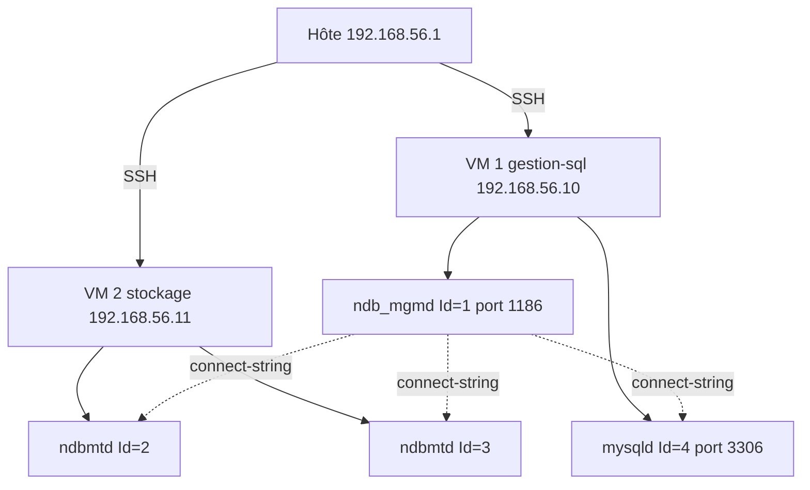

# Chapitre 1 — Introduction et installation de MySQL Cluster

## Objectif du chapitre

À la fin de ce chapitre, l'apprenant sait décrire l'architecture de MySQL Cluster (moteur NDB, nœuds de gestion, de stockage et SQL), installer et configurer les deux VM du laboratoire (réseau vboxnet0, adresses IP statiques, SSH), installer les composants MySQL Cluster sur chaque VM, démarrer les nœuds dans l'ordre critique (gestion, puis stockage, puis SQL) et vérifier l'intégrité du cluster avec la commande `ndb_mgm -e "SHOW"`.

## Avertissement et périmètre

- Cibles autorisées : VM 1 (192.168.56.10, hostname `gestion-sql`, nœud de gestion + nœud SQL) et VM 2 (192.168.56.11, hostname `stockage`, deux nœuds de stockage `ndbmtd`).
- Réseau : VirtualBox host-only `vboxnet0`, `192.168.56.0/24`, DHCP désactivé, pas d'accès Internet pendant les labs (adaptateur NAT temporaire uniquement pendant l'installation des paquets).
- Données : factices uniquement, marquées `LAB-ONLY`. Aucune donnée de production, aucune cible réelle.
- Snapshots : prise d'un snapshot propre sur chaque VM avant toute manipulation de configuration.
- Actions interdites : aucun mode pont, aucune redirection NAT permanente, aucun accès Internet depuis les VMs pendant les labs, aucune commande MySQL Cluster exécutée sur l'hôte.
- Hôte : 192.168.56.1, utilisé uniquement comme hyperviseur et pour le stockage des preuves.

## Durée estimée

- Durée totale : 6 heures (2 labs de 3 heures).
- Lab-01 : 3 heures (installation et configuration des deux VM).
- Lab-02 : 3 heures (installation de MySQL Cluster et vérification d'intégrité).

## Prérequis

| Élément | Détail | Vérification |
|---|---|---|
| Hôte | VirtualBox, réseau host-only vboxnet0 192.168.56.0/24 | `VBoxManage list hostonlyifs` liste vboxnet0 |
| ISO | `iso/ubuntu-24.04.5-autoinstall.iso` présent sur l'hôte | `ls -lh iso/` retourne le fichier |
| VM 1 | Ubuntu Server 24.04 LTS, 1 vCPU, 1 Go RAM, 15 Go disque, IP 192.168.56.10, hostname `gestion-sql` | `ping 192.168.56.10` depuis l'hôte |
| VM 2 | Ubuntu Server 24.04 LTS, 1 vCPU, 1 Go RAM, 15 Go disque, IP 192.168.56.11, hostname `stockage` | `ping 192.168.56.11` depuis l'hôte |
| SSH | Accès root depuis l'hôte sur les deux VM | `ssh root@192.168.56.10` et `ssh root@192.168.56.11` |
| Snapshot | `propre-apres-install` pris sur chaque VM avant le module | Snapshot listé dans VirtualBox |

## Vocabulaire

| Terme | Définition |
|---|---|
| Nœud de gestion (MGM) | Serveur qui distribue la configuration du cluster, processus `ndb_mgmd`, écoute sur le port 1186. |
| Nœud de stockage (NDB) | Serveur qui stocke les fragments de données en mémoire, processus `ndbmtd` ou `ndbd`. |
| Nœud SQL (API) | Instance MySQL `mysqld` avec le moteur NDB qui expose l'interface SQL sur le port 3306. |
| NDB | Moteur de stockage distribué et en mémoire de MySQL Cluster. |
| NoOfReplicas | Nombre de copies de chaque fragment de données pour la redondance (valeur 2 dans ce lab). |
| Node-group | Groupe de nœuds de stockage qui contiennent les mêmes copies de données. |
| Split-brain | Situation où le cluster est partitionné en deux groupes qui ne peuvent plus communiquer. |
| LAB-ONLY | Mot de passe ou identifiant factice, valide uniquement dans le lab isolé. |

## Introduction à MySQL Cluster — Architecture et composants (module 1.0)

MySQL Cluster est une solution de base de données distribuée qui repose sur le moteur de stockage NDB. Contrairement à une architecture client-serveur classique, les données sont fragmentées et répliquées sur plusieurs nœuds de stockage, tandis qu'un nœud de gestion centralise la configuration et qu'un ou plusieurs nœuds SQL exposent l'interface SQL aux applications.

Le schéma ci-dessous présente l'architecture du lab de ce chapitre.



**Fig 1.1** — Architecture du cluster de lab : un nœud de gestion et un nœud SQL sur VM 1, deux nœuds de stockage sur VM 2, accès par SSH depuis l'hôte.

Les trois types de nœuds jouent des rôles distincts :

- Le **nœud de gestion** (`ndb_mgmd`) lit le fichier `config.ini` qui décrit la topologie du cluster et la communique aux autres nœuds au démarrage. Il est le premier élément à démarrer.
- Les **nœuds de stockage** (`ndbmtd`) contiennent les données en mémoire et les répliquent selon le paramètre `NoOfReplicas`. Ils se déclarent au nœud de gestion au démarrage.
- Le **nœud SQL** (`mysqld`) active le moteur NDB et permet d'exécuter des requêtes SQL sur les données du cluster. Il se connecte au nœud de gestion pour découvrir la topologie.

L'ordre de démarrage est critique : le nœud de gestion doit être lancé avant les nœuds de stockage, qui doivent être lancés avant le nœud SQL. Cet ordre garantit que chaque nœud trouve le gestionnaire et rejoint le cluster sans erreur.

MySQL Cluster est adapté aux applications critiques car il offre une haute disponibilité et une tolérance aux pannes : avec `NoOfReplicas = 2`, la perte d'un nœud de stockage n'interrompt pas le service, la réplique restante continue de répondre.

## Cartographie de référence des opérations (NDB-nn)

Le tableau ci-dessous classe les opérations de ce chapitre selon le référentiel standard du parcours (skill `common`, section 4.2). Chaque opération cite sa source de données, sa règle de détection et sa mitigation.

| Opération | ID | Composant | Source de données | Règle de détection | Mitigation |
|---|---|---|---|---|---|
| Présentation des composants | NDB-01 | Architecture | Schéma Fig 1.1, `ndb_mgm SHOW` | Vérifier la présence des trois types de nœuds | Documenter l'architecture avant toute installation |
| Études de cas | NDB-02 | Usage critique | Documentation MySQL Cluster | Identifier les charges à haute disponibilité | Réserver MySQL Cluster aux cas critiques |
| Installation des composants | NDB-03 | Tous les nœuds | Sortie `apt-get`, commande `which` | Vérifier la présence de `ndb_mgm`, `ndb_mgmd`, `ndbmtd`, `mysqld` | Installer depuis le dépôt officiel MySQL |
| Configuration initiale | NDB-04 | Nœud de gestion | Fichier `config.ini` | Vérifier que `ndb_mgmd` démarre sans erreur | Sauvegarder `config.ini` avant toute modification |
| Dimensionnement résilience | NDB-08 | Stockage | `config.ini`, `ndb_mgm SHOW` | Vérifier `NoOfReplicas = 2` et deux node-group | Définir `NoOfReplicas = 2` avant le premier démarrage |
| Vérification d'intégrité | NDB-05 | Cluster entier | `ndb_mgm -e "SHOW"` | Alerte si un nœud apparaît `not connected` | Redémarrer dans l'ordre : gestion, stockage, SQL |

## Plan d'installation maître

Le plan ci-dessous ordonne tous les labs du chapitre. Aucune action de configuration ne précède ce plan.

| Ordre | Lab | Objectif | Cible | Tactique | Opérations de référence | Preuve attendue |
|---|---|---|---|---|---|---|
| 1 | Lab-01 | Installer et configurer les deux VM (réseau, IP, SSH, snapshot) | VM 1 + VM 2 | VirtualBox, Ubuntu, netplan, SSH | — (infrastructure) | `ping` OK depuis l'hôte, snapshots pris |
| 2 | Lab-02 | Installer MySQL Cluster, démarrer dans l'ordre, vérifier l'intégrité | VM 1 + VM 2 | Dépôt MySQL, `config.ini`, démarrage MGM → stockage → SQL | NDB-03, NDB-04, NDB-08, NDB-05 | `SHOW` avec 4 nœuds connectés |

## Vérification préalable

Avant le premier lab de configuration, l'hôte doit pouvoir joindre les deux VM et ouvrir une session SSH sur chacune.

| Contrôle | Méthode | Résultat attendu | Preuve |
|---|---|---|---|
| Connectivité VM 1 | `ping -c 4 192.168.56.10` depuis l'hôte | 4 réponses, 0 % de perte | `preuves/ch1-lab1/ping-vm1.txt` |
| Connectivité VM 2 | `ping -c 4 192.168.56.11` depuis l'hôte | 4 réponses, 0 % de perte | `preuves/ch1-lab1/ping-vm2.txt` |
| Accès SSH VM 1 | `ssh root@192.168.56.10 "hostname"` | Retourne `gestion-sql` | `preuves/ch1-lab1/ssh-vm1.txt` |
| Accès SSH VM 2 | `ssh root@192.168.56.11 "hostname"` | Retourne `stockage` | `preuves/ch1-lab1/ssh-vm2.txt` |

Ces contrôles sont exécutés et prouvés à l'étape 10 du Lab-01.

## Lab-01 — Installation et configuration des deux VM

### Énoncé / Contexte

Installer Ubuntu Server 24.04 LTS sur deux machines virtuelles VirtualBox, configurer le réseau host-only `vboxnet0` avec des adresses IP statiques, activer le service SSH, prendre des snapshots propres et vérifier la connectivité depuis l'hôte. Cette infrastructure constitue la base de l'installation de MySQL Cluster réalisée au Lab-02. Ce lab ne contient aucune commande MySQL Cluster ; il prépare uniquement les cibles autorisées.

### Outils et commandes utilisées

| Outil | Commande | Rôle |
|---|---|---|
| VirtualBox | `VBoxManage createvm`, `VBoxManage modifyvm` | Création et configuration des VM |
| Ubuntu Server ISO | `ubuntu-24.04.5-autoinstall.iso` | Installation du système d'exploitation |
| netplan | `netplan apply` | Configuration IP statique sur vboxnet0 |
| openssh-server | `apt-get install -y openssh-server` | Accès distant SSH sur les VM |
| VBoxManage | `VBoxManage snapshot ... take` | Snapshot propre avant manipulation |
| ping | `ping -c 4 192.168.56.10` | Test de connectivité ICMP depuis l'hôte |
| ssh | `ssh root@192.168.56.10 "hostname"` | Vérification de l'accès distant |

### Commande et laboratoire étape par étape

#### Étape 1 — Créer la VM 1 (gestion-sql) sur l'hôte

**But** — Créer la machine virtuelle VM 1 avec 1 vCPU, 1 Go de RAM, 15 Go de disque et deux adaptateurs réseau (NAT pour l'installation, host-only vboxnet0 pour le lab).

**Machine** — Hôte (192.168.56.1), création de la VM 1 nommée `gestion-sql`.

**Prérequis** — VirtualBox installé sur l'hôte, réseau host-only vboxnet0 présent, ISO Ubuntu Server 24.04 dans le dossier `iso/`.

> **Machine** : Hôte (192.168.56.1) | **Terminal** : terminal hôte | **Utilisateur** : `yug` | **Répertoire** : `/home/yug/Documents/mysql`

**Exemple de commande**

```bash
VBoxManage createvm --name gestion-sql --register --basefolder "/home/yug/VirtualBox VMs"
VBoxManage modifyvm gestion-sql --cpus 1 --memory 1024 --vram 16
VBoxManage createhd --filename "/home/yug/VirtualBox VMs/gestion-sql/gestion-sql.vdi" --size 15360
VBoxManage storagectl gestion-sql --name "IDE" --add ide
VBoxManage storageattach gestion-sql --storagectl "IDE" --port 0 --device 0 --type hdd --medium "/home/yug/VirtualBox VMs/gestion-sql/gestion-sql.vdi"
VBoxManage storageattach gestion-sql --storagectl "IDE" --port 1 --device 0 --type dvddrive --medium "/home/yug/iso/ubuntu-24.04.5-autoinstall.iso"
VBoxManage modifyvm gestion-sql --nic1 nat --nic2 hostonly --hostonlyadapter2 vboxnet0
```

**Explication de la commande**

- `VBoxManage createvm` : enregistre la VM nommée `gestion-sql` dans VirtualBox.
- `--cpus 1 --memory 1024` : alloue 1 processeur virtuel et 1 Go de RAM, conformément au dimensionnement du syllabus.
- `VBoxManage createhd` : crée le disque virtuel de 15 Go.
- `VBoxManage storageattach ... --type hdd` : attache le disque dur à la VM.
- `VBoxManage storageattach ... --type dvddrive` : attache l'ISO d'installation Ubuntu au lecteur virtuel.
- `--nic1 nat --nic2 hostonly --hostonlyadapter2 vboxnet0` : configure le premier adaptateur en NAT (accès Internet temporaire pendant l'installation) et le second en host-only sur vboxnet0 (réseau isolé du lab).
- **Piège** : les chemins contenant des espaces doivent être entourés de guillemets doubles.

**Résultat attendu**

```text
# Aucune sortie à l'écran en cas de succès.
# La VM gestion-sql apparaît dans le gestionnaire de VirtualBox, éteinte.
```

**Preuve** : `preuves/ch1-lab1/vbox-vm1.txt`, avec `# date:`, `# cmd:`, `# rc=`.

#### Étape 2 — Installer Ubuntu Server 24.04 sur la VM 1

**But** — Démarrer la VM 1 sur l'ISO et installer Ubuntu Server 24.04 LTS avec un utilisateur administrateur et un mot de passe factice `LAB-ONLY`.

**Machine** — VM 1 (future 192.168.56.10), démarrée depuis l'ISO.

**Prérequis** — VM 1 créée, ISO attaché, adaptateur NAT actif pour permettre l'installation des paquets pendant l'installation Ubuntu.

> **Machine** : VM 1 en cours d'installation | **Terminal** : console VirtualBox de VM 1 | **Utilisateur** : installateur Ubuntu | **Répertoire** : —

**Exemple de commande**

```bash
VBoxManage startvm gestion-sql --type gui
```

**Explication de la commande**

- `VBoxManage startvm` : allume la machine virtuelle `gestion-sql`.
- `--type gui` : affiche la console graphique pour suivre l'installation dans l'installeur Ubuntu.
- **Piège** : l'installation se déroule dans l'installeur graphique d'Ubuntu, non par commandes shell ; choisir l'installation minimale, créer un utilisateur avec mot de passe `LAB-ONLY`, et utiliser la totalité du disque.

**Résultat attendu**

```text
# L'installeur Ubuntu Server s'affiche à l'écran de la VM.
# À la fin, l'invite de connexion (login) apparaît.
```

**Preuve** : `preuves/ch1-lab1/ubuntu-install-vm1.txt`, avec `# date:`, `# cmd:`, `# rc=`.

#### Étape 3 — Configurer l'adresse IP statique 192.168.56.10 sur la VM 1

**But** — Passer l'interface host-only de la VM 1 en adresse IP statique `192.168.56.10/24` avec netplan.

**Machine** — VM 1 (192.168.56.10), configuration réseau.

**Prérequis** — Ubuntu installé, accès root, nom de l'interface host-only connu.

> **Machine** : 192.168.56.10 | **Terminal** : SSH depuis l'hôte (ou console VM) | **Utilisateur** : `root` | **Répertoire** : `/etc/netplan`

**Exemple de commande**

```bash
ip -br link show
cat > /etc/netplan/01-hostonly.yaml << 'EOF'
network:
  version: 2
  ethernets:
    enp0s8:
      dhcp4: no
      addresses:
        - 192.168.56.10/24
      routes:
        - to: default
          via: 192.168.56.1
      nameservers:
        addresses: [192.168.56.1]
EOF
netplan apply
ip -br addr show enp0s8
```

**Explication de la commande**

- `ip -br link show` : liste les interfaces réseau pour identifier le nom de l'interface host-only (souvent `enp0s8`, à adapter selon le retour).
- `cat > ... << 'EOF'` : écrit le fichier de configuration netplan qui définit l'adresse statique.
- `enp0s8` : nom de l'interface host-only à remplacer par le nom réel relevé précédemment.
- `addresses: - 192.168.56.10/24` : assigne l'adresse IP statique et le masque du sous-réseau.
- `routes: - to: default via: 192.168.56.1` : définit la passerelle par défaut sur l'hôte.
- `nameservers: addresses: [192.168.56.1]` : configure le DNS sur l'hôte pendant la phase d'installation (à retirer pour les labs isolés).
- `netplan apply` : active la configuration réseau sans redémarrer.
- `ip -br addr show enp0s8` : vérifie que l'adresse `192.168.56.10/24` est bien affectée.
- **Piège** : si le nom d'interface n'est pas `enp0s8`, remplacer toutes les occurrences dans le fichier netplan.

**Résultat attendu**

```text
enp0s8             UNKNOWN        192.168.56.10/24
```

**Preuve** : `preuves/ch1-lab1/netplan-vm1.txt`, avec `# date:`, `# cmd:`, `# rc=`.

#### Étape 4 — Activer le service SSH sur la VM 1

**But** — Installer et démarrer le serveur SSH pour permettre l'accès distant depuis l'hôte.

**Machine** — VM 1 (192.168.56.10).

**Prérequis** — IP statique configurée, accès root, adaptateur NAT encore disponible pour récupérer les paquets.

> **Machine** : 192.168.56.10 | **Terminal** : SSH depuis l'hôte | **Utilisateur** : `root` | **Répertoire** : `/root`

**Exemple de commande**

```bash
apt-get update
apt-get install -y openssh-server
systemctl enable --now ssh
```

**Explication de la commande**

- `apt-get update` : rafraîchit la liste des paquets depuis les dépôts (nécessite Internet via NAT).
- `apt-get install -y openssh-server` : installe le serveur SSH ; `-y` répond automatiquement oui aux confirmations.
- `systemctl enable --now ssh` : active le service SSH au démarrage et le lance immédiatement.
- **Piège** : si le pare-feu de la VM bloque le port 22, la connexion SSH depuis l'hôte échouera ; dans ce lab, le pare-feu reste désactivé ou autorise le réseau vboxnet0.

**Résultat attendu**

```text
# L'installation de openssh-server se termine par :
# Paramétrage de openssh-server (…)
# Le service ssh est activé et démarré.
```

**Preuve** : `preuves/ch1-lab1/ssh-vm1.txt`, avec `# date:`, `# cmd:`, `# rc=`.

#### Étape 5 — Créer la VM 2 (stockage) sur l'hôte

**But** — Créer la machine virtuelle VM 2 nommée `stockage` avec 1 vCPU, 1 Go de RAM, 15 Go de disque et les mêmes deux adaptateurs réseau (NAT + host-only vboxnet0).

**Machine** — Hôte (192.168.56.1), création de la VM 2 nommée `stockage`.

**Prérequis** — VM 1 créée et configurée, ISO Ubuntu disponible, réseau vboxnet0 opérationnel.

> **Machine** : Hôte (192.168.56.1) | **Terminal** : terminal hôte | **Utilisateur** : `yug` | **Répertoire** : `/home/yug/Documents/mysql`

**Exemple de commande**

```bash
VBoxManage createvm --name stockage --register --basefolder "/home/yug/VirtualBox VMs"
VBoxManage modifyvm stockage --cpus 1 --memory 1024 --vram 16
VBoxManage createhd --filename "/home/yug/VirtualBox VMs/stockage/stockage.vdi" --size 15360
VBoxManage storagectl stockage --name "IDE" --add ide
VBoxManage storageattach stockage --storagectl "IDE" --port 0 --device 0 --type hdd --medium "/home/yug/VirtualBox VMs/stockage/stockage.vdi"
VBoxManage storageattach stockage --storagectl "IDE" --port 1 --device 0 --type dvddrive --medium "/home/yug/iso/ubuntu-24.04.5-autoinstall.iso"
VBoxManage modifyvm stockage --nic1 nat --nic2 hostonly --hostonlyadapter2 vboxnet0
```

**Explication de la commande**

- Même logique que l'Étape 1 pour la VM 1, avec le nom `stockage`.
- Le deuxième adaptateur est placé sur le même réseau host-only `vboxnet0` pour que les deux VM puissent communiquer entre elles et avec l'hôte.
- **Piège** : chaque nom de VM doit être unique dans VirtualBox.

**Résultat attendu**

```text
# Aucune sortie à l'écran en cas de succès.
# La VM stockage apparaît dans le gestionnaire de VirtualBox, éteinte.
```

**Preuve** : `preuves/ch1-lab1/vbox-vm2.txt`, avec `# date:`, `# cmd:`, `# rc=`.

#### Étape 6 — Installer Ubuntu Server 24.04 sur la VM 2

**But** — Démarrer la VM 2 sur l'ISO et installer Ubuntu Server 24.04 LTS.

**Machine** — VM 2 (future 192.168.56.11), démarrée depuis l'ISO.

**Prérequis** — VM 2 créée, ISO attaché, adaptateur NAT actif.

> **Machine** : VM 2 en cours d'installation | **Terminal** : console VirtualBox de VM 2 | **Utilisateur** : installateur Ubuntu | **Répertoire** : —

**Exemple de commande**

```bash
VBoxManage startvm stockage --type gui
```

**Explication de la commande**

- `VBoxManage startvm` : allume la machine virtuelle `stockage`.
- `--type gui` : affiche la console graphique pour suivre l'installation Ubuntu.
- **Piège** : même procédure que l'Étape 2, installation minimale et mot de passe `LAB-ONLY`.

**Résultat attendu**

```text
# L'installeur Ubuntu Server s'affiche à l'écran de la VM.
# À la fin, l'invite de connexion (login) apparaît.
```

**Preuve** : `preuves/ch1-lab1/ubuntu-install-vm2.txt`, avec `# date:`, `# cmd:`, `# rc=`.

#### Étape 7 — Configurer l'adresse IP statique 192.168.56.11 sur la VM 2

**But** — Passer l'interface host-only de la VM 2 en adresse IP statique `192.168.56.11/24` avec netplan.

**Machine** — VM 2 (192.168.56.11), configuration réseau.

**Prérequis** — Ubuntu installé sur VM 2, accès root, nom de l'interface host-only connu.

> **Machine** : 192.168.56.11 | **Terminal** : SSH depuis l'hôte | **Utilisateur** : `root` | **Répertoire** : `/etc/netplan`

**Exemple de commande**

```bash
ip -br link show
cat > /etc/netplan/01-hostonly.yaml << 'EOF'
network:
  version: 2
  ethernets:
    enp0s8:
      dhcp4: no
      addresses:
        - 192.168.56.11/24
      routes:
        - to: default
          via: 192.168.56.1
      nameservers:
        addresses: [192.168.56.1]
EOF
netplan apply
ip -br addr show enp0s8
```

**Explication de la commande**

- Identique à l'Étape 3, avec l'adresse `192.168.56.11/24` pour la VM 2.
- `ip -br link show` identifie l'interface host-only (souvent `enp0s8`, à adapter).
- `netplan apply` active l'adresse IP statique.
- `ip -br addr show enp0s8` confirme l'affectation de `192.168.56.11/24`.
- **Piège** : adapter le nom d'interface `enp0s8` si nécessaire.

**Résultat attendu**

```text
enp0s8             UNKNOWN        192.168.56.11/24
```

**Preuve** : `preuves/ch1-lab1/netplan-vm2.txt`, avec `# date:`, `# cmd:`, `# rc=`.

#### Étape 8 — Activer le service SSH sur la VM 2

**But** — Installer et démarrer le serveur SSH sur la VM 2 pour l'accès distant.

**Machine** — VM 2 (192.168.56.11).

**Prérequis** — IP statique configurée, accès root, adaptateur NAT disponible.

> **Machine** : 192.168.56.11 | **Terminal** : SSH depuis l'hôte | **Utilisateur** : `root` | **Répertoire** : `/root`

**Exemple de commande**

```bash
apt-get update
apt-get install -y openssh-server
systemctl enable --now ssh
```

**Explication de la commande**

- `apt-get update` : rafraîchit les dépôts (Internet via NAT temporaire).
- `apt-get install -y openssh-server` : installe le serveur SSH.
- `systemctl enable --now ssh` : active et démarre le service SSH.
- **Piège** : vérifier que le port 22 est joignable depuis l'hôte après l'installation.

**Résultat attendu**

```text
# Le service ssh est activé et démarré sur la VM 2.
```

**Preuve** : `preuves/ch1-lab1/ssh-vm2.txt`, avec `# date:`, `# cmd:`, `# rc=`.

#### Étape 9 — Prendre des snapshots propres des deux VM

**But** — Créer un snapshot nommé `propre-apres-install` sur chaque VM pour permettre un retour à l'état initial après chaque manipulation.

**Machine** — Hôte (192.168.56.1), snapshot des VM 1 et VM 2.

**Prérequis** — Les deux VM sont installées, configurées (IP, SSH) et arrêtées ou en cours d'exécution.

> **Machine** : Hôte (192.168.56.1) | **Terminal** : terminal hôte | **Utilisateur** : `yug` | **Répertoire** : `/home/yug/Documents/mysql`

**Exemple de commande**

```bash
VBoxManage snapshot gestion-sql take propre-apres-install --description "Etat propre après installation Ubuntu et configuration réseau"
VBoxManage snapshot stockage take propre-apres-install --description "Etat propre après installation Ubuntu et configuration réseau"
VBoxManage snapshot gestion-sql list
VBoxManage snapshot stockage list
```

**Explication de la commande**

- `VBoxManage snapshot ... take` : crée un snapshot de l'état courant de la VM.
- `--description` : ajoute un libellé pour identifier le snapshot ultérieurement.
- `VBoxManage snapshot ... list` : affiche la liste des snapshots pour confirmer leur création.
- **Piège** : prendre le snapshot avant toute modification de MySQL Cluster ; le restaurer en cas d'erreur pendant le lab.

**Résultat attendu**

```text
# Liste des snapshots :
# Name: propre-apres-install (UUID: …)
```

**Preuve** : `preuves/ch1-lab1/snapshot-vm1.txt` et `preuves/ch1-lab1/snapshot-vm2.txt`, avec `# date:`, `# cmd:`, `# rc=`.

#### Étape 10 — Tester la connectivité depuis l'hôte

**But** — Vérifier depuis l'hôte que les deux VM sont joignables et accessibles en SSH, conformément aux contrôles de vérification préalable.

**Machine** — Hôte (192.168.56.1) vers VM 1 (192.168.56.10) et VM 2 (192.168.56.11).

**Prérequis** — Les deux VM démarrées, SSH actif, adaptateur host-only vboxnet0 opérationnel.

> **Machine** : Hôte (192.168.56.1) | **Terminal** : terminal hôte | **Utilisateur** : `yug` | **Répertoire** : `/home/yug/Documents/mysql`

**Exemple de commande**

```bash
ping -c 4 192.168.56.10 | tee preuves/ch1-lab1/ping-vm1.txt 2>&1
ping -c 4 192.168.56.11 | tee preuves/ch1-lab1/ping-vm2.txt 2>&1
ssh root@192.168.56.10 "hostname" | tee preuves/ch1-lab1/ssh-vm1.txt 2>&1
ssh root@192.168.56.11 "hostname" | tee preuves/ch1-lab1/ssh-vm2.txt 2>&1
```

**Explication de la commande**

- `ping -c 4` : envoie 4 requêtes ICMP et s'arrête ; vérifie la joignabilité de chaque VM.
- `| tee preuves/...` : affiche la sortie à l'écran et l'enregistre simultanément dans le fichier de preuve.
- `2>&1` : redirige les erreurs vers la sortie standard pour qu'elles soient aussi capturées.
- `ssh root@192.168.56.10 "hostname"` : ouvre une session SSH sur la VM 1 et exécute `hostname` pour confirmer l'identité de la machine.
- **Piège** : si `ping` ou `ssh` échouent, vérifier les adresses IP, le démarrage des VM et le service SSH avant de passer au Lab-02.

**Résultat attendu**

```text
--- 192.168.56.10 ping statistics ---
4 packets transmitted, 4 received, 0% packet loss, time 3004ms
gestion-sql
stockage
```

**Preuve** : `preuves/ch1-lab1/ping-vm1.txt`, `preuves/ch1-lab1/ping-vm2.txt`, `preuves/ch1-lab1/ssh-vm1.txt`, `preuves/ch1-lab1/ssh-vm2.txt`, avec `# date:`, `# cmd:`, `# rc=`.

### En conclusion

Les deux VM du laboratoire sont installées et configurées : Ubuntu Server 24.04 LTS, adresses IP statiques `192.168.56.10` (gestion-sql) et `192.168.56.11` (stockage), service SSH actif, snapshots propres pris, connectivité vérifiée depuis l'hôte. Cette infrastructure est prête pour l'installation de MySQL Cluster au Lab-02. Critères de réussite : `ping` et `ssh` fonctionnent depuis l'hôte vers les deux VM, les snapshots `propre-apres-install` existent. Renvoi : passer au Lab-02 pour installer les composants MySQL Cluster.

## Lab-02 — Installation de MySQL Cluster sur les deux VM

### Énoncé / Contexte

Installer les composants MySQL Cluster sur les deux VM configurées au Lab-01 : le nœud de gestion et le nœud SQL sur VM 1, les deux nœuds de stockage `ndbmtd` sur VM 2. Rédiger le fichier `config.ini` du nœud de gestion, démarrer les nœuds dans l'ordre critique (gestion, puis stockage, puis SQL) et vérifier l'intégrité du cluster avec `ndb_mgm -e "SHOW"`. Ce lab réalise les opérations `NDB-03` (installation), `NDB-04` (configuration initiale), `NDB-08` (dimensionnement résilience) et `NDB-05` (vérification d'intégrité) du parcours.

### Outils et commandes utilisées

| Outil | Commande | Rôle |
|---|---|---|
| apt / dépôt MySQL | `apt-get install -y` | Installation des paquets MySQL Cluster |
| ndb_mgmd | `ndb_mgmd --config-file=...` | Nœud de gestion du cluster |
| ndbmtd | `ndbmtd --ndb-connectstring=...` | Nœuds de stockage du cluster |
| mysqld | `mysqld --ndbcluster ...` | Nœud SQL du cluster |
| ndb_mgm | `ndb_mgm -e "SHOW"` | Vérification de l'état du cluster |
| ndb_config | `ndb_config --query-all` | Interrogation de la configuration effective |

### Commande et laboratoire étape par étape

#### Étape 1 — Préparer le répertoire de configuration du cluster sur VM 1

**But** — Créer le répertoire qui contiendra le fichier `config.ini` et les fichiers d'état du nœud de gestion.

**Machine** — VM 1 (192.168.56.10), nœud de gestion + SQL.

**Prérequis** — VM 1 démarrée, SSH accessible depuis l'hôte, utilisateur root.

> **Machine** : 192.168.56.10 | **Terminal** : SSH depuis l'hôte | **Utilisateur** : `root` | **Répertoire** : `/var/lib/mysql-cluster`

**Exemple de commande**

```bash
mkdir -p /var/lib/mysql-cluster
ls -ld /var/lib/mysql-cluster
```

**Explication de la commande**

- `mkdir -p /var/lib/mysql-cluster` : crée le répertoire de données du nœud de gestion, le répertoire parent s'il n'existe pas.
- `ls -ld /var/lib/mysql-cluster` : affiche les droits et le propriétaire du répertoire créé pour vérifier sa présence.
- **Piège** : ce répertoire doit exister avant le démarrage de `ndb_mgmd`, sinon le gestionnaire refuse de se lancer.

**Résultat attendu**

```text
drwxr-xr-x 2 root root 4096 … /var/lib/mysql-cluster
```

**Preuve** : `preuves/ch1-lab2/repertoire-cluster.txt`, avec `# date:`, `# cmd:`, `# rc=`.

#### Étape 2 — Installer les composants MySQL Cluster sur VM 1

**But** — Installer sur VM 1 le nœud de gestion (`ndb_mgmd`) et le nœud SQL (`mysqld` avec moteur NDB).

**Machine** — VM 1 (192.168.56.10).

**Prérequis** — Accès Internet temporaire via adaptateur NAT pour récupérer les paquets depuis le dépôt MySQL, droits root.

> **Machine** : 192.168.56.10 | **Terminal** : SSH depuis l'hôte | **Utilisateur** : `root` | **Répertoire** : `/root`

**Exemple de commande**

```bash
apt-get update
apt-get install -y mysql-cluster-community-management-server mysql-cluster-community-server
which ndb_mgmd mysqld
```

**Explication de la commande**

- `apt-get update` : rafraîchit la liste des paquets depuis le dépôt MySQL configuré.
- `apt-get install -y mysql-cluster-community-management-server` : installe le binaire `ndb_mgmd` (nœud de gestion).
- `apt-get install -y mysql-cluster-community-server` : installe `mysqld` avec le moteur NDB (nœud SQL).
- `which ndb_mgmd mysqld` : affiche le chemin des binaires installés pour confirmer leur présence.
- **Piège** : si le dépôt MySQL n'est pas configuré, l'installation échoue ; configurer le dépôt MySQL APT avant cette étape.

**Résultat attendu**

```text
/usr/sbin/ndb_mgmd
/usr/sbin/mysqld
```

**Preuve** : `preuves/ch1-lab2/apt-install-vm1.txt`, avec `# date:`, `# cmd:`, `# rc=`.

#### Étape 3 — Installer les composants de stockage sur VM 2

**But** — Installer sur VM 2 le composant de stockage `ndbmtd` pour les deux nœuds de stockage.

**Machine** — VM 2 (192.168.56.11).

**Prérequis** — Accès Internet temporaire via adaptateur NAT, droits root, VM 2 joignable en SSH.

> **Machine** : 192.168.56.11 | **Terminal** : SSH depuis l'hôte | **Utilisateur** : `root` | **Répertoire** : `/root`

**Exemple de commande**

```bash
apt-get update
apt-get install -y mysql-cluster-community-data-node
which ndbmtd
```

**Explication de la commande**

- `apt-get install -y mysql-cluster-community-data-node` : installe le binaire `ndbmtd` (nœud de stockage multi-threadé).
- `which ndbmtd` : confirme la présence du binaire de stockage sur VM 2.
- **Piège** : les deux nœuds de stockage partagent le même binaire `ndbmtd` ; ils se distinguent par leur `Id` dans le fichier `config.ini`.

**Résultat attendu**

```text
/usr/sbin/ndbmtd
```

**Preuve** : `preuves/ch1-lab2/apt-install-vm2.txt`, avec `# date:`, `# cmd:`, `# rc=`.

#### Étape 4 — Créer le fichier de configuration config.ini du nœud de gestion

**But** — Rédiger le fichier `config.ini` qui définit la topologie du cluster : 1 nœud de gestion, 2 nœuds de stockage sur VM 2, 1 nœud SQL sur VM 1, avec `NoOfReplicas = 2` pour la redondance.

**Machine** — VM 1 (192.168.56.10), nœud de gestion.

**Prérequis** — Répertoire `/var/lib/mysql-cluster` créé, binaire `ndb_mgmd` installé.

> **Machine** : 192.168.56.10 | **Terminal** : SSH depuis l'hôte | **Utilisateur** : `root` | **Répertoire** : `/var/lib/mysql-cluster`

**Exemple de commande**

```bash
cat > /var/lib/mysql-cluster/config.ini << 'EOF'
[ndb_mgmd default]
DataDir = /var/lib/mysql-cluster

[ndbd default]
NoOfReplicas = 2
DataMemory = 256M
IndexMemory = 128M

[tcp default]

[ndb_mgmd]
Id = 1
HostName = 192.168.56.10
DataDir = /var/lib/mysql-cluster

[ndbd]
Id = 2
HostName = 192.168.56.11
DataDir = /var/lib/mysql-cluster/ndb_2

[ndbd]
Id = 3
HostName = 192.168.56.11
DataDir = /var/lib/mysql-cluster/ndb_3

[mysqld]
Id = 4
HostName = 192.168.56.10
EOF
cat /var/lib/mysql-cluster/config.ini
```

**Explication de la commande**

- `cat > ... << 'EOF'` : écrit le fichier `config.ini` jusqu'au marqueur `EOF`.
- `[ndb_mgmd]` `Id = 1` : définit le nœud de gestion avec l'identifiant unique 1 sur `192.168.56.10`.
- `[ndbd]` `Id = 2` et `Id = 3` : définissent les deux nœuds de stockage, tous deux sur `192.168.56.11` (collocation sur la même VM), avec des identifiants uniques 2 et 3.
- `[mysqld]` `Id = 4` : définit le nœud SQL sur `192.168.56.10`.
- `NoOfReplicas = 2` : chaque fragment de données existe en deux exemplaires pour tolérer la perte d'un nœud de stockage.
- `DataDir` par node : répertoires distincts `/var/lib/mysql-cluster/ndb_2` et `/var/lib/mysql-cluster/ndb_3` pour éviter toute collision entre les deux nœuds de stockage sur VM 2 ; ces répertoires sont créés sur VM 2 à l'étape suivante.
- `cat /var/lib/mysql-cluster/config.ini` : affiche le fichier pour en vérifier le contenu avant le démarrage.
- **Piège** : les `Id` doivent être uniques dans tout le cluster ; deux nœuds ne peuvent pas partager le même identifiant.

**Résultat attendu**

```text
[ndb_mgmd]
Id = 1
HostName = 192.168.56.10
DataDir = /var/lib/mysql-cluster
[ndbd]
Id = 2
HostName = 192.168.56.11
DataDir = /var/lib/mysql-cluster/ndb_2
[ndbd]
Id = 3
HostName = 192.168.56.11
DataDir = /var/lib/mysql-cluster/ndb_3
[mysqld]
Id = 4
HostName = 192.168.56.10
```

**Preuve** : `preuves/ch1-lab2/config-ini.txt`, avec `# date:`, `# cmd:`, `# rc=`.

#### Étape 5 — Démarrer le nœud de gestion ndb_mgmd sur VM 1

**But** — Lancer le nœud de gestion `ndb_mgmd` qui centralise la configuration du cluster et accepte les connexions des autres nœuds.

**Machine** — VM 1 (192.168.56.10), nœud de gestion.

**Prérequis** — `config.ini` présent et valide, port 1186 libre, aucun autre `ndb_mgmd` en cours.

> **Machine** : 192.168.56.10 | **Terminal** : SSH depuis l'hôte | **Utilisateur** : `root` | **Répertoire** : `/var/lib/mysql-cluster`

**Exemple de commande**

```bash
ndb_mgmd --config-file=/var/lib/mysql-cluster/config.ini --initial &
```

**Explication de la commande**

- `ndb_mgmd` : démon du nœud de gestion de MySQL Cluster.
- `--config-file=/var/lib/mysql-cluster/config.ini` : indique le fichier de topologie à charger au démarrage.
- `--initial` : force l'initialisation propre du nœud de gestion ; à n'utiliser qu'au premier démarrage ou après un snapshot propre.
- `&` : lance le processus en arrière-plan pour libérer le terminal.
- **Piège** : `--initial` supprime les fichiers de configuration précédents du gestionnaire ; ne pas l'utiliser sur un cluster déjà en production avec des données.

**Résultat attendu**

```text
MySQL Cluster Management Server 8.0
…
NDBT_ProgramExit: 0
```

**Preuve** : `preuves/ch1-lab2/ndb-mgmd-start.txt`, avec `# date:`, `# cmd:`, `# rc=`.

#### Étape 6 — Démarrer les deux nœuds de stockage ndbmtd sur VM 2

**But** — Lancer les deux processus `ndbmtd` (identifiants 2 et 3) sur VM 2, qui rejoignent le nœud de gestion et initialisent leur stockage.

**Machine** — VM 2 (192.168.56.11), nœuds de stockage 1 et 2.

**Prérequis** — Nœud de gestion démarré sur `192.168.56.10`, répertoires de données créés, binaire `ndbmtd` installé.

> **Machine** : 192.168.56.11 | **Terminal** : SSH depuis l'hôte | **Utilisateur** : `root` | **Répertoire** : `/var/lib/mysql-cluster`

**Exemple de commande**

```bash
mkdir -p /var/lib/mysql-cluster/ndb_2 /var/lib/mysql-cluster/ndb_3
(cd /var/lib/mysql-cluster/ndb_2 && ndbmtd --ndb-connectstring=192.168.56.10 --initial &)
(cd /var/lib/mysql-cluster/ndb_3 && ndbmtd --ndb-connectstring=192.168.56.10 --initial &)
```

**Explication de la commande**

- `mkdir -p …/ndb_2 …/ndb_3` : crée les répertoires de données distincts pour chacun des deux nœuds de stockage sur VM 2.
- `(cd … && ndbmtd … &)` : se place dans le répertoire dédié puis lance `ndbmtd` en arrière-plan dans un sous-shell, isolant l'environnement de chaque node.
- `ndbmtd` : démon multi-threadé de stockage NDB.
- `--ndb-connectstring=192.168.56.10` : indique l'adresse du nœud de gestion pour rejoindre le cluster.
- `--initial` : initialise proprement le stockage de chaque node au premier démarrage.
- **Piège** : si le nœud de gestion n'est pas joignable, `ndbmtd` échoue au démarrage ; vérifier d'abord que `ndb_mgmd` écoute sur le port 1186 de `192.168.56.10`.

**Résultat attendu**

```text
NDBT_ProgramExit: 0
```

**Preuve** : `preuves/ch1-lab2/ndbmtd-start.txt`, avec `# date:`, `# cmd:`, `# rc=`.

#### Étape 7 — Initialiser et démarrer le nœud SQL mysqld sur VM 1

**But** — Initialiser la datadir MySQL si nécessaire et lancer `mysqld` avec le moteur NDB pour exposer l'interface SQL du cluster.

**Machine** — VM 1 (192.168.56.10), nœud SQL.

**Prérequis** — Nœuds de gestion et de stockage démarrés, binaire `mysqld` installé, port 3306 libre.

> **Machine** : 192.168.56.10 | **Terminal** : SSH depuis l'hôte | **Utilisateur** : `root` | **Répertoire** : `/var/lib/mysql`

**Exemple de commande**

```bash
mysqld --initialize-insecure --user=mysql 2>/dev/null || true
mysqld --ndbcluster --ndb-connectstring=192.168.56.10 &
```

**Explication de la commande**

- `mysqld --initialize-insecure --user=mysql` : initialise la datadir MySQL sans mot de passe root (factice `LAB-ONLY`, uniquement pour le lab) ; `|| true` évite l'arrêt si la datadir est déjà initialisée.
- `2>/dev/null` : masque les messages d'initialisation non pertinents pour ce lab.
- `mysqld --ndbcluster` : active le moteur de stockage NDB sur cette instance SQL.
- `--ndb-connectstring=192.168.56.10` : indique le nœud de gestion pour la découverte du cluster.
- `&` : lance `mysqld` en arrière-plan.
- **Piège** : si un autre `mysqld` utilise déjà le port 3306, le démarrage échoue ; stopper l'instance existante avant.

**Résultat attendu**

```text
# mysqld démarre et accepte les connexions sur le port 3306.
# Aucune erreur NDB dans le journal d'erreur.
```

**Preuve** : `preuves/ch1-lab2/mysqld-start.txt`, avec `# date:`, `# cmd:`, `# rc=`.

#### Étape 8 — Vérifier l'intégrité du cluster avec ndb_mgm -e "SHOW"

**But** — Confirmer que le nœud de gestion, les deux nœuds de stockage et le nœud SQL sont connectés au cluster et que l'installation est intégrale.

**Machine** — VM 1 (192.168.56.10), nœud de gestion + SQL.

**Prérequis** — Tous les nœuds démarrés (étapes 5 à 7), `ndb_mgm` installé.

> **Machine** : 192.168.56.10 | **Terminal** : SSH depuis l'hôte | **Utilisateur** : `root` | **Répertoire** : `/root`

**Exemple de commande**

```bash
ndb_mgm -e "SHOW" | tee preuves/ch1-lab2/ndb-show.txt 2>&1
```

**Explication de la commande**

- `ndb_mgm` : client de gestion du cluster MySQL, se connecte au nœud de gestion par défaut sur `127.0.0.1:1186` ou à l'hôte configuré.
- `-e "SHOW"` : exécute la commande `SHOW` qui liste tous les nœuds du cluster et leur état, puis quitte.
- `| tee preuves/ch1-lab2/ndb-show.txt` : affiche la sortie à l'écran et l'enregistre simultanément dans le fichier de preuve.
- `2>&1` : redirige les erreurs vers la sortie standard pour les capturer aussi.
- **Piège** : si un nœud manque, sa ligne apparaît avec l'état `not connected` ; investiguer (connectstring, pare-feu, ordre de démarrage) avant de considérer le lab réussi.

**Résultat attendu**

```text
Connected to Management Server at: 192.168.56.10:1186
Cluster Configuration
---------------------
[ndbd(NDB)]     2 node(s)
id=2    @192.168.56.11 (Version: 8.0.42, Nodegroup: 0, *)
id=3    @192.168.56.11 (Version: 8.0.42, Nodegroup: 0)

[ndb_mgmd(MGM)] 1 node(s)
id=1    @192.168.56.10 (Version: 8.0.42)

[mysqld(API)]   1 node(s)
id=4    @192.168.56.10 (Version: 8.0.42)
```

**Preuve** : `preuves/ch1-lab2/ndb-show.txt`, avec `# date:`, `# cmd:`, `# rc=`.

#### Étape 9 — Interroger la configuration effective du cluster

**But** — Confirmer que les paramètres de configuration (notamment `NoOfReplicas = 2`) sont correctement propagés à tous les nœuds.

**Machine** — VM 1 (192.168.56.10), nœud de gestion + SQL.

**Prérequis** — `ndb_mgm -e "SHOW"` a confirmé tous les nœuds connectés (étape précédente).

> **Machine** : 192.168.56.10 | **Terminal** : SSH depuis l'hôte | **Utilisateur** : `root` | **Répertoire** : `/root`

**Exemple de commande**

```bash
ndb_config --query-all | grep -E "NoOfReplicas|HostName|Name =|id=" | tee preuves/ch1-lab2/ndb-config.txt 2>&1
```

**Explication de la commande**

- `ndb_config --query-all` : retourne tous les paramètres de configuration de tous les nœuds du cluster.
- `grep -E "NoOfReplicas|HostName|Name =|id="` : filtre les lignes pertinentes pour vérifier la topologie et le facteur de réplication sans afficher la sortie volumineuse complète.
- `tee preuves/ch1-lab2/ndb-config.txt` : enregistre le résultat filtré dans le fichier de preuve.
- `2>&1` : capture les éventuelles erreurs.
- **Piège** : la sortie complète de `ndb_config --query-all` est très volumineuse ; le filtrage par `grep` concentre l'attention sur les paramètres clés de ce lab.

**Résultat attendu**

```text
id=1    @192.168.56.10 (ndb_mgmd)
        Name = ndb_mgmd
        HostName = 192.168.56.10
id=2    @192.168.56.11 (ndbd)
        Name = ndbd
        HostName = 192.168.56.11
id=3    @192.168.56.11 (ndbd)
        Name = ndbd
        HostName = 192.168.56.11
id=4    @192.168.56.10 (mysqld)
        Name = mysqld
        HostName = 192.168.56.10
NoOfReplicas = 2
```

**Preuve** : `preuves/ch1-lab2/ndb-config.txt`, avec `# date:`, `# cmd:`, `# rc=`.

### En conclusion

Les composants MySQL Cluster sont installés sur les deux VM et les nœuds sont démarrés dans l'ordre requis : gestion (`ndb_mgmd`, Id 1) sur VM 1, stockage (`ndbmtd`, Id 2 et 3) sur VM 2, puis SQL (`mysqld`, Id 4) sur VM 1. La commande `ndb_mgm -e "SHOW"` affiche les 4 nœuds connectés et `ndb_config` confirme `NoOfReplicas = 2`. Les opérations `NDB-03`, `NDB-04`, `NDB-08` et `NDB-05` sont réalisées. Critères de réussite : `SHOW` liste 4 nœuds sans état `not connected`, preuve horodatée conservée. Le chapitre 1 est terminé ; le prochain chapitre (Jour 2) couvrira l'architecture détaillée et l'administration des nœuds.

## Synthèse du chapitre

> **À retenir** — MySQL Cluster s'installe sur deux VM : gestion + SQL sur `192.168.56.10`, stockage (deux nœuds `ndbmtd`) sur `192.168.56.11`. L'intégrité se prouve avec `ndb_mgm -e "SHOW"` montrant les 4 nœuds connectés et `NoOfReplicas = 2`.

## Erreurs fréquentes

| Symptôme | Cause probable | Solution |
|---|---|---|
| `ndb_mgm` ne se connecte pas | Nœud de gestion non démarré ou port 1186 bloqué | Démarrer `ndb_mgmd` sur `192.168.56.10`, vérifier le port 1186 |
| Nœud de stockage `not connected` | `ndbmtd` ne rejoint pas le gestionnaire | Vérifier `--ndb-connectstring=192.168.56.10` et le démarrage de `ndb_mgmd` |
| `mysqld` ne voit pas NDB | Moteur `--ndbcluster` absent | Relancer `mysqld` avec l'option `--ndbcluster` |
| Adresse IP non persistante | Netplan mal appliqué ou interface mal nommée | Vérifier le nom d'interface avec `ip -br link show` et relancer `netplan apply` |
| Échec d'installation des paquets | Dépôt MySQL non configuré ou pas d'Internet | Configurer le dépôt MySQL APT et activer l'adaptateur NAT temporairement |

## Ressources et références

- Documentation MySQL Cluster officielle : https://dev.mysql.com/doc/mysql-cluster/
- Manuel de référence MySQL : https://dev.mysql.com/doc/refman/
- MySQL Cluster Manager : https://dev.mysql.com/doc/mysql-cluster-manager/
