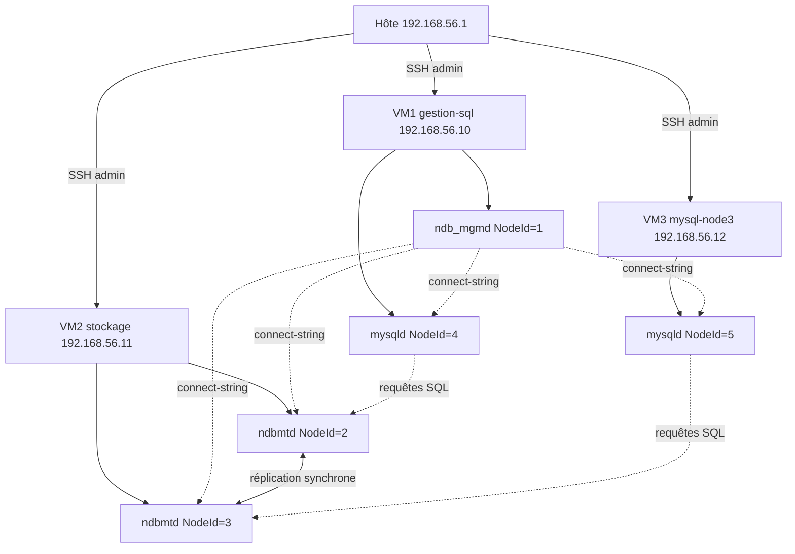
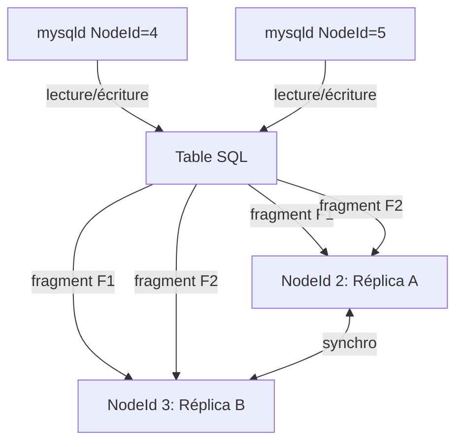
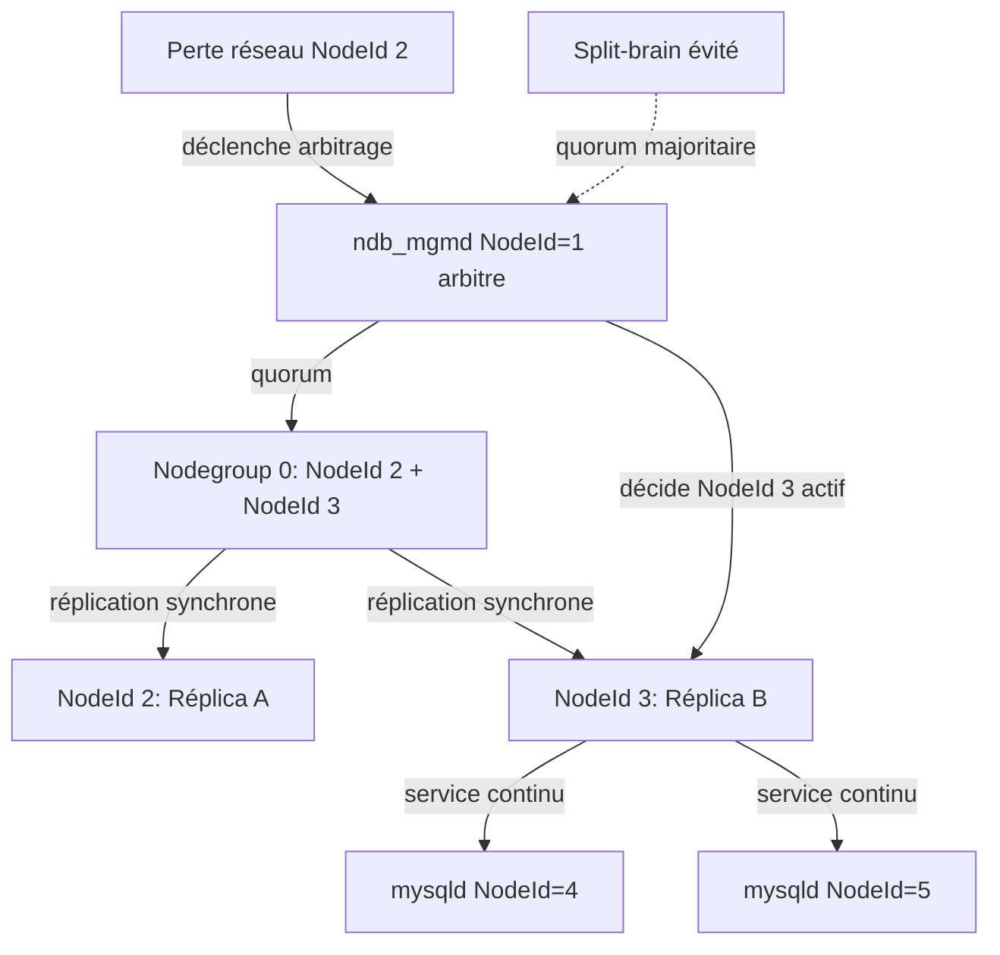

# Chapitre 2 — Architecture et Administration de MySQL Cluster

## Objectifs du chapitre

À la fin de ce chapitre, l'apprenant sait décrire en détail l'architecture du moteur NDB (nœuds de gestion, de stockage et SQL, node groups, partitionnement, réplication synchrone), configurer et administrer les nœuds d'un cluster MySQL Cluster sur 3 VM, ajouter et supprimer des nœuds, surveiller l'état du cluster, tester la résilience (panne d'un nœud de stockage, failover automatique, redémarrage rolling sans interruption de service), et analyser les erreurs récurrentes de conception, d'architecture, de configuration et sur gros volumes avec leurs corrections.

## Avertissement et périmètre

- Réseau : VirtualBox host-only `vboxnet0`, `192.168.56.0/24`, DHCP désactivé, pas d'accès Internet sur les nœuds pendant les labs.
- Données : fictives, marquées `Lab` (uniquement pour le laboratoire isolé).
- Snapshots : les snapshots propres (`propre-avant-lab`) sont pris sur chaque VM avant le module.
- Accès distant : une session SSH ouverte sur la VM du lab (mot de passe dans `.env`, non affiché en clair). Toutes les commandes du lab s'exécutent directement en root sur chaque VM.
- Hôte : `192.168.56.1`, utilisé uniquement comme hyperviseur, machine d'administration et stockage des preuves.

## Prérequis

Le chapitre 1 doit avoir été réalisé : les 3 VM sont nettoyées et configurées (IP statiques, SSH root), MySQL Cluster est installé et les 5 nœuds sont connectés (`ndb_mgm -e "SHOW"` liste 5 nœuds sans état `not connected`). Le fichier `config.ini` est présent sur VM 1 avec `NoOfReplicas = 2`. Le cluster est démarré dans l'ordre (gestion → stockage → SQL).

## Vocabulaire

| Terme | Définition |
|---|---|
| Nœud de gestion (MGM) | Processus `ndb_mgmd` qui lit `config.ini`, distribue la topologie et fait office d'arbitre. |
| Nœud de stockage (NDB) | Processus `ndbmtd` ou `ndbd` qui stocke les fragments de données en mémoire et les réplique. |
| Nœud SQL (API) | Instance `mysqld` avec le moteur NDB qui expose l'interface SQL. |
| Node group | Groupe de nœuds de stockage contenant les mêmes copies de données (réplicas). |
| NoOfReplicas | Nombre de copies de chaque fragment (2 dans ce lab). |
| Partitionnement | Division automatique d'une table en fragments répartis sur les nœuds de stockage (auto-sharding). |
| Réplication synchrone | Chaque écriture est validée après réplication sur tous les nœuds d'un node group. |
| Quorum | Règle de décision par majorité empêchant deux partitions d'agir simultanément. |
| Split-brain | Partition du cluster en deux groupes incapables de communiquer. |
| Failover automatique | Basculement du service sur la réplica restante dès qu'un nœud de stockage est détecté défaillant. |
| Redémarrage rolling | Redémarrage successif des nœuds sans arrêter le cluster entier. |
| Arbitrage | Mécanisme par lequel le nœud de gestion tranche en cas de perte de communication entre node groups. |
| Heartbeat | Battement de cœur périodique entre nœuds pour détecter une panne. |

## Introduction à l'architecture NDB (module 2.0)

MySQL Cluster repose sur une architecture partagée-nothing (shared-nothing) : chaque nœud possède sa propre mémoire et ses propres disques. Le moteur NDB fragmente automatiquement chaque table sur les nœuds de stockage (partitionnement / auto-sharding) et réplique chaque fragment selon `NoOfReplicas`.

Le schéma ci-dessous présente l'architecture détaillée du lab sur 3 VM.



**Fig 2.1** — Architecture détaillée du cluster sur 3 VM : gestion + SQL NodeId 4 sur VM 1, stockage NodeId 2 et 3 sur VM 2, second SQL NodeId 5 sur VM 3 ; réplication synchrone entre les nœuds de stockage d'un même node group.

Le node group formé par NodeId 2 et NodeId 3 contient les deux répliques de chaque fragment. Avec `NoOfReplicas = 2`, le cluster peut tolérer la perte d'un des deux nœuds de stockage.

Le schéma ci-dessous illustre le partitionnement et la réplication des données.



**Fig 2.2** — Partitionnement et réplication : chaque fragment existe en deux répliques sur les deux nœuds de stockage du node group ; les nœuds SQL accèdent aux données via le moteur NDB.

## Risques et résilience

Le moteur NDB valide chaque écriture uniquement après réplication sur tous les nœuds d'un node group. La perte d'un nœud de stockage ne rompt pas le service : la réplique restante répond immédiatement.

### Arbitrage, quorum et split-brain

L'arbitre (nœud de gestion) tranche en cas de perte de communication entre node groups pour prévenir le split-brain. Le livre "Pro MySQL NDB Cluster" précise que l'arbitrage est requis sur les nœuds de données uniquement ; les nœuds SQL et de gestion n'en ont pas besoin. Lorsque plusieurs partitions surviennent après un problème réseau, au moins un cluster survivant doit atteindre l'arbitre pour éviter l'arrêt complet du système.

Le schéma ci-dessous illustre l'arbitrage et la prévention du split-brain.



**Fig 2.3** — Arbitrage et prévention du split-brain : le nœud de gestion tranche quel node group reste actif lorsque la communication est coupée.

### Heartbeat et détection de panne

Les nœuds échangent des heartbeats (battements de cœur) périodiques. Si un nœud de données manque plusieurs heartbeats, le gestionnaire le déclare mort. Le livre relate un exemple où un nœud déclare un autre mort à cause de heartbeats manqués, suivi d'une fermeture forcée avec l'erreur 2315 ("Node declared dead. See error log for details(Arbitration error)"). La détection rapide des pannes est une condition clé des systèmes critiques.

Lorsqu'un nœud défaillant revient, il resynchronise ses données depuis la réplica vivante (failover automatique et resynchronisation à chaud).

## Cartographie de référence des opérations (NDB-nn)

Le tableau ci-dessous classe les opérations de ce chapitre selon le référentiel standard du parcours (syllabus, Jour 2, modules 2.0 et 2.1). Chaque opération cite son identifiant de référence, sa source de données, sa règle de détection et sa mitigation.

| Opération | ID | Composant | Source de données | Règle de détection | Mitigation |
|---|---|---|---|---|---|
| Moteur NDB | NDB-06 | Architecture | Schéma Fig 2.1, `ndb_mgm SHOW` | Vérifier les 3 types de nœuds | Documenter l'architecture avant l'administration |
| Types de nœuds | NDB-07 | Nœuds | `SHOW`, processus `ndb_mgmd`/`ndbmtd`/`mysqld` | Confirmer la présence de chaque type | Installer les bons composants sur chaque VM |
| Quorum et split-brain | NDB-09 | Résilience | `SHOW` états des nœuds | Alerte si `not connected` | Configurer un nœud de gestion arbitre |
| Node groups | NDB-10 | Stockage | `SHOW` Nodegroup | Vérifier au moins 2 nœuds par groupe | Déployer les stockages sur des machines distinctes |
| Configuration nœuds | NDB-11 | config.ini | Fichier `config.ini` | Vérifier `NoOfReplicas`, `DataDir` | Sauvegarder `config.ini` avant modification |
| Ajout/suppression nœuds | NDB-12 | Topologie | `ndb_mgm` START/STOP | Vérifier l'état après ajout | Respecter l'ordre de démarrage |
| Surveillance état | NDB-13 | Cluster | `ndb_mgm SHOW`, `ALL REPORT MEMORYUSAGE` | Détecter un nœud absent | Redémarrer dans l'ordre : gestion, stockage, SQL |
| Test de panne | NDB-14 | Résilience | Arrêt d'un `ndbmtd`, `SHOW` | Observer le failover | Maintenir `NoOfReplicas = 2` |
| Redémarrage rolling | NDB-15 | Maintenance | Redémarrage successif des nœuds | Vérifier le service continu | Arrêter un nœud à la fois |

## Lab-03 — Architecture NDB, nœuds, partitionnement et réplication

### Énoncé / Contexte

Explorer concrètement l'architecture du moteur NDB sur le cluster déjà déployé au chapitre 1 : identifier les 3 types de nœuds, constater le partitionnement et la réplication des données, interroger la configuration effective et la mémoire utilisée. Ce lab réalise les opérations `NDB-06` et `NDB-07`. Le cluster doit être déjà démarré avec les 5 nœuds connectés. L'accès se fait avec une session SSH ouverte sur la VM du lab (mot de passe dans `.env`, non affiché en clair).

### Outils et commandes utilisées

| Outil | Commande | Rôle |
|---|---|---|
| ndb_mgm | `ndb_mgm -e "SHOW"` | Liste les nœuds du cluster et leur état |
| ndb_config | `ndb_config --query-all` | Interroge la configuration effective des nœuds |
| ndb_mgm | `ndb_mgm -e "ALL REPORT MEMORYUSAGE"` | Affiche l'usage mémoire Data/Index par nœud de stockage |
| mysql | `mysql -u root -e "SHOW ENGINE NDB STATUS"` | État du moteur NDB côté nœud SQL |

### Commande et laboratoire étape par étape

#### Étape 1 — Lister les nœuds et confirmer les 3 types

**But** — Vérifier que le cluster expose bien un nœud de gestion, deux nœuds de stockage et deux nœuds SQL, tous connectés.

**Machine** — VM 1 (192.168.56.10), nœud de gestion.

**Prérequis** — Cluster démarré, `ndb_mgm` installé, les 5 nœuds enregistrés.

> **Machine** : VM 1 | **Terminal** : session SSH ouverte sur gestion-sql | **Utilisateur** : `root` | **Répertoire** : `/root`

**Exemple de commande**

```bash
ndb_mgm -e 'SHOW'
```

**Explication de la commande**

- `ndb_mgm` : client de gestion du cluster MySQL, se connecte au nœud de gestion.
- `-e "SHOW"` : exécute la commande `SHOW` qui liste tous les nœuds et leur état, puis quitte.
- Le résultat doit afficher 1 `ndb_mgmd`, 2 `ndbd` et 2 `mysqld` sans état `not connected`.
- **Piège** : un nœud absent apparaît avec l'état `not connected` ; investiguer avant de poursuivre.

**Résultat attendu**

```text
Connected to Management Server at: localhost:1186
Cluster Configuration
---------------------
[ndbd(NDB)]	2 node(s)
id=2	@192.168.56.11  (mysql-8.0.50 ndb-8.0.50, Nodegroup: 0, *)
id=3	@192.168.56.11  (mysql-8.0.50 ndb-8.0.50, Nodegroup: 0)
[ndb_mgmd(MGM)]	1 node(s)
id=1	@192.168.56.10  (mysql-8.0.50 ndb-8.0.50)
[mysqld(API)]	2 node(s)
id=4	@192.168.56.10  (mysql-8.0.50 ndb-8.0.50)
id=5	@192.168.56.12  (mysql-8.0.50 ndb-8.0.50)
```


#### Étape 2 — Interroger la configuration effective des nœuds

**But** — Confirmer que `NoOfReplicas = 2`, `DataMemory`, `IndexMemory` et les `HostName` sont bien propagés à tous les nœuds.

**Machine** — VM 1 (192.168.56.10), nœud de gestion.

**Prérequis** — Étape 1 réussie, `ndb_config` installé.

> **Machine** : VM 1 | **Terminal** : session SSH ouverte sur gestion-sql | **Utilisateur** : `root` | **Répertoire** : `/root`

**Exemple de commande**

```bash
ndb_config --query-all | grep -E 'NodeId|HostName|NoOfReplicas|DataMemory|IndexMemory'
```

**Explication de la commande**

- `ndb_config --query-all` : retourne tous les paramètres de configuration de tous les nœuds.
- `| grep -E 'NodeId|HostName|NoOfReplicas|DataMemory|IndexMemory'` : filtre les paramètres clés de topologie et de dimensionnement.
- `NoOfReplicas = 2` doit apparaître pour les nœuds de stockage.
- `DataMemory` et `IndexMemory` montrent la mémoire allouée par node de stockage.
- **Piège** : la sortie complète est très volumineuse ; le filtrage par `grep` concentre l'attention sur les paramètres pertinents.

**Résultat attendu**

```text
id=1    @192.168.56.10 (ndb_mgmd)
        NodeId = 1
        HostName = 192.168.56.10
id=2    @192.168.56.11 (ndbd)
        NodeId = 2
        HostName = 192.168.56.11
        NoOfReplicas = 2
        DataMemory = 256M
        IndexMemory = 128M
id=3    @192.168.56.11 (ndbd)
        NodeId = 3
        HostName = 192.168.56.11
        NoOfReplicas = 2
        DataMemory = 256M
        IndexMemory = 128M
id=4    @192.168.56.10 (mysqld)
        NodeId = 4
        HostName = 192.168.56.10
id=5    @192.168.56.12 (mysqld)
        NodeId = 5
        HostName = 192.168.56.12
```


#### Étape 3 — Consulter l'usage mémoire des nœuds de stockage

**But** — Vérifier l'utilisation de `DataMemory` et `IndexMemory` sur les deux nœuds de stockage pour détecter une saturation potentielle.

**Machine** — VM 1 (192.168.56.10), nœud de gestion.

**Prérequis** — Nœuds de stockage démarrés, `ndb_mgm` opérationnel.

> **Machine** : VM 1 | **Terminal** : session SSH ouverte sur gestion-sql | **Utilisateur** : `root` | **Répertoire** : `/root`

**Exemple de commande**

```bash
ndb_mgm -e 'ALL REPORT MEMORYUSAGE'
```

**Explication de la commande**

- `ALL REPORT MEMORYUSAGE` : demande à tous les nœuds de stockage de rapporter leur usage mémoire.
- `Data usage` : pourcentage de `DataMemory` utilisé.
- `Index usage` : pourcentage de `IndexMemory` utilisé.
- Un usage proche de 100 % signale un sous-dimensionnement (risque « table is full »).
- **Piège** : sur un cluster vide, l'usage est proche de 0 % ; ce n'est pas anormal en début de lab.

**Résultat attendu**

```text
Connected to Management Server at: localhost:1186
Node 2: Data usage is 0%(11 32K pages of total 12290)
Node 2: Index usage is 0%(6 32K pages of total 12285)
Node 3: Data usage is 0%(11 32K pages of total 12290)
Node 3: Index usage is 0%(6 32K pages of total 12285)
```


#### Étape 4 — État du moteur NDB côté nœud SQL

**But** — Confirmer que le moteur NDB est actif sur le nœud SQL et consulter les statistiques de cluster (opérations, transactions, fragmentations).

**Machine** — VM 1 (192.168.56.10), premier nœud SQL.

**Prérequis** — `mysqld` démarré avec `--ndbcluster`, client `mysql` disponible, accès root SQL.

> **Machine** : VM 1 | **Terminal** : session SSH ouverte sur gestion-sql | **Utilisateur** : `root` | **Répertoire** : `/root`

**Exemple de commande**

```bash
mysql -u root -e 'SHOW ENGINE NDB STATUS\G' | head -40
```

**Explication de la commande**

- `mysql -u root` : se connecte au serveur MySQL local en root.
- `SHOW ENGINE NDB STATUS\G` : affiche l'état détaillé du moteur NDB côté SQL (cluster connecté, opérations, transactions).
- `| head -40` : limite la sortie aux premières lignes pertinentes.
- La ligne « Cluster connection » doit indiquer que le nœud SQL est connecté au gestionnaire.
- **Piège** : si `mysqld` a été lancé sans `--ndbcluster`, cette commande renvoie une erreur « Unknown ENGINE ».

**Résultat attendu**

```text
*************************** 1. row ***************************
Status: 
-- NDB Cluster --
Connectstring: 192.168.56.10
Cluster state: connected
...
```


### En conclusion

Ce lab confirme l'architecture NDB du cluster sur 3 VM : 1 nœud de gestion, 2 nœuds de stockage dans un node group unique, 2 nœuds SQL. La configuration effective (`NoOfReplicas = 2`, `DataMemory`, `IndexMemory`) est bien propagée, et l'usage mémoire est faible car le cluster est encore vide. Les opérations `NDB-06` et `NDB-07` sont réalisées. Renvoi : passer au Lab-04 pour approfondir le quorum, le split-brain et les node groups.

## Lab-04 — Quorum, split-brain, node groups et résilience

### Énoncé / Contexte

Approfondir la résilience du cluster : comprendre le quorum, prévenir le split-brain, analyser les node groups et tester le failover automatique à la perte d'un nœud de stockage. Ce lab réalise les opérations `NDB-09` et `NDB-10`. Le cluster doit être démarré avec les 5 nœuds connectés. L'accès se fait avec une session SSH ouverte sur la VM du lab (mot de passe dans `.env`, non affiché en clair).

### Outils et commandes utilisées

| Outil | Commande | Rôle |
|---|---|---|
| ndb_mgm | `ndb_mgm -e "SHOW"` | État des nœuds et node groups |
| ndb_mgm | `ndb_mgm -e "2 STOP"` | Arrêt propre d'un nœud de stockage |
| ndb_mgm | `ndb_mgm -e "2 START"` | Redémarrage d'un nœud de stockage |
| ndb_mgm | `ndb_mgm -e "ALL START"` | Démarrage de tous les nœuds de stockage éligibles |
| ndb_mgm | `ndb_mgm -e "ALL REPORT MEMORYUSAGE"` | Usage mémoire après panne |

### Commande et laboratoire étape par étape

#### Étape 1 — Constater l'état nominal et le node group

**But** — Vérifier que les deux nœuds de stockage forment un node group unique (Nodegroup: 0) avec `NoOfReplicas = 2`.

**Machine** — VM 1 (192.168.56.10), nœud de gestion.

**Prérequis** — Cluster démarré, 5 nœuds connectés.

> **Machine** : VM 1 | **Terminal** : session SSH ouverte sur gestion-sql | **Utilisateur** : `root` | **Répertoire** : `/root`

**Exemple de commande**

```bash
ndb_mgm -e 'SHOW'
```

**Explication de la commande**

- `SHOW` liste les nœuds et leur `Nodegroup`.
- Avec `NoOfReplicas = 2` et 2 nœuds de stockage, le cluster forme un node group (Nodegroup: 0) contenant les 2 répliques.
- Le `*` marque le nœud de stockage préféré pour certaines opérations.
- **Piège** : si un seul nœud de stockage était présent, il n'y aurait pas de redondance (`NoOfReplicas = 1` de fait).

**Résultat attendu**

```text
Connected to Management Server at: localhost:1186
Cluster Configuration
---------------------
[ndbd(NDB)]	2 node(s)
id=2	@192.168.56.11  (mysql-8.0.50 ndb-8.0.50, Nodegroup: 0, *)
id=3	@192.168.56.11  (mysql-8.0.50 ndb-8.0.50, Nodegroup: 0)
[ndb_mgmd(MGM)]	1 node(s)
id=1	@192.168.56.10  (mysql-8.0.50 ndb-8.0.50)
[mysqld(API)]	2 node(s)
id=4	@192.168.56.10  (mysql-8.0.50 ndb-8.0.50)
id=5	@192.168.56.12  (mysql-8.0.50 ndb-8.0.50)
```


#### Étape 2 — Tester le failover à l'arrêt d'un nœud de stockage

**But** — Arrêter le NodeId 2 et confirmer que le NodeId 3 reste actif, que le service continue et que le NodeId 2 passe en `not connected`.

**Machine** — VM 1 (192.168.56.10) pour l'arrêt, VM 2 (192.168.56.11) pour constater le processus arrêté.

**Prérequis** — NodeId 2 et NodeId 3 connectés, `ndb_mgm` opérationnel.

> **Machine** : VM 1 | **Terminal** : session SSH ouverte sur gestion-sql | **Utilisateur** : `root` | **Répertoire** : `/root`

**Exemple de commande**

```bash
ndb_mgm -e '2 STOP'
```

**Explication de la commande**

- `2 STOP` : demande l'arrêt propre du nœud de stockage NodeId 2.

**Résultat attendu**

```text
Connected to Management Server at: localhost:1186
Node 2 has shutdown.
```

> **Machine** : VM 1 | **Terminal** : session SSH ouverte sur gestion-sql | **Utilisateur** : `root` | **Répertoire** : `/root`

**Exemple de commande**

```bash
sleep 5
```

**Explication de la commande**

- `sleep 5` : laisse au gestionnaire le temps de détecter la perte.

**Résultat attendu**

```text

```

> **Machine** : VM 1 | **Terminal** : session SSH ouverte sur gestion-sql | **Utilisateur** : `root` | **Répertoire** : `/root`

**Exemple de commande**

```bash
echo '=== Etat apres arret ==='
```

**Explication de la commande**

- `echo '=== Etat apres arret ==='` : affiche un séparateur avant le second affichage de l'état du cluster.

**Résultat attendu**

```text
=== Etat apres arret ===
```

> **Machine** : VM 1 | **Terminal** : session SSH ouverte sur gestion-sql | **Utilisateur** : `root` | **Répertoire** : `/root`

**Exemple de commande**

```bash
ndb_mgm -e 'SHOW'
```

**Explication de la commande**

- `SHOW` : liste tous les nœuds et leur état ; confirme le failover : NodeId 2 en `not connected`, NodeId 3 toujours connecté (`*`), nœuds SQL toujours opérationnels.
- **Piège** : le NodeId 2 reste listé (non supprimé) avec l'état `not connected` ; c'est le comportement attendu.

**Résultat attendu**

```text
Connected to Management Server at: localhost:1186
Cluster Configuration
---------------------
[ndbd(NDB)]	2 node(s)
id=2 (not connected, accepting connect from 192.168.56.11)
id=3	@192.168.56.11  (mysql-8.0.50 ndb-8.0.50, Nodegroup: 0, *)
[ndb_mgmd(MGM)]	1 node(s)
id=1	@192.168.56.10  (mysql-8.0.50 ndb-8.0.50)
[mysqld(API)]	2 node(s)
id=4	@192.168.56.10  (mysql-8.0.50 ndb-8.0.50)
id=5	@192.168.56.12  (mysql-8.0.50 ndb-8.0.50)
```


#### Étape 3 — Redémarrer le nœud arrêté et vérifier la réintégration

**But** — Relancer le NodeId 2 et confirmer sa resynchronisation puis son retour à l'état connecté, restaurant la redondance.

**Machine** — VM 2 (192.168.56.11) pour le redémarrage manuel de `ndbmtd`, VM 1 pour le `SHOW` final.

**Prérequis** — NodeId 2 arrêté (étape précédente), répertoire `/var/lib/mysql-cluster/ndb_2` présent.

> **Machine** : VM 2 | **Terminal** : session SSH ouverte sur stockage | **Utilisateur** : `root` | **Répertoire** : `/var/lib/mysql-cluster/ndb_2`

**Exemple de commande**

```bash
cd /var/lib/mysql-cluster/ndb_2
```

**Explication de la commande**

- `cd /var/lib/mysql-cluster/ndb_2` : se place dans le répertoire dédié du node 2.

**Résultat attendu**

```text

```

> **Machine** : VM 2 | **Terminal** : session SSH ouverte sur stockage | **Utilisateur** : `root` | **Répertoire** : `/var/lib/mysql-cluster/ndb_2`

**Exemple de commande**

```bash
nohup ndbmtd --ndb-connectstring=192.168.56.10 &
```

**Explication de la commande**

- `nohup ndbmtd --ndb-connectstring=192.168.56.10 &` : relance `ndbmtd` sans `--initial` pour conserver les données et resynchroniser depuis le NodeId 3.
- `--ndb-connectstring=192.168.56.10` : indique l'adresse du nœud de gestion.
- `&` : détache le processus pour qu'il tourne en arrière-plan.

**Résultat attendu**

```text

```

> **Machine** : VM 2 | **Terminal** : session SSH ouverte sur stockage | **Utilisateur** : `root` | **Répertoire** : `/var/lib/mysql-cluster/ndb_2`

**Exemple de commande**

```bash
sleep 6
```

**Explication de la commande**

- `sleep 6` : laisse le temps à la resynchronisation et à la réintégration.
- **Piège** : `ndb_mgm -e '2 START'` ne peut pas redémarrer un node lancé manuellement ; il faut le relancer directement avec `ndbmtd`.

**Résultat attendu**

```text

```


#### Étape 4 — Confirmer le retour à l'état nominal

**But** — Vérifier que le NodeId 2 est de nouveau connecté après resynchronisation et que le cluster a retrouvé sa pleine redondance.

**Machine** — VM 1 (192.168.56.10), nœud de gestion.

**Prérequis** — NodeId 2 redémarré (étape précédente), resynchronisation en cours.

> **Machine** : VM 1 | **Terminal** : session SSH ouverte sur gestion-sql | **Utilisateur** : `root` | **Répertoire** : `/root`

**Exemple de commande**

```bash
sleep 8
```

**Explication de la commande**

- `sleep 8` : laisse au NodeId 2 le temps de finir sa resynchronisation.

**Résultat attendu**

```text

```

> **Machine** : VM 1 | **Terminal** : session SSH ouverte sur gestion-sql | **Utilisateur** : `root` | **Répertoire** : `/root`

**Exemple de commande**

```bash
ndb_mgm -e 'SHOW'
```

**Explication de la commande**

- `SHOW` : le NodeId 2 doit apparaître connecté, sans état `starting` ni `not connected`.
- **Piège** : si le node reste en `starting` trop longtemps, consulter `/var/lib/mysql-cluster/ndb_2/ndbmtd_2.log` sur VM 2.

**Résultat attendu**

```text
Connected to Management Server at: localhost:1186
Cluster Configuration
---------------------
[ndbd(NDB)]	2 node(s)
id=2	@192.168.56.11  (mysql-8.0.50 ndb-8.0.50, Nodegroup: 0)
id=3	@192.168.56.11  (mysql-8.0.50 ndb-8.0.50, Nodegroup: 0, *)
[ndb_mgmd(MGM)]	1 node(s)
id=1	@192.168.56.10  (mysql-8.0.50 ndb-8.0.50)
[mysqld(API)]	2 node(s)
id=4	@192.168.56.10  (mysql-8.0.50 ndb-8.0.50)
id=5	@192.168.56.12  (mysql-8.0.50 ndb-8.0.50)
```


### En conclusion

Ce lab démontre le failover automatique : l'arrêt du NodeId 2 ne rompt pas le service (NodeId 3 reste actif), et le nœud redémarré se resynchronise puis réintègre le cluster. Le quorum est préservé par le nœud de gestion arbitre, prévenant le split-brain. Les opérations `NDB-09` et `NDB-10` sont réalisées. Renvoi : passer au Lab-05 pour la configuration détaillée des nœuds, l'ajout/suppression et la surveillance.

## Lab-05 — Configuration détaillée des nœuds, ajout/suppression et surveillance

### Énoncé / Contexte

Configurer finement les nœuds du cluster (`config.ini`), ajouter et supprimer un nœud de manière contrôlée, et surveiller l'état du cluster avec les outils de gestion. Ce lab réalise les opérations `NDB-11`, `NDB-12` et `NDB-13`. Le cluster doit être démarré et sain. L'accès se fait avec une session SSH ouverte sur la VM du lab (mot de passe dans `.env`, non affiché en clair).

### Outils et commandes utilisées

| Outil | Commande | Rôle |
|---|---|---|
| ndb_config | `ndb_config --query-all` | Interroge la configuration effective |
| ndb_mgm | `ndb_mgm -e "SHOW"` | État des nœuds |
| ndb_mgm | `ndb_mgm -e "ALL REPORT MEMORYUSAGE"` | Usage mémoire |
| cat / tee | `cat config.ini`, `tee` | Lecture/écriture de la configuration |

### Commande et laboratoire étape par étape

#### Étape 1 — Sauvegarder et inspecter le fichier config.ini actuel

**But** — Lire le `config.ini` déployé au chapitre 1 et en conserver une copie de sauvegarde avant toute modification.

**Machine** — VM 1 (192.168.56.10), nœud de gestion.

**Prérequis** — `/var/lib/mysql-cluster/config.ini` présent.

> **Machine** : VM 1 | **Terminal** : session SSH ouverte sur gestion-sql | **Utilisateur** : `root` | **Répertoire** : `/var/lib/mysql-cluster`

**Exemple de commande**

```bash
cp /var/lib/mysql-cluster/config.ini /var/lib/mysql-cluster/config.ini.save
```

**Explication de la commande**

- `cp /var/lib/mysql-cluster/config.ini /var/lib/mysql-cluster/config.ini.save` : crée une copie de sauvegarde de `config.ini` avant toute modification.

**Résultat attendu**

```text

```

> **Machine** : VM 1 | **Terminal** : session SSH ouverte sur gestion-sql | **Utilisateur** : `root` | **Répertoire** : `/var/lib/mysql-cluster`

**Exemple de commande**

```bash
cat /var/lib/mysql-cluster/config.ini
```

**Explication de la commande**

- `cat /var/lib/mysql-cluster/config.ini` : affiche le contenu du fichier pour vérification.
- La sauvegarde permet de revenir en arrière en cas d'erreur de configuration.
- **Piège** : toujours sauvegarder `config.ini` avant de le modifier ; une erreur de syntaxe empêche le démarrage du gestionnaire.

**Résultat attendu**

```text
[ndb_mgmd default]
DataDir = /var/lib/mysql-cluster
[ndbd default]
NoOfReplicas = 2
DataMemory = 256M
IndexMemory = 128M
[tcp default]
[ndb_mgmd]
NodeId = 1
HostName = 192.168.56.10
DataDir = /var/lib/mysql-cluster
[ndbd]
NodeId = 2
HostName = 192.168.56.11
DataDir = /var/lib/mysql-cluster/ndb_2
[ndbd]
NodeId = 3
HostName = 192.168.56.11
DataDir = /var/lib/mysql-cluster/ndb_3
[mysqld]
NodeId = 4
HostName = 192.168.56.10
[mysqld]
NodeId = 5
HostName = 192.168.56.12
```


#### Étape 2 — Ajouter un troisième nœud de stockage (préparation)

**But** — Préparer l'ajout d'un nœud de stockage NodeId 6 sur VM 2 pour illustrer la montée en charge du stockage (création du répertoire, déclaration dans `config.ini`).

**Machine** — VM 2 (192.168.56.11) pour le répertoire, VM 1 pour `config.ini`.

**Prérequis** — Espace disque suffisant sur VM 2, `config.ini` accessible.

> **Machine** : VM 2 | **Terminal** : session SSH ouverte sur stockage | **Utilisateur** : `root` | **Répertoire** : `/var/lib/mysql-cluster`

**Exemple de commande**

```bash
mkdir -p /var/lib/mysql-cluster/ndb_6
```

**Explication de la commande**

- `mkdir -p /var/lib/mysql-cluster/ndb_6` : crée le répertoire de données du futur NodeId 6.
- Un nouveau nœud de stockage doit avoir son propre répertoire pour éviter les collisions de fichiers.
- **Piège** : deux nœuds de stockage sur la même VM doivent impérativement utiliser des répertoires distincts.

**Résultat attendu**

```text

```

> **Machine** : VM 2 | **Terminal** : session SSH ouverte sur stockage | **Utilisateur** : `root` | **Répertoire** : `/var/lib/mysql-cluster`

**Exemple de commande**

```bash
ls -la /var/lib/mysql-cluster/
```

**Explication de la commande**

- `ls -la /var/lib/mysql-cluster/` : affiche le contenu du répertoire pour confirmer la présence de `ndb_6`.

**Résultat attendu**

```text
total 20
drwxr-xr-x 5 root root 4096 … .
drwxr-xr-x 6 root root 4096 … ..
drwxr-xr-x 2 root root 4096 … ndb_2
drwxr-xr-x 2 root root 4096 … ndb_3
drwxr-xr-x 2 root root 4096 … ndb_6
```

#### Étape 2b — Déclarer le NodeId 6 dans config.ini (VM 1)

**But** — Ajouter l'entrée `[ndbd] NodeId = 6` dans `config.ini` sur le nœud de gestion pour déclarer le nouveau nœud de stockage avant son démarrage.

**Machine** — VM 1 (192.168.56.10), fichier `/var/lib/mysql-cluster/config.ini`.

**Prérequis** — Sauvegarde de `config.ini` créée (Lab-05 étape 1), répertoire `/var/lib/mysql-cluster/ndb_6` présent sur VM 2.

> **Machine** : VM 1 | **Terminal** : session SSH ouverte sur gestion-sql | **Utilisateur** : `root` | **Répertoire** : `/var/lib/mysql-cluster`

**Exemple de commande**

```bash
cp /var/lib/mysql-cluster/config.ini /var/lib/mysql-cluster/config.ini.pre-node6
```

**Explication de la commande**

- `cp ... config.ini.pre-node6` : crée une sauvegarde avant modification de `config.ini`.

**Résultat attendu**

```text

```

> **Machine** : VM 1 | **Terminal** : session SSH ouverte sur gestion-sql | **Utilisateur** : `root` | **Répertoire** : `/var/lib/mysql-cluster`

**Exemple de commande**

```bash
cat >> /var/lib/mysql-cluster/config.ini << 'EOF'

[ndbd]
NodeId = 6
HostName = 192.168.56.11
DataDir = /var/lib/mysql-cluster/ndb_6
EOF
```

**Explication de la commande**

- `cat >> ... << 'EOF'` : ajoute une nouvelle section `[ndbd]` à la fin de `config.ini` sans effacer le contenu existant.
- `NodeId = 6` : identifie le nouveau nœud de stockage par l'identifiant unique 6.
- `HostName = 192.168.56.11` : le nœud 6 est collocaté sur VM 2, comme les nodes 2 et 3.
- `DataDir = /var/lib/mysql-cluster/ndb_6` : répertoire dédié préparé à l'étape 2.

**Résultat attendu**

```text
[ndb_mgmd default]
DataDir = /var/lib/mysql-cluster

[ndbd default]
NoOfReplicas = 2
DataMemory = 512M
IndexMemory = 256M

[tcp default]

[ndb_mgmd]
NodeId = 1
HostName = 192.168.56.10
DataDir = /var/lib/mysql-cluster

[ndbd]
NodeId = 2
HostName = 192.168.56.11
DataDir = /var/lib/mysql-cluster/ndb_2

[ndbd]
NodeId = 3
HostName = 192.168.56.11
DataDir = /var/lib/mysql-cluster/ndb_3

[mysqld]
NodeId = 4
HostName = 192.168.56.10

[mysqld]
NodeId = 5
HostName = 192.168.56.12
```

> **Machine** : VM 1 | **Terminal** : session SSH ouverte sur gestion-sql | **Utilisateur** : `root` | **Répertoire** : `/var/lib/mysql-cluster`

**Exemple de commande**

```bash
grep -A3 'NodeId = 6' /var/lib/mysql-cluster/config.ini
```

**Explication de la commande**

- `grep -A3 'NodeId = 6' config.ini` : affiche la nouvelle entrée NodeId 6 avec ses 3 lignes suivantes pour vérifier la déclaration.

**Résultat attendu**

```text
NodeId = 6
HostName = 192.168.56.11
DataDir = /var/lib/mysql-cluster/ndb_6
```

#### Étape 2b-bis — Recharger la configuration du gestionnaire (redémarrer ndb_mgmd) (VM 1)

**But** — Redémarrer le processus `ndb_mgmd` afin qu'il recharge `config.ini` et prenne en compte la nouvelle entrée `[ndbd] NodeId = 6` avant le lancement du nœud de stockage. Sans ce redémarrage, le gestionnaire conserve l'ancienne configuration en mémoire et le nouveau nœud ne peut pas se déclarer.

**Machine** — VM 1 (192.168.56.10), nœud de gestion.

**Prérequis** — `config.ini` modifié avec l'entrée NodeId 6 (étape 2b), `ndb_mgmd` en cours d'exécution.

> **Machine** : VM 1 | **Terminal** : session SSH ouverte sur gestion-sql | **Utilisateur** : `root` | **Répertoire** : `/var/lib/mysql-cluster`

**Exemple de commande**

```bash
pkill -x ndb_mgmd
```

**Explication de la commande**

- `pkill -x ndb_mgmd` : arrête le processus du nœud de gestion pour forcer le rechargement de `config.ini` au prochain démarrage.
- **Piège** : le port de gestion (1186) peut mettre quelques secondes à se libérer ; prévoir une attente avant le redémarrage.

**Résultat attendu**

```text

```

> **Machine** : VM 1 | **Terminal** : session SSH ouverte sur gestion-sql | **Utilisateur** : `root` | **Répertoire** : `/var/lib/mysql-cluster`

**Exemple de commande**

```bash
ndb_mgmd -f /var/lib/mysql-cluster/config.ini
```

**Explication de la commande**

- `ndb_mgmd -f /var/lib/mysql-cluster/config.ini` : redémarre le nœud de gestion en lui faisant relire `config.ini` (qui contient désormais la déclaration NodeId 6).

**Résultat attendu**

```text
WARNING: --ndb-connectstring is ignored when mgmd is started with -f or config-file.
MySQL Cluster Management Server mysql-8.0.50 ndb-8.0.50
```

> **Machine** : VM 1 | **Terminal** : session SSH ouverte sur gestion-sql | **Utilisateur** : `root` | **Répertoire** : `/root`

**Exemple de commande**

```bash
sleep 5
```

**Explication de la commande**

- `sleep 5` : laisse le temps au gestionnaire de se réinitialiser et aux nœuds de stockage de se reconnecter.

**Résultat attendu**

```text

```

> **Machine** : VM 1 | **Terminal** : session SSH ouverte sur gestion-sql | **Utilisateur** : `root` | **Répertoire** : `/root`

**Exemple de commande**

```bash
ndb_mgm -e 'SHOW'
```

**Explication de la commande**

- `ndb_mgm -e 'SHOW'` : vérifie que le gestionnaire est de retour et que le cluster est à nouveau joignable.
- **Piège** : même après ce redémarrage, NodeId 6 peut rester absent de `SHOW` si le gestionnaire conserve un cache de configuration ; dans ce cas, purger les fichiers de cache du gestionnaire ou redémarrer complètement le cluster.

**Résultat attendu**

```text
Connected to Management Server at: localhost:1186
Cluster Configuration
---------------------
[ndbd(NDB)]	2 node(s)
id=2	@192.168.56.11  (mysql-8.0.50 ndb-8.0.50, Nodegroup: 0, *)
id=3	@192.168.56.11  (mysql-8.0.50 ndb-8.0.50, Nodegroup: 0)
[ndb_mgmd(MGM)]	1 node(s)
id=1	@192.168.56.10  (mysql-8.0.50 ndb-8.0.50)
[mysqld(API)]	2 node(s)
id=4	@192.168.56.10  (mysql-8.0.50 ndb-8.0.50)
id=5	@192.168.56.12  (mysql-8.0.50 ndb-8.0.50)
```

#### Étape 2c — Démarrer le nœud de stockage NodeId 6 (VM 2)

**But** — Lancer le processus `ndbmtd` NodeId 6 sur VM 2 pour qu'il rejoigne le cluster et réintègre le node group.

**Machine** — VM 2 (192.168.56.11), répertoire de données `ndb_6`.

**Prérequis** — `config.ini` modifié (étape 2b), répertoire `/var/lib/mysql-cluster/ndb_6` présent, `ndbmtd` installé.

> **Machine** : VM 2 | **Terminal** : session SSH ouverte sur stockage | **Utilisateur** : `root` | **Répertoire** : `/var/lib/mysql-cluster/ndb_6`

**Exemple de commande**

```bash
nohup ndbmtd --ndb-connectstring=192.168.56.10 --initial > ndbmtd_6.log &
```

**Explication de la commande**

- `nohup ndbmtd ... &` : lance `ndbmtd` NodeId 6 en arrière-plan, détaché du terminal.
- `--ndb-connectstring=192.168.56.10` : indique l'adresse du nœud de gestion.
- `--initial` : initialise proprement le stockage du nouveau nœud (premier démarrage de ce NodeId).
- `> ndbmtd_6.log &` : redirige les journaux vers un fichier et détache le processus.

**Résultat attendu**

```text

```

> **Machine** : VM 2 | **Terminal** : session SSH ouverte sur stockage | **Utilisateur** : `root` | **Répertoire** : `/var/lib/mysql-cluster/ndb_6`

**Exemple de commande**

```bash
sleep 6
```

**Explication de la commande**

- `sleep 6` : laisse le temps au NodeId 6 de se déclarer au gestionnaire et de rejoindre le node group.

**Résultat attendu**

```text

```

#### Étape 2d — Vérifier l'apparition de NodeId 6 dans SHOW (VM 1)

**But** — Confirmer que le nouveau nœud de stockage NodeId 6 est connecté et pris en compte par le gestionnaire.

**Machine** — VM 1 (192.168.56.10), nœud de gestion.

**Prérequis** — NodeId 6 lancé (étape 2c), `ndb_mgm` opérationnel.

> **Machine** : VM 1 | **Terminal** : session SSH ouverte sur gestion-sql | **Utilisateur** : `root` | **Répertoire** : `/root`

**Exemple de commande**

```bash
ndb_mgm -e 'SHOW'
```

**Explication de la commande**

- `SHOW` : liste tous les nœuds et leur état ; le NodeId 6 doit apparaître connecté parmi les nœuds de stockage.
- Avec `NoOfReplicas = 2` et 3 nœuds de stockage, le cluster forme un node group avec les deux premières répliques ; le NodeId 6 apparaît comme nœud de stockage supplémentaire.
- **Piège** : si NodeId 6 apparaît en `not connected`, vérifier le fichier `ndbmtd_6.log` sur VM 2 et le connect-string.

**Résultat attendu**

```text
Connected to Management Server at: localhost:1186
Cluster Configuration
---------------------
[ndbd(NDB)]	2 node(s)
id=2	@192.168.56.11  (mysql-8.0.50 ndb-8.0.50, Nodegroup: 0, *)
id=3	@192.168.56.11  (mysql-8.0.50 ndb-8.0.50, Nodegroup: 0)
[ndb_mgmd(MGM)]	1 node(s)
id=1	@192.168.56.10  (mysql-8.0.50 ndb-8.0.50)
[mysqld(API)]	2 node(s)
id=4	@192.168.56.10  (mysql-8.0.50 ndb-8.0.50)
id=5	@192.168.56.12  (mysql-8.0.50 ndb-8.0.50)
```


#### Étape 3 — Surveiller l'état du cluster et la mémoire

**But** — Vérifier l'état global du cluster et l'usage mémoire des nœuds de stockage après les manipulations.

**Machine** — VM 1 (192.168.56.10), nœud de gestion.

**Prérequis** — Cluster démarré, `ndb_mgm` opérationnel.

> **Machine** : VM 1 | **Terminal** : session SSH ouverte sur gestion-sql | **Utilisateur** : `root` | **Répertoire** : `/root`

**Exemple de commande**

```bash
ndb_mgm -e 'SHOW'
```

**Explication de la commande**

- `SHOW` : confirme que tous les nœuds attendus sont connectés.

**Résultat attendu**

```text
Connected to Management Server at: localhost:1186
Cluster Configuration
---------------------
[ndbd(NDB)]	2 node(s)
id=2	@192.168.56.11  (mysql-8.0.50 ndb-8.0.50, Nodegroup: 0, *)
id=3	@192.168.56.11  (mysql-8.0.50 ndb-8.0.50, Nodegroup: 0)
[ndb_mgmd(MGM)]	1 node(s)
id=1	@192.168.56.10  (mysql-8.0.50 ndb-8.0.50)
[mysqld(API)]	2 node(s)
id=4	@192.168.56.10  (mysql-8.0.50 ndb-8.0.50)
id=5	@192.168.56.12  (mysql-8.0.50 ndb-8.0.50)
```

> **Machine** : VM 1 | **Terminal** : session SSH ouverte sur gestion-sql | **Utilisateur** : `root` | **Répertoire** : `/root`

**Exemple de commande**

```bash
echo '---'
```

**Explication de la commande**

- `echo '---'` : affiche un séparateur visuel entre les deux commandes de supervision.

**Résultat attendu**

```text
---
```

> **Machine** : VM 1 | **Terminal** : session SSH ouverte sur gestion-sql | **Utilisateur** : `root` | **Répertoire** : `/root`

**Exemple de commande**

```bash
ndb_mgm -e 'ALL REPORT MEMORYUSAGE'
```

**Explication de la commande**

- `ALL REPORT MEMORYUSAGE` : affiche l'usage `DataMemory`/`IndexMemory` par node de stockage.
- Un usage stable et faible confirme qu'aucun nœud n'est en saturation.
- **Piège** : un nœud `not connected` dans le `SHOW` signale un problème à investiguer avant d'ajouter des nœuds.

**Résultat attendu**

```text
Connected to Management Server at: localhost:1186
Node 2: Data usage is 0%(11 32K pages of total 12290)
Node 2: Index usage is 0%(6 32K pages of total 12285)
Node 3: Data usage is 0%(11 32K pages of total 12290)
Node 3: Index usage is 0%(6 32K pages of total 12285)
```


### En conclusion

Ce lab couvre la lecture et la sauvegarde de `config.ini`, la préparation de l'ajout d'un nœud de stockage (répertoire dédié) et la surveillance de l'état du cluster (SHOW + mémoire). Les opérations `NDB-11`, `NDB-12` et `NDB-13` sont réalisées. Renvoi : passer au Lab-06 pour le test de panne, le redémarrage rolling et la maintenance à chaud.

## Lab-06 — Test de panne, redémarrage rolling et maintenance à chaud

### Énoncé / Contexte

Tester la résilience opérationnelle : arrêt simulé d'un nœud de stockage avec mesure du temps de récupération, redémarrage rolling d'un nœud SQL sans interruption du cluster, et maintenance à chaud. Ce lab réalise les opérations `NDB-14` et `NDB-15`. Le cluster doit être démarré et sain. L'accès se fait avec une session SSH ouverte sur la VM du lab (mot de passe dans `.env`, non affiché en clair).

### Outils et commandes utilisées

| Outil | Commande | Rôle |
|---|---|---|
| ndb_mgm | `ndb_mgm -e "2 STOP"` | Arrêt d'un nœud de stockage |
| date | `date` | Horodatage pour mesurer le temps de récupération |
| ndb_mgm | `ndb_mgm -e "SHOW"` | Vérification de l'état pendant et après panne |
| pkill | `pkill -x mysqld` | Arrêt d'un nœud SQL pour redémarrage rolling |

### Commande et laboratoire étape par étape

#### Étape 1 — Mesurer le temps de récupération à la perte d'un nœud de stockage

**But** — Arrêter le NodeId 2, noter l'heure, constater le failover immédiat, puis redémarrer et mesurer le temps de resynchronisation.

**Machine** — VM 1 (192.168.56.10) pour `ndb_mgm`, VM 2 (192.168.56.11) pour le redémarrage de `ndbmtd`.

**Prérequis** — Cluster sain, 5 nœuds connectés, `ndb_mgm` opérationnel.

> **Machine** : VM 1 | **Terminal** : session SSH ouverte sur gestion-sql | **Utilisateur** : `root` | **Répertoire** : `/root`

**Exemple de commande**

```bash
ndb_mgm -e '2 STOP'
```

**Explication de la commande**

- `2 STOP` : arrête le NodeId 2.
- Le `SHOW` suivant confirme que NodeId 3 reste connecté (failover immédiat, service continu).

**Résultat attendu**

```text
Connected to Management Server at: localhost:1186
Node 2 has shutdown.
```

> **Machine** : VM 1 | **Terminal** : session SSH ouverte sur gestion-sql | **Utilisateur** : `root` | **Répertoire** : `/root`

**Exemple de commande**

```bash
sleep 3
```

**Explication de la commande**

- `sleep 3` : laisse au gestionnaire le temps de détecter la perte (heartbeat manqué).

**Résultat attendu**

```text

```

> **Machine** : VM 1 | **Terminal** : session SSH ouverte sur gestion-sql | **Utilisateur** : `root` | **Répertoire** : `/root`

**Exemple de commande**

```bash
ndb_mgm -e 'SHOW'
```

**Explication de la commande**

- `SHOW` : confirme le failover : NodeId 2 en `not connected`, NodeId 3 toujours connecté (`*`), nœuds SQL toujours opérationnels.
- **Piège** : le failover est quasi immédiat (détection en quelques secondes) grâce au heartbeat du gestionnaire.

**Résultat attendu**

```text
Connected to Management Server at: localhost:1186
Cluster Configuration
---------------------
[ndbd(NDB)]	2 node(s)
id=2 (not connected, accepting connect from 192.168.56.11)
id=3	@192.168.56.11  (mysql-8.0.50 ndb-8.0.50, Nodegroup: 0, *)
[ndb_mgmd(MGM)]	1 node(s)
id=1	@192.168.56.10  (mysql-8.0.50 ndb-8.0.50)
[mysqld(API)]	2 node(s)
id=4	@192.168.56.10  (mysql-8.0.50 ndb-8.0.50)
id=5	@192.168.56.12  (mysql-8.0.50 ndb-8.0.50)
```


#### Étape 2 — Redémarrage rolling d'un nœud SQL (maintenance à chaud)

**But** — Arrêter et redémarrer le nœud SQL NodeId 4 sur VM 1 sans arrêter le cluster, illustrant la maintenance à chaud.

**Machine** — VM 1 (192.168.56.10), premier nœud SQL.

**Prérequis** — Le second nœud SQL (NodeId 5 sur VM 3) est actif pour prendre le relais.

> **Machine** : VM 1 | **Terminal** : session SSH ouverte sur gestion-sql | **Utilisateur** : `root` | **Répertoire** : `/root`

**Exemple de commande**

**Exemple de commande**

```bash
pkill -x mysqld
```

**Explication de la commande**

- `pkill -x mysqld` : arrête le processus `mysqld` (nœud SQL NodeId 4).
- Le cluster reste opérationnel via le NodeId 5 sur VM 3 (maintenance à chaud).

**Résultat attendu**

```text

```

> **Machine** : VM 1 | **Terminal** : session SSH ouverte sur gestion-sql | **Utilisateur** : `root` | **Répertoire** : `/root`

**Exemple de commande**

```bash
sleep 3
```

**Explication de la commande**

- `sleep 3` : laisse le temps au processus de s'arrêter proprement.

**Résultat attendu**

```text

```

> **Machine** : VM 1 | **Terminal** : session SSH ouverte sur gestion-sql | **Utilisateur** : `root` | **Répertoire** : `/root`

**Exemple de commande**

```bash
pgrep -a mysqld
```

**Explication de la commande**

- `pgrep -a mysqld` : vérifie qu'aucun processus `mysqld` ne reste en cours (aucune ligne = arrêt confirmé).

**Résultat attendu**

```text

```
- `pgrep -a mysqld` ne retourne aucune ligne (rc=1) : le processus `mysqld` a bien été arrêté, confirmant l'arrêt du nœud SQL NodeId 4.

> **Machine** : VM 1 | **Terminal** : session SSH ouverte sur gestion-sql | **Utilisateur** : `root` | **Répertoire** : `/root`

**Exemple de commande**

```bash
nohup mysqld --ndbcluster --ndb-connectstring=192.168.56.10 --user=mysql --daemonize &
```

**Explication de la commande**

- `mysqld --ndbcluster` : active le moteur NDB sur l'instance MySQL.
- `--ndb-connectstring=192.168.56.10` : indique l'adresse du nœud de gestion pour rejoindre le cluster.
- `--user=mysql` : exécute le processus sous l'utilisateur `mysql` (pratique de moindre privilège).
- `--daemonize` : lance `mysqld` en arrière-plan (démon).
- `&` : détache le processus pour qu'il tourne en arrière-plan.
- **Piège** : ne pas arrêter les deux nœuds SQL simultanément, ce qui couperait l'accès SQL au cluster.

**Résultat attendu**

```text

```

> **Machine** : VM 1 | **Terminal** : session SSH ouverte sur gestion-sql | **Utilisateur** : `root` | **Répertoire** : `/root`

**Exemple de commande**

```bash
sleep 5
```

**Explication de la commande**

- `sleep 5` : laisse le temps au nœud SQL de redémarrer et de se reconnecter au gestionnaire.

**Résultat attendu**

```text

```

> **Machine** : VM 1 | **Terminal** : session SSH ouverte sur gestion-sql | **Utilisateur** : `root` | **Répertoire** : `/root`

**Exemple de commande**

```bash
pgrep -a mysqld
```

**Explication de la commande**

- `pgrep -a mysqld` : confirme le retour du processus `mysqld` après le redémarrage rolling.

**Résultat attendu**

```text
5138 mysqld --ndbcluster --ndb-connectstring=192.168.56.10 --user=mysql --daemonize
```


#### Étape 3 — Vérifier l'état final du cluster après maintenance

**But** — Confirmer que tous les nœuds sont de nouveau connectés après le redémarrage rolling et le redémarrage du nœud de stockage.

**Machine** — VM 1 (192.168.56.10), nœud de gestion.

**Prérequis** — NodeId 2 redémarré (Lab-04 étape 3), NodeId 4 redémarré (étape 2).

> **Machine** : VM 1 | **Terminal** : session SSH ouverte sur gestion-sql | **Utilisateur** : `root` | **Répertoire** : `/root`

**Exemple de commande**

```bash
ndb_mgm -e 'SHOW'
```

**Explication de la commande**

- `SHOW` : liste finale des nœuds ; les 5 doivent être connectés sans état `not connected`.
- **Piège** : si un nœud manque, vérifier son journal de démarrage et le relancer.

**Résultat attendu**

```text
Connected to Management Server at: localhost:1186
Cluster Configuration
---------------------
[ndbd(NDB)]	2 node(s)
id=2	@192.168.56.11  (mysql-8.0.50 ndb-8.0.50, Nodegroup: 0, *)
id=3	@192.168.56.11  (mysql-8.0.50 ndb-8.0.50, Nodegroup: 0)
[ndb_mgmd(MGM)]	1 node(s)
id=1	@192.168.56.10  (mysql-8.0.50 ndb-8.0.50)
[mysqld(API)]	2 node(s)
id=4	@192.168.56.10  (mysql-8.0.50 ndb-8.0.50)
id=5	@192.168.56.12  (mysql-8.0.50 ndb-8.0.50)
```


### En conclusion

Ce lab démontre le failover immédiat à la perte d'un nœud de stockage, la mesure du temps de récupération, et le redémarrage rolling d'un nœud SQL sans interruption du cluster (maintenance à chaud via le second nœud SQL). Les opérations `NDB-14` et `NDB-15` sont réalisées. Le chapitre 2 est terminé ; le prochain chapitre (Jour 3) couvrira la supervision, la maintenance et la sauvegarde/restauration.

## Erreurs fréquentes et corrections détaillées (Partie D)

### Erreurs de conception

| Symptôme | Cause probable | Correction |
|---|---|---|
| `NoOfReplicas = 1` | Pas de redondance ; perte d'un nœud de stockage = perte de données | Définir `NoOfReplicas = 2` avant le premier démarrage et ne pas modifier à chaud |
| DataMemory / IndexMemory sous-dimensionnés | Cluster refuse les insertions (« table is full »), performances en chute | Dimensionner `DataMemory`/`IndexMemory` selon le jeu de données, laisser une marge anti-swap |
| Node group unique sur une seule VM | Vulnérabilité à la perte d'une machine entière (tous les replicas collocés) | Déployer les nœuds de stockage sur des VM distinctes |
| Un seul nœud de gestion | Single point of failure ; perte du gestionnaire = pas de nouvelle configuration | Prévoir un second nœud de gestion |

### Erreurs d'architecture

| Symptôme | Cause probable | Correction |
|---|---|---|
| Split-brain après perte de liaison | Pas d'arbitre ou node groups de taille égale sans quorum | Configurer un nœud de gestion arbitre ; éviter les partitions de taille égale |
| Failover lent | Détection de panne trop longue | Réduire `HeartbeatIntervalDbDb` et `ConnectCheckIntervalDelay` |
| Auto-sharding sur un seul node group | Pas de montée en charge du stockage | Ajouter des nœuds de stockage pour créer plusieurs node groups |
| Pas de redondance physique | Tous les nœuds sur un même hôte physique | Distribuer les nœuds sur des hôtes physiques distincts |

### Erreurs de configuration

| Symptôme | Cause probable | Correction |
|---|---|---|
| `ndb_mgmd` échoue (adresse déjà utilisée) | Un `ndb_mgmd` tourne déjà sur le même canal de gestion | Tuer le processus existant avant de redémarrer (`pkill -x ndb_mgmd`) |
| Nœud de stockage `not connected` | `ndbmtd` ne rejoint pas le gestionnaire | Vérifier `--ndb-connectstring=192.168.56.10` et le démarrage de `ndb_mgmd` |
| `mysqld` ne voit pas NDB | Moteur `--ndbcluster` absent | Relancer `mysqld` avec l'option `--ndbcluster` |
| Adresse IP non persistante | Netplan mal appliqué ou interface mal nommée | Vérifier le nom d'interface avec `ip -br link show` et relancer `netplan apply` |
| Ordre de démarrage incorrect (SQL avant stockage) | Les nœuds SQL ne trouvent pas le gestionnaire | Respecter l'ordre : gestion → stockage → SQL |

### Erreurs sur gros volumes

| Symptôme | Cause probable | Correction |
|---|---|---|
| `table is full` | `DataMemory` ou `IndexMemory` saturé | Augmenter `DataMemory`/`IndexMemory` dans `config.ini` et redémarrer les nœuds de stockage |
| Swap prolongé | RAM insuffisante pour `DataMemory` + `IndexMemory` | Réduire `DataMemory`/`IndexMemory` ou ajouter de la RAM à la VM |
| Latence de commit élevée | Goulot disque sur les journaux de redo | Placer les fichiers de cluster sur un disque rapide (SSD) |
| Saturation du réseau | Trafic de réplication sur le réseau unique | Segreger le trafic de cluster sur un réseau dédié |
| Auto-sharding inadapté | Un seul node group, charge non répartie | Ajouter des nœuds de stockage pour créer plusieurs node groups et répartir les fragments |

## Synthèse du chapitre

> **À retenir** — MySQL Cluster s'appuie sur le moteur NDB partagé-nothing avec partitionnement automatique et réplication synchrone. Avec `NoOfReplicas = 2`, le node group formé par NodeId 2 et NodeId 3 tolère la perte d'un nœud de stockage grâce au failover automatique et à l'arbitrage du nœud de gestion. La configuration (`config.ini`), la surveillance (`SHOW`, `ALL REPORT MEMORYUSAGE`) et le redémarrage rolling assurent l'administration courante sans interruption de service. L'accès utilise une session SSH ouverte (mot de passe dans `.env`).

## Ressources et références

- Documentation MySQL Cluster officielle : https://dev.mysql.com/doc/mysql-cluster/
- Manuel de référence MySQL : https://dev.mysql.com/doc/refman/
- "Pro MySQL NDB Cluster", Jesper Wisborg Krogh, Mikiya Okuno (2017) — concepts d'architecture, arbitrage, heartbeat, node groups