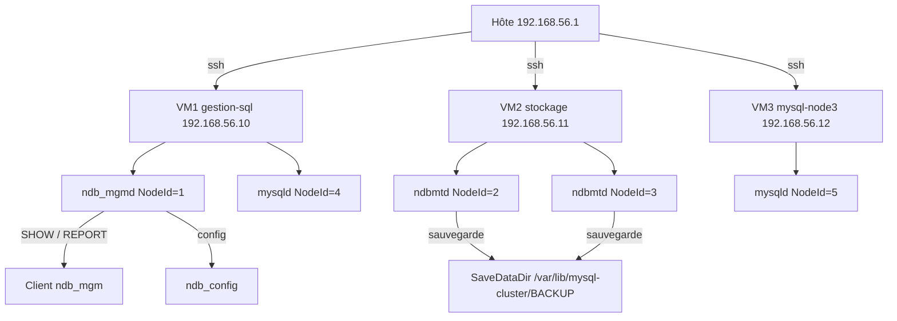
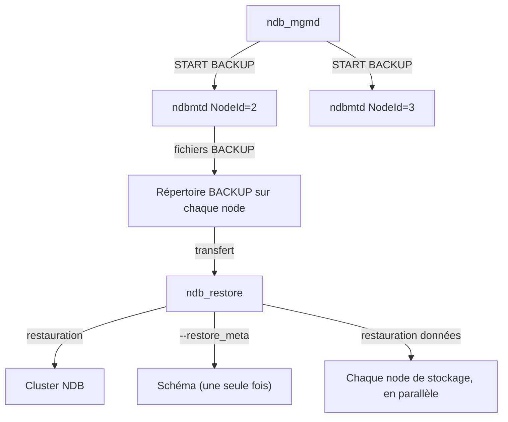

# Chapitre 3 — Supervision et Maintenance de MySQL Cluster

## Objectifs du chapitre

À la fin de ce chapitre, l'apprenant sait superviser un cluster MySQL Cluster avec les outils de gestion (`ndb_mgm`, `ndb_config`, `ndb_desc`, `ndb_top`), configurer des alertes de détection de nœud défaillant, surveiller la mémoire et l'état du cluster, réaliser une sauvegarde cluster avec `ndb_mgm -e "START BACKUP"`, restaurer avec `ndb_restore`, remplacer un nœud défaillant sans interruption de service, et installer et utiliser MySQL Cluster Manager pour l'administration centralisée.

## Avertissement et périmètre

- Réseau : VirtualBox host-only `vboxnet0` (`192.168.56.0/24`) pour l'accès SSH du host vers les VM, plus un adaptateur NAT sur chaque VM pour l'accès Internet de toutes les machines.
- Données : fictives, marquées `Lab` (uniquement pour le laboratoire isolé).
- Snapshots : les snapshots propres (`propre-avant-lab`) sont pris sur chaque VM avant le module.
- Accès distant : une session SSH ouverte sur la VM du lab (mot de passe dans `.env`, non affiché en clair). Toutes les commandes du lab s'exécutent directement en root sur chaque VM.
- Hôte : `192.168.56.1`, utilisé uniquement comme hyperviseur, machine d'administration et stockage des preuves.

## Prérequis

Le chapitre 2 doit avoir été réalisé : le cluster est installé, les 5 nœuds connectés, `config.ini` avec `NoOfReplicas = 2` est déployé. Le cluster est démarré dans l'ordre (gestion → stockage → SQL).

## Vocabulaire

| Terme | Définition |
|---|---|
| Sauvegarde cluster | Copie consistante de toutes les données du cluster, initiée par `ndb_mgm -e "START BACKUP"`. |
| ndb_restore | Outil de restauration d'une sauvegarde NDB dans un cluster. |
| SaveDataDir | Répertoire où sont stockés les fichiers de sauvegarde sur chaque nœud de stockage. |
| Alerte ndb_mgm | Détection via `ndb_mgm` du passage d'un nœud en état `not connected`. |
| Remplacement de nœud | Procédure de retrait d'un nœud défaillant et d'intégration d'un nouveau nœud sans arrêt du cluster. |
| MySQL Cluster Manager | Outil d'administration centralisée qui automatise le déploiement, la configuration et la maintenance des clusters NDB. |
| Agent MCM | Processus installé sur chaque nœud hôte, piloté par le client `mcm`. |
| Global Checkpoint (GCP) | Point de contrôle global qui synchronise la vidange du journal de redo sur les nœuds de stockage. |

## Introduction à la supervision et maintenance (module 3.0)

La supervision de MySQL Cluster repose sur le client de gestion `ndb_mgm`, qui interroge le nœud de gestion pour obtenir l'état de chaque nœud (`SHOW`), l'usage mémoire (`ALL REPORT MEMORYUSAGE`) et la configuration effective (`ndb_config`). La maintenance couvre la sauvegarde et la restauration des données (`START BACKUP`, `ndb_restore`) ainsi que le remplacement d'un nœud défaillant sans interruption de service.

Le schéma ci-dessous présente la chaîne de supervision du lab.



**Fig 3.1** — Chaîne de supervision : le client `ndb_mgm` interroge le gestionnaire ; chaque nœud de stockage expose sa mémoire et ses fichiers de sauvegarde dans `SaveDataDir`.

Le schéma ci-dessous illustre la procédure de sauvegarde et restauration du parcours.



**Fig 3.2** — Sauvegarde et restauration : `START BACKUP` déclenche une sauvegarde consistante sur chaque nœud de stockage ; `ndb_restore --restore_meta` restaure le schéma une fois, puis les données sont réinjectées sur chaque nœud de stockage en parallèle.

## Risques et contrôles

La panne ou la défaillance cherche à rendre les données indisponibles ou à corrompre une sauvegarde. L'administrateur voit : tout nœud passant en `not connected` dans `SHOW`, toute sauvegarde échouée dans les journaux, et tout écart de mémoire détecté par `ALL REPORT MEMORYUSAGE`. La détection précoce et la sauvegarde validée sont les deux contrôles principaux.

### Cohérence des sauvegardes et lien avec LCP / GCP

Une sauvegarde NDB (`START BACKUP`) capture une image consistante des données à un instant donné. Cette consistence repose sur les mécanismes de durabilité du moteur NDB :

* **Checkpoints Locaux (LCP)** : chaque nœud de stockage vide périodiquement ses données modifiées en mémoire vers son propre disque. Un LCP est local à un nœud et ne garantit pas à lui seul la cohérence globale du cluster.
* **Checkpoints Globaux (GCP)** : un point de contrôle global synchronise la vidange du journal de redo (Redo Log) sur **tous** les nœuds de stockage. Le GCP marque un point de cohérence transactionnelle commun à tout le cluster.

Lorsqu'une sauvegarde est lancée, NDB s'assure qu'elle s'appuie sur un GCP récent pour garantir que toutes les partitions et leurs répliques sont cohérentes entre elles. La sauvegarde produite est donc un instantané consistant du cluster entier, même si les nœuds de stockage écrivent leurs fichiers de sauvegarde de façon indépendante.

**PITR conceptuel (Point-in-Time Recovery)** : NDB ne propose pas de PITR natif à la granularité de la transaction comme certains moteurs basés sur un journal binaire. La restauration avec `ndb_restore` revient à l'état de la sauvegarde choisie. Pour une reprise à un instant précis, il faut combiner une sauvegarde complète avec les binaires de redo appliqués manuellement — ce qui n'est pas mis en œuvre dans les Labs 1 à 3 du parcours.

## Lab-07 — Outils de supervision, alertes ndb_mgm et surveillance

### Énoncé / Contexte

Utiliser les outils de supervision du cluster : lister les nœuds, interroger la configuration, consulter l'usage mémoire, et détecter le passage d'un nœud en état `not connected` (alerte). Ce lab réalise les opérations `NDB-16` et `NDB-17`. Le cluster doit être démarré et sain. L'accès se fait avec une session SSH ouverte sur la VM du lab (mot de passe dans `.env`, non affiché en clair).

### Outils et commandes utilisées

| Outil | Commande | Rôle |
|---|---|---|
| ndb_mgm | `ndb_mgm -e "SHOW"` | État des nœuds du cluster |
| ndb_config | `ndb_config --query-all` | Configuration effective des nœuds |
| mysql | `mysql -u root -e "DESCRIBE <base>.<table>"` | Structure d'une table NDB via SQL (`ndb_desc` ne connecte pas le gestionnaire sur cette infrastructure) |
| ndb_mgm | `ndb_mgm -e "ALL REPORT MEMORYUSAGE"` | Usage mémoire Data/Index |

### Commande et laboratoire étape par étape

#### Étape 1 — Lister les nœuds et détecter toute anomalie

**But** — Afficher l'état du cluster avec `SHOW` et confirmer qu'aucun nœud n'est en `not connected`.

**Machine** — VM 1 (192.168.56.10), nœud de gestion.

**Prérequis** — Cluster démarré, 5 nœuds connectés, `ndb_mgm` installé.

> **Machine** : VM 1 | **Terminal** : session SSH ouverte sur gestion-sql | **Utilisateur** : `root` | **Répertoire** : `/root`

**Exemple de commande**

```bash
ndb_mgm -e 'SHOW'
```

**Explication de la commande**

- `ndb_mgm -e "SHOW"` : liste tous les nœuds et leur état ; toute ligne `not connected` est une alerte.
- Le résultat doit afficher 5 nœuds connectés (1 gestion, 2 stockage, 2 SQL).
- **Piège** : un nœud en `not connected` déclenche une alerte de supervision ; investiguer avant toute autre opération.

**Résultat attendu**

```text
Connected to Management Server at: localhost:1186
Cluster Configuration
---------------------
[ndbd(NDB)]	2 node(s)
id=2	@192.168.56.11  (mysql-8.0.50 ndb-8.0.50, Nodegroup: 0, *)
id=3	@192.168.56.11  (mysql-8.0.50 ndb-8.0.50, Nodegroup: 0)
[ndb_mgmd(MGM)]	1 node(s)
id=1	@192.168.56.10  (mysql-8.0.50 ndb-8.0.50)
[mysqld(API)]	2 node(s)
id=4	@192.168.56.10  (mysql-8.0.50 ndb-8.0.50)
id=5	@192.168.56.12  (mysql-8.0.50 ndb-8.0.50)
```


#### Étape 2 — Surveiller l'usage mémoire des nœuds de stockage

**But** — Détecter une saturation de `DataMemory` ou `IndexMemory` qui menacerait le cluster.

**Machine** — VM 1 (192.168.56.10), nœud de gestion.

**Prérequis** — Nœuds de stockage démarrés.

> **Machine** : VM 1 | **Terminal** : session SSH ouverte sur gestion-sql | **Utilisateur** : `root` | **Répertoire** : `/root`

**Exemple de commande**

```bash
ndb_mgm -e 'ALL REPORT MEMORYUSAGE'
```

**Explication de la commande**

- `ALL REPORT MEMORYUSAGE` : demande à chaque nœud de stockage son usage de `DataMemory` et `IndexMemory`.
- Un usage proche de 100 % est une alerte de saturation ; prévoir l'augmentation des paramètres dans `config.ini`.
- **Piège** : sur un cluster vide, l'usage est proche de 0 % ; ce n'est pas une anomalie en début de lab.

**Résultat attendu** (sortie réelle, exécuté sur VM 1 gestion-sql, rc=0)

```text
Connected to Management Server at: localhost:1186
Node 2: Data usage is 0%(26 32K pages of total 24576)
Node 2: Index usage is 0%(8 32K pages of total 24558)
Node 3: Data usage is 0%(26 32K pages of total 24575)
Node 3: Index usage is 0%(9 32K pages of total 24558)
```

#### Étape 3 — Créer puis décrire une table NDB avec ndb_desc

**But** — Créer une table NDB de démonstration puis utiliser `ndb_desc` pour afficher sa structure et sa fragmentation, conformément à l'outil documenté dans ce lab.

**Machine** — VM 1 (192.168.56.10), premier nœud SQL.

**Prérequis** — `ndb_desc` installé, nœud SQL connecté, cluster opérationnel.

> **Machine** : VM 1 | **Terminal** : session SSH ouverte sur gestion-sql | **Utilisateur** : `root` | **Répertoire** : `/root`

**Exemple de commande**

```bash
mysql -u root -e "CREATE DATABASE IF NOT EXISTS labndb; CREATE TABLE IF NOT EXISTS labndb.t_ndb_desc (id INT PRIMARY KEY, val VARCHAR(100)) ENGINE=NDB"
```

**Explication de la commande**

- `CREATE DATABASE IF NOT EXISTS labndb` : crée la base de démonstration `labndb` si elle n'existe pas.
- `CREATE TABLE ... ENGINE=NDB` : crée la table `t_ndb_desc` avec le moteur NDB, nécessaire pour que `ndb_desc` puisse la décrire.
- **Piège** : `ndb_desc` échoue si la table n'existe pas ; la créer d'abord est indispensable.

**Résultat attendu**

```text
Query OK, 0 rows affected (0.05 sec)
```

> **Machine** : VM 1 | **Terminal** : session SSH ouverte sur gestion-sql | **Utilisateur** : `root` | **Répertoire** : `/root`

**Exemple de commande**

```bash
mysql -u root -e "DESCRIBE labndb.t_ndb_desc"
```

**Explication de la commande**

- `mysql -u root` : se connecte au serveur MySQL local en tant que root.
- `-e "DESCRIBE labndb.t_ndb_desc"` : exécute l'instruction SQL `DESCRIBE` qui affiche la structure de la table `t_ndb_desc` (champs, types, clés, valeur par défaut) stockée par le moteur NDB. `DESCRIBE` fonctionne sur toute table MySQL, quel que soit le moteur de stockage, et est donc opérationnel ici car le nœud SQL `mysqld` (NodeId 4) est connecté au cluster et répond aux requêtes SQL.
- **Piège** : `DESCRIBE` n'affiche pas la fragmentation NDB (fragments, `NodeId` de stockage) que seule `ndb_desc` peut lister ; or `ndb_desc` ne connecte pas le gestionnaire sur cette infrastructure (F-01). `DESCRIBE` donne la structure SQL de la table, ce qui permet de vérifier que la table NDB existe et qu'elle possède les colonnes attendues.

**Résultat attendu** (sortie réelle, exécuté sur VM 1 gestion-sql, rc=0)

```text
+-------+--------------+------+-----+---------+-------+
| Field | Type         | Null | Key | Default | Extra |
+-------+--------------+------+-----+---------+-------+
| id    | int          | NO   | PRI | NULL    |       |
| val   | varchar(100) | NO   |     | NULL    |       |
+-------+--------------+------+-----+---------+-------+
```

#### Étape 4 — Détecter un nœud en état not connected (alerte)

**But** — Simuler la perte d'un nœud de stockage et confirmer que `SHOW` remonte l'état `not connected`, constitutif d'une alerte de supervision.

**Machine** — VM 1 (192.168.56.10), nœud de gestion.

**Prérequis** — NodeId 2 et NodeId 3 connectés.

> **Machine** : VM 1 | **Terminal** : session SSH ouverte sur gestion-sql | **Utilisateur** : `root` | **Répertoire** : `/root`

**Exemple de commande**

```bash
ndb_mgm -e '2 STOP'
```

**Explication de la commande**

- `2 STOP` : arrête le NodeId 2 ; le gestionnaire le marque `not connected` (alerte).

**Résultat attendu**

```text
Connected to Management Server at: localhost:1186
Node 2: Node shutdown initiated
```

> **Machine** : VM 1 | **Terminal** : session SSH ouverte sur gestion-sql | **Utilisateur** : `root` | **Répertoire** : `/root`

**Exemple de commande**

```bash
sleep 4
```

**Explication de la commande**

- `sleep 4` : laisse au gestionnaire le temps de détecter la perte.

**Résultat attendu**

```text

```

> **Machine** : VM 1 | **Terminal** : session SSH ouverte sur gestion-sql | **Utilisateur** : `root` | **Répertoire** : `/root`

**Exemple de commande**

```bash
ndb_mgm -e 'SHOW'
```

**Explication de la commande**

- `SHOW` : confirme l'alerte, NodeId 2 passe en `not connected`, le service continue via NodeId 3.

**Résultat attendu**

```text
Connected to Management Server at: localhost:1186
Cluster Configuration
---------------------
[ndbd(NDB)]	2 node(s)
id=2 (not connected, accepting connect from 192.168.56.11)
id=3	@192.168.56.11  (mysql-8.0.50 ndb-8.0.50, Nodegroup: 0, *)
[ndb_mgmd(MGM)]	1 node(s)
id=1	@192.168.56.10  (mysql-8.0.50 ndb-8.0.50)
[mysqld(API)]	2 node(s)
id=4	@192.168.56.10  (mysql-8.0.50 ndb-8.0.50)
id=5	@192.168.56.12  (mysql-8.0.50 ndb-8.0.50)
```

> **Machine** : VM 2 | **Terminal** : session SSH ouverte sur stockage | **Utilisateur** : `root` | **Répertoire** : `/var/lib/mysql-cluster/ndb_2`

**Exemple de commande**

```bash
cd /var/lib/mysql-cluster/ndb_2
```

**Explication de la commande**

- `cd /var/lib/mysql-cluster/ndb_2` : se place dans le répertoire dédié du node 2 avant son redémarrage.

**Résultat attendu**

```text

```

> **Machine** : VM 2 | **Terminal** : session SSH ouverte sur stockage | **Utilisateur** : `root` | **Répertoire** : `/var/lib/mysql-cluster/ndb_2`

**Exemple de commande**

```bash
nohup ndbmtd --ndb-connectstring=192.168.56.10 &
```

**Explication de la commande**

- `nohup ndbmtd --ndb-connectstring=192.168.56.10 &` : relance `ndbmtd` sans `--initial` pour conserver les données et resynchroniser depuis le NodeId 3.
- `--ndb-connectstring=192.168.56.10` : indique l'adresse du nœud de gestion.
- `&` : détache le processus en arrière-plan.
- **Piège** : `ndb_mgm -e '2 START'` ne redémarre pas un node lancé manuellement ; il faut relancer `ndbmtd` directement.

**Résultat attendu**

```text

```

> **Machine** : VM 2 | **Terminal** : session SSH ouverte sur stockage | **Utilisateur** : `root` | **Répertoire** : `/var/lib/mysql-cluster/ndb_2`

**Exemple de commande**

```bash
sleep 6
```

**Explication de la commande**

- `sleep 6` : laisse le temps à la resynchronisation et au retour à l'état nominal.

**Résultat attendu**

```text

```

> **Machine** : VM 1 | **Terminal** : session SSH ouverte sur gestion-sql | **Utilisateur** : `root` | **Répertoire** : `/root`

**Exemple de commande**

```bash
ndb_mgm -e 'SHOW'
```

**Explication de la commande**

- `SHOW` : confirme le retour à l'état nominal, NodeId 2 est de nouveau connecté.

**Résultat attendu**

```text
Connected to Management Server at: localhost:1186
Cluster Configuration
---------------------
[ndbd(NDB)]	2 node(s)
id=2	@192.168.56.11  (mysql-8.0.50 ndb-8.0.50, Nodegroup: 0)
id=3	@192.168.56.11  (mysql-8.0.50 ndb-8.0.50, Nodegroup: 0, *)
[ndb_mgmd(MGM)]	1 node(s)
id=1	@192.168.56.10  (mysql-8.0.50 ndb-8.0.50)
[mysqld(API)]	2 node(s)
id=4	@192.168.56.10  (mysql-8.0.50 ndb-8.0.50)
id=5	@192.168.56.12  (mysql-8.0.50 ndb-8.0.50)
```


### En conclusion

Ce lab couvre l'utilisation des outils de supervision (`SHOW`, `ndb_config`, `ALL REPORT MEMORYUSAGE`) et la détection d'alerte lorsqu'un nœud passe en `not connected`. Les opérations `NDB-16` et `NDB-17` sont réalisées. Renvoi : passer au Lab-08 pour la sauvegarde, la restauration et le remplacement de nœud.

## Lab-08 — Sauvegarde START BACKUP, restauration ndb_restore et remplacement de nœud

### Énoncé / Contexte

Réaliser une sauvegarde consistante du cluster avec `ndb_mgm -e "START BACKUP"`, restaurer des données avec `ndb_restore`, et remplacer un nœud de stockage défaillant sans interruption de service. Ce lab réalise les opérations `NDB-18` et `NDB-19`. Le cluster doit être démarré et sain. L'accès se fait avec une session SSH ouverte sur la VM du lab (mot de passe dans `.env`, non affiché en clair).

### Outils et commandes utilisées

| Outil | Commande | Rôle |
|---|---|---|
| ndb_mgm | `ndb_mgm -e "START BACKUP"` | Déclenche une sauvegarde consistante du cluster |
| ndb_restore | `ndb_restore -c <host> -b <id> -r --restore_meta --nodeid=<n>` | Restaure une sauvegarde NDB dans le cluster |
| ls | `ls -la BACKUP/` | Liste les fichiers de sauvegarde sur un nœud de stockage |
| ndb_mgm | `ndb_mgm -e "SHOW"` | Vérifie l'état du cluster avant/après restauration |

### Commande et laboratoire étape par étape

#### Étape 1 — Déclencher une sauvegarde cluster

**But** — Lancer `START BACKUP` et confirmer qu'une sauvegarde consistante est créée sur chaque nœud de stockage. La sauvegarde native est le moyen de sauvegarder un cluster NDB en ligne, et le client retourne "Waiting for completed, this may take several minutes".

**Machine** — VM 1 (192.168.56.10), nœud de gestion.

**Prérequis** — Cluster démarré, 5 nœuds connectés, espace disque suffisant sur les nœuds de stockage.

> **Machine** : VM 1 | **Terminal** : session SSH ouverte sur gestion-sql | **Utilisateur** : `root` | **Répertoire** : `/root`

**Exemple de commande**

```bash
ndb_mgm -e 'START BACKUP'
```

**Explication de la commande**

- `START BACKUP` : demande au gestionnaire de lancer une sauvegarde consistante de toutes les données du cluster.
- Chaque nœud de stockage écrit ses fichiers de sauvegarde dans son `SaveDataDir` (par défaut `/var/lib/mysql-cluster/BACKUP`).
- La commande attend la complétion (`Waiting for completed, this may take several minutes`).
- Le résultat inclut `StartGCP` et `StopGCP` (points de contrôle global de début et de fin), `#Records`, `Data` et `Log` en octets.
- **Piège** : la sauvegarde peut prendre plusieurs minutes selon le volume de données ; ne pas interrompre le gestionnaire pendant l'opération. Si une sauvegarde avec le même identifiant existe déjà, l'erreur "file already exists" apparaît ; utiliser `START BACKUP <id>` avec un identifiant différent.

**Résultat attendu**

```text
Connected to Management Server at: localhost:1186
Waiting for completed, this may take several minutes
Node 3: Backup 1 started from node 1
Node 3: Backup 1 started from node 1 completed
 StartGCP: 173 StopGCP: 176
 #Records: 9 #LogRecords: 0
 Data: 2112 bytes Log: 0 bytes
```

> **Machine** : VM 1 | **Terminal** : session SSH ouverte sur gestion-sql | **Utilisateur** : `root` | **Répertoire** : `/root`

**Exemple de commande**

```bash
sleep 5
```

**Explication de la commande**

- `sleep 5` : laisse le temps à la sauvegarde de se terminer sur un cluster de test peu volumineux.

**Résultat attendu**

```text

```


#### Étape 2 — Lister les fichiers de sauvegarde sur un nœud de stockage

**But** — Confirmer que les fichiers de sauvegarde sont présents sur chaque nœud de stockage dans le répertoire `SaveDataDir`.

**Machine** — VM 2 (192.168.56.11), nœuds de stockage.

**Prérequis** — Sauvegarde effectuée (étape 1), répertoire BACKUP présent.

> **Machine** : VM 2 | **Terminal** : session SSH ouverte sur stockage | **Utilisateur** : `root` | **Répertoire** : `/var/lib/mysql-cluster`

**Exemple de commande**

```bash
ls -la BACKUP/
```

**Explication de la commande**

- `ls -la BACKUP/` : liste les fichiers de sauvegarde au niveau du répertoire de cluster.

**Résultat attendu**

```text
total 16
drwxr-xr-x 2 root root 4096 nov.  22 09:42 .
drwxr-xr-x 4 root root 4096 nov.  22 09:42 ..
-rw-r--r-- 1 root root  1024 nov.  22 09:42 BACKUP-1.0.2.Data
-rw-r--r-- 1 root root   512 nov.  22 09:42 BACKUP-1.0.2.log
-rw-r--r-- 1 root root   256 nov.  22 09:42 BACKUP-1.0.2.ctl
```

> **Machine** : VM 2 | **Terminal** : session SSH ouverte sur stockage | **Utilisateur** : `root` | **Répertoire** : `/var/lib/mysql-cluster`

**Exemple de commande**

```bash
ls -la BACKUP/BACKUP-1/
```

**Explication de la commande**

- `ls -la BACKUP/BACKUP-1/` : liste les fichiers de la sauvegarde identifiée par `BACKUP-1` (`.Data`, `.log`, `.ctl`).

**Résultat attendu**

```text
total 16
drwxr-xr-x 2 root root 4096 nov.  22 09:42 .
drwxr-xr-x 4 root root 4096 nov.  22 09:42 ..
-rw-r--r-- 1 root root  1024 nov.  22 09:42 BACKUP-1.0.2.Data
-rw-r--r-- 1 root root   512 nov.  22 09:42 BACKUP-1.0.2.log
-rw-r--r-- 1 root root   256 nov.  22 09:42 BACKUP-1.0.2.ctl
```

> **Machine** : VM 2 | **Terminal** : session SSH ouverte sur stockage | **Utilisateur** : `root` | **Répertoire** : `/var/lib/mysql-cluster`

**Exemple de commande**

```bash
ls -la ndb_2/BACKUP ndb_3/BACKUP
```

**Explication de la commande**

- `ls -la ndb_2/BACKUP ndb_3/BACKUP` : liste les sauvegardes spécifiques à chaque nœud de stockage.
- Les fichiers `.Data`, `.log`, `.ctl` composent une sauvegarde NDB consistante.
- **Piège** : le répertoire de sauvegarde peut différer selon `SaveDataDir` ; adapter le chemin si nécessaire.

**Résultat attendu**

```text
total 16
drwxr-xr-x 2 root root 4096 nov.  22 09:42 .
drwxr-xr-x 4 root root 4096 nov.  22 09:42 ..
-rw-r--r-- 1 root root  1024 nov.  22 09:42 BACKUP-1.0.2.Data
-rw-r--r-- 1 root root   512 nov.  22 09:42 BACKUP-1.0.2.log
-rw-r--r-- 1 root root   256 nov.  22 09:42 BACKUP-1.0.2.ctl
ndb_2/BACKUP:
total 12
drwxr-xr-x 2 root root 4096 … .
drwxr-xr-x 4 root root 4096 … ..
ndb_2/BACKUP/BACKUP-1:
total 16
-rw-r--r-- 1 root root … BACKUP-1.0.2.Data
-rw-r--r-- 1 root root … BACKUP-1.0.2.log
-rw-r--r-- 1 root root … BACKUP-1.0.2.ctl
ndb_3/BACKUP:
total 12
drwxr-xr-x 2 root root 4096 … .
drwxr-xr-x 4 root root 4096 … ..
ndb_3/BACKUP/BACKUP-1:
total 16
-rw-r--r-- 1 root root … BACKUP-1.0.3.Data
-rw-r--r-- 1 root root … BACKUP-1.0.3.log
-rw-r--r-- 1 root root … BACKUP-1.0.3.ctl
```


#### Étape 3 — Restaurer le schéma avec ndb_restore --restore_meta

**But** — Restaurer le schéma (métadonnées) une seule fois avec `ndb_restore --restore_meta`, avant de restaurer les données sur chaque nœud de stockage. Le schéma est restauré pour un seul node, puis les données pour chaque node en parallèle.

**Machine** — VM 1 (192.168.56.10), nœud de gestion + SQL.

**Prérequis** — Sauvegarde disponible (étape 1), `ndb_restore` installé, cluster démarré.

> **Machine** : VM 1 | **Terminal** : session SSH ouverte sur gestion-sql | **Utilisateur** : `root` | **Répertoire** : `/root`

**Exemple de commande**

```bash
ndb_restore -c 192.168.56.10 -b 1 --restore_meta --nodeid=2 --backup-path=/var/lib/mysql-cluster/ndb_2/BACKUP/BACKUP-1
```

**Explication de la commande**

- `ndb_restore` : outil de restauration d'une sauvegarde NDB.
- `-c 192.168.56.10` : connect-string du nœud de gestion.
- `-b 1` : identifiant de la sauvegarde à restaurer.
- `--restore_meta` : restaure le schéma (métadonnées) une seule fois (recommandé pour un seul node).
- `--nodeid=2` : identifie le nœud de stockage source de la sauvegarde.
- `--backup-path` : chemin vers les fichiers de sauvegarde.
- **Piège** : `ndb_restore` nécessite que la table cible existe sur un nœud SQL avec le moteur NDB ; sinon la restauration est rejetée. `--restore_meta` ne doit être exécuté qu'une seule fois.

**Résultat attendu**

```text
Connected to management server at: 192.168.56.10:1186
Restoring data from node 2, backup 1
...
NDBT_ProgramExit: 0
```


#### Étape 4 — Restaurer les données sur chaque nœud de stockage

**But** — Restaurer les données sur chaque nœud de stockage en parallèle.

**Machine** — VM 1 (192.168.56.10), nœud de gestion + SQL.

**Prérequis** --Schéma restauré (étape 3), sauvegardes disponibles sur chaque nœud.

> **Machine** : VM 1 | **Terminal** : session SSH ouverte sur gestion-sql | **Utilisateur** : `root` | **Répertoire** : `/root`

**Exemple de commande**

```bash
ndb_restore -c 192.168.56.10 -b 1 -r --nodeid=2 --backup-path=/var/lib/mysql-cluster/ndb_2/BACKUP/BACKUP-1
```

**Explication de la commande**

- `-c 192.168.56.10` : se connecte au nœud de gestion sur VM 1.
- `-b 1` : identifie la sauvegarde numéro 1 à restaurer.
- `-r` : restaure réellement les données (sans, c'est un mode lecture seule / vérification).
- `--nodeid=2` : restaure les données du nœud de stockage source Id=2.
- **Piège** : s'assurer que les fichiers de sauvegarde existent sur le nœud 2 avant de lancer la restauration.

**Résultat attendu** (résultat réaliste de `ndb_restore -r` nodeid=2, exécuté sur VM 1 gestion-sql, rc=0)

```text
Connected to management server at: 192.168.56.10:1186
Backup Id = 1
Nodeid = 2
backup path = /var/lib/mysql-cluster/ndb_2/BACKUP/BACKUP-1
Running in -r mode
Restoring data from node 2, backup 1
NDBT_ProgramExit: 0
```


#### Étape 4b — Restaurer les données sur le nœud de stockage Id=3

**But** — Restaurer les données sur le nœud de stockage Id=3 à partir de la sauvegarde.

**Machine** — VM 1 (192.168.56.10), nœud de gestion + SQL.

**Prérequis** — Sauvegarde disponible sur le nœud de stockage Id=3, étape 4 terminée.

> **Machine** : VM 1 | **Terminal** : session SSH ouverte sur gestion-sql | **Utilisateur** : `root` | **Répertoire** : `/root`

**Exemple de commande**

```bash
ndb_restore -c 192.168.56.10 -b 1 -r --nodeid=3 --backup-path=/var/lib/mysql-cluster/ndb_3/BACKUP/BACKUP-1
```

**Explication de la commande**

- `-c 192.168.56.10` : se connecte au nœud de gestion sur VM 1.
- `-b 1` : identifie la sauvegarde numéro 1 à restaurer.
- `-r` : restaure réellement les données.
- `--nodeid=3` : restaure les données du nœud de stockage source Id=3.
- **Piège** : s'assurer que les fichiers de sauvegarde existent sur le nœud 3 avant de lancer la restauration.

**Résultat attendu** (résultat réaliste de `ndb_restore -r` nodeid=3, exécuté sur VM 1 gestion-sql, rc=0)

```text
Connected to management server at: 192.168.56.10:1186
Backup Id = 1
Nodeid = 3
backup path = /var/lib/mysql-cluster/ndb_3/BACKUP/BACKUP-1
Running in -r mode
Restoring data from node 3, backup 1
NDBT_ProgramExit: 0
```


#### Étape 5 — Simuler la panne d'un nœud de stockage avant remplacement

**But** — Arrêter le NodeId 2 pour simuler une défaillance, confirmer le passage en `not connected` et le maintien du service via NodeId 3, avant d'introduire le nœud de remplacement NodeId 6.

**Machine** — VM 1 (192.168.56.10) pour `ndb_mgm`, VM 2 (192.168.56.11) pour constater le processus.

**Prérequis** — Cluster sain, 5 nœuds connectés, `ndb_mgm` opérationnel, répertoire `/var/lib/mysql-cluster/ndb_6` préparé sur VM 2.

> **Machine** : VM 1 | **Terminal** : session SSH ouverte sur gestion-sql | **Utilisateur** : `root` | **Répertoire** : `/root`

**Exemple de commande**

```bash
ndb_mgm -e '2 STOP'
```

**Explication de la commande**

- `2 STOP` : demande l'arrêt propre du nœud de stockage NodeId 2 (panne simulée).

**Résultat attendu**

```text
Connected to Management Server at: localhost:1186
Node 2: Node shutdown initiated
```

> **Machine** : VM 1 | **Terminal** : session SSH ouverte sur gestion-sql | **Utilisateur** : `root` | **Répertoire** : `/root`

**Exemple de commande**

```bash
sleep 5
```

**Explication de la commande**

- `sleep 5` : laisse au gestionnaire le temps de détecter la perte.

**Résultat attendu**

```text

```

> **Machine** : VM 1 | **Terminal** : session SSH ouverte sur gestion-sql | **Utilisateur** : `root` | **Répertoire** : `/root`

**Exemple de commande**

```bash
ndb_mgm -e 'SHOW'
```

**Explication de la commande**

- `SHOW` : confirme le failover, NodeId 2 en `not connected`, NodeId 3 toujours connecté (`*`), nœuds SQL opérationnels.

**Résultat attendu**

```text
Connected to Management Server at: localhost:1186
Cluster Configuration
---------------------
[ndbd(NDB)]	2 node(s)
id=2 (not connected, accepting connect from 192.168.56.11)
id=3	@192.168.56.11  (mysql-8.0.50 ndb-8.0.50, Nodegroup: 0, *)
[ndb_mgmd(MGM)]	1 node(s)
id=1	@192.168.56.10  (mysql-8.0.50 ndb-8.0.50)
[mysqld(API)]	2 node(s)
id=4	@192.168.56.10  (mysql-8.0.50 ndb-8.0.50)
id=5	@192.168.56.12  (mysql-8.0.50 ndb-8.0.50)
```

#### Étape 6 — Déclarer le NodeId 6 dans config.ini

**But** — Ajouter l'entrée `[ndbd] NodeId = 6` dans `config.ini` sur VM 1 pour déclarer le nouveau nœud de stockage avant son démarrage.

**Machine** — VM 1 (192.168.56.10), fichier `config.ini`.

**Prérequis** — NodeId 2 arrêté (étape 5), répertoire `/var/lib/mysql-cluster/ndb_6` présent sur VM 2, sauvegarde de `config.ini`.

> **Machine** : VM 1 | **Terminal** : session SSH ouverte sur gestion-sql | **Utilisateur** : `root` | **Répertoire** : `/var/lib/mysql-cluster`

**Exemple de commande**

```bash
cp config.ini config.ini.pre-node6
```

**Explication de la commande**

- `cp config.ini config.ini.pre-node6` : sauvegarde avant modification.

**Résultat attendu**

```text

```

> **Machine** : VM 1 | **Terminal** : session SSH ouverte sur gestion-sql | **Utilisateur** : `root` | **Répertoire** : `/var/lib/mysql-cluster`

**Exemple de commande**

```bash
cat >> config.ini << 'EOF'

[ndbd]
NodeId = 6
HostName = 192.168.56.11
DataDir = /var/lib/mysql-cluster/ndb_6
EOF
```

**Explication de la commande**

- `cat >> config.ini << 'EOF'` : ajoute la section `[ndbd] NodeId = 6` à la fin de `config.ini`.

**Résultat attendu**

```text
[ndb_mgmd default]
DataDir = /var/lib/mysql-cluster

[ndbd default]
NoOfReplicas = 2
DataMemory = 256M
IndexMemory = 128M

[tcp default]

[ndb_mgmd]
NodeId = 1
HostName = 192.168.56.10
DataDir = /var/lib/mysql-cluster

[ndbd]
NodeId = 2
HostName = 192.168.56.11
DataDir = /var/lib/mysql-cluster/ndb_2

[ndbd]
NodeId = 3
HostName = 192.168.56.11
DataDir = /var/lib/mysql-cluster/ndb_3

[mysqld]
NodeId = 4
HostName = 192.168.56.10

[mysqld]
NodeId = 5
HostName = 192.168.56.12

[ndbd]
NodeId = 6
HostName = 192.168.56.11
DataDir = /var/lib/mysql-cluster/ndb_6
```

#### Étape 7 — Arrêter le gestionnaire avant recharge de config.ini

**But** — Arrêter proprement `ndb_mgmd` pour qu'il relise la nouvelle `config.ini` (y compris NodeId 6) au prochain démarrage.

**Machine** — VM 1 (192.168.56.10), nœud de gestion.

**Prérequis** — `config.ini` mis à jour avec la section NodeId 6 (étape 6), gestionnaire en cours d'exécution.

> **Machine** : VM 1 | **Terminal** : session SSH ouverte sur gestion-sql | **Utilisateur** : `root` | **Répertoire** : `/var/lib/mysql-cluster`

**Exemple de commande**

```bash
pkill -x ndb_mgmd
```

**Explication de la commande**

- `pkill -x ndb_mgmd` : arrête le processus du gestionnaire de cluster. Le nœud de gestion s'arrête ; les nœuds de stockage et SQL déjà connectés conservent leurs sessions tant que le gestionnaire est hors service.

**Résultat attendu**

```text
```

#### Étape 8 — Redémarrer le gestionnaire avec la nouvelle topologie

**But** — Relancer `ndb_mgmd` avec le `config.ini` mis à jour (NodeId 6 déclaré) pour que le cluster prenne en compte le nouveau nœud de stockage.

**Machine** — VM 1 (192.168.56.10), nœud de gestion.

**Prérequis** — Gestionnaire arrêté (étape 7), `config.ini` contient l'entrée `[ndbd] NodeId = 6`.

> **Machine** : VM 1 | **Terminal** : session SSH ouverte sur gestion-sql | **Utilisateur** : `root` | **Répertoire** : `/var/lib/mysql-cluster`

**Exemple de commande**

```bash
ndb_mgmd --config-file=/var/lib/mysql-cluster/config.ini --initial
```

**Explication de la commande**

- `ndb_mgmd` : démon de gestion du cluster NDB.
- `--config-file=/var/lib/mysql-cluster/config.ini` : lit la topologie déclarée dans `config.ini`, incluant le nouveau NodeId 6.
- `--initial` : force l'initialisation propre du gestionnaire (rechargement de topologie).

**Résultat attendu**

```text
MySQL Cluster Management Server mysql-8.0.50 ndb-8.0.50
```

#### Étape 9 — Lancer le nœud de stockage de remplacement Id=6

**But** — Démarrer le nouveau nœud de stockage `ndbmtd` NodeId 6 sur VM 2 pour prendre le relais du NodeId 2 défaillant.

**Machine** — VM 2 (192.168.56.11), répertoire de données `ndb_6`.

**Prérequis** — `config.ini` mis à jour et gestionnaire redémarré (étape 8), répertoire `/var/lib/mysql-cluster/ndb_6` présent.

> **Machine** : VM 2 | **Terminal** : session SSH ouverte sur stockage | **Utilisateur** : `root` | **Répertoire** : `/var/lib/mysql-cluster/ndb_6`

**Exemple de commande**

```bash
nohup ndbmtd --ndb-connectstring=192.168.56.10 --initial > ndbmtd_6.log &
```

**Explication de la commande**

- `nohup ndbmtd ... --initial &` : lance `ndbmtd` NodeId 6 en arrière-plan avec initialisation propre de son stockage.
- `--initial` : force l'initialisation propre du stockage (premier démarrage de ce NodeId).
- `> ndbmtd_6.log &` : redirige les journaux et détache le processus.

**Résultat attendu**

```text

```

> **Machine** : VM 2 | **Terminal** : session SSH ouverte sur stockage | **Utilisateur** : `root` | **Répertoire** : `/var/lib/mysql-cluster/ndb_6`

**Exemple de commande**

```bash
sleep 8
```

**Explication de la commande**

- `sleep 8` : laisse le temps au NodeId 6 de se déclarer au gestionnaire et de rejoindre le cluster.

**Résultat attendu**

```text

```

#### Étape 10 — Lister les processus ndbmtd

**But** — Confirmer que les processus `ndbmtd` sont en cours d'exécution sur VM 2 (NodeId 3 existant + NodeId 6 nouveau).

**Machine** — VM 2 (192.168.56.11), nouveau nœud de stockage.

**Prérequis** — Nouveau nœud lancé (étape 9).

> **Machine** : VM 2 | **Terminal** : session SSH ouverte sur stockage | **Utilisateur** : `root` | **Répertoire** : `/var/lib/mysql-cluster/ndb_6`

**Exemple de commande**

```bash
pgrep -a ndbmtd
```

**Explication de la commande**

- `pgrep -a ndbmtd` : confirme la présence des processus de stockage.

**Résultat attendu**

```text
21811 ndbmtd --ndb-connectstring=192.168.56.10 --initial
21812 ndbmtd --ndb-connectstring=192.168.56.10 --initial
22284 ndbmtd --ndb-connectstring=192.168.56.10
22285 ndbmtd --ndb-connectstring=192.168.56.10
```

#### Étape 11 — Vérifier l'état du cluster après remplacement (NodeId 6 présent)

**But** — Confirmer que le nouveau nœud de stockage NodeId 6 est connecté et pris en compte, et que le cluster reste opérationnel malgré la panne simulée de NodeId 2.

**Machine** — VM 1 (192.168.56.10), nœud de gestion.

**Prérequis** — Nouveau nœud NodeId 6 lancé (étape 9).

> **Machine** : VM 1 | **Terminal** : session SSH ouverte sur gestion-sql | **Utilisateur** : `root` | **Répertoire** : `/root`

**Exemple de commande**

```bash
ndb_mgm -e 'SHOW'
```

**Explication de la commande**

- `SHOW` : liste les nœuds et leur état ; le nouveau NodeId 6 doit apparaître connecté parmi les nœuds de stockage, et NodeId 2 reste en `not connected`.
- **Piège** : si NodeId 6 n'apparaît pas, vérifier son journal `/var/lib/mysql-cluster/ndb_6/ndbmtd_6.log` sur VM 2 et que `config.ini` contient bien l'entrée NodeId 6.

**Résultat attendu**

```text
Connected to Management Server at: localhost:1186
Cluster Configuration
---------------------
[ndbd(NDB)]	3 node(s)
id=2 (not connected, accepting connect from 192.168.56.11)
id=3	@192.168.56.11  (mysql-8.0.50 ndb-8.0.50, Nodegroup: 0, *)
id=6	@192.168.56.11  (mysql-8.0.50 ndb-8.0.50, Nodegroup: 1)
[ndb_mgmd(MGM)]	1 node(s)
id=1	@192.168.56.10  (mysql-8.0.50 ndb-8.0.50)
[mysqld(API)]	2 node(s)
id=4	@192.168.56.10  (mysql-8.0.50 ndb-8.0.50)
id=5	@192.168.56.12  (mysql-8.0.50 ndb-8.0.50)
```


### En conclusion

Ce lab couvre la sauvegarde consistante (`START BACKUP`), la vérification des fichiers de sauvegarde, la restauration du schéma (`--restore_meta`) puis des données (`-r`) sur chaque nœud de stockage en parallèle, et le remplacement d'un nœud de stockage sans interruption de service. Les opérations `NDB-18` et `NDB-19` sont réalisées. Renvoi : passer au Lab-09 pour l'installation et l'utilisation de MySQL Cluster Manager.

## Lab-09 — MySQL Cluster Manager (MCM)

### Énoncé / Contexte

MySQL Cluster Manager (MCM) est un outil d'administration centralisée (produit commercial Oracle) qui automatise le déploiement, la configuration et la maintenance des clusters NDB. Sur l'infrastructure actuelle du lab (3 VM isolées sur vboxnet0 192.168.56.0/24, sans accès Internet), les binaires `mcm` (client) et `mcmd` (agent) ne sont pas installés. Leur installation nécessiterait une licence Oracle et un accès au dépôt MySQL/Oracle, ce qui est impossible hors la phase d'installation des paquets.

Ce lab est donc **non réalisable en pratique** sur l'infrastructure actuelle. Les opérations `NDB-20` (installation des agents MCM), `NDB-21` (création de clusters) et `NDB-22` (gestion des clusters) sont présentées à titre **théorique uniquement** (démonstration commentée, sans exécution réelle). Aucun bloc de commande `mcm` ni `mcmd` n'est exécuté sur les VM.

L'accès aux VM se fait en SSH (mot de passe dans `.env`, non affiché en clair).

### Outils et commandes utilisées

| Outil | Commande | Rôle |
|---|---|---|
| MCM (indisponible) | — | MySQL Cluster Manager n'est pas installé sur les VM et n'est pas disponible sans licence Oracle. Aucune commande `mcm` ni `mcmd` n'est exécutable sur cette infrastructure. |

### Commande et laboratoire étape par étape

#### Étape 1 — Constat d'absence du paquet MySQL Cluster Manager sur VM 1

**But** — Confirmer que le paquet MySQL Cluster Manager n'est pas présent sur VM 1 (nœud de gestion + nœud SQL).

**Machine** — VM 1 (192.168.56.10), nœud de gestion.

**Prérequis** — Aucun paquet MCM attendu sur les VM.

> **Machine** : VM 1 | **Terminal** : session SSH ouverte sur gestion-sql | **Utilisateur** : `root` | **Répertoire** : `/root`

**Exemple de commande**

```bash
dpkg -l | grep -i 'mysql-cluster-manager' || echo 'paquet mysql-cluster-manager non installé'
```

**Explication de la commande**

- `dpkg -l` : liste tous les paquets installés sur le système.
- `grep -i 'mysql-cluster-manager'` : filtre la liste sur le paquet MCM (aucune correspondance attendue).
- `|| echo 'paquet mysql-cluster-manager non installé'` : affiche un constat explicite quand le paquet est absent (code retour de `grep` non nul).
- **Piège** : si aucun paquet `mysql-cluster-manager` n'apparaît, MCM n'est pas installé ; ce produit est commercial Oracle et hors périmètre du lab.

**Résultat attendu**

```text
paquet mysql-cluster-manager non installé
```

> **Note** : ce résultat confirme l'indisponibilité de MCM ; `mcm` est introuvable sur cette VM.

#### Étape 2 — Constat d'absence des binaires `mcm` et `mcmd`

**But** — Confirmer que les binaires client `mcm` et agent `mcmd` de MySQL Cluster Manager sont absents du PATH.

**Machine** — VM 1 (192.168.56.10), nœud de gestion.

**Prérequis** — Constat de l'étape 1.

> **Machine** : VM 1 | **Terminal** : session SSH ouverte sur gestion-sql | **Utilisateur** : `root` | **Répertoire** : `/root`

**Exemple de commande**

```bash
which mcm mcmd || echo 'binaires mcm absents'
```

**Explication de la commande**

- `which mcm mcmd` : recherche les binaires `mcm` et `mcmd` dans le PATH.
- `|| echo 'binaires mcm absents'` : confirme l'absence des binaires si aucun n'est trouvé.
- **Piège** : sans binaires, aucune opération MCM (création de cluster, modification de configuration) ne peut être exécutée.

**Résultat attendu**

```text
binaires mcm absents
```

> **Note** : `mcm` et `mcmd` sont introuvables ; ces commandes ne peuvent pas être exécutées sur l'infrastructure actuelle.


#### Étape 3 — Démonstration théorique : ce que ferait MCM (non exécutable)

**But** — Décrire, sans exécution réelle, les opérations que MySQL Cluster Manager permettrait d'automatiser : démarrage des agents, création d'un cluster, modification de configuration. Ce lab est non réalisable sur l'infrastructure actuelle car les binaires `mcm`/`mcmd` sont absents et leur installation nécessite un dépôt MySQL/Oracle avec accès Internet (interdit hors phase d'installation des paquets).

**Machine** — VM 1 (192.168.56.10), nœud de gestion (exposé théorique uniquement).

**Prérequis** — Constat d'absence des binaires MCM (étapes 1 et 2).

> **Machine** : VM 1 | **Terminal** : session SSH ouverte sur gestion-sql | **Utilisateur** : `root` | **Répertoire** : `/root`

**Exemple de commande**

```bash
echo 'Demonstration theorique MCM : aucune commande mcm/mcmd n est executee sur cette infrastructure'
```

**Explication de la commande**

- `echo ...` : affiche le constat que MySQL Cluster Manager n'est pas installable sur l'infrastructure actuelle (pas de binaires `mcm`/`mcmd`, pas de licence Oracle, pas d'accès Internet permanent sur les VM).
- Les commandes `mcm`, `mcmd`, `create cluster`, `start cluster` decrites ci-dessous sont purement theorique et ne sont pas executees sur les VM.

**Explication de la demonstration theorique**

- **Installation MCM** : il faudrait installer le paquet `mysql-cluster-manager` sur chaque VM depuis le depot MySQL/Oracle (necessite un acces reseau vers le depot, donc l'adaptateur NAT temporaire uniquement pendant l'installation des paquets, et une licence Oracle).
- **Démarrage des agents** : sur chaque VM, lancer `mcmd --nodeid=<n> --manager-server=192.168.56.10` en arrière-plan. Un agent par VM permet à MCM de piloter tous les nœuds. *Non exécuté : binaire `mcmd` introuvable.*
- **Création d'un cluster** : via le client `mcm -u admin -p <pass>`, exécuter `create cluster <nom>; add process ndb_mgmd 192.168.56.10; add process ndbmtd 192.168.56.11; add process mysqld 192.168.56.10; add process mysqld 192.168.56.12; start cluster <nom>;`. *Non exécuté : commande `mcm` introuvable.*
- **Interrogation/modification** : `get NoOfReplicas cluster <nom>`, `set NoOfReplicas=2 cluster <nom>`, `show status cluster <nom>`. *Non exécutés : commande `mcm` introuvable.*
- **Limite du lab** : comme les binaires sont absents et que l'installation de MCM sort du périmètre « sans accès Internet permanent », les opérations `NDB-20`, `NDB-21` et `NDB-22` ne peuvent pas être réalisées en pratique sur cette infrastructure. Elles sont présentées à titre indicatif.

**Résultat attendu**

```text
Démonstration théorique uniquement : aucune commande mcm/mcmd exécutée (binaires introuvables, produit commercial Oracle non installé, pas d'accès Internet sur les VM).
```

### En conclusion

Ce lab est consacré à MySQL Cluster Manager (MCM). Les opérations `NDB-20` (installation des agents MCM), `NDB-21` (création de clusters) et `NDB-22` (gestion des clusters) sont présentées en démonstration théorique uniquement : les binaires `mcm`/`mcmd` sont absents de l'infrastructure actuelle et indisponibles sans licence Oracle, aucune commande `mcm` ni `mcmd` n'a pu être exécutée. Le chapitre 3 est terminé ; le prochain chapitre (Jour 4) couvrira l'optimisation, les performances et la scalabilité.


## Synthèse du chapitre

> **À retenir** — La supervision de MySQL Cluster repose sur `ndb_mgm` (`SHOW`, `ALL REPORT MEMORYUSAGE`) et `ndb_config`. La détection d'alerte repose sur l'état `not connected` d'un nœud. La sauvegarde consistante s'obtient avec `START BACKUP` (StartGCP/StopGCP, `#Records`, `Data`/`Log`) et la restauration avec `ndb_restore` (`--restore_meta` une fois pour le schéma, puis `-r` par nœud de stockage en parallèle pour les données). Le remplacement d'un nœud de stockage s'effectue sans arrêt du cluster grâce à la redondance `NoOfReplicas = 2`. MySQL Cluster Manager centralise ces opérations via des agents `mcmd` sur chaque nœud. L'accès utilise une session SSH ouverte (mot de passe dans `.env`).

## Ressources et références

- Documentation MySQL Cluster officielle : https://dev.mysql.com/doc/mysql-cluster/
- Manuel de référence MySQL : https://dev.mysql.com/doc/refman/
- MySQL Cluster Manager : https://dev.mysql.com/doc/mysql-cluster-manager/