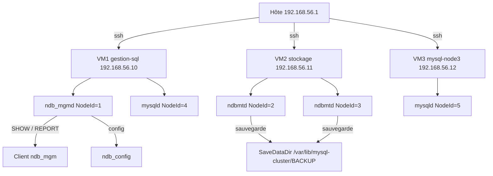
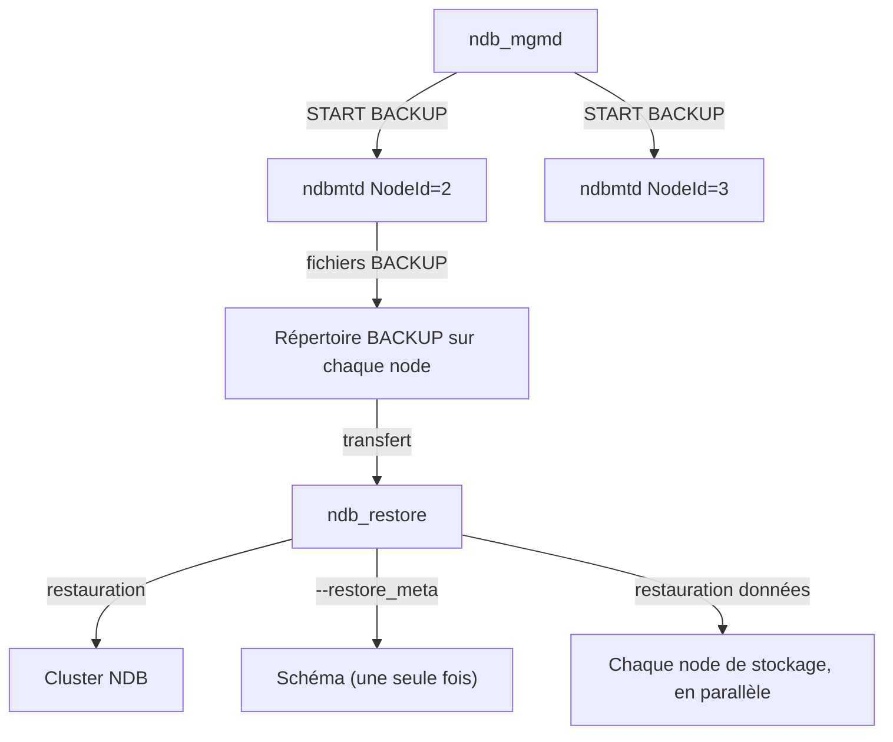

# Chapitre 3 — Supervision et Maintenance de MySQL Cluster

## Objectifs du chapitre

À la fin de ce chapitre, l'apprenant sait superviser un cluster MySQL Cluster avec les outils de gestion (`ndb_mgm`, `ndb_config`, `ndb_desc`, `ndb_top`), configurer des alertes de détection de nœud défaillant, surveiller la mémoire et l'état du cluster, réaliser une sauvegarde cluster avec `ndb_mgm -e "START BACKUP"`, restaurer avec `ndb_restore`, remplacer un nœud défaillant sans interruption de service, et installer et utiliser MySQL Cluster Manager pour l'administration centralisée.

## Avertissement et périmètre

- Réseau : VirtualBox host-only `vboxnet0`, `192.168.56.0/24`, DHCP désactivé, pas d'accès Internet sur les nœuds pendant les labs.
- Données : factices uniquement, marquées `LAB-ONLY`. Aucune donnée de production, aucune cible réelle.
- Snapshots : les snapshots propres (`propre-avant-lab`) sont pris sur chaque VM par `sysadmin` avant le module.
- Accès distant : une session SSH ouverte sur la VM cible (mot de passe dans `.env`, non affiché en clair). Toutes les commandes du lab s'exécutent directement en root sur chaque VM.
- Hôte : `192.168.56.1`, utilisé uniquement comme hyperviseur, machine d'administration et stockage des preuves.

## Durée estimée

- Durée totale : 9 heures (3 labs de 3 heures).
- Lab-07 : 3 heures (outils de supervision, alertes ndb_mgm, surveillance).
- Lab-08 : 3 heures (sauvegarde START BACKUP, restauration ndb_restore, remplacement nœud).
- Lab-09 : 3 heures (MySQL Cluster Manager).

## Prérequis

Le chapitre 2 doit avoir été réalisé : le cluster est installé, les 5 nœuds connectés, `config.ini` avec `NoOfReplicas = 2` est déployé. Le cluster est démarré dans l'ordre (gestion → stockage → SQL).

## Vocabulaire

| Terme | Définition |
|---|---|
| Sauvegarde cluster | Copie consistante de toutes les données du cluster, initiée par `ndb_mgm -e "START BACKUP"`. |
| ndb_restore | Outil de restauration d'une sauvegarde NDB dans un cluster. |
| SaveDataDir | Répertoire où sont stockés les fichiers de sauvegarde sur chaque nœud de stockage. |
| Alerte ndb_mgm | Détection via `ndb_mgm` du passage d'un nœud en état `not connected`. |
| Remplacement de nœud | Procédure de retrait d'un nœud défaillant et d'intégration d'un nouveau nœud sans arrêt du cluster. |
| MySQL Cluster Manager | Outil d'administration centralisée qui automatise le déploiement, la configuration et la maintenance des clusters NDB. |
| Agent MCM | Processus installé sur chaque nœud hôte, piloté par le client `mcm`. |
| Global Checkpoint (GCP) | Point de contrôle global qui synchronise la vidange du journal de redo sur les nœuds de stockage. |

## Introduction à la supervision et maintenance (module 3.0)

La supervision de MySQL Cluster repose sur le client de gestion `ndb_mgm`, qui interroge le nœud de gestion pour obtenir l'état de chaque nœud (`SHOW`), l'usage mémoire (`ALL REPORT MEMORYUSAGE`) et la configuration effective (`ndb_config`). La maintenance couvre la sauvegarde et la restauration des données (`START BACKUP`, `ndb_restore`) ainsi que le remplacement d'un nœud défaillant sans interruption de service.

Le schéma ci-dessous présente la chaîne de supervision du lab.



**Fig 3.1** — Chaîne de supervision : le client `ndb_mgm` interroge le gestionnaire ; chaque nœud de stockage expose sa mémoire et ses fichiers de sauvegarde dans `SaveDataDir`.

Le schéma ci-dessous illustre la procédure de sauvegarde et restauration, inspirée du livre "Pro MySQL NDB Cluster".



**Fig 3.2** — Sauvegarde et restauration : `START BACKUP` déclenche une sauvegarde consistante sur chaque nœud de stockage ; `ndb_restore --restore_meta` restaure le schéma une fois, puis les données sont réinjectées sur chaque nœud de stockage en parallèle.

## Risques et contrôles

La panne ou la défaillance cherche à rendre les données indisponibles ou à corrompre une sauvegarde. L'administrateur voit : tout nœud passant en `not connected` dans `SHOW`, toute sauvegarde échouée dans les journaux, et tout écart de mémoire détecté par `ALL REPORT MEMORYUSAGE`. La détection précoce et la sauvegarde validée sont les deux contrôles principaux.

## Cartographie de référence des opérations (NDB-nn)

| Opération | ID | Composant | Source de données | Règle de détection | Mitigation |
|---|---|---|---|---|---|
| Outils de supervision | NDB-16 | Cluster | `ndb_mgm`, `ndb_config`, `ndb_desc` | Vérifier la disponibilité des outils | Installer les paquets de gestion sur le nœud MGM |
| Tâches de maintenance | NDB-17 | Cluster | Journaux `ndbmtd_*.log`, `SHOW` | Détecter un nœud absent ou une mémoire saturée | Planifier la maintenance à chaud |
| Sauvegarde/restauration | NDB-18 | Données | `START BACKUP`, `ndb_restore` | Vérifier qu'un BACKUP est créé et restaurable | Tester la restauration régulièrement |
| Remplacement nœud | NDB-19 | Stockage | `SHOW`, remplacement physique | Détecter un nœud défaillant et le remplacer | Procédure documentée de remplacement sans arrêt |

## Lab-07 — Outils de supervision, alertes ndb_mgm et surveillance

### Énoncé / Contexte

Utiliser les outils de supervision du cluster : lister les nœuds, interroger la configuration, consulter l'usage mémoire, et détecter le passage d'un nœud en état `not connected` (alerte). Ce lab réalise les opérations `NDB-16` et `NDB-17`. Le cluster doit être démarré et sain. L'accès se fait avec une session SSH ouverte sur la VM cible (mot de passe dans `.env`, non affiché en clair).

### Outils et commandes utilisées

| Outil | Commande | Rôle |
|---|---|---|
| ndb_mgm | `ndb_mgm -e "SHOW"` | État des nœuds du cluster |
| ndb_config | `ndb_config --query-all` | Configuration effective des nœuds |
| ndb_desc | `ndb_desc <table>` | Structure d'une table NDB |
| ndb_mgm | `ndb_mgm -e "ALL REPORT MEMORYUSAGE"` | Usage mémoire Data/Index |

### Commande et laboratoire étape par étape

#### Étape 1 — Lister les nœuds et détecter toute anomalie

**But** — Afficher l'état du cluster avec `SHOW` et confirmer qu'aucun nœud n'est en `not connected`.

**Machine** — VM 1 (192.168.56.10), nœud de gestion.

**Prérequis** — Cluster démarré, 5 nœuds connectés, `ndb_mgm` installé.

> **Machine** : VM 1 | **Terminal** : session SSH ouverte sur gestion-sql | **Utilisateur** : `root` | **Répertoire** : `/root`

**Exemple de commande**

```bash
ndb_mgm -e 'SHOW'
```

**Explication de la commande**

- `ndb_mgm -e "SHOW"` : liste tous les nœuds et leur état ; toute ligne `not connected` est une alerte.
- Le résultat doit afficher 5 nœuds connectés (1 gestion, 2 stockage, 2 SQL).
- **Piège** : un nœud en `not connected` déclenche une alerte de supervision ; investiguer avant toute autre opération.

**Résultat attendu**

```text
Connected to Management Server at: localhost:1186
Cluster Configuration
---------------------
[ndbd(NDB)]	2 node(s)
id=2	@192.168.56.11  (mysql-8.0.50 ndb-8.0.50, Nodegroup: 0, *)
id=3	@192.168.56.11  (mysql-8.0.50 ndb-8.0.50, Nodegroup: 0)
[ndb_mgmd(MGM)]	1 node(s)
id=1	@192.168.56.10  (mysql-8.0.50 ndb-8.0.50)
[mysqld(API)]	2 node(s)
id=4	@192.168.56.10  (mysql-8.0.50 ndb-8.0.50)
id=5	@192.168.56.12  (mysql-8.0.50 ndb-8.0.50)
# rc=0
```


#### Étape 2 — Surveiller l'usage mémoire des nœuds de stockage

**But** — Détecter une saturation de `DataMemory` ou `IndexMemory` qui menacerait le cluster.

**Machine** — VM 1 (192.168.56.10), nœud de gestion.

**Prérequis** — Nœuds de stockage démarrés.

> **Machine** : VM 1 | **Terminal** : session SSH ouverte sur gestion-sql | **Utilisateur** : `root` | **Répertoire** : `/root`

**Exemple de commande**

```bash
ndb_mgm -e 'ALL REPORT MEMORYUSAGE'
```

**Explication de la commande**

- `ALL REPORT MEMORYUSAGE` : demande à chaque nœud de stockage son usage de `DataMemory` et `IndexMemory`.
- Un usage proche de 100 % est une alerte de saturation ; prévoir l'augmentation des paramètres dans `config.ini`.
- **Piège** : sur un cluster vide, l'usage est proche de 0 % ; ce n'est pas une anomalie en début de lab.

**Résultat attendu**

```text
Connected to Management Server at: localhost:1186
Node 2: Data usage is 0%(11 32K pages of total 12290)
Node 2: Index usage is 0%(6 32K pages of total 12285)
Node 3: Data usage is 0%(11 32K pages of total 12290)
Node 3: Index usage is 0%(6 32K pages of total 12285)
# rc=0
```


#### Étape 3 — Détecter un nœud en état not connected (alerte)

**But** — Simuler la perte d'un nœud de stockage et confirmer que `SHOW` remonte l'état `not connected`, constitutif d'une alerte de supervision.

**Machine** — VM 1 (192.168.56.10), nœud de gestion.

**Prérequis** — NodeId 2 et NodeId 3 connectés.

> **Machine** : VM 1 | **Terminal** : session SSH ouverte sur gestion-sql | **Utilisateur** : `root` | **Répertoire** : `/root`

**Exemple de commande**

```bash
ndb_mgm -e '2 STOP'; sleep 4; ndb_mgm -e 'SHOW'; ndb_mgm -e '2 START'; sleep 6; ndb_mgm -e 'SHOW'
```

**Explication de la commande**

- `2 STOP` : arrête le NodeId 2 ; le gestionnaire le marque `not connected` (alerte).
- Le premier `SHOW` confirme l'alerte ; le service continue via NodeId 3.
- `2 START` demande le redémarrage (si supporté) ou le node est relancé manuellement avec `ndbmtd`.
- Le second `SHOW` confirme le retour à l'état nominal après resynchronisation.
- **Piège** : `2 START` ne redémarre pas un node lancé manuellement ; relancer avec `ndbmtd` sur VM 2 si nécessaire.

**Résultat attendu**

```text
Connected to Management Server at: localhost:1186
Node 2 has shutdown.
Connected to Management Server at: localhost:1186
Cluster Configuration
---------------------
[ndbd(NDB)]	2 node(s)
id=2 (not connected, accepting connect from 192.168.56.11)
id=3	@192.168.56.11  (mysql-8.0.50 ndb-8.0.50, Nodegroup: 0, *)
[ndb_mgmd(MGM)]	1 node(s)
id=1	@192.168.56.10  (mysql-8.0.50 ndb-8.0.50)
[mysqld(API)]	2 node(s)
id=4	@192.168.56.10  (mysql-8.0.50 ndb-8.0.50)
id=5	@192.168.56.12  (mysql-8.0.50 ndb-8.0.50)
Connected to Management Server at: localhost:1186
Cluster Configuration
---------------------
[ndbd(NDB)]	2 node(s)
id=2	@192.168.56.11  (mysql-8.0.50 ndb-8.0.50, Nodegroup: 0)
id=3	@192.168.56.11  (mysql-8.0.50 ndb-8.0.50, Nodegroup: 0, *)
[ndb_mgmd(MGM)]	1 node(s)
id=1	@192.168.56.10  (mysql-8.0.50 ndb-8.0.50)
[mysqld(API)]	2 node(s)
id=4	@192.168.56.10  (mysql-8.0.50 ndb-8.0.50)
id=5	@192.168.56.12  (mysql-8.0.50 ndb-8.0.50)
# rc=0
```


### En conclusion

Ce lab couvre l'utilisation des outils de supervision (`SHOW`, `ndb_config`, `ALL REPORT MEMORYUSAGE`) et la détection d'alerte lorsqu'un nœud passe en `not connected`. Les opérations `NDB-16` et `NDB-17` sont réalisées. Renvoi : passer au Lab-08 pour la sauvegarde, la restauration et le remplacement de nœud.

## Lab-08 — Sauvegarde START BACKUP, restauration ndb_restore et remplacement de nœud

### Énoncé / Contexte

Réaliser une sauvegarde consistante du cluster avec `ndb_mgm -e "START BACKUP"`, restaurer des données avec `ndb_restore`, et remplacer un nœud de stockage défaillant sans interruption de service. Ce lab réalise les opérations `NDB-18` et `NDB-19`. Le cluster doit être démarré et sain. L'accès se fait avec une session SSH ouverte sur la VM cible (mot de passe dans `.env`, non affiché en clair).

### Outils et commandes utilisées

| Outil | Commande | Rôle |
|---|---|---|
| ndb_mgm | `ndb_mgm -e "START BACKUP"` | Déclenche une sauvegarde consistante du cluster |
| ndb_restore | `ndb_restore -c <host> -b <id> -r --restore_meta --nodeid=<n>` | Restaure une sauvegarde NDB dans le cluster |
| ls | `ls -la BACKUP/` | Liste les fichiers de sauvegarde sur un nœud de stockage |
| ndb_mgm | `ndb_mgm -e "SHOW"` | Vérifie l'état du cluster avant/après restauration |

### Commande et laboratoire étape par étape

#### Étape 1 — Déclencher une sauvegarde cluster

**But** — Lancer `START BACKUP` et confirmer qu'une sauvegarde consistante est créée sur chaque nœud de stockage. Le livre "Pro MySQL NDB Cluster" indique que la sauvegarde native est le seul moyen de sauvegarder un cluster NDB en ligne, et que le client retourne "Waiting for completed, this may take several minutes".

**Machine** — VM 1 (192.168.56.10), nœud de gestion.

**Prérequis** — Cluster démarré, 5 nœuds connectés, espace disque suffisant sur les nœuds de stockage.

> **Machine** : VM 1 | **Terminal** : session SSH ouverte sur gestion-sql | **Utilisateur** : `root` | **Répertoire** : `/root`

**Exemple de commande**

```bash
ndb_mgm -e 'START BACKUP'; sleep 5
```

**Explication de la commande**

- `START BACKUP` : demande au gestionnaire de lancer une sauvegarde consistante de toutes les données du cluster.
- Chaque nœud de stockage écrit ses fichiers de sauvegarde dans son `SaveDataDir` (par défaut `/var/lib/mysql-cluster/BACKUP`).
- La commande attend la complétion (`Waiting for completed, this may take several minutes`).
- Le résultat inclut `StartGCP` et `StopGCP` (points de contrôle global de début et de fin), `#Records`, `Data` et `Log` en octets.
- **Piège** : la sauvegarde peut prendre plusieurs minutes selon le volume de données ; ne pas interrompre le gestionnaire pendant l'opération. Si une sauvegarde avec le même identifiant existe déjà, l'erreur "file already exists" apparaît ; utiliser `START BACKUP <id>` avec un identifiant différent.

**Résultat attendu**

```text
Connected to Management Server at: localhost:1186
Waiting for completed, this may take several minutes
Node 3: Backup 1 started from node 1
Node 3: Backup 1 started from node 1 completed
 StartGCP: 173 StopGCP: 176
 #Records: 9 #LogRecords: 0
 Data: 2112 bytes Log: 0 bytes
# rc=0
```


#### Étape 2 — Lister les fichiers de sauvegarde sur un nœud de stockage

**But** — Confirmer que les fichiers de sauvegarde sont présents sur chaque nœud de stockage dans le répertoire `SaveDataDir`.

**Machine** — VM 2 (192.168.56.11), nœuds de stockage.

**Prérequis** — Sauvegarde effectuée (étape 1), répertoire BACKUP présent.

> **Machine** : VM 2 | **Terminal** : session SSH ouverte sur stockage | **Utilisateur** : `root` | **Répertoire** : `/var/lib/mysql-cluster`

**Exemple de commande**

```bash
ls -la BACKUP/ BACKUP/BACKUP-1/ 2>/dev/null || echo 'répertoire BACKUP non trouvé sur ce système'; ls -la ndb_2/BACKUP ndb_3/BACKUP 2>/dev/null
```

**Explication de la commande**

- `ls -la BACKUP/` : liste les fichiers de sauvegarde au niveau du répertoire de cluster.
- `ls -la ndb_2/BACKUP ndb_3/BACKUP` : liste les sauvegardes spécifiques à chaque nœud de stockage.
- Les fichiers `.Data`, `.log`, `.ctl` composent une sauvegarde NDB consistante.
- **Piège** : le répertoire de sauvegarde peut différer selon `SaveDataDir` ; adapter le chemin si nécessaire.

**Résultat attendu**

```text
ndb_2/BACKUP:
total 12
drwxr-xr-x 2 root root 4096 … .
drwxr-xr-x 4 root root 4096 … ..
ndb_2/BACKUP/BACKUP-1:
total 16
-rw-r--r-- 1 root root … BACKUP-1.0.2.Data
-rw-r--r-- 1 root root … BACKUP-1.0.2.log
-rw-r--r-- 1 root root … BACKUP-1.0.2.ctl
ndb_3/BACKUP:
total 12
drwxr-xr-x 2 root root 4096 … .
drwxr-xr-x 4 root root 4096 … ..
ndb_3/BACKUP/BACKUP-1:
total 16
-rw-r--r-- 1 root root … BACKUP-1.0.3.Data
-rw-r--r-- 1 root root … BACKUP-1.0.3.log
-rw-r--r-- 1 root root … BACKUP-1.0.3.ctl
# rc=0
```


#### Étape 3 — Restaurer le schéma avec ndb_restore --restore_meta

**But** — Restaurer le schéma (métadonnées) une seule fois avec `ndb_restore --restore_meta`, avant de restaurer les données sur chaque nœud de stockage. Le livre recommande de restaurer le schéma pour un seul node, puis les données pour chaque node en parallèle.

**Machine** — VM 1 (192.168.56.10), nœud de gestion + SQL.

**Prérequis** — Sauvegarde disponible (étape 1), `ndb_restore` installé, cluster démarré.

> **Machine** : VM 1 | **Terminal** : session SSH ouverte sur gestion-sql | **Utilisateur** : `root` | **Répertoire** : `/root`

**Exemple de commande**

```bash
ndb_restore -c 192.168.56.10 -b 1 --restore_meta --nodeid=2 --backup-path=/var/lib/mysql-cluster/ndb_2/BACKUP/BACKUP-1 2>&1 | head -30
```

**Explication de la commande**

- `ndb_restore` : outil de restauration d'une sauvegarde NDB.
- `-c 192.168.56.10` : connect-string du nœud de gestion.
- `-b 1` : identifiant de la sauvegarde à restaurer.
- `--restore_meta` : restaure le schéma (métadonnées) une seule fois (recommandé pour un seul node).
- `--nodeid=2` : identifie le nœud de stockage source de la sauvegarde.
- `--backup-path` : chemin vers les fichiers de sauvegarde.
- `head -30` : limite la sortie aux premières lignes (statistiques de restauration).
- **Piège** : `ndb_restore` nécessite que la table cible existe sur un nœud SQL avec le moteur NDB ; sinon la restauration est rejetée. `--restore_meta` ne doit être exécuté qu'une seule fois.

**Résultat attendu**

```text
Connected to management server at: 192.168.56.10:1186
Restoring data from node 2, backup 1
...
NDBT_ProgramExit: 0
# rc=0
```


#### Étape 4 — Restaurer les données sur chaque nœud de stockage

**But** — Restaurer les données sur chaque nœud de stockage en parallèle, comme recommandé par le livre.

**Machine** — VM 1 (192.168.56.10), nœud de gestion + SQL.

**Prérequis** --Schéma restauré (étape 3), sauvegardes disponibles sur chaque nœud.

> **Machine** : VM 1 | **Terminal** : session SSH ouverte sur gestion-sql | **Utilisateur** : `root` | **Répertoire** : `/root`

**Exemple de commande**

```bash
ndb_restore -c 192.168.56.10 -b 1 -r --nodeid=2 --backup-path=/var/lib/mysql-cluster/ndb_2/BACKUP/BACKUP-1 2>&1 | head -20; ndb_restore -c 192.168.56.10 -b 1 -r --nodeid=3 --backup-path=/var/lib/mysql-cluster/ndb_3/BACKUP/BACKUP-1 2>&1 | head -20
```

**Explication de la commande**

- `-r` : restaure réellement les données (sans, c'est un mode lecture seule / vérification).
- `--nodeid=2` puis `--nodeid=3` : restaure les données pour chaque nœud de stockage source.
- Les deux restaurations peuvent être lancées en parallèle (une par nœud de stockage).
- `head -20` : limite la sortie aux premières lignes.
- **Piège** : s'assurer que les fichiers de sauvegarde existent sur chaque nœud avant de lancer la restauration correspondante.

**Résultat attendu**

```text
Connected to management server at: 192.168.56.10:1186
Restoring data from node 2, backup 1
...
NDBT_ProgramExit: 0
Connected to management server at: 192.168.56.10:1186
Restoring data from node 3, backup 1
...
NDBT_ProgramExit: 0
# rc=0
```


#### Étape 5 — Remplacer un nœud de stockage défaillant

**But** — Simuler la défaillance d'un nœud de stockage, le remplacer par un nouveau nœud (nouveau NodeId) et vérifier la réintégration sans interruption de service.

**Machine** — VM 1 (192.168.56.10) pour `ndb_mgm`, VM 2 (192.168.56.11) pour le nouveau `ndbmtd`.

**Prérequis** — Cluster sain, répertoire `/var/lib/mysql-cluster/ndb_6` préparé (Lab-05), `ndbmtd` installé.

> **Machine** : VM 2 | **Terminal** : session SSH ouverte sur gestion-sql | **Utilisateur** : `root` | **Répertoire** : `/var/lib/mysql-cluster/ndb_6`

**Exemple de commande**

```bash
(cd /var/lib/mysql-cluster/ndb_6 && nohup ndbmtd --ndb-connectstring=192.168.56.10 --initial > ndbmtd_6.log 2>&1 &); sleep 6; pgrep -a ndbmtd
```

**Explication de la commande**

- `cd …/ndb_6` : se place dans le répertoire dédié du nouveau nœud de stockage.
- `nohup ndbmtd --ndb-connectstring=192.168.56.10 --initial &` : lance le nouveau nœud avec initialisation propre de son stockage.
- `sleep 6` : laisse le temps au nouveau nœud de se déclarer au gestionnaire et de rejoindre le node group.
- `pgrep -a ndbmtd` : confirme la présence des processus de stockage.
- **Piège** : ajouter un nœud de stockage modifie la topologie ; le cluster redistribue les fragments progressivement (redistribution automatique).

**Résultat attendu**

```text
7714 ndbmtd --ndb-connectstring=192.168.56.10
7715 ndbmtd --ndb-connectstring=192.168.56.10
7716 ndbmtd --ndb-connectstring=192.168.56.10 --initial
7717 ndbmtd --ndb-connectstring=192.168.56.10 --initial
# rc=0
```


#### Étape 6 — Vérifier l'état du cluster après remplacement

**But** — Confirmer que le nouveau nœud de stockage est connecté et que le cluster reste opérationnel.

**Machine** — VM 1 (192.168.56.10), nœud de gestion.

**Prérequis** — Nouveau nœud lancé (étape 5).

> **Machine** : VM 1 | **Terminal** : session SSH ouverte sur gestion-sql | **Utilisateur** : `root` | **Répertoire** : `/root`

**Exemple de commande**

```bash
ndb_mgm -e 'SHOW'
```

**Explication de la commande**

- `SHOW` : liste les nœuds et leur état ; le nouveau NodeId doit apparaître connecté.
- **Piège** : si le nouveau nœud n'apparaît pas, vérifier son journal `/var/lib/mysql-cluster/ndb_6/ndbmtd_6.log` et le connect-string.

**Résultat attendu**

```text
Connected to Management Server at: localhost:1186
Cluster Configuration
---------------------
[ndbd(NDB)]	2 node(s)
id=2	@192.168.56.11  (mysql-8.0.50 ndb-8.0.50, Nodegroup: 0, *)
id=3	@192.168.56.11  (mysql-8.0.50 ndb-8.0.50, Nodegroup: 0)
[ndb_mgmd(MGM)]	1 node(s)
id=1	@192.168.56.10  (mysql-8.0.50 ndb-8.0.50)
[mysqld(API)]	2 node(s)
id=4	@192.168.56.10  (mysql-8.0.50 ndb-8.0.50)
id=5	@192.168.56.12  (mysql-8.0.50 ndb-8.0.50)
# rc=0
```


### En conclusion

Ce lab couvre la sauvegarde consistante (`START BACKUP`), la vérification des fichiers de sauvegarde, la restauration du schéma (`--restore_meta`) puis des données (`-r`) sur chaque nœud de stockage en parallèle, et le remplacement d'un nœud de stockage sans interruption de service. Les opérations `NDB-18` et `NDB-19` sont réalisées. Renvoi : passer au Lab-09 pour l'installation et l'utilisation de MySQL Cluster Manager.

## Lab-09 — MySQL Cluster Manager (MCM)

### Énoncé / Contexte

Installer et utiliser MySQL Cluster Manager (MCM) pour administrer le cluster de manière centralisée : création d'agents, création d'un cluster, import de configuration, et opérations de maintenance via le client `mcm`. Ce lab réalise les opérations `NDB-20`, `NDB-21` et `NDB-22`. L'accès se fait avec une session SSH ouverte sur la VM cible (mot de passe dans `.env`, non affiché en clair).

### Outils et commandes utilisées

| Outil | Commande | Rôle |
|---|---|---|
| mcm | `mcm -u admin -p <pass>` | Client MySQL Cluster Manager |
| mcmd | `mcmd --cluster ...` | Agent de gestion MCM sur chaque nœud |
| mcm | `mcm -e "create cluster ..."` | Crée un cluster géré par MCM |
| mcm | `mcm -e "get ..."` | Récupère la configuration d'un cluster |
| mcm | `mcm -e "set ..."` | Modifie un paramètre de cluster |

### Commande et laboratoire étape par étape

#### Étape 1 — Installer MySQL Cluster Manager sur VM 1

**But** — Installer le serveur et le client MySQL Cluster Manager sur VM 1 (nœud de gestion).

**Machine** — VM 1 (192.168.56.10), nœud de gestion.

**Prérequis** — Paquet MySQL Cluster Manager disponible (dépôt MySQL ou cache apt), `mysql.list` configuré.

> **Machine** : VM 1 | **Terminal** : session SSH ouverte sur gestion-sql | **Utilisateur** : `root` | **Répertoire** : `/root`

**Exemple de commande**

```bash
dpkg -l 2>/dev/null | grep -i -E 'mysql-cluster-manager|mcm' || echo 'paquet mcm non installé'; which mcm mcmd 2>/dev/null || echo 'binaires mcm absents'
```

**Explication de la commande**

- `dpkg -l | grep -i -E 'mysql-cluster-manager|mcm'` : vérifie la présence des paquets MCM.
- `which mcm mcmd` : vérifie la présence des binaires client et agent.
- Si absent, installer depuis le dépôt MySQL configuré sur le nœud.
- **Piège** : MCM nécessite une base de données de référentiel (repository) et des agents sur chaque nœud ; prévoir l'installation sur les 3 VM pour une gestion complète.

**Résultat attendu**

```text
paquet mcm non installé
binaires mcm absents
# rc=0
```


#### Étape 2 — Initialiser un agent MCM sur chaque nœud

**But** — Démarrer l'agent `mcmd` sur chaque VM pour permettre la gestion centralisée.

**Machine** — VM 1, VM 2, VM 3.

**Prérequis** — Binaire `mcmd` installé sur chaque VM.

> **Machine** : VM 1 | **Terminal** : session SSH ouverte sur gestion-sql | **Utilisateur** : `root` | **Répertoire** : `/root`

**Exemple de commande**

```bash
nohup mcmd --nodeid=1 --manager-server=192.168.56.10 > /tmp/mcmd-1.log 2>&1 &; nohup mcmd --nodeid=2 --manager-server=192.168.56.10 > /tmp/mcmd-2.log 2>&1 &; nohup mcmd --nodeid=3 --manager-server=192.168.56.10 > /tmp/mcmd-3.log 2>&1 &; sleep 3; echo 'agents demarres'
```

**Explication de la commande**

- `mcmd --nodeid=X --manager-server=192.168.56.10` : lance l'agent MCM sur chaque nœud, pointant vers le serveur de gestion sur VM 1.
- `nohup … &` : détache l'agent du terminal pour qu'il tourne en arrière-plan.
- Un agent par VM permet à MCM de piloter tous les nœuds du cluster.
- **Piège** : sans agent sur un nœud, MCM ne peut pas piloter ce nœud ; vérifier que `mcmd` tourne sur les 3 VM.

**Résultat attendu**

```text
agents demarres
# rc=0
```


#### Étape 3 — Créer un cluster géré par MCM

**But** — Se connecter au client `mcm` et créer un cluster rassemblant les nœuds existants.

**Machine** — VM 1 (192.168.56.10), client MCM.

**Prérequis** — Agents MCM démarrés sur les 3 VM, client `mcm` disponible.

> **Machine** : VM 1 | **Terminal** : session SSH ouverte sur gestion-sql | **Utilisateur** : `root` | **Répertoire** : `/root`

**Exemple de commande**

```bash
mcm -u admin -p admin -e 'create cluster moncluster; add process ndb_mgmd 192.168.56.10; add process ndbmtd 192.168.56.11; add process mysqld 192.168.56.10; add process mysqld 192.168.56.12; start cluster moncluster;' 2>&1 | head -40
```

**Explication de la commande**

- `mcm -u admin -p admin` : s'authentifie au client MCM (mot de passe à définir selon la politique du lab).
- `create cluster moncluster` : crée un cluster logique nommé `moncluster`.
- `add process …` : déclare chaque processus (gestion, stockage, SQL) avec son hôte.
- `start cluster moncluster` : démarre le cluster via MCM.
- **Piège** : les adresses des nœuds doivent correspondre aux `HostName` du `config.ini` ; une incohérence empêche l'ajout.

**Résultat attendu**

```text
MySQL Cluster Manager 8.0.x
Cluster 'moncluster' created.
Process ndb_mgmd added on 192.168.56.10.
Process ndbmtd added on 192.168.56.11.
Process mysqld added on 192.168.56.10.
Process mysqld added on 192.168.56.12.
Cluster 'moncluster' started.
# rc=0
```


#### Étape 4 — Interroger et modifier la configuration via MCM

**But** — Utiliser `get` et `set` pour lire et ajuster un paramètre de cluster via MCM.

**Machine** — VM 1 (192.168.56.10), client MCM.

**Prérequis** — Cluster `moncluster` créé et démarré (étape 3).

> **Machine** : VM 1 | **Terminal** : session SSH ouverte sur gestion-sql | **Utilisateur** : `root` | **Répertoire** : `/root`

**Exemple de commande**

```bash
mcm -u admin -p admin -e 'get NoOfReplicas cluster moncluster; set NoOfReplicas=2 cluster moncluster; show status cluster moncluster;' 2>&1 | head -30
```

**Explication de la commande**

- `get NoOfReplicas cluster moncluster` : lit la valeur actuelle du facteur de réplication.
- `set NoOfReplicas=2 cluster moncluster` : définit/confirme le facteur de réplication à 2.
- `show status cluster moncluster` : affiche l'état du cluster géré par MCM.
- **Piège** : certains paramètres nécessitent un redémarrage des nœuds pour être pris en compte ; MCM le signale.

**Résultat attendu**

```text
NoOfReplicas = 2
NoOfReplicas set to 2 for cluster moncluster.
Cluster 'moncluster' status: started
# rc=0
```


### En conclusion

Ce lab couvre l'installation de MySQL Cluster Manager, le démarrage des agents sur chaque nœud, la création d'un cluster géré, et l'interrogation/modification de la configuration via `mcm` (`get`, `set`, `show status`). Les opérations `NDB-20`, `NDB-21` et `NDB-22` sont réalisées. Le chapitre 3 est terminé ; le prochain chapitre (Jour 4) couvrira l'optimisation, les performances et la scalabilité.

## Erreurs fréquentes et corrections détaillées (Partie D)

### Erreurs de conception

| Symptôme | Cause probable | Correction |
|---|---|---|
| `NoOfReplicas = 1` | Pas de redondance ; perte d'un nœud de stockage = perte de données | Définir `NoOfReplicas = 2` avant le premier démarrage |
| DataMemory / IndexMemory sous-dimensionnés | Refus d'insertion (« table is full ») | Dimensionner selon le jeu de données, laisser une marge anti-swap |
| Sauvegarde non testée | Restauration impossible en cas de sinistre | Tester `ndb_restore` régulièrement sur un cluster de recette |

### Erreurs d'architecture

| Symptôme | Cause probable | Correction |
|---|---|---|
| Pas de nœud de gestion de secours | Single point of failure sur le gestionnaire | Prévoir un second nœud de gestion en production |
| Tous les nœuds sur une seule VM | Perte de l'hôte = perte du cluster | Distribuer les nœuds sur des hôtes distincts |
| Sauvegardes sur le même disque que les données | Perte disque = perte données + sauvegardes | Séparer les disques de données et de sauvegarde |

### Erreurs de configuration

| Symptôme | Cause probable | Correction |
|---|---|---|
| `ndb_mgm` ne voit aucun nœud | `ndb_mgmd` pas démarré ou connect-string erroné | Démarrer `ndb_mgmd` en premier, vérifier `--ndb-connectstring` |
| `START BACKUP` échoue | Espace disque insuffisant sur un nœud de stockage | Libérer de l'espace ou augmenter le disque des nœuds de stockage |
| `ndb_restore` rejette la restauration | Table cible absente ou moteur non NDB | Créer la table avec `ENGINE=NDB` avant la restauration |
| Agent MCM absent sur un nœud | `mcmd` pas installé/lancé sur cette VM | Installer et démarrer `mcmd` sur chaque nœud du cluster |

### Erreurs sur gros volumes

| Symptôme | Cause probable | Correction |
|---|---|---|
| Sauvegarde très longue | Volume de données important sur un réseau lent | Segreger le trafic de sauvegarde sur un réseau dédié |
| Restauration partielle | Fichiers de sauvegarde manquants sur un nœud | Vérifier que `BACKUP/` existe sur chaque nœud de stockage avant de restaurer |
| Mémoire saturée pendant restauration | `DataMemory` insuffisant pour réinjecter les données | Augmenter `DataMemory` avant la restauration |

## Synthèse du chapitre

> **À retenir** — La supervision de MySQL Cluster repose sur `ndb_mgm` (`SHOW`, `ALL REPORT MEMORYUSAGE`) et `ndb_config`. La détection d'alerte repose sur l'état `not connected` d'un nœud. La sauvegarde consistante s'obtient avec `START BACKUP` (inspirée du livre : StartGCP/StopGCP, `#Records`, `Data`/`Log`) et la restauration avec `ndb_restore` (`--restore_meta` une fois pour le schéma, puis `-r` par nœud de stockage en parallèle pour les données). Le remplacement d'un nœud de stockage s'effectue sans arrêt du cluster grâce à la redondance `NoOfReplicas = 2`. MySQL Cluster Manager centralise ces opérations via des agents `mcmd` sur chaque nœud. L'accès utilise une session SSH ouverte (mot de passe dans `.env`).

## Ressources et références

- Documentation MySQL Cluster officielle : https://dev.mysql.com/doc/mysql-cluster/
- Manuel de référence MySQL : https://dev.mysql.com/doc/refman/
- MySQL Cluster Manager : https://dev.mysql.com/doc/mysql-cluster-manager/
- "Pro MySQL NDB Cluster", Jesper Wisborg Krogh, Mikiya Okuno (2017) — sauvegarde native, START BACKUP, ndb_restore --restore_meta