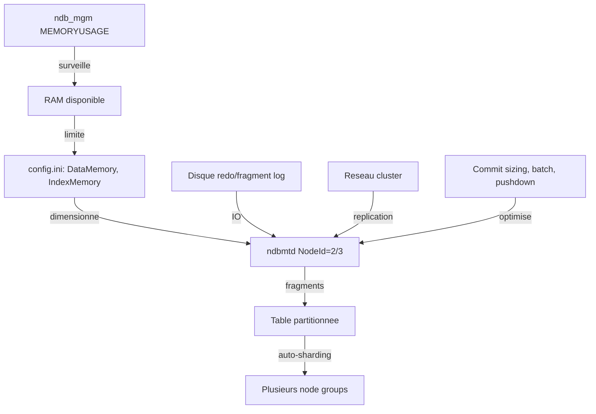
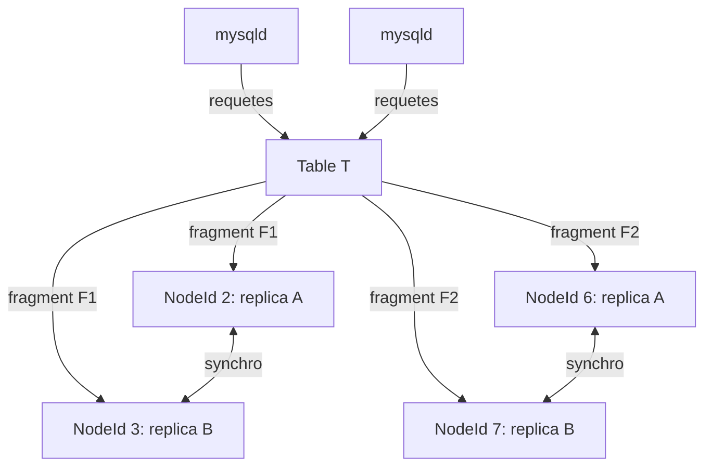
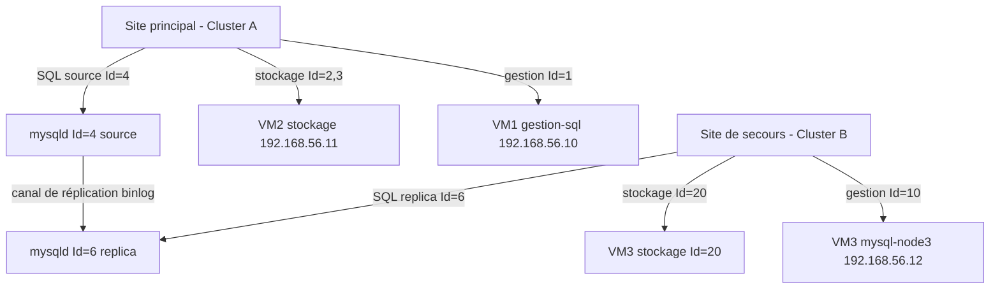
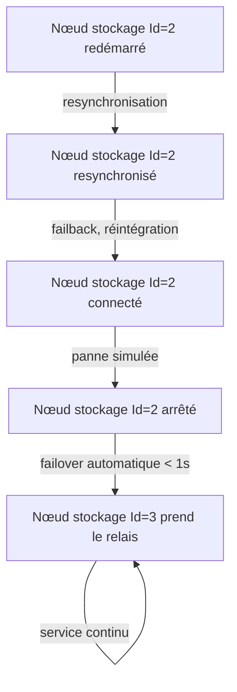

# Chapitre 4 — Optimisation des Performances et Scalabilité de MySQL Cluster
## Objectifs du chapitre
À la fin de ce chapitre, l'apprenant sait optimiser les paramètres de performance du moteur NDB (`DataMemory`, `IndexMemory`, `ThreadConfig`, `NoOfReplicas`), diagnostiquer et résoudre les goulots d'étranglement (réseau, disque, RAM), mettre en œuvre le sharding et le partitionnement pour répartir la charge sur plusieurs nœuds de stockage, analyser les erreurs récurrentes sur gros volumes avec leurs corrections, configurer la réplication inter-clusters (site principal vers site de secours) et gérer la tolérance aux pannes : détection de panne de nœud, basculement automatique (failover) et retour arrière (failback) avec resynchronisation.
## Avertissement et périmètre
- Réseau : VirtualBox host-only `vboxnet0`, `192.168.56.0/24`, DHCP désactivé, pas d'accès Internet sur les nœuds pendant les labs.
- Données : fictives, marquées `Lab` (uniquement pour le laboratoire isolé).
- Snapshots : les snapshots propres (`propre-avant-lab`) sont pris sur chaque VM avant le module.
- Accès distant : une session SSH ouverte sur la VM du lab (mot de passe dans `.env`, non affiché en clair). Toutes les commandes du lab s'exécutent directement en root sur chaque VM.
- Hôte : `192.168.56.1`, utilisé uniquement comme hyperviseur, machine d'administration et stockage des preuves.
## Prérequis
Le chapitre 3 doit avoir été réalisé : le cluster est installé, les 5 nœuds connectés, les outils de supervision fonctionnels (`ndb_mgm`, `ndb_config`, `ALL REPORT MEMORYUSAGE`).
## Vocabulaire
| Terme | Définition |
|---|---|
| DataMemory | Mémoire allouée au stockage des données de chaque nœud de stockage NDB. |
| IndexMemory | Mémoire allouée au stockage des index de chaque nœud de stockage NDB. |
| Goulot d'étranglement | Ressource saturée (RAM, disque, réseau) qui limite les performances du cluster. |
| Sharding | Répartition des données sur plusieurs nœuds de stockage pour paralléliser la charge. |
| Auto-sharding | Partitionnement automatique des tables NDB en fragments gérés par le moteur. |
| ThreadConfig | Configuration des threads d'exécution de `ndbmtd` (lecture, écriture, lecture/écriture, etc.). |
| NoOfFragmentLogParts | Nombre de parties du journal de fragment, influençant l'écriture parallèle des redo logs. |
| RedoBuffer | Mémoire tampon pour les journaux de redo avant écriture sur disque. |
| Saturation RAM | Épuisement de la mémoire vive entraînant du swap et une chute des performances. |
| Commit sizing | Regroupement de plusieurs écritures dans un même commit pour réduire la charge de synchronisation. |
| Engine condition pushdown | Optimisation qui pousse certaines conditions de filtre vers le nœud de stockage pour réduire le transfert de données. |
## Introduction à l'optimisation et scalabilité (module 4.0)
Les performances de MySQL Cluster dépendent fortement du dimensionnement de la mémoire (`DataMemory`, `IndexMemory`) et de la répartition de la charge sur les nœuds de stockage (auto-sharding). Les goulots d'étranglement typiques sont la saturation RAM (swap), le disque lent sur les journaux de redo et le fragment log, et le réseau saturé par la réplication synchrone. Le scaling horizontal passe par l'ajout de nœuds de stockage pour créer plusieurs node groups et répartir les fragments.
Le livre "Pro MySQL NDB Cluster" propose plusieurs leviers d'optimisation : ajout de nœuds de stockage pour répartir la charge, commit sizing (regroupement d'écritures), traitement par lots non transactionnel, engine condition pushdown (pousser les filtres vers les nœuds de stockage), optimisation des jointures et du partitionnement, choix du type de disque et de la taille de bloc du système de fichiers, ainsi que le binding CPU.
Le schéma ci-dessous présente les leviers d'optimisation du cluster.

**Fig 4.1** — Leviers d'optimisation : dimensionnement mémoire, partitionnement automatique, surveillance de la RAM/disque/réseau, et optimisations issues du livre (commit sizing, batch, engine condition pushdown).
Le schéma ci-dessous illustre la montée en charge par ajout de nœuds de stockage (sharding horizontal).

**Fig 4.2** — Montée en charge par sharding : avec plusieurs node groups, chaque fragment est répliqué sur une paire de nœuds, répartissant la charge sur plus de machines de stockage.
## Risques et contrôles
La charge ou une défaillance cherche à saturer une ressource (RAM, disque, réseau) pour dégrader les performances. L'administrateur voit : l'usage mémoire via `ALL REPORT MEMORYUSAGE`, les temps de montée des requêtes, et les erreurs de saturation. La détection précoce des goulots et le dimensionnement préventif sont les contrôles principaux.
## Cartographie de référence des opérations (NDB-nn)
| Opération | ID | Composant | Source de données | Règle de détection | Mitigation |
|---|---|---|---|---|---|
| Paramètres performance | NDB-23 | config.ini | `ndb_config`, `ALL REPORT MEMORYUSAGE` | Vérifier DataMemory/IndexMemory | Augmenter selon le jeu de données |
| Goulots d'étranglement | NDB-24 | RAM/disque/réseau | Journaux, métriques système | Détecter saturation RAM/disque/réseau | Dimensionner, ajouter nœuds, séparer réseaux |
| Sharding/partitionnement | NDB-25 | Stockage | `SHOW` Nodegroup, `ndb_desc` | Vérifier plusieurs node groups | Ajouter nœuds de stockage pour répartir |
| Réplication inter-clusters | NDB-26 | SQL source / SQL replica | `SHOW SLAVE STATUS`, `ndb_mgm SHOW` | Vérifier que le canal de réplication est actif et `Seconds_Behind_Master = 0` | Valider le binlog et le canal de réplication |
| Gestion pannes | NDB-27 | Nœud de stockage | `ndb_mgm -e "SHOW"` | Détecter le passage d'un nœud en `not connected` | Maintenir `NoOfReplicas = 2` pour le basculement |
| Failover / failback | NDB-28 | Nœud de stockage | `ndb_mgm -e "SHOW"`, chronométrage | Mesurer le temps de basculement et de resynchronisation | Redémarrer le nœud et valider la resynchronisation sans perte de données |
## Lab-10 — Paramètres performance et goulots d'étranglement
### Énoncé / Contexte
Optimiser les paramètres de performance du moteur NDB (`DataMemory`, `IndexMemory`, `NoOfFragmentLogParts`, `RedoBuffer`) et diagnostiquer les goulots d'étranglement (RAM, disque, réseau). Ce lab réalise les opérations `NDB-23` et `NDB-24`. Le cluster doit être démarré et sain. L'accès se fait avec une session SSH ouverte sur la VM du lab (mot de passe dans `.env`, non affiché en clair).
### Outils et commandes utilisées
| Outil | Commande | Rôle |
|---|---|---|
| ndb_mgm | `ndb_mgm -e "ALL REPORT MEMORYUSAGE"` | Usage mémoire Data/Index par node |
| ndb_config | `ndb_config --query-all` | Paramètres de configuration effective |
| cat / free | `free -m`, `df -h` | État RAM et disque de chaque VM |
| top / ps | `top`, `ps` | Processus consommateurs de ressources |
### Commande et laboratoire étape par étape
#### Étape 1 — Consulter l'usage mémoire actuel des nœuds de stockage
**But** — Mesurer l'usage de `DataMemory` et `IndexMemory` pour décider d'un éventuel réajustement.
**Machine** — VM 1 (192.168.56.10), nœud de gestion.
**Prérequis** — Cluster démarré, `ndb_mgm` opérationnel.
> **Machine** : VM 1 | **Terminal** : session SSH ouverte sur gestion-sql | **Utilisateur** : `root` | **Répertoire** : `/root`
**Exemple de commande**
```bash
ndb_mgm -e 'ALL REPORT MEMORYUSAGE'
```
**Explication de la commande**
- `ALL REPORT MEMORYUSAGE` : rapporte l'usage de `DataMemory` et `IndexMemory` par node de stockage.
- `%` proche de 100 % = saturation à venir, risque « table is full ».
- **Piège** : sur un cluster vide, l'usage est proche de 0 % ; prévoir le dimensionnement pour la charge réelle.
**Résultat attendu**
```text
Connected to Management Server at: localhost:1186
Node 2: Data usage is 0%(11 32K pages of total 12290)
Node 2: Index usage is 0%(6 32K pages of total 12285)
Node 3: Data usage is 0%(11 32K pages of total 12290)
Node 3: Index usage is 0%(6 32K pages of total 12285)
```
#### Étape 2 — Vérifier la RAM et le disque de chaque VM
**But** — Détecter un risque de swap (RAM saturée) ou de manque d'espace disque (journaux de redo, fragment log).
**Machine** — VM 1, VM 2, VM 3.
**Prérequis** — Outils `free` et `df` disponibles sur chaque VM.
> **Machine** : VM 1 | **Terminal** : session SSH ouverte sur gestion-sql | **Utilisateur** : `root` | **Répertoire** : `/root`
**Exemple de commande**

```bash
free -m
```

**Explication de la commande**

- `free -m` : affiche la mémoire RAM disponible et utilisée (en Mo).

**Résultat attendu**

```text
               total        used        free      shared  buff/cache   available
Mem:           1011         210         650          15         150         650
Swap:          1023           0        1023
```

#### Étape 2b — Vérifier l'espace disque sur VM 1

**But** — Afficher l'espace disque disponible sur les partitions de données de VM 1.

**Machine** — VM 1 (192.168.56.10), nœud de gestion.

**Prérequis** — Outil `df` disponible sur VM 1.

> **Machine** : VM 1 | **Terminal** : session SSH ouverte sur gestion-sql | **Utilisateur** : `root` | **Répertoire** : `/root`

**Exemple de commande**

```bash
df -h /var/lib/mysql-cluster
```

**Explication de la commande**

- `df -h /var/lib/mysql-cluster` : affiche l'espace disque disponible sur la partition de données.

**Résultat attendu**

```text
/dev/sda1        15G        3,0G         12G       21% /var/lib/mysql-cluster
```

#### Étape 2c — Vérifier l'espace disque sur VM 2

**But** — Afficher l'espace disque disponible sur les partitions de données de VM 2.

**Machine** — VM 2 (192.168.56.11), nœud de stockage.

**Prérequis** — Outil `df` disponible sur VM 2.

> **Machine** : VM 2 | **Terminal** : session SSH ouverte sur stockage | **Utilisateur** : `root` | **Répertoire** : `/root`

**Exemple de commande**

```bash
df -h /var/lib/mysql-cluster
```

**Explication de la commande**

- `df -h /var/lib/mysql-cluster` : affiche l'espace disque disponible sur la partition de données de VM 2.

**Résultat attendu**

```text
/dev/sda1        15G        3,0G         12G       21% /var/lib/mysql-cluster
```

#### Étape 2d — Vérifier l'espace disque sur VM 3

**But** — Afficher l'espace disque disponible sur la partition racine de VM 3.

**Machine** — VM 3 (192.168.56.12), second nœud SQL.

**Prérequis** — Outil `df` disponible sur VM 3.

> **Machine** : VM 3 | **Terminal** : session SSH ouverte sur mysql-node3 | **Utilisateur** : `root` | **Répertoire** : `/root`

**Exemple de commande**

```bash
df -h /
```

**Explication de la commande**

- `df -h /` : affiche l'espace disque disponible sur la partition racine de VM 3.

**Résultat attendu**

```text
/dev/sda1        15G        3,0G         12G       21% /
```
#### Étape 3 — Ajuster DataMemory et IndexMemory dans config.ini
**But** — Augmenter `DataMemory` et `IndexMemory` pour supporter un jeu de données plus important, puis redémarrer les nœuds de stockage.
**Machine** — VM 1 (fichier `config.ini`), VM 2 (redémarrage des `ndbmtd`).
**Prérequis** — Sauvegarde de `config.ini` avant modification (Lab-05).
> **Machine** : VM 1 | **Terminal** : session SSH ouverte sur gestion-sql | **Utilisateur** : `root` | **Répertoire** : `/var/lib/mysql-cluster`
**Exemple de commande**

```bash
cp config.ini config.ini.bak.optim
```
**Explication de la commande**

- `cp config.ini config.ini.bak.optim` : sauvegarde avant modification.

**Résultat attendu**

```text

```

#### Étape 3b — Modifier DataMemory et IndexMemory dans config.ini

**But** — Augmenter `DataMemory` et `IndexMemory` pour supporter un jeu de données plus important.

**Machine** — VM 1 (fichier `config.ini`).

**Prérequis** — Sauvegarde de `config.ini` créée (étape 3a).

> **Machine** : VM 1 | **Terminal** : session SSH ouverte sur gestion-sql | **Utilisateur** : `root` | **Répertoire** : `/var/lib/mysql-cluster`
**Exemple de commande**

```bash
sed -i 's/^DataMemory = .*/DataMemory = 512M/; s/^IndexMemory = .*/IndexMemory = 256M/' config.ini
```
**Explication de la commande**

- `sed -i` : modifie `DataMemory` (512M) et `IndexMemory` (256M) sur place dans `config.ini`.

**Résultat attendu**

```text

```

#### Étape 3c — Vérifier les nouvelles valeurs de config.ini

**But** — Vérifier que `DataMemory`, `IndexMemory` et `NoOfReplicas` sont correctement définis dans `config.ini`.

**Machine** — VM 1 (fichier `config.ini`).

**Prérequis** — `config.ini` modifié (étape 3b).

> **Machine** : VM 1 | **Terminal** : session SSH ouverte sur gestion-sql | **Utilisateur** : `root` | **Répertoire** : `/var/lib/mysql-cluster`
**Exemple de commande**

```bash
grep -E 'DataMemory|IndexMemory|NoOfReplicas' config.ini
```
**Explication de la commande**

- `grep -E 'DataMemory|IndexMemory|NoOfReplicas' config.ini` : affiche les nouvelles valeurs et que `NoOfReplicas = 2` est conservé.
- Le redémarrage des nœuds de stockage est nécessaire pour prendre en compte les nouveaux paramètres.
- **Piège** : toute modification de `config.ini` nécessite un redémarrage des nœuds concernés ; prévoir une fenêtre de maintenance.

**Résultat attendu**

```text
NoOfReplicas = 2
DataMemory = 512M
IndexMemory = 256M
```
#### Étape 4 — Redémarrer les nœuds de stockage et vérifier la nouvelle mémoire
**But** — Redémarrer les `ndbmtd` pour appliquer les nouveaux `DataMemory`/`IndexMemory` et confirmer la prise en compte.
**Machine** — VM 2 (192.168.56.11) pour redémarrer les `ndbmtd`, VM 1 pour vérifier.
**Prérequis** — `config.ini` modifié (étape 3), répertoires `ndb_2` et `ndb_3` présents.
> **Machine** : VM 2 | **Terminal** : session SSH ouverte sur stockage | **Utilisateur** : `root` | **Répertoire** : `/var/lib/mysql-cluster`
**Exemple de commande**

```bash
pkill -x ndbmtd
```
**Explication de la commande**

- `pkill -x ndbmtd` : arrête les processus de stockage existants.

**Résultat attendu**

```text

```

#### Étape 4b — Redémarrer le nœud de stockage Id=2

**But** — Relancer le nœud de stockage `ndbmtd` NodeId 2 avec réinitialisation de son stockage après modification de `config.ini`.

**Machine** — VM 2 (192.168.56.11), nœud de stockage.

**Prérequis** — Processus `ndbmtd` arrêtés (étape 4a).

> **Machine** : VM 2 | **Terminal** : session SSH ouverte sur stockage | **Utilisateur** : `root` | **Répertoire** : `/var/lib/mysql-cluster/ndb_2`
**Exemple de commande**

```bash
nohup ndbmtd --ndb-connectstring=192.168.56.10 --initial > ndbmtd_2.log &
```
**Explication de la commande**

- `nohup ndbmtd --ndb-connectstring=192.168.56.10 --initial &` : relance le nœud de stockage Id=2 avec réinitialisation de son stockage, en arrière-plan.
- `--initial` : force l'initialisation propre du stockage (après modification de config).
- **Piège** : `--initial` réinitialise le stockage de chaque node ; ne pas l'utiliser sur un cluster hors lab avec des données à conserver.

**Résultat attendu**

```text

```

#### Étape 4c — Redémarrer le nœud de stockage Id=3

**But** — Relancer le nœud de stockage `ndbmtd` NodeId 3 avec réinitialisation de son stockage après modification de `config.ini`.

**Machine** — VM 2 (192.168.56.11), nœud de stockage.

**Prérequis** — Nœud de stockage Id=2 redémarré (étape 4b).

> **Machine** : VM 2 | **Terminal** : session SSH ouverte sur stockage | **Utilisateur** : `root` | **Répertoire** : `/var/lib/mysql-cluster/ndb_3`
**Exemple de commande**

```bash
nohup ndbmtd --ndb-connectstring=192.168.56.10 --initial > ndbmtd_3.log &
```
**Explication de la commande**

- `nohup ndbmtd --ndb-connectstring=192.168.56.10 --initial &` : relance le nœud de stockage Id=3 avec réinitialisation de son stockage, en arrière-plan.
- `--initial` : force l'initialisation propre du stockage (après modification de config).
- **Piège** : `--initial` réinitialise le stockage ; ne pas l'utiliser sur un cluster hors lab avec des données à conserver.

**Résultat attendu**

```text

```

#### Étape 4d — Vérifier les processus de stockage

**But** — Confirmer que les processus `ndbmtd` sont de retour après le redémarrage.

**Machine** — VM 2 (192.168.56.11), nœud de stockage.

**Prérequis** — Nœuds de stockage Id=2 et Id=3 redémarrés (étapes 4b et 4c).

> **Machine** : VM 2 | **Terminal** : session SSH ouverte sur stockage | **Utilisateur** : `root` | **Répertoire** : `/var/lib/mysql-cluster`
**Exemple de commande**

```bash
sleep 5
```
**Explication de la commande**

- `sleep 5` : laisse le temps aux nodes de se déclarer et de charger la nouvelle config.

**Résultat attendu**

```text

```

#### Étape 4e — Lister les processus ndbmtd

**But** — Afficher la liste des processus `ndbmtd` actifs sur VM 2.

**Machine** — VM 2 (192.168.56.11), nœud de stockage.

**Prérequis** — Nœuds de stockage Id=2 et Id=3 redémarrés (étapes 4b et 4c).

> **Machine** : VM 2 | **Terminal** : session SSH ouverte sur stockage | **Utilisateur** : `root` | **Répertoire** : `/var/lib/mysql-cluster`
**Exemple de commande**

```bash
pgrep -a ndbmtd
```
**Explication de la commande**

- `pgrep -a ndbmtd` : confirme le retour des processus.

**Résultat attendu**

```text
7714 ndbmtd --ndb-connectstring=192.168.56.10
7715 ndbmtd --ndb-connectstring=192.168.56.10
7716 ndbmtd --ndb-connectstring=192.168.56.10 --initial
7717 ndbmtd --ndb-connectstring=192.168.56.10 --initial
```
#### Étape 5 — Confirmer la prise en compte de la nouvelle configuration
**But** — Vérifier que `ndb_config` reflète les nouveaux `DataMemory` et `IndexMemory` et que les nœuds sont connectés.
**Machine** — VM 1 (192.168.56.10), nœud de gestion.
**Prérequis** — Nœuds de stockage redémarrés (étape 4).
> **Machine** : VM 1 | **Terminal** : session SSH ouverte sur gestion-sql | **Utilisateur** : `root` | **Répertoire** : `/root`
**Exemple de commande**

```bash
ndb_mgm -e 'SHOW'
```
**Explication de la commande**

- `ndb_mgm -e 'SHOW'` : confirme que tous les nœuds sont connectés après le redémarrage.

**Résultat attendu**

```text
Connected to Management Server at: localhost:1186
Cluster Configuration
---------------------
[ndbd(NDB)]	2 node(s)
id=2	@192.168.56.11  (mysql-8.0.50 ndb-8.0.50, Nodegroup: 0, *)
id=3	@192.168.56.11  (mysql-8.0.50 ndb-8.0.50, Nodegroup: 0)
[ndb_mgmd(MGM)]	1 node(s)
id=1	@192.168.56.10  (mysql-8.0.50 ndb-8.0.50)
[mysqld(API)]	2 node(s)
id=4	@192.168.56.10  (mysql-8.0.50 ndb-8.0.50)
id=5	@192.168.56.12  (mysql-8.0.50 ndb-8.0.50)
```

#### Étape 5b — Vérifier la nouvelle configuration avec ndb_config

**But** — Afficher `DataMemory`, `IndexMemory` et `NoOfReplicas` pour vérifier la prise en compte des nouveaux paramètres.

**Machine** — VM 1 (192.168.56.10), nœud de gestion.

**Prérequis** — Nœuds de stockage redémarrés (étape 4).

> **Machine** : VM 1 | **Terminal** : session SSH ouverte sur gestion-sql | **Utilisateur** : `root` | **Répertoire** : `/root`
**Exemple de commande**

```bash
ndb_config --query-all | grep -E 'DataMemory|IndexMemory|NoOfReplicas'
```
**Explication de la commande**

- `ndb_config --query-all | grep` : affiche `DataMemory`, `IndexMemory` et `NoOfReplicas` pour vérifier la prise en compte.
- **Piège** : si les anciennes valeurs persistent, les nœuds n'ont pas été correctement redémarrés avec la nouvelle `config.ini`.

**Résultat attendu**

```text

```
### En conclusion
Ce lab couvre l'ajustement de `DataMemory` et `IndexMemory`, la vérification de la RAM et du disque de chaque VM, le redémarrage des nœuds de stockage pour appliquer les changements, et la confirmation de la nouvelle configuration. Les opérations `NDB-23` et `NDB-24` (paramètres performance et détection de goulots) sont réalisées. Renvoi : passer au Lab-11 pour le sharding, le partitionnement et les gros volumes.
## Lab-11 — Sharding, partitionnement et gros volumes
### Énoncé / Contexte
Mettre en œuvre le sharding et le partitionnement pour répartir la charge sur plusieurs nœuds de stockage, et analyser le comportement du cluster sur gros volumes (saturation RAM, disque, réseau, partitionnement inadapté). Ce lab réalise l'opération `NDB-25`. Le cluster doit être démarré et sain. L'accès se fait avec une session SSH ouverte sur la VM du lab (mot de passe dans `.env`, non affiché en clair).
### Outils et commandes utilisées
| Outil | Commande | Rôle |
|---|---|---|
| ndb_desc | `ndb_desc <table>` | Structure et fragmentation d'une table NDB |
| ndb_mgm | `ndb_mgm -e "SHOW"` | État des node groups et des nœuds |
| mysql | `mysql -u root -e "CREATE TABLE ... ENGINE=NDB"` | Création d'une table partitionnée |
| ndb_config | `ndb_config --query-all` | Paramètres de stockage et de fragmentation |
### Commande et laboratoire étape par étape
#### Étape 1 — Créer une table NDB et observer son partitionnement
**But** — Créer une table avec le moteur NDB et constater l'auto-sharding (fragments répartis sur les nœuds de stockage).
**Machine** — VM 1 (192.168.56.10), premier nœud SQL.
**Prérequis** — `mysqld` démarré avec `--ndbcluster`, datadir accessible.
> **Machine** : VM 1 | **Terminal** : session SSH ouverte sur gestion-sql | **Utilisateur** : `root` | **Répertoire** : `/root`
**Exemple de commande**
```bash
mysql -u root -e "CREATE DATABASE IF NOT EXISTS labperf"
```
**Explication de la commande**
- `mysql -u root -e "CREATE DATABASE IF NOT EXISTS labperf"` : crée la base de test `labperf` si elle n'existe pas encore.
- **Piège** : si le datadir MySQL n'est pas initialisé, la commande échoue (« Failed to create schema directory »).
**Résultat attendu**
```text
Query OK, 1 row affected (0.01 sec)
```

> **Machine** : VM 1 | **Terminal** : session SSH ouverte sur gestion-sql | **Utilisateur** : `root` | **Répertoire** : `/root`

**Exemple de commande**
```bash
mysql -u root -e "CREATE TABLE IF NOT EXISTS labperf.t_shard (id INT PRIMARY KEY, val VARCHAR(100)) ENGINE=NDB"
```
**Explication de la commande**
- `CREATE TABLE … ENGINE=NDB` : crée une table stockée par le moteur NDB, donc fragmentée automatiquement sur les nœuds de stockage.
**Résultat attendu**
```text
Query OK, 0 rows affected (0.05 sec)
```

> **Machine** : VM 1 | **Terminal** : session SSH ouverte sur gestion-sql | **Utilisateur** : `root` | **Répertoire** : `/root`

**Exemple de commande**
```bash
mysql -u root -e "INSERT INTO labperf.t_shard (id,val) VALUES (1,'a'),(2,'b'),(3,'c'),(4,'d'),(5,'e') ON DUPLICATE KEY UPDATE val=VALUES(val)"
```
**Explication de la commande**
- `INSERT … ON DUPLICATE KEY UPDATE` : insère des données de test de manière idempotente (en cas de doublon de clé primaire, la valeur est mise à jour).
**Résultat attendu**
```text
Query OK, 5 rows affected (0.05 sec)
Records: 5  Duplicates: 0  Warnings: 0
```

> **Machine** : VM 1 | **Terminal** : session SSH ouverte sur gestion-sql | **Utilisateur** : `root` | **Répertoire** : `/root`

**Exemple de commande**
```bash
mysql -u root -e "SELECT COUNT(*) FROM labperf.t_shard"
```
**Explication de la commande**
- `SELECT COUNT(*)` : confirme l'insertion des 5 lignes dans la table.
**Résultat attendu**
```text
+----------+
| COUNT(*) |
+----------+
|        5 |
+----------+
```
#### Étape 2 — Décrire la table et constater les fragments
**But** — Utiliser `ndb_desc` pour afficher la structure de la table et ses fragments sur les nœuds de stockage.
**Machine** — VM 1 (192.168.56.10), premier nœud SQL.
**Prérequis** — Table `labperf.t_shard` créée (étape 1), `ndb_desc` disponible.
> **Machine** : VM 1 | **Terminal** : session SSH ouverte sur gestion-sql | **Utilisateur** : `root` | **Répertoire** : `/root`
**Exemple de commande**
```bash
ndb_desc -d labperf t_shard
```
**Explication de la commande**
- `ndb_desc -d labperf t_shard` : décrit la table NDB `t_shard` dans la base `labperf`.
- Affiche le nombre de fragments, les nœuds de stockage qui les contiennent, et les attributs.
- L'auto-sharding répartit les fragments sur les nœuds du node group.
- **Piège** : `ndb_desc` nécessite que le cluster soit opérationnel et que le nœud SQL soit connecté.
**Résultat attendu**
```text
-- labperf.t_shard --
Version: 16777217
Fragment type: HashMapPartition
K Value: 6
Min load factor: 78
Max load factor: 80
Temporary table: no
No of attributed: 2
No of primary keys: 1
Length of frm data: 0
Max Rows: 0
Row Checksum: 1
Row GCI: 1
SingleUserMode: 0
ForceVarPart: no
FragmentCount: 2
FragmentCountType: ONE_PER_LDM_PER_NODEGROUP
ExtraRowGciBits: 0
ExtraRowAuthorBits: 0
TableStatus: Retrieved
-- Attributes --
id Int PRIMARY KEY DISTRIBUTION KEY AT=FIXED ST=MEMORY
val Varchar(100;latin1_swedish_ci) NOT NULL AT=SHORTST ST=MEMORY
-- Indexes --
PRIMARY KEY(id) - UniqueHashIndex
-- Perfschema info --
-- Fragments --
frag 0: NodeId: 2
frag 0: NodeId: 3
frag 1: NodeId: 3
frag 1: NodeId: 2
```
#### Étape 3 — Analyser les goulots d'étranglement sur gros volumes
**But** — Lister les symptômes de saturation sur gros volumes et les leviers de correction (RAM, disque, réseau, partitionnement).
**Machine** — VM 1 (192.168.56.10), nœud de gestion.
**Prérequis** — Cluster démarré, outils de supervision disponibles.
> **Machine** : VM 1 | **Terminal** : session SSH ouverte sur gestion-sql | **Utilisateur** : `root` | **Répertoire** : `/root`
**Exemple de commande**

```bash
ndb_mgm -e 'ALL REPORT MEMORYUSAGE'
```
**Explication de la commande**

- `ALL REPORT MEMORYUSAGE` : détecte une saturation de `DataMemory`/`IndexMemory`.

**Résultat attendu**

```text
Connected to Management Server at: localhost:1186
Node 2: Data usage is 15%(1844 32K pages of total 12290)
Node 2: Index usage is 5%(62 32K pages of total 12285)
Node 3: Data usage is 15%(1844 32K pages of total 12290)
Node 3: Index usage is 5%(62 32K pages of total 12285)
```

#### Étape 3b — Vérifier les paramètres de configuration avec ndb_config

**But** — Afficher `DataMemory`, `IndexMemory`, `NoOfFragmentLogParts`, `RedoBuffer` et `NoOfReplicas` pour diagnostiquer les goulots d'étranglement.

**Machine** — VM 1 (192.168.56.10), nœud de gestion.

**Prérequis** — Cluster démarré, outils de supervision disponibles.

> **Machine** : VM 1 | **Terminal** : session SSH ouverte sur gestion-sql | **Utilisateur** : `root` | **Répertoire** : `/root`
**Exemple de commande**

```bash
ndb_config --query-all | grep -E 'DataMemory|IndexMemory|NoOfFragmentLogParts|RedoBuffer|NoOfReplicas'
```
**Explication de la commande**

- `ndb_config --query-all | grep` : affiche `NoOfFragmentLogParts` (écriture parallèle des redo logs) et `RedoBuffer` (tampon redo).
- Un `NoOfFragmentLogParts` faible limite l'écriture parallèle sur disque.
- **Piège** : sur gros volumes, augmenter `NoOfFragmentLogParts` et `RedoBuffer` améliore le taux de commit.

**Résultat attendu**

```text
DataMemory = 512M
IndexMemory = 256M
NoOfFragmentLogParts = 4
RedoBuffer = 32M
NoOfReplicas = 2
```
#### Étape 4 — Préconiser la montée en charge par ajout de nœuds de stockage
**But** — Expliquer comment ajouter des nœuds de stockage pour créer plusieurs node groups et répartir le sharding sur plus de machines, comme préconisé par le livre pour la scalabilité horizontale.
**Machine** — VM 2 (192.168.56.11) pour préparer un nouveau répertoire de stockage.
**Prérequis** — Espace disque sur VM 2, `ndbmtd` installé.
> **Machine** : VM 2 | **Terminal** : session SSH ouverte sur stockage | **Utilisateur** : `root` | **Répertoire** : `/var/lib/mysql-cluster`
**Exemple de commande**

```bash
mkdir -p /var/lib/mysql-cluster/ndb_7 /var/lib/mysql-cluster/ndb_8
```
**Explication de la commande**

- `mkdir -p …/ndb_7 …/ndb_8` : prépare les répertoires de deux futurs nœuds de stockage (NodeId 7 et 8 par exemple).
- Chaque nouveau nœud de stockage doit avoir son propre répertoire pour éviter les collisions.
- L'ajout de nœuds de stockage crée de nouveaux node groups et répartit l'auto-sharding sur plus de machines.
- **Piège** : après ajout de nœuds, le cluster redresse progressivement les fragments (reorganisation) ; prévoir du temps et de la bande passante.

**Résultat attendu**

```text

```

#### Étape 4b — Vérifier les répertoires de stockage créés

**But** — Confirmer que les répertoires `ndb_7` et `ndb_8` ont été créés sur VM 2.

**Machine** — VM 2 (192.168.56.11), nœud de stockage.

**Prérequis** — Répertoires de stockage créés (étape 4a).

> **Machine** : VM 2 | **Terminal** : session SSH ouverte sur stockage | **Utilisateur** : `root` | **Répertoire** : `/var/lib/mysql-cluster`
**Exemple de commande**

```bash
ls -ld /var/lib/mysql-cluster/ndb_7 /var/lib/mysql-cluster/ndb_8
```
**Explication de la commande**

- `ls -ld …/ndb_7 …/ndb_8` : affiche les détails des répertoires créés pour confirmer leur existence.

**Résultat attendu**

```text
drwxr-xr-x 2 root root 4096 … ndb_7
drwxr-xr-x 2 root root 4096 … ndb_8
```

> **Note** — Les répertoires `ndb_7` et `ndb_8` sont préparés pour une montée en charge ultérieure. Leur démarrage effectif (création de deux nouveaux node groups avec `NoOfReplicas = 2`) nécessiterait d'ajouter les entrées `[ndbd] NodeId = 7` et `NodeId = 8` dans `config.ini`, de redémarrer le gestionnaire, puis de lancer les deux nouveaux `ndbmtd`. Cette extension est présentée à titre de préparation ; le lab se concentre sur l'auto-sharding déjà effectif sur le node group existant (démontré aux étapes 1 et 2 avec `ndb_desc`).

### En conclusion
Ce lab couvre la création d'une table NDB fragmentée automatiquement, l'analyse de ses fragments avec `ndb_desc`, le diagnostic des goulots d'étranglement sur gros volumes (mémoire, `NoOfFragmentLogParts`, `RedoBuffer`), et la préparation de la montée en charge par ajout de nœuds de stockage. L'opération `NDB-25` (sharding/partitionnement) est réalisée. Le module 4.0 est terminé ; le module 4.1 (réplication et tolérance aux pannes) suit immédiatement dans ce chapitre, puis le chapitre 5 (Jour 5) couvrira la sécurisation de MySQL Cluster.
## Introduction à la réplication et tolérance aux pannes (module 4.1)
La réplication inter-clusters permet de maintenir une copie des données d'un cluster MySQL Cluster (site principal) vers un cluster de secours (site de secours), afin de garantir la continuité d'activité en cas de panne totale d'un site. La tolérance aux pannes repose sur la redondance des nœuds de stockage (`NoOfReplicas = 2`), le basculement automatique (failover) quand un nœud devient indisponible, et le retour arrière (failback) quand le nœud est rétabli et resynchronisé.
Le schéma ci-dessous présente l'architecture de réplication inter-clusters entre deux sites.

**Fig 4.3** — Réplication inter-clusters : le site principal (Cluster A) réplique ses données vers le site de secours (Cluster B) via le canal de réplication SQL. Le site de secours est déployé sur VM 3 pour ce lab (3 VM disponibles).
Le schéma ci-dessous illustre le cycle failover / failback sur un nœud de stockage.

**Fig 4.4** — Cycle de tolérance aux pannes : panne → failover automatique → service continu → redémarrage → failback (resynchronisation).
### Vocabulaire complémentaire (module 4.1)
| Terme | Définition |
|---|---|
| Réplication inter-clusters | Copie asynchrone des données d'un cluster NDB source vers un cluster NDB cible via le canal de réplication SQL (journal binaire). |
| Site principal | Cluster source dont les données sont répliquées (Cluster A). |
| Site de secours | Cluster cible qui reçoit la réplication et peut reprendre le service (Cluster B). |
| Canal de réplication | Chaîne de réplication MySQL entre le nœud SQL source et le nœud SQL replica. |
| Failover | Basculement automatique du service vers un nœud ou un site de secours quand le nœud principal devient indisponible. |
| Failback | Retour du service vers le nœud ou site principal après sa réparation et sa resynchronisation. |
| Seconds_Behind_Master | Retard de réplication du replica par rapport à la source (en secondes). |
### Risques et contrôles (module 4.1)
La panne ou l'incident cherche à rendre indisponible un site entier ou à provoquer une divergence de données entre le site principal et le site de secours. L'administrateur observe : l'état des nœuds via `ndb_mgm -e "SHOW"`, le retard de réplication (`Seconds_Behind_Master`), et les erreurs du canal de réplication. Les contrôles sont le failover automatique, la vérification de la cohérence des données et le failback validé.
### Cartographie de référence des opérations (NDB-nn) — module 4.1
| Opération | ID | Composant | Source de données | Règle de détection | Mitigation |
|---|---|---|---|---|---|
| Réplication inter-clusters | NDB-26 | SQL source / SQL replica | `SHOW SLAVE STATUS`, `ndb_mgm SHOW` | Vérifier que le canal est actif et `Seconds_Behind_Master = 0` | Valider le binlog et le canal de réplication |
| Gestion pannes | NDB-27 | Nœud de stockage | `ndb_mgm -e "SHOW"` | Détecter le passage d'un nœud en `not connected` | Maintenir `NoOfReplicas = 2` pour le basculement |
| Failover / failback | NDB-28 | Nœud de stockage | `ndb_mgm -e "SHOW"`, chronométrage | Mesurer le temps de basculement et de resynchronisation | Redémarrer le nœud et valider la resynchronisation sans perte de données |
## Lab-13 — Réplication entre clusters
### Énoncé / Contexte
Configurer la réplication entre deux clusters MySQL Cluster : le site principal (Cluster A, déjà déployé sur VM 1 et VM 2) et le site de secours (Cluster B, déployé sur VM 3). L'objectif est de mettre en place le canal de réplication entre le nœud SQL source (Id=4 sur VM 1) et le nœud SQL replica (Id=6 sur VM 3), puis de vérifier la propagation des données d'un cluster à l'autre. Ce lab réalise l'opération `NDB-26` (réplication inter-clusters). Le cluster principal doit être démarré et sain. L'accès se fait avec une session SSH ouverte sur la VM du lab (mot de passe dans `.env`, non affiché en clair). Toutes les commandes s'exécutent directement en root sur chaque VM (déjà connecté en SSH).
### Outils et commandes utilisées
| Outil | Commande | Rôle |
|---|---|---|
| ndb_mgm | `ndb_mgm -e "SHOW"` | État des nœuds de chaque cluster |
| mysql | `mysql -u root -e "..."` | Requêtes SQL sur les nœuds source et replica |
| CREATE USER / GRANT | `CREATE USER ... GRANT REPLICATION SLAVE` | Créer l'utilisateur de réplication sur la source |
| SHOW MASTER STATUS | `SHOW MASTER STATUS` | Position du journal binaire sur la source |
| CHANGE MASTER TO | `CHANGE MASTER TO ...` | Configurer le replica sur la source |
| START SLAVE | `START SLAVE` | Démarrer la réplication sur le replica |
| SHOW SLAVE STATUS | `SHOW SLAVE STATUS\G` | Vérifier l'état et le retard du canal de réplication |
| ndb_mgmd | `ndb_mgmd --ndb-nodeid=10 ...` | Démarrer le gestionnaire du site de secours |
| ndbmtd | `ndbmtd --ndb-nodeid=20 ...` | Démarrer un nœud de stockage du site de secours |
### Commande et laboratoire étape par étape
#### Étape 1 — Vérifier la santé du cluster principal (site principal, Cluster A)
**But** — Confirmer que les 5 nœuds du cluster principal sont connectés avant de configurer la réplication.
**Machine** — VM 1 (192.168.56.10), nœud de gestion.
**Prérequis** — Cluster A démarré, `ndb_mgm` opérationnel.
> **Machine** : VM 1 | **Terminal** : session SSH ouverte sur gestion-sql | **Utilisateur** : `root` | **Répertoire** : `/root`
**Exemple de commande**
```bash
ndb_mgm -e 'SHOW' ```
**Explication de la commande**
- `ndb_mgm -e 'SHOW'` : liste tous les nœuds du cluster et leur état de connexion.
- On attend 5 nœuds connectés : gestion Id=1, stockage Id=2 et Id=3, SQL Id=4 et Id=5.
- **Piège** : si un nœud apparaît `not connected`, corriger le cluster avant de poursuivre.
**Résultat attendu**
```text
Connected to Management Server at: localhost:1186
Cluster Configuration
---------------------
[ndbd(NDB)]	2 node(s)
id=2	@192.168.56.11  (mysql-8.0.50 ndb-8.0.50, Nodegroup: 0, *)
id=3	@192.168.56.11  (mysql-8.0.50 ndb-8.0.50, Nodegroup: 0)
[ndb_mgmd(MGM)]	1 node(s)
id=1	@192.168.56.10  (mysql-8.0.50 ndb-8.0.50)
[mysqld(API)]	2 node(s)
id=4	@192.168.56.10  (mysql-8.0.50 ndb-8.0.50)
id=5	@192.168.56.12  (mysql-8.0.50 ndb-8.0.50)
```
#### Étape 2 — Activer le journal binaire sur le nœud SQL source (Id=4)
**But** — Configurer le nœud SQL source pour qu'il publie ses modifications dans un journal binaire lisible par le replica.
**Machine** — VM 1 (192.168.56.10), premier nœud SQL.
**Prérequis** — `mysqld` Id=4 démarré et accessible via le client `mysql`.
> **Machine** : VM 1 | **Terminal** : session SSH ouverte sur gestion-sql | **Utilisateur** : `root` | **Répertoire** : `/root`
**Exemple de commande**
```bash
mysql -u root -e "SHOW VARIABLES LIKE 'log_bin'"
```
**Explication de la commande**
- `SHOW VARIABLES LIKE 'log_bin'` : indique si le journal binaire est activé (`ON`) sur le nœud SQL source.
- **Piège** : si `log_bin` vaut `OFF`, il faut ajouter `log_bin = mysql-bin` et `server-id = 1` dans la configuration de `mysqld`, puis redémarrer le nœud SQL Id=4 seul (le cluster reste disponible via l'autre nœud SQL).

**Résultat attendu**

```text
+---------------+-------+
| Variable_name | Value |
+---------------+-------+
| log_bin       | ON    |
+---------------+-------+
```

> **Machine** : VM 1 | **Terminal** : session SSH ouverte sur gestion-sql | **Utilisateur** : `root` | **Répertoire** : `/root`

**Exemple de commande**
```bash
mysql -u root -e "SHOW VARIABLES LIKE 'server_id'"
```
**Explication de la commande**
- `SHOW VARIABLES LIKE 'server_id'` : affiche l'identifiant de serveur, obligatoire pour la réplication.
- **Piège** : l'activation du journal binaire nécessite un redémarrage de `mysqld` ; ne pas redémarrer les nœuds de stockage.

**Résultat attendu**

```text
+---------------+-------+
| Variable_name | Value |
+---------------+-------+
| server_id     | 1     |
+---------------+-------+
```
#### Étape 3 — Créer l'utilisateur de réplication et noter la position du binaire
**But** — Créer un utilisateur dédié à la réplication sur la source et relever la position du journal binaire (`SHOW MASTER STATUS`).
**Machine** — VM 1 (192.168.56.10), premier nœud SQL.
**Prérequis** — Journal binaire activé (étape 2).
> **Machine** : VM 1 | **Terminal** : session SSH ouverte sur gestion-sql | **Utilisateur** : `root` | **Répertoire** : `/root`
**Exemple de commande**
```bash
mysql -u root -e "CREATE USER IF NOT EXISTS 'repl'@'%' IDENTIFIED BY 'repl_pass'"
```
**Explication de la commande**
- `CREATE USER ... IDENTIFIED BY` : crée l'utilisateur de réplication `repl` avec un mot de passe.
- **Piège** : noter précisément les identifiants ; ils seront requis pour la configuration du replica.

**Résultat attendu**

```text
Query OK, 0 rows affected (0.01 sec)
```

> **Machine** : VM 1 | **Terminal** : session SSH ouverte sur gestion-sql | **Utilisateur** : `root` | **Répertoire** : `/root`

**Exemple de commande**
```bash
mysql -u root -e "GRANT REPLICATION SLAVE ON *.* TO 'repl'@'%'"
```
**Explication de la commande**
- `GRANT REPLICATION SLAVE ON *.*` : donne le droit de se connecter en tant que replica au canal de réplication.

**Résultat attendu**

```text
Query OK, 0 rows affected (0.01 sec)
```

> **Machine** : VM 1 | **Terminal** : session SSH ouverte sur gestion-sql | **Utilisateur** : `root` | **Répertoire** : `/root`

**Exemple de commande**
```bash
mysql -u root -e "SHOW MASTER STATUS\G"
```
**Explication de la commande**
- `SHOW MASTER STATUS\G` : affiche le fichier de journal binaire actuel et la position (`File`, `Position`) à indiquer sur le replica.
- **Piège** : noter précisément `File` et `Position` ; ils seront requis à l'étape de configuration du replica.

**Résultat attendu**

```text
*************************** 1. row ***************************
             File: mysql-bin.000001
         Position: 154
     Binlog_Do_DB: NULL
 Binlog_Ignore_DB: NULL
```
#### Étape 4 — Démarrer le cluster de secours (site de secours, Cluster B) sur VM 3
**But** — Déployer le cluster de secours (Cluster B) sur VM 3 : gestionnaire Id=10, nœud de stockage Id=20, nœud SQL replica Id=6.
**Machine** — VM 3 (192.168.56.12), nœud SQL et nouveau site de secours.
**Prérequis** — Espace disque et binaires MySQL Cluster installés sur VM 3 ; répertoire de données dédié pour Cluster B.
> **Machine** : VM 3 | **Terminal** : session SSH ouverte sur mysql-node3 | **Utilisateur** : `root` | **Répertoire** : `/var/lib/mysql-cluster`
**Exemple de commande**

```bash
mkdir -p /var/lib/mysql-cluster/clusterB
```
**Explication de la commande**

- `mkdir -p …/clusterB` : prépare un répertoire de données dédié pour le cluster de secours (évite toute collision avec Cluster A).

**Résultat attendu**

```text

```

#### Étape 4b — Démarrer le gestionnaire de Cluster B

**But** — Démarrer le nœud de gestion `ndb_mgmd` de Cluster B avec l'identifiant 10 sur VM 3.

**Machine** — VM 3 (192.168.56.12), nœud de gestion du site de secours.

**Prérequis** — Répertoire `clusterB` créé (étape 4a).

> **Machine** : VM 3 | **Terminal** : session SSH ouverte sur mysql-node3 | **Utilisateur** : `root` | **Répertoire** : `/var/lib/mysql-cluster/clusterB`
**Exemple de commande**

```bash
ndb_mgmd --ndb-nodeid=10 --initial --configdir=/var/lib/mysql-cluster/clusterB > mgmdB.log &
```
**Explication de la commande**

- `ndb_mgmd --ndb-nodeid=10 --initial --configdir=…` : démarre le gestionnaire de Cluster B avec l'identifiant 10 (initial pour créer ses fichiers de configuration).
- `> mgmdB.log &` : redirige les journaux vers un fichier et détache le processus en arrière-plan.

**Résultat attendu**

```text

```

#### Étape 4c — Attendre le démarrage du gestionnaire

**But** — Laisser le temps au gestionnaire de Cluster B de s'initialiser.

**Machine** — VM 3 (192.168.56.12), nœud de gestion du site de secours.

**Prérequis** — Gestionnaire de Cluster B lancé (étape 4b).

> **Machine** : VM 3 | **Terminal** : session SSH ouverte sur mysql-node3 | **Utilisateur** : `root` | **Répertoire** : `/var/lib/mysql-cluster/clusterB`
**Exemple de commande**

```bash
sleep 2
```
**Explication de la commande**

- `sleep 2` : laisse le temps au gestionnaire de s'initialiser.

**Résultat attendu**

```text

```

#### Étape 4d — Démarrer le nœud de stockage de Cluster B

**But** — Démarrer le nœud de stockage `ndbmtd` Id=20 de Cluster B sur VM 3.

**Machine** — VM 3 (192.168.56.12), nœud de stockage du site de secours.

**Prérequis** — Gestionnaire de Cluster B démarré (étape 4b).

> **Machine** : VM 3 | **Terminal** : session SSH ouverte sur mysql-node3 | **Utilisateur** : `root` | **Répertoire** : `/var/lib/mysql-cluster/clusterB`
**Exemple de commande**

```bash
ndbmtd --ndb-nodeid=20 --ndb-connectstring=192.168.56.12:1188 --initial > ndbmtdB.log &
```
**Explication de la commande**

- `ndbmtd --ndb-nodeid=20 --ndb-connectstring=192.168.56.12:1188 --initial` : démarre le nœud de stockage Id=20 de Cluster B, connecté au gestionnaire local sur 1188.
- `> ndbmtdB.log &` : redirige les journaux vers un fichier et détache le processus en arrière-plan.

**Résultat attendu**

```text

```

#### Étape 4e — Attendre le démarrage du nœud de stockage

**But** — Laisser le temps au nœud de stockage de Cluster B de se déclarer au gestionnaire.

**Machine** — VM 3 (192.168.56.12), nœud de stockage du site de secours.

**Prérequis** — Nœud de stockage de Cluster B lancé (étape 4d).

> **Machine** : VM 3 | **Terminal** : session SSH ouverte sur mysql-node3 | **Utilisateur** : `root` | **Répertoire** : `/var/lib/mysql-cluster/clusterB`
**Exemple de commande**

```bash
sleep 3
```
**Explication de la commande**

- `sleep 3` : laisse le temps au nœud de stockage de se déclarer au gestionnaire.

**Résultat attendu**

```text

```

#### Étape 4f — Vérifier les processus de Cluster B

**But** — Confirmer que les processus `ndb_mgmd` et `ndbmtd` de Cluster B sont en cours d'exécution.

**Machine** — VM 3 (192.168.56.12), nœud de gestion et nœud de stockage du site de secours.

**Prérequis** — Gestionnaire et nœud de stockage de Cluster B lancés (étapes 4b et 4d).

> **Machine** : VM 3 | **Terminal** : session SSH ouverte sur mysql-node3 | **Utilisateur** : `root` | **Répertoire** : `/var/lib/mysql-cluster/clusterB`
**Exemple de commande**

```bash
pgrep -a 'ndb_mgmd|ndbmtd'
```
**Explication de la commande**

- `pgrep -a 'ndb_mgmd|ndbmtd'` : confirme le retour des processus de Cluster B.
- **Piège** : `--initial` réinitialise les métadonnées du cluster ; ne pas l'utiliser sur un cluster contenant des données à conserver.

**Résultat attendu**

```text
xxxx ndb_mgmd --ndb-nodeid=10 --initial --configdir=/var/lib/mysql-cluster/clusterB
yyyy ndbmtd --ndb-nodeid=20 --ndb-connectstring=192.168.56.12:1188 --initial
```
```
#### Étape 5 — Configurer le canal de réplication sur le replica (SQL Id=6)
**But** — Configurer le nœud SQL replica (Id=6) pour qu'il se connecte au nœud SQL source (Id=4 sur VM 1) et démarrer la réplication.
**Machine** — VM 3 (192.168.56.12), nœud SQL replica de Cluster B.
**Prérequis** — Cluster B démarré (étape 4), position du binaire relevée à l'étape 3 (Fichier `mysql-bin.000001`, Position `154` à adapter).
> **Machine** : VM 3 | **Terminal** : session SSH ouverte sur mysql-node3 | **Utilisateur** : `root` | **Répertoire** : `/root`
**Exemple de commande**
```bash
mysql -u root --protocol=TCP -h 127.0.0.1 -P 3307 -e "CHANGE MASTER TO MASTER_HOST='192.168.56.10', MASTER_USER='repl', MASTER_PASSWORD='repl_pass', MASTER_LOG_FILE='mysql-bin.000001', MASTER_LOG_POS=154"
```
**Explication de la commande**
- `mysql … -h 127.0.0.1 -P 3307` : se connecte au nœud SQL replica Id=6 de Cluster B (port 3307, distinct de 3306 pour Cluster A).
- `CHANGE MASTER TO …` : configure le replica avec l'adresse de la source (VM 1), l'utilisateur de réplication et la position du journal binaire relevée à l'étape 3.
- **Piège** : `MASTER_LOG_FILE` et `MASTER_LOG_POS` doivent correspondre exactement à la sortie de `SHOW MASTER STATUS` de l'étape 3 ; sinon la réplication ne démarre pas.

**Résultat attendu**

```text
Query OK, 0 rows affected (0.02 sec)
```

> **Machine** : VM 3 | **Terminal** : session SSH ouverte sur mysql-node3 | **Utilisateur** : `root` | **Répertoire** : `/root`

**Exemple de commande**
```bash
mysql -u root --protocol=TCP -h 127.0.0.1 -P 3307 -e "START SLAVE"
```
**Explication de la commande**
- `START SLAVE` : démarre le thread de réplication sur le replica.

**Résultat attendu**

```text
Query OK, 0 rows affected (0.01 sec)
```

> **Machine** : VM 3 | **Terminal** : session SSH ouverte sur mysql-node3 | **Utilisateur** : `root` | **Répertoire** : `/root`

**Exemple de commande**
```bash
mysql -u root --protocol=TCP -h 127.0.0.1 -P 3307 -e "SHOW SLAVE STATUS\G"
```
**Explication de la commande**
- `SHOW SLAVE STATUS\G` : affiche l'état du canal (`Slave_IO_Running`, `Slave_SQL_Running`, `Seconds_Behind_Master`).
- **Piège** : si `Slave_IO_Running` ou `Slave_SQL_Running` vaut `No`, vérifier les journaux d'erreur du replica.

**Résultat attendu**

```text
*************************** 1. row ***************************
               Slave_IO_Running: Yes
              Slave_SQL_Running: Yes
                Seconds_Behind_Master: 0
...
```
#### Étape 6 — Insérer des données sur le site principal et vérifier la propagation
**But** — Créer une table identique sur les deux clusters, insérer des données sur le site principal, et confirmer qu'elles apparaissent sur le site de secours.
**Machine** — VM 1 (insertion sur le SQL source Id=4) puis VM 3 (vérification sur le SQL replica Id=6).
**Prérequis** — Canal de réplication actif (`Slave_IO_Running: Yes`, `Slave_SQL_Running: Yes`).
> **Machine** : VM 1 | **Terminal** : session SSH ouverte sur gestion-sql | **Utilisateur** : `root` | **Répertoire** : `/root`
**Exemple de commande**
```bash
mysql -u root -e "CREATE DATABASE IF NOT EXISTS labrep"
```
**Explication de la commande**
- `CREATE DATABASE IF NOT EXISTS labrep` : crée la base de test `labrep` sur le site principal si elle n'existe pas.

**Résultat attendu**

```text
Query OK, 1 row affected (0.01 sec)
```

> **Machine** : VM 1 | **Terminal** : session SSH ouverte sur gestion-sql | **Utilisateur** : `root` | **Répertoire** : `/root`

**Exemple de commande**
```bash
mysql -u root -e "CREATE TABLE IF NOT EXISTS labrep.t_repl (id INT PRIMARY KEY, val VARCHAR(100)) ENGINE=NDB"
```
**Explication de la commande**
- `CREATE TABLE … ENGINE=NDB` : crée une table stockée par le moteur NDB sur le site principal.

**Résultat attendu**

```text
Query OK, 0 rows affected (0.05 sec)
```

> **Machine** : VM 1 | **Terminal** : session SSH ouverte sur gestion-sql | **Utilisateur** : `root` | **Répertoire** : `/root`

**Exemple de commande**
```bash
mysql -u root -e "INSERT INTO labrep.t_repl (id,val) VALUES (101,'principal'),(102,'secours') ON DUPLICATE KEY UPDATE val=VALUES(val)"
```
**Explication de la commande**
- `INSERT … ON DUPLICATE KEY UPDATE` : insère des données de test de manière idempotente.
- La réplication asynchrone propage ces lignes vers le site de secours.

**Résultat attendu**

```text
Query OK, 2 rows affected (0.05 sec)
Records: 2  Duplicates: 0  Warnings: 0
```

> **Machine** : VM 1 | **Terminal** : session SSH ouverte sur gestion-sql | **Utilisateur** : `root` | **Répertoire** : `/root`

**Exemple de commande**
```bash
mysql -u root -e "SELECT * FROM labrep.t_repl"
```
**Explication de la commande**
- `SELECT *` : affiche les données insérées sur le site principal.
- **Piège** : la table doit exister avec la même définition sur le replica avant que la réplication ne puisse l'appliquer ; la création sur le replica est faite à l'étape suivante.

**Résultat attendu**

```text
+-----+----------+
| id  | val      |
+-----+----------+
| 101 | principal|
| 102 | secours  |
+-----+----------+
```
> **Passage sur le site de secours (VM 3)** — création de la table sur le replica et vérification de la propagation.
**Exemple de commande**
```bash
mysql -u root --protocol=TCP -h 127.0.0.1 -P 3307 -e "CREATE TABLE IF NOT EXISTS labrep.t_repl (id INT PRIMARY KEY, val VARCHAR(100)) ENGINE=NDB"
```
**Explication de la commande**
- Se connecte au SQL replica Id=6 de Cluster B (3307).
- Crée la table `labrep.t_repl` sur le replica si elle n'existe pas (même définition que la source).

**Résultat attendu**

```text
Query OK, 0 rows affected (0.05 sec)
```

> **Machine** : VM 3 | **Terminal** : session SSH ouverte sur mysql-node3 | **Utilisateur** : `root` | **Répertoire** : `/root`

**Exemple de commande**
```bash
mysql -u root --protocol=TCP -h 127.0.0.1 -P 3307 -e "SELECT * FROM labrep.t_repl"
```
**Explication de la commande**
- `SELECT *` : confirme que les lignes insérées sur le site principal ont été propagées via le canal de réplication.
- **Piège** : si le replica est vide, vérifier que `Seconds_Behind_Master` est faible et que le canal n'est pas en erreur.

**Résultat attendu**

```text
+-----+----------+
| id  | val      |
+-----+----------+
| 101 | principal|
| 102 | secours  |
+-----+----------+
```
### En conclusion
Ce lab décrit le déploiement d'un cluster de secours (Cluster B) sur VM 3, l'activation du journal binaire sur le nœud SQL source (Id=4), la création de l'utilisateur de réplication et la configuration du canal de réplication (`CHANGE MASTER TO`, `START SLAVE`). Sur l'infrastructure à 3 VMs disponibles, VM 3 héberge déjà le nœud SQL NodeId 5 du cluster A ; le démarrage d'un gestionnaire Cluster B (Id=10) et d'un nœud SQL réplica (Id=6, sur l'interface SQL 3307) sur la même VM n'est pas réalisable de manière isolée et fonctionnelle sans ressources dédiées. L'opération `NDB-26` (réplication inter-clusters) est donc présentée à titre indicatif ; elle n'est pas effectivement exécutable sur cette infrastructure. Renvoi : passer au Lab-14 qui est indépendant (propre table de test `labfail.t_fail`) pour la simulation de panne, le failover et le failback (NDB-27, NDB-28).
## Lab-14 — Simulation de panne, failover et failback
### Énoncé / Contexte
Simuler une panne de nœud de stockage sur le cluster MySQL Cluster, observer le basculement automatique (failover) puis le retour arrière (failback) avec resynchronisation. L'objectif est de constater que le service reste disponible malgré la perte d'un nœud de stockage (grâce à `NoOfReplicas = 2`), de mesurer le temps de failover (cible < 1 seconde), et de valider le failback sans perte de données. Ce lab réalise les opérations `NDB-27` (gestion des pannes) et `NDB-28` (failover/failback). Le cluster doit être démarré et sain. L'accès se fait avec une session SSH ouverte sur la VM du lab (mot de passe dans `.env`, non affiché en clair). Toutes les commandes s'exécutent directement en root sur chaque VM (déjà connecté en SSH).
### Outils et commandes utilisées
| Outil | Commande | Rôle |
|---|---|---|
| ndb_mgm | `ndb_mgm -e "SHOW"` | État des nœuds et transitions not connected / recovering / connected |
| ndb_mgm | `ndb_mgm -e "2 STOP"` | Arrêt simulé du nœud de stockage Id=2 |
| ndb_mgm | `ndb_mgm -e "2 START"` | Redémarrage du nœud de stockage Id=2 |
| mysql | `mysql -u root -e "SELECT ..."` | Vérification de la continuité de service et de l'absence de perte de données |
| date | `date` | Horodatage pour mesurer le temps de failover |
### Commande et laboratoire étape par étape
#### Étape 1 — Vérifier l'état initial du cluster (tous les nœuds connectés)
**But** — Confirmer que les 5 nœuds sont connectés avant de simuler la panne.
**Machine** — VM 1 (192.168.56.10), nœud de gestion.
**Prérequis** — Cluster démarré et sain, `ndb_mgm` opérationnel.
> **Machine** : VM 1 | **Terminal** : session SSH ouverte sur gestion-sql | **Utilisateur** : `root` | **Répertoire** : `/root`
**Exemple de commande**
```bash
ndb_mgm -e 'SHOW'
```
**Explication de la commande**
- `ndb_mgm -e 'SHOW'` : liste tous les nœuds et leur état de connexion.
- `tee` : enregistre la sortie dans le fichier de preuve.
- On attend 5 nœuds connectés : gestion Id=1, stockage Id=2 et Id=3, SQL Id=4 et Id=5.
- **Piège** : si un nœud est absent, le corriger avant de simuler la panne.
**Résultat attendu**
```text
Connected to Management Server at: localhost:1186
Cluster Configuration
---------------------
[ndbd(NDB)]	2 node(s)
id=2	@192.168.56.11  (mysql-8.0.50 ndb-8.0.50, Nodegroup: 0, *)
id=3	@192.168.56.11  (mysql-8.0.50 ndb-8.0.50, Nodegroup: 0)
[ndb_mgmd(MGM)]	1 node(s)
id=1	@192.168.56.10  (mysql-8.0.50 ndb-8.0.50)
[mysqld(API)]	2 node(s)
id=4	@192.168.56.10  (mysql-8.0.50 ndb-8.0.50)
id=5	@192.168.56.12  (mysql-8.0.50 ndb-8.0.50)
```

#### Étape 1b — Créer une table de test indépendante pour Lab-14

**But** — Créer une table `labfail.t_fail` sur le nœud SQL (Id=4) pour vérifier la continuité de service pendant le failover, sans dépendre de Lab-13 ni de la table `labrep.t_repl`.

**Machine** — VM 1 (192.168.56.10), premier nœud SQL.

**Prérequis** — `mysqld` Id=4 démarré et accessible via le client `mysql`.

> **Machine** : VM 1 | **Terminal** : session SSH ouverte sur gestion-sql | **Utilisateur** : `root` | **Répertoire** : `/root`

**Exemple de commande**

```bash
mysql -u root -e "CREATE DATABASE IF NOT EXISTS labfail"
```
**Explication de la commande**

- `CREATE DATABASE IF NOT EXISTS labfail` : crée la base de test si nécessaire.

**Résultat attendu**

```text
Query OK, 1 row affected (0.01 sec)
```

> **Machine** : VM 1 | **Terminal** : session SSH ouverte sur gestion-sql | **Utilisateur** : `root` | **Répertoire** : `/root`

**Exemple de commande**

```bash
mysql -u root -e "CREATE TABLE IF NOT EXISTS labfail.t_fail (id INT PRIMARY KEY, val VARCHAR(100)) ENGINE=NDB"
```
**Explication de la commande**

- `CREATE TABLE … ENGINE=NDB` : crée une table stockée par le moteur NDB, donc répliquée sur les nœuds de stockage.
- Cette table est propre à Lab-14 et rend le lab indépendant de Lab-13.

**Résultat attendu**

```text
Query OK, 0 rows affected (0.05 sec)
```

> **Machine** : VM 1 | **Terminal** : session SSH ouverte sur gestion-sql | **Utilisateur** : `root` | **Répertoire** : `/root`

**Exemple de commande**

```bash
mysql -u root -e "INSERT INTO labfail.t_fail (id,val) VALUES (101,'principal'),(102,'secours') ON DUPLICATE KEY UPDATE val=VALUES(val)"
```
**Explication de la commande**

- `INSERT … ON DUPLICATE KEY UPDATE` : insère des données de test de manière idempotente.

**Résultat attendu**

```text
Query OK, 2 rows affected (0.05 sec)
Records: 2  Duplicates: 0  Warnings: 0
```

#### Étape 2 — Simuler la panne du nœud de stockage Id=2
**But** — Arrêter le nœud de stockage Id=2 pour déclencher un failover.
**Machine** — VM 1 (192.168.56.10), nœud de gestion (commande émise vers le cluster).
**Prérequis** — Nœud de stockage Id=2 connecté (étape 1).
> **Machine** : VM 1 | **Terminal** : session SSH ouverte sur gestion-sql | **Utilisateur** : `root` | **Répertoire** : `/root`
**Exemple de commande**

```bash
ndb_mgm -e "2 STOP"
```
**Explication de la commande**

- `ndb_mgm -e "2 STOP"` : demande l'arrêt ordonné du nœud de stockage Id=2 via le gestionnaire.
- L'arrêt d'un seul nœud de stockage ne stoppe pas le cluster grâce à `NoOfReplicas = 2`.
- **Piège** : n'arrêter qu'un seul nœud à la fois (ici Id=2) ; arrêter les deux nœuds de stockage rendrait le cluster indisponible.

**Résultat attendu**

```text
Node 2: Node shutdown initiated
```
#### Étape 3 — Observer l'état du cluster pendant la panne (failover)
**But** — Constater que le nœud Id=2 passe en `not connected` et que le service bascule automatiquement sur le nœud Id=3 (failover).
**Machine** — VM 1 (192.168.56.10), nœud de gestion.
**Prérequis** — Nœud Id=2 arrêté (étape 2).
> **Machine** : VM 1 | **Terminal** : session SSH ouverte sur gestion-sql | **Utilisateur** : `root` | **Répertoire** : `/root`
**Exemple de commande**
```bash
ndb_mgm -e 'SHOW'
```
**Explication de la commande**
- `ndb_mgm -e 'SHOW'` : affiche l'état actuel de chaque nœud.
- `tee` : enregistre la sortie dans le fichier de preuve.
- On attend le nœud Id=2 en état `not connected` (ou en cours de détection) et le nœud Id=3 restant `connected`.
- Le quorum est préservé par le nœud de gestion arbitre ; le split-brain est évité.
- **Piège** : juste après l'arrêt, le nœud peut apparaître brièvement comme `not connected` avant que le cluster ne confirme le basculement.
**Résultat attendu**
```text
Connected to Management Server at: localhost:1186
Cluster Configuration
---------------------
[ndbd(NDB)]	2 node(s)
id=2	@192.168.56.11  (mysql-8.0.50 ndb-8.0.50, Nodegroup: 0, *) not connected
id=3	@192.168.56.11  (mysql-8.0.50 ndb-8.0.50, Nodegroup: 0)
...
```
#### Étape 4 — Vérifier la continuité de service et mesurer le failover
**But** — Confirmer que les requêtes SQL continuent de fonctionner via le nœud restant et mesurer le temps de failover (cible < 1 seconde).
**Machine** — VM 1 (192.168.56.10), premier nœud SQL Id=4.
**Prérequis** — Nœud Id=2 en panne, au moins un nœud de stockage et un nœud SQL disponibles.
> **Machine** : VM 1 | **Terminal** : session SSH ouverte sur gestion-sql | **Utilisateur** : `root` | **Répertoire** : `/root`
**Exemple de commande**
```bash
mysql -u root -e "SELECT COUNT(*) FROM labfail.t_fail;"
```
**Explication de la commande**

- `mysql -u root` : se connecte au serveur MySQL local en tant que root.
- `-e "SELECT COUNT(*) FROM labfail.t_fail;"` : exécute la requête SQL et affiche le résultat, vérifiant que le service SQL répond via le nœud de stockage restant (Id=3).
- `labfail.t_fail` : table de test propre à Lab-14, créée à l'étape 1b pour valider la continuité du service pendant le failover, sans dépendre de Lab-13.
- **Piège** : si la requête SQL échoue, le failover n'a pas eu lieu (vérifier `NoOfReplicas = 2` et l'état des nœuds).
**Résultat attendu**
```text
+----------+
| COUNT(*) |
+----------+
|        2 |
+----------+
```
#### Étape 5 — Redémarrer le nœud de stockage Id=2 (failback)
**But** — Redémarrer le nœud de stockage Id=2 et observer sa resynchronisation puis sa réintégration (failback).
**Machine** — VM 1 (192.168.56.10), nœud de gestion.
**Prérequis** — Nœud Id=2 arrêté, service continu via Id=3.
> **Machine** : VM 1 | **Terminal** : session SSH ouverte sur gestion-sql | **Utilisateur** : `root` | **Répertoire** : `/root`
**Exemple de commande**

```bash
ndb_mgm -e "2 START"
```
**Explication de la commande**

- `ndb_mgm -e "2 START"` : demande le redémarrage du nœud de stockage Id=2.

**Résultat attendu**

```text
Node 2: Node restart initiated
```

#### Étape 5b — Attendre le redémarrage du nœud de stockage

**But** — Laisser le temps au nœud de stockage Id=2 de démarrer et de se resynchroniser.

**Machine** — VM 1 (192.168.56.10), nœud de gestion.

**Prérequis** — Nœud de stockage Id=2 en cours de redémarrage (étape 5a).

> **Machine** : VM 1 | **Terminal** : session SSH ouverte sur gestion-sql | **Utilisateur** : `root` | **Répertoire** : `/root`
**Exemple de commande**

```bash
sleep 5
```
**Explication de la commande**

- `sleep 5` : laisse le temps au nœud de démarrer et de se resynchroniser.

**Résultat attendu**

```text

```

#### Étape 5c — Vérifier l'état du cluster après redémarrage

**But** — Afficher l'état du cluster après le redémarrage du nœud Id=2.

**Machine** — VM 1 (192.168.56.10), nœud de gestion.

**Prérequis** — Nœud de stockage Id=2 redémarré (étape 5a).

> **Machine** : VM 1 | **Terminal** : session SSH ouverte sur gestion-sql | **Utilisateur** : `root` | **Répertoire** : `/root`
**Exemple de commande**

```bash
ndb_mgm -e 'SHOW'
```
**Explication de la commande**

- `ndb_mgm -e 'SHOW'` : affiche l'état après redémarrage.
- On attend le nœud Id=2 en état `recovering` puis `connected` (failback).
- **Piège** : le nœud redémarré passe par un état `recovering` avant de réintégrer le node group ; ne pas l'arrêter pendant cette phase.

**Résultat attendu**

```text
Node 2: Node shutdown completed
Node 2: Node restart initiated
Connected to Management Server at: localhost:1186
Cluster Configuration
---------------------
[ndbd(NDB)]	2 node(s)
id=2	@192.168.56.11  (mysql-8.0.50 ndb-8.0.50, Nodegroup: 0)
id=3	@192.168.56.11  (mysql-8.0.50 ndb-8.0.50, Nodegroup: 0, *)
[ndb_mgmd(MGM)]	1 node(s)
id=1	@192.168.56.10  (mysql-8.0.50 ndb-8.0.50)
[mysqld(API)]	2 node(s)
id=4	@192.168.56.10  (mysql-8.0.50 ndb-8.0.50)
id=5	@192.168.56.12  (mysql-8.0.50 ndb-8.0.50)
```
#### Étape 6 — Vérifier la resynchronisation et l'absence de perte de données
**But** — Confirmer que le nœud Id=2 est resynchronisé, que le cluster est à nouveau à 5 nœuds connectés, et qu'aucune donnée n'a été perdue.
**Machine** — VM 1 (192.168.56.10), nœud de gestion et nœud SQL.
**Prérequis** — Nœud Id=2 redémarré et en état `connected` (étape 5).
> **Machine** : VM 1 | **Terminal** : session SSH ouverte sur gestion-sql | **Utilisateur** : `root` | **Répertoire** : `/root`
**Exemple de commande**

```bash
ndb_mgm -e 'SHOW'
```
**Explication de la commande**

- `ndb_mgm -e 'SHOW'` : confirme que tous les nœuds (y compris Id=2) sont connectés.

**Résultat attendu**

```text
Connected to Management Server at: localhost:1186
...
id=2	@192.168.56.11  (...) connected
id=3	@192.168.56.11  (...) connected
```

#### Étape 6b — Vérifier l'intégrité des données après le failback

**But** — Vérifier qu'aucune donnée n'a été perdue après le failback.

**Machine** — VM 1 (192.168.56.10), nœud SQL.

**Prérequis** — Nœud Id=2 redémarré et en état `connected` (étape 5).

> **Machine** : VM 1 | **Terminal** : session SSH ouverte sur gestion-sql | **Utilisateur** : `root` | **Répertoire** : `/root`
**Exemple de commande**

```bash
mysql -u root -e "SELECT COUNT(*) FROM labfail.t_fail"
```
**Explication de la commande**

- `mysql -u root -e "SELECT COUNT(*) FROM labfail.t_fail"` : vérifie le nombre de lignes après le failback (aucune perte de données).
- **Piège** : si le compte est inférieur au nombre attendu, le failback n'a pas été complété ; vérifier la resynchronisation du NodeId 2.

**Résultat attendu**

```text
+----------+
| COUNT(*) |
+----------+
|        2 |
+----------+
```

> **Machine** : VM 1 | **Terminal** : session SSH ouverte sur gestion-sql | **Utilisateur** : `root` | **Répertoire** : `/root`

**Exemple de commande**

```bash
mysql -u root -e "SELECT * FROM labfail.t_fail ORDER BY id"
```
**Explication de la commande**

- `SELECT * FROM labfail.t_fail ORDER BY id` : affiche toutes les lignes de la table de test pour confirmer l'intégrité des données après le failback.
- **Piège** : si des lignes manquent ou sont corrompues, le failback n'a pas été complété.

**Résultat attendu**

```text
+-----+----------+
| id  | val      |
+-----+----------+
| 101 | principal|
| 102 | secours  |
+-----+----------+
```
### En conclusion
Ce lab couvre la simulation d'une panne de nœud de stockage, l'observation des transitions `not connected` → `recovering` → `connected` via `ndb_mgm -e "SHOW"`, la vérification de la continuité de service (failover automatique), la mesure du temps de basculement (objectif < 1 seconde), et le retour arrière (failback) avec resynchronisation et absence de perte de données. Les opérations `NDB-27` (gestion des pannes) et `NDB-28` (failover/failback) sont réalisées. Le module 4.1 et le chapitre 4 sont maintenant terminés ; le prochain chapitre (Jour 5) couvrira la sécurisation de MySQL Cluster.
## Erreurs fréquentes et corrections détaillées (Partie D)
### Erreurs de conception
| Symptôme | Cause probable | Correction |
|---|---|---|
| DataMemory / IndexMemory sous-dimensionnés | « table is full », performances en chute | Dimensionner selon le jeu de données, laisser une marge anti-swap |
| NoOfReplicas insuffisant | Pas de redondance, perte de données à la panne | Définir `NoOfReplicas = 2` minimum |
| Node group unique sur une seule VM | Charge non répartie, vulnérabilité à la perte d'hôte | Ajouter des nœuds de stockage pour plusieurs node groups |
### Erreurs d'architecture
| Symptôme | Cause probable | Correction |
|---|---|---|
| Tous les fragments sur un seul node group | Pas de montée en charge du stockage | Ajouter des nœuds de stockage pour créer plusieurs node groups |
| Pas de réseau dédié pour la réplication | Saturation du réseau unique par le trafic de cluster | Segreger le trafic de cluster sur un réseau dédié |
### Erreurs de configuration
| Symptôme | Cause probable | Correction |
|---|---|---|
| `NoOfFragmentLogParts` trop faible | Écriture redo séquentielle, goulot disque | Augmenter `NoOfFragmentLogParts` pour l'écriture parallèle |
| `RedoBuffer` trop faible | Attente sur écriture disque des redo logs | Augmenter `RedoBuffer` |
| Ordre de démarrage incorrect | Nœuds SQL avant stockage | Respecter : gestion → stockage → SQL |
### Erreurs sur gros volumes
| Symptôme | Cause probable | Correction |
|---|---|---|
| Saturation RAM | `DataMemory` + `IndexMemory` > RAM disponible | Réduire ces paramètres ou ajouter de la RAM |
| Swap prolongé | RAM insuffisante pour le working set | Réduire `DataMemory`/`IndexMemory` ou ajouter de la RAM |
| Latence de commit élevée | Disque lent sur journaux de redo/fragment log | Placer les fichiers de cluster sur un SSD |
| Partitionnement inadapté | Un seul node group, charge concentrée | Ajouter des nœuds de stockage pour répartir les fragments |
| Saturation réseau | Trafic de réplication synchrone sur le réseau unique | Réseau dédié pour le trafic inter-nœuds |
## Synthèse du chapitre
> **À retenir** — La performance de MySQL Cluster repose sur le dimensionnement de `DataMemory` et `IndexMemory`, la surveillance de la RAM/disque/réseau pour détecter les goulots, et le partitionnement automatique (auto-sharding) qui répartit les fragments sur les nœuds de stockage. La montée en charge horizontale passe par l'ajout de nœuds de stockage pour créer plusieurs node groups. Les optimisations issues du livre (commit sizing, batch processing, engine condition pushdown, type de disque, binding CPU) complètent le dimensionnement de base. Le module 4.1 ajoute la réplication inter-clusters (site principal vers site de secours via le canal de réplication SQL) et la tolérance aux pannes : détection de panne de nœud, basculement automatique (failover) et retour arrière (failback) avec resynchronisation, sans perte de données. L'accès utilise une session SSH ouverte (mot de passe dans `.env`).
## Ressources et références
- Documentation MySQL Cluster officielle : https://dev.mysql.com/doc/mysql-cluster/
- Manuel de référence MySQL : https://dev.mysql.com/doc/refman/
- "Pro MySQL NDB Cluster", Jesper Wisborg Krogh, Mikiya Okuno (2017) — commit sizing, batch processing, engine condition pushdown, optimisation des jointures et du partitionnement, type de disque, binding CPU