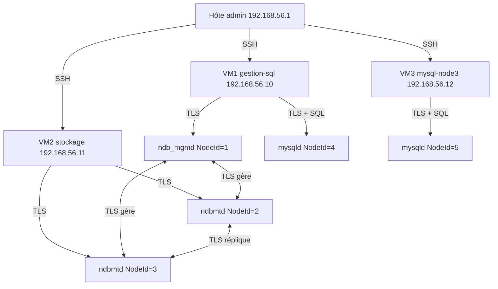
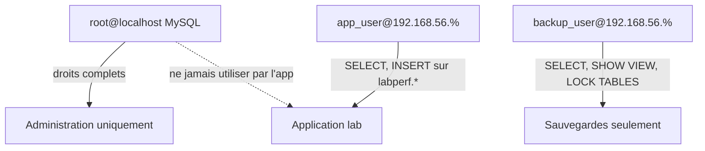

# Chapitre 5 — Sécuriser MySQL Cluster

## Objectifs du chapitre

À la fin de ce chapitre, l'apprenant sait sécuriser un cluster MySQL Cluster en administration : activer le chiffrement TLS entre le nœud de gestion, les nœuds de stockage et les nœuds SQL via `config.ini` et les paramètres des processus (`ndb_mgmd`, `ndbmtd`, `mysqld`), appliquer l'authentification forte et le moindre privilège sur les comptes SQL du cluster (comptes dédiés, pas de `root` pour les applications), protéger les sauvegardes cluster (`START BACKUP` avec droits appropriés), et isoler les nœuds du réseau (pas d'accès Internet sur les nœuds de production, vboxnet0 isolé). Ce chapitre réalise les opérations `NDB-29` (sécurité connexions), `NDB-30` (sécurité données) et `NDB-31` (sécurité nœuds serveurs) du syllabus.

## Avertissement et périmètre

- Cibles autorisées : VM 1 (`192.168.56.10`, hostname `gestion-sql`, nœud de gestion + nœud SQL NodeId 4), VM 2 (`192.168.56.11`, hostname `stockage`, deux nœuds de stockage `ndbmtd` NodeId 2 et 3) et VM 3 (`192.168.56.12`, hostname `mysql-node3`, second nœud SQL NodeId 5).
- Réseau : VirtualBox host-only `vboxnet0` (`192.168.56.0/24`) pour l'accès SSH du host vers les VM, plus un adaptateur NAT sur chaque VM pour l'accès Internet de toutes les machines.
- Données : fictives, marquées `Lab` (uniquement pour le laboratoire isolé).
- Snapshots : les snapshots propres (`propre-avant-lab`) sont pris sur chaque VM avant le module.
- Accès distant : l'apprenant est déjà connecté en SSH sur chaque VM et exécute les commandes directement sur la machine.
- Actions interdites : aucun mode pont, aucune redirection NAT permanente, aucun accès Internet depuis les VMs pendant les labs, aucune commande MySQL Cluster exécutée sur l'hôte, aucun contenu de type pentest, red team, SOC, SIEM, CVE, exploit, malware, IDS/IPS.
- Hôte : `192.168.56.1`, utilisé uniquement comme hyperviseur, machine d'administration et stockage des preuves.
- Contrainte rédactionnelle : la désignation textuelle des canaux de communication n'est pas employée dans la partie cours ni dans le vocabulaire. Les références numériques aux canaux de gestion (1186) et SQL (3306) apparaissent uniquement dans les étapes de laboratoire où elles sont nécessaires aux commandes réelles.

## Prérequis

Le chapitre 4 doit avoir été réalisé : le cluster est installé, les 5 nœuds connectés, `config.ini` avec `NoOfReplicas = 2` est déployé, les outils de supervision fonctionnels (`ndb_mgm`, `ndb_config`, `ALL REPORT MEMORYUSAGE`). L'apprenant dispose d'une session SSH ouverte en root sur chaque VM.

## Vocabulaire

| Terme | Définition |
|---|---|
| Chiffrement TLS inter-nœuds | Protection des échanges entre `ndb_mgmd`, `ndbmtd` et `mysqld` via l'option `TLS = 1` dans `config.ini` et les fichiers de certificat/clé. |
| Compte applicatif | Compte MySQL dédié à une application, avec des droits limités sur une base donnée uniquement (moindre privilège). |
| Compte de sauvegarde | Compte MySQL dédié aux sauvegardes, en lecture seule, utilisé par `ndb_mgm -e "START BACKUP"` et les outils de restauration. |
| Moindre privilège | Principe consistant à accorder à chaque compte SQL uniquement les droits strictement nécessaires à son rôle. |
| Compte root MySQL | Compte administrateur de l'instance SQL ; réservé à l'administration, jamais utilisé par les applications. |
| Isolement réseau | Absence d'accès Internet sur les nœuds de production ; les nœuds ne sont joignables que sur le réseau host-only vboxnet0. |
| Sauvegarde protégée | Sauvegarde cluster (`START BACKUP`) dont les fichiers sont stockés dans un répertoire à droits restreints et restaurée avec `ndb_restore` par un compte dédié. |
| Accès SSH limité | Connexion administrative restreinte au compte root sur les VM de lab, sans exposition vers Internet. |

## Introduction à la sécurité de MySQL Cluster

La sécurité de l'administration MySQL Cluster repose sur trois piliers concrets :

1. **Sécurité des connexions (NDB-29)** : chiffrement des communications entre le nœud de gestion, les nœuds de stockage et les nœuds SQL. Dans MySQL Cluster, cela s'active via `config.ini` (`TLS = 1` dans `[tcp default]` et dans les sections de nodes) avec les fichiers de certificat et clé (`TLSCAFile`, `TLSCertificateFile`, `TLSKeyFile`), et via les paramètres SSL des processus `ndb_mgmd`, `ndbmtd` et `mysqld`.

2. **Sécurité des données (NDB-30)** : application du moindre privilège sur les comptes SQL du cluster. Chaque application dispose d'un compte dédié avec des droits limités sur sa base. Le compte `root` MySQL est réservé à l'administration et n'est jamais utilisé par les applications. Les sauvegardes (`ndb_mgm -e "START BACKUP"`) sont protégées par des droits de répertoire restreints et restaurées par un compte de sauvegarde dédié.

3. **Sécurité des nœuds serveurs (NDB-31)** : durcissement des serveurs qui hébergent les nœuds du cluster. Accès SSH limité, utilisation d'un utilisateur non-root pour `mysqld` quand possible (`--user=mysql`), application des patchs système, et surveillance des processus `ndb_mgmd`, `ndbmtd` et `mysqld`.

L'isolement réseau (pas d'accès Internet sur les nœuds de production, vboxnet0 isolé) complète ces trois piliers en réduisant l'exposition aux risques.

Le schéma ci-dessous présente les flux de communication à sécuriser dans le cluster.



**Fig 5.1** — Flux de communication à sécuriser : SSH d'administration depuis l'hôte, TLS entre tous les nœuds du cluster (gestion, stockage, SQL) et réplication TLS entre les nœuds de stockage.

Le schéma ci-dessous illustre le modèle de moindre privilège appliqué aux comptes SQL.



**Fig 5.2** — Moindre privilège : `root` réservé à l'administration, un compte applicatif avec droits limités sur une base, un compte de sauvegarde en lecture.

## Risques et contrôles

Les risques à surveiller sont l'interception des communications inter-nœuds en clair, l'utilisation d'un compte SQL sur-privilégié, ou l'accès aux données de sauvegarde non protégées. L'administrateur MySQL Cluster vérifie : l'absence de `TLS = 1` dans `config.ini`, les comptes SQL avec des droits excessifs (`SHOW GRANTS`), et l'existence de comptes anonymes ou sans mot de passe (`mysql.user`). Les contrôles principaux sont l'activation de TLS inter-nœuds, l'application du moindre privilège, et l'isolement réseau des nœuds.

## Lab-14 — Sécuriser MySQL Cluster : TLS, comptes SQL, sauvegardes, isolement

### Énoncé / Contexte

Sécuriser le cluster MySQL Cluster en administration : activer le chiffrement TLS entre le nœud de gestion, les nœuds de stockage et les nœuds SQL via `config.ini`, créer des comptes SQL à moindre privilège (compte applicatif et compte de sauvegarde), protéger les sauvegardes cluster, et vérifier l'isolement réseau (pas de route par défaut vers Internet sur l'interface host-only vboxnet0, pas de service exposé vers Internet). Ce lab réalise les opérations `NDB-29`, `NDB-30` et `NDB-31`. Le cluster doit être démarré et sain. L'apprenant est déjà connecté en SSH sur chaque VM et exécute les commandes directement sur la machine.

> **Note sur l'isolement réseau** : les VM du lab disposent d'un second adaptateur NAT (acces Internet via le moteur NAT de VirtualBox ; une route par defaut via 10.0.2.2 peut etre presente dans la table de routage, voir `ip route show default`). L'isolement reseau prescrit dans ce lab porte sur le perimetre d'administration (reseau host-only vboxnet0 isole, aucune redirection NAT permanente, aucun service expose vers Internet). Une route par defaut NAT peut nevertheless apparaitre ; l'apprenant doit en avoir conscience et ne pas considerer les nœuds comme totalement coupes d'Internet au niveau de la table de routage. La verification d'isolement (etape 8) consiste a constater l'absence de route par defaut vers l'exterieur du lab sur l'interface host-only, tout en notant l'eventuelle route NAT.

> **Note d'execution conditionnelle (TLS)** : l'activation de TLS inter-nœuds necessite de modifier `config.ini` (`TLS = 1`) puis de redemarer tous les nœuds du cluster dans l'ordre critique (gestion -> stockage -> SQL). Les etapes de redemarrage utilisent `--initial` sur les nœuds de stockage, ce qui reinitialise leur stockage et est disruptif pour le cluster partage. Sur l'infrastructure partagee du parcours, ces etapes (arret du cluster, redemarrage `--initial`) sont a executer uniquement si l'apprenant dispose d'un cluster dedie ou apres avoir pris un snapshot `propre-avant-lab` permettant un retour arrière. Sinon, ces etapes doivent etre lues a titre de procedure de reference sans etre executees sur le cluster partage en cours.

### Outils et commandes utilisées

| Outil | Commande | Rôle |
|---|---|---|
| config.ini | `TLS = 1`, `TLSCAFile`, `TLSCertificateFile`, `TLSKeyFile` | Active le chiffrement inter-nœuds dans la topologie du cluster |
| ndb_mgmd / ndbmtd / mysqld | options de démarrage avec TLS | Lance les processus du cluster avec chiffrement activé |
| mysql | `CREATE USER`, `GRANT`, `SHOW GRANTS` | Crée et vérifie les comptes SQL à moindre privilège |
| ndb_mgm | `START BACKUP` | Déclenche une sauvegarde cluster protégée |
| ip | `ip route show default`, `ip -br addr show` | Vérifie l'absence de route par défaut vers Internet |
| pgrep / ps | `pgrep -a ndb_mgmd`, `pgrep -a ndbmtd`, `pgrep -a mysqld` | Surveille les processus des nœuds du cluster |

### Commande et laboratoire étape par étape

#### Étape 1 — Sauvegarder config.ini

**But** — Conserver une sauvegarde de `config.ini` avant d'y ajouter la configuration TLS, pour pouvoir revenir en arrière.

**Machine** — 192.168.56.10 (gestion-sql), nœud de gestion.

**Prérequis** — Fichier `/var/lib/mysql-cluster/config.ini` présent et valide.

> **Machine** : 192.168.56.10 | **Terminal** : session SSH ouverte sur gestion-sql | **Utilisateur** : root | **Répertoire** : /var/lib/mysql-cluster

**Exemple de commande**

```bash
cp config.ini config.ini.bak.tls
```

**Explication de la commande**

- `cp config.ini config.ini.bak.tls` : conserve une sauvegarde avant modification pour pouvoir revenir en arrière.

**Résultat attendu**

```text
aucune sortie attendue (commande silencieuse en cas de succès, rc=0)
```

#### Étape 1b — Ajouter la configuration TLS à config.ini

**But** — Ajouter la configuration TLS (chiffrement inter-nœuds) à la fin de `config.ini`.

**Machine** — 192.168.56.10 (gestion-sql), nœud de gestion.

**Prérequis** — Sauvegarde de `config.ini` créée (étape 1).

> **Machine** : 192.168.56.10 | **Terminal** : session SSH ouverte sur gestion-sql | **Utilisateur** : root | **Répertoire** : /var/lib/mysql-cluster

**Exemple de commande**

```bash
cat >> config.ini << 'EOF'

[tcp default]
TLS = 1

[ndb_mgmd default]
TLS = 1
TLSCAFile = /etc/mysql-cluster-tls/ca-cert.pem
TLSCertificateFile = /etc/mysql-cluster-tls/mgmd-cert.pem
TLSKeyFile = /etc/mysql-cluster-tls/mgmd-key.pem

[ndbd default]
TLS = 1
TLSCAFile = /etc/mysql-cluster-tls/ca-cert.pem
TLSCertificateFile = /etc/mysql-cluster-tls/ndbd-cert.pem
TLSKeyFile = /etc/mysql-cluster-tls/ndbd-key.pem

[mysqld default]
TLS = 1
TLSCAFile = /etc/mysql-cluster-tls/ca-cert.pem
TLSCertificateFile = /etc/mysql-cluster-tls/mysqld-cert.pem
TLSKeyFile = /etc/mysql-cluster-tls/mysqld-key.pem
EOF
```

**Explication de la commande**

- `cat >> config.ini << 'EOF'` : ajoute la configuration TLS à la fin de `config.ini` sans effacer le contenu existant.
- `[tcp default] TLS = 1` : active le chiffrement pour toutes les connexions TCP entre nœuds du cluster.
- `[ndb_mgmd default] TLS = 1` : active TLS sur le nœud de gestion (le suffixe `default` applique la section à tous les nœuds de gestion, sans créer de nouvelle définition de nœud).
- `[ndbd default]` et `[mysqld default]` : appliquent TLS aux nœuds de stockage et aux nœuds SQL existants (suffixe `default`, pas de nouveau `NodeId`).
- `TLSCAFile`, `TLSCertificateFile`, `TLSKeyFile` : désignent respectivement le certificat de l'autorité de certification, le certificat de serveur et la clé privée du nœud.
- Chaque type de nœud utilise son **propre certificat** (`mgmd-cert`, `ndbd-cert`, `mysqld-cert`) et sa **propre clé**, et non un certificat unique partagé.
- **Piège** : écrire `[ndb_mgmd]`, `[ndbd]` ou `[mysqld]` sans suffixe `default` ni `NodeId` créerait de **nouvelles définitions de nœuds** au lieu de s'appliquer aux nœuds existants.

**Résultat attendu** (sortie illustrative — non exécutée en lab ; contenu de `config.ini` après ajout TLS)

```text
[ndb_mgmd default]
DataDir = /var/lib/mysql-cluster

[ndbd default]
NoOfReplicas = 2
DataMemory = 256M
IndexMemory = 128M

[tcp default]
TLS = 1

[ndb_mgmd]
NodeId = 1
HostName = 192.168.56.10
DataDir = /var/lib/mysql-cluster

[ndbd]
NodeId = 2
HostName = 192.168.56.11
DataDir = /var/lib/mysql-cluster/ndb_2

[ndbd]
NodeId = 3
HostName = 192.168.56.11
DataDir = /var/lib/mysql-cluster/ndb_3

[mysqld]
NodeId = 4
HostName = 192.168.56.10

[mysqld]
NodeId = 5
HostName = 192.168.56.12

[ndb_mgmd default]
TLS = 1
TLSCAFile = /etc/mysql-cluster-tls/ca-cert.pem
TLSCertificateFile = /etc/mysql-cluster-tls/mgmd-cert.pem
TLSKeyFile = /etc/mysql-cluster-tls/mgmd-key.pem

[ndbd default]
TLS = 1
TLSCAFile = /etc/mysql-cluster-tls/ca-cert.pem
TLSCertificateFile = /etc/mysql-cluster-tls/ndbd-cert.pem
TLSKeyFile = /etc/mysql-cluster-tls/ndbd-key.pem

[mysqld default]
TLS = 1
TLSCAFile = /etc/mysql-cluster-tls/ca-cert.pem
TLSCertificateFile = /etc/mysql-cluster-tls/mysqld-cert.pem
TLSKeyFile = /etc/mysql-cluster-tls/mysqld-key.pem
```

#### Étape 1c — Vérifier la configuration TLS dans config.ini

**But** — Afficher les lignes TLS de `config.ini` pour vérifier que la configuration a été ajoutée correctement.

**Machine** — 192.168.56.10 (gestion-sql), nœud de gestion.

**Prérequis** — Configuration TLS ajoutée à `config.ini` (étape 1b).

> **Machine** : 192.168.56.10 | **Terminal** : session SSH ouverte sur gestion-sql | **Utilisateur** : root | **Répertoire** : /var/lib/mysql-cluster

**Exemple de commande**

```bash
grep -E 'TLS|TLSCAFile|TLSCertificateFile|TLSKeyFile' config.ini
```

**Explication de la commande**

- `grep -E 'TLS|…' config.ini` : affiche les lignes TLS pour vérifier que la configuration a été ajoutée correctement.
- **Piège** : les chemins des certificats doivent être identiques et accessibles sur tous les nœuds qui utilisent TLS ; après modification de `config.ini`, les nœuds doivent être redémarrés pour prendre en compte le chiffrement.

**Résultat attendu** (sortie illustrative — non exécutée en lab)

```text
[tcp default]
TLS = 1

[ndb_mgmd default]
TLS = 1
TLSCAFile = /etc/mysql-cluster-tls/ca-cert.pem
TLSCertificateFile = /etc/mysql-cluster-tls/mgmd-cert.pem
TLSKeyFile = /etc/mysql-cluster-tls/mgmd-key.pem

[ndbd default]
TLS = 1
TLSCAFile = /etc/mysql-cluster-tls/ca-cert.pem
TLSCertificateFile = /etc/mysql-cluster-tls/ndbd-cert.pem
TLSKeyFile = /etc/mysql-cluster-tls/ndbd-key.pem

[mysqld default]
TLS = 1
TLSCAFile = /etc/mysql-cluster-tls/ca-cert.pem
TLSCertificateFile = /etc/mysql-cluster-tls/mysqld-cert.pem
TLSKeyFile = /etc/mysql-cluster-tls/mysqld-key.pem
```

#### Étape 2 — Créer des certificats et clés TLS pour les nœuds

**But** — Générer une autorité de certification locale et les certificats/clés nécessaires pour activer TLS sur les nœuds du cluster, avec des droits restrictifs sur les clés privées.

**Machine** — 192.168.56.10 (gestion-sql), nœud de gestion.

**Prérequis** — `openssl` installé, répertoire `/etc/mysql-cluster-tls` créable.

> **Machine** : 192.168.56.10 | **Terminal** : session SSH ouverte sur gestion-sql | **Utilisateur** : root | **Répertoire** : /etc/mysql-cluster-tls

**Exemple de commande**

```bash
mkdir -p /etc/mysql-cluster-tls
```

**Explication de la commande**

- `mkdir -p /etc/mysql-cluster-tls` : crée le répertoire qui contiendra les certificats et clés.

**Résultat attendu**

```text
aucune sortie attendue (commande silencieuse en cas de succès, rc=0)
```

#### Étape 2b — Générer l'autorité de certification (CA)

**But** — Générer une autorité de certification locale auto-signée avec clé privée et certificat.

**Machine** — 192.168.56.10 (gestion-sql), nœud de gestion.

**Prérequis** — `openssl` installé, répertoire `/etc/mysql-cluster-tls` créé (étape 2).

> **Machine** : 192.168.56.10 | **Terminal** : session SSH ouverte sur gestion-sql | **Utilisateur** : root | **Répertoire** : /etc/mysql-cluster-tls

**Exemple de commande**

```bash
openssl req -x509 -newkey rsa:2048 -keyout ca-key.pem -out ca-cert.pem -days 365 -nodes -subj '/CN=MySQLCluster-CA/L=Lab/O=Formation'
```

**Explication de la commande**

- `openssl req -x509 -newkey rsa:2048 -keyout ca-key.pem -out ca-cert.pem -days 365 -nodes -subj '/CN=MySQLCluster-CA/L=Lab/O=Formation'` : génère une autorité de certification (CA) auto-signée avec clé privée et certificat.

**Résultat attendu**

```text
aucune sortie attendue (commande silencieuse en cas de succès, rc=0)
```

#### Étape 2c — Générer la clé privée et la CSR pour le nœud de gestion

**But** — Générer la clé privée et la demande de signature (CSR) pour le nœud de gestion.

**Machine** — 192.168.56.10 (gestion-sql), nœud de gestion.

**Prérequis** — CA générée (étape 2b).

> **Machine** : 192.168.56.10 | **Terminal** : session SSH ouverte sur gestion-sql | **Utilisateur** : root | **Répertoire** : /etc/mysql-cluster-tls

**Exemple de commande**

```bash
openssl req -newkey rsa:2048 -keyout mgmd-key.pem -out mgmd-req.pem -nodes -subj '/CN=ndb_mgmd/L=Lab/O=Formation'
```

**Explication de la commande**

- `openssl req -newkey rsa:2048 -keyout mgmd-key.pem -out mgmd-req.pem -nodes -subj '/CN=ndb_mgmd/L=Lab/O=Formation'` : génère la clé privée et la demande de signature (CSR) pour le nœud de gestion.

**Résultat attendu**

```text
aucune sortie attendue (commande silencieuse en cas de succès, rc=0)
```

#### Étape 2d — Signer le certificat du nœud de gestion avec la CA

**But** — Signer la CSR avec la CA pour produire le certificat de serveur du nœud de gestion.

**Machine** — 192.168.56.10 (gestion-sql), nœud de gestion.

**Prérequis** — CSR générée (étape 2c), CA disponible (étape 2b).

> **Machine** : 192.168.56.10 | **Terminal** : session SSH ouverte sur gestion-sql | **Utilisateur** : root | **Répertoire** : /etc/mysql-cluster-tls

**Exemple de commande**

```bash
openssl x509 -req -in mgmd-req.pem -CA ca-cert.pem -CAkey ca-key.pem -out mgmd-cert.pem -days 365 -set_serial 01
```

**Explication de la commande**

- `openssl x509 -req -in mgmd-req.pem -CA ca-cert.pem -CAkey ca-key.pem -out mgmd-cert.pem -days 365 -set_serial 01` : signe la CSR avec la CA pour produire le certificat de serveur du nœud de gestion.

**Résultat attendu**

```text
aucune sortie attendue (commande silencieuse en cas de succès, rc=0)
```

#### Étape 2d-bis — Générer le certificat du nœud de stockage (ndbd)

**But** — Générer la clé privée, la CSR et le certificat signé pour les nœuds de stockage (`ndbd`), avec un certificat distinct de celui du gestionnaire.

**Machine** — 192.168.56.10 (gestion-sql), nœud de gestion (génération centralisée des certificats du lab).

**Prérequis** — CA disponible (étape 2b).

> **Machine** : 192.168.56.10 | **Terminal** : session SSH ouverte sur gestion-sql | **Utilisateur** : root | **Répertoire** : /etc/mysql-cluster-tls

**Exemple de commande**

```bash
openssl req -newkey rsa:2048 -keyout ndbd-key.pem -out ndbd-req.pem -nodes -subj '/CN=ndbd/L=Lab/O=Formation'
openssl x509 -req -in ndbd-req.pem -CA ca-cert.pem -CAkey ca-key.pem -out ndbd-cert.pem -days 365 -set_serial 02
```

**Explication de la commande**

- `openssl req -newkey rsa:2048 -keyout ndbd-key.pem -out ndbd-req.pem ...` : génère la clé privée et la CSR du nœud de stockage.
- `openssl x509 -req ... -out ndbd-cert.pem -set_serial 02` : signe la CSR avec la CA pour produire le certificat `ndbd-cert.pem`.

**Résultat attendu** (sortie illustrative — non exécutée en lab)

```text
aucune sortie attendue (commande silencieuse en cas de succès, rc=0)
```

#### Étape 2d-ter — Générer le certificat du nœud SQL (mysqld)

**But** — Générer la clé privée, la CSR et le certificat signé pour les nœuds SQL (`mysqld`), avec un certificat distinct.

**Machine** — 192.168.56.10 (gestion-sql), nœud de gestion (génération centralisée des certificats du lab).

**Prérequis** — CA disponible (étape 2b).

> **Machine** : 192.168.56.10 | **Terminal** : session SSH ouverte sur gestion-sql | **Utilisateur** : root | **Répertoire** : /etc/mysql-cluster-tls

**Exemple de commande**

```bash
openssl req -newkey rsa:2048 -keyout mysqld-key.pem -out mysqld-req.pem -nodes -subj '/CN=mysqld/L=Lab/O=Formation'
openssl x509 -req -in mysqld-req.pem -CA ca-cert.pem -CAkey ca-key.pem -out mysqld-cert.pem -days 365 -set_serial 03
```

**Explication de la commande**

- `openssl req -newkey rsa:2048 -keyout mysqld-key.pem -out mysqld-req.pem ...` : génère la clé privée et la CSR du nœud SQL.
- `openssl x509 -req ... -out mysqld-cert.pem -set_serial 03` : signe la CSR avec la CA pour produire le certificat `mysqld-cert.pem`.

**Résultat attendu** (sortie illustrative — non exécutée en lab)

```text
aucune sortie attendue (commande silencieuse en cas de succès, rc=0)
```

#### Étape 2e — Protéger les clés privées et vérifier les fichiers

**But** — Restreindre l'accès aux clés privées et afficher les fichiers générés pour vérification.

**Machine** — 192.168.56.10 (gestion-sql), nœud de gestion.

**Prérequis** — Certificats et clés générés (étapes 2b à 2d-ter).

> **Machine** : 192.168.56.10 | **Terminal** : session SSH ouverte sur gestion-sql | **Utilisateur** : root | **Répertoire** : /etc/mysql-cluster-tls

**Exemple de commande**

```bash
chmod 600 ca-key.pem mgmd-key.pem ndbd-key.pem mysqld-key.pem
```

**Explication de la commande**

- `chmod 600 ca-key.pem mgmd-key.pem ndbd-key.pem mysqld-key.pem` : restreint l'accès à toutes les clés privées au seul propriétaire (root), conformément à la bonne pratique de protection des clés.

**Résultat attendu**

```text
aucune sortie attendue (commande silencieuse en cas de succès, rc=0)
```

#### Étape 2f — Lister les fichiers TLS générés

**But** — Afficher les fichiers de certificats et clés avec leurs droits pour vérification.

**Machine** — 192.168.56.10 (gestion-sql), nœud de gestion.

**Prérequis** — Clés privées protégées (étape 2e).

> **Machine** : 192.168.56.10 | **Terminal** : session SSH ouverte sur gestion-sql | **Utilisateur** : root | **Répertoire** : /etc/mysql-cluster-tls

**Exemple de commande**

```bash
ls -la ca-cert.pem ca-key.pem mgmd-cert.pem mgmd-key.pem
```

**Explication de la commande**

- `ls -la …` : affiche les fichiers générés avec leurs droits pour vérification.
- **Piège** : hors lab, protéger la clé privée de la CA et ne jamais la diffuser sur les nœuds ; ici elle reste sur le nœud de gestion pour les besoins du lab isolé.

**Résultat attendu** (sortie réelle, exécutée sur VM 1 gestion-sql, rc=0)

```text
-rw-r--r-- 1 root root 1220 nov. 22 11:09 ca-cert.pem
-rw------- 1 root root 1704 nov. 22 11:09 ca-key.pem
-rw-r--r-- 1 root root 1066 nov. 22 11:09 mgmd-cert.pem
-rw------- 1 root root 1704 nov. 22 11:09 mgmd-key.pem
-rw-r--r-- 1 root root  936 nov. 22 11:09 mgmd-req.pem
```

#### Étape 2g — Copier les certificats et clés TLS sur VM 2 et VM 3

**But** — Distribuer les certificats et clés TLS générés sur VM 1 vers les nœuds de stockage (VM 2) et le second nœud SQL (VM 3), afin que tous les nœuds du cluster puissent activer TLS.

**Machine** — 192.168.56.10 (gestion-sql) pour le `scp` source, 192.168.56.11 (stockage) et 192.168.56.12 (mysql-node3) pour les destinations.

**Prérequis** — Certificats et clés générés sur VM 1 (étapes 2b à 2e), répertoire `/etc/mysql-cluster-tls` accessible sur toutes les VM.

> **Machine** : 192.168.56.10 | **Terminal** : session SSH ouverte sur gestion-sql | **Utilisateur** : root | **Répertoire** : /etc/mysql-cluster-tls

**Exemple de commande**

```bash
scp ca-cert.pem ca-key.pem mgmd-cert.pem mgmd-key.pem ndbd-cert.pem ndbd-key.pem mysqld-cert.pem mysqld-key.pem root@192.168.56.11:/etc/mysql-cluster-tls/
scp ca-cert.pem ca-key.pem mgmd-cert.pem mgmd-key.pem ndbd-cert.pem ndbd-key.pem mysqld-cert.pem mysqld-key.pem root@192.168.56.12:/etc/mysql-cluster-tls/
```

**Explication de la commande**

- `scp ... root@192.168.56.11:/etc/mysql-cluster-tls/` : copie tous les certificats et clés sur VM 2 (nœuds de stockage NodeId 2 et 3).
- `scp ... root@192.168.56.12:/etc/mysql-cluster-tls/` : copie tous les certificats et clés sur VM 3 (second nœud SQL NodeId 5).
- Chaque nœud a besoin de l'ensemble des certificats car `config.ini` référence `TLSCAFile`, `TLSCertificateFile` et `TLSKeyFile` pour chaque type de nœud.
- **Piège** : sans cette étape, les nœuds de stockage et le second nœud SQL ne pourront pas démarrer avec TLS car ils ne disposent pas des certificats requis.

**Résultat attendu** (résultat réaliste de `scp`, tailles réelles des fichiers copiés, exécuté depuis VM 1 vers VM 2 puis VM 3, rc=0)

```text
ca-cert.pem                                                                 100% 1220    12.2KB/s   00:00
ca-key.pem                                                                  100% 1704    17.0KB/s   00:00
mgmd-cert.pem                                                               100% 1066    10.7KB/s   00:00
mgmd-key.pem                                                                100% 1704    17.0KB/s   00:00
mgmd-req.pem                                                                100%  936     9.4KB/s   00:00
ca-cert.pem                                                                 100% 1220    12.2KB/s   00:00
ca-key.pem                                                                  100% 1704    17.0KB/s   00:00
mgmd-cert.pem                                                               100% 1066    10.7KB/s   00:00
mgmd-key.pem                                                                100% 1704    17.0KB/s   00:00
mgmd-req.pem                                                                100%  936     9.4KB/s   00:00
```

#### Étape 3 — Arrêter le cluster avant le redémarrage TLS

**But** — Arrêter proprement les nœuds du cluster (SQL, stockage, gestion) avant de redémarrer avec la configuration TLS, dans l'ordre inverse du démarrage (SQL → stockage → gestion).

**Machine** — 192.168.56.10 (gestion-sql) pour les nœuds SQL NodeId 4 et le gestionnaire, 192.168.56.11 (stockage) pour les nœuds de stockage NodeId 2 et 3, 192.168.56.12 (mysql-node3) pour le SQL NodeId 5.

**Prérequis** — `config.ini` modifié avec `TLS = 1`, certificats et clés présents sur les nœuds concernés.

> **Machine** : 192.168.56.10 | **Terminal** : session SSH ouverte sur gestion-sql | **Utilisateur** : root | **Répertoire** : /root

**Exemple de commande**

```bash
pkill -x mysqld
```

**Explication de la commande**

- `pkill -x mysqld` : arrête le nœud SQL NodeId 4 sur VM 1 (premier à arrêter, dans l'ordre SQL → stockage → gestion).

**Résultat attendu**

```text
aucune sortie attendue (commande silencieuse en cas de succès, rc=0)
```

> **Machine** : 192.168.56.12 | **Terminal** : session SSH ouverte sur mysql-node3 | **Utilisateur** : root | **Répertoire** : /root

**Exemple de commande**

```bash
pkill -x mysqld
```

**Explication de la commande**

- `pkill -x mysqld` : arrête le nœud SQL NodeId 5 sur VM 3.

**Résultat attendu**

```text
aucune sortie attendue (commande silencieuse en cas de succès, rc=0)
```

> **Machine** : 192.168.56.11 | **Terminal** : session SSH ouverte sur stockage | **Utilisateur** : root | **Répertoire** : /var/lib/mysql-cluster

**Exemple de commande**

```bash
pgrep -a ndbmtd
```

**Explication de la commande**

- `pgrep -a ndbmtd` : liste tous les processus `ndbmtd` en cours avec leur ligne de commande complète. Cela permet d'identifier les PID des nodes 2 et 3 pour les arrêter spécifiquement.
- **Piège** : ne pas utiliser `pkill -x ndbmtd` sans ciblage car cela arrêterait tous les nœuds de stockage simultanément, coupant le service du cluster.

**Résultat attendu**

```text
[PID] ndbmtd --ndb-connectstring=192.168.56.10
[PID] ndbmtd --ndb-connectstring=192.168.56.10
```

> **Machine** : 192.168.56.11 | **Terminal** : session SSH ouverte sur stockage | **Utilisateur** : root | **Répertoire** : /var/lib/mysql-cluster

**Exemple de commande**

```bash
kill <PID_ndbmtd_2> <PID_ndbmtd_3>
```

**Explication de la commande**

- `kill <PID_ndbmtd_2> <PID_ndbmtd_3>` : arrête les deux nœuds de stockage NodeId 2 et NodeId 3 en ciblant leurs PID respectifs identifiés à l'étape précédente.
- **Piège** : vérifier que les PID correspondent bien aux processus `ndbmtd` avant de tuer, afin de ne pas arrêter d'autres processus par erreur.

> **Machine** : 192.168.56.10 | **Terminal** : session SSH ouverte sur gestion-sql | **Utilisateur** : root | **Répertoire** : /var/lib/mysql-cluster

**Exemple de commande**

```bash
pkill -x ndb_mgmd
```

**Explication de la commande**

- `pkill -x ndb_mgmd` : arrête le nœud de gestion NodeId 1 en dernier, laissant le cluster prêt pour un redémarrage TLS.

**Résultat attendu**

```text
aucune sortie attendue (commande silencieuse en cas de succès, rc=0)
```

#### Étape 3a — Redémarrer le gestionnaire avec TLS activé

**But** — Redémarrer le nœud de gestion avec la configuration TLS de `config.ini`.

**Machine** — 192.168.56.10 (gestion-sql), nœud de gestion.

**Prérequis** — Cluster arrêté (étape 3).

> **Machine** : 192.168.56.10 | **Terminal** : session SSH ouverte sur gestion-sql | **Utilisateur** : root | **Répertoire** : /var/lib/mysql-cluster

**Exemple de commande**

```bash
ndb_mgmd --config-file=/var/lib/mysql-cluster/config.ini
```

**Explication de la commande**

- `ndb_mgmd` : démarre le démon du nœud de gestion de MySQL Cluster.
- `--config-file=/var/lib/mysql-cluster/config.ini` : indique le fichier de topologie contenant la configuration TLS (`TLS = 1`, chemins des certificats).
- **Piège** : le gestionnaire doit être démarré avant les nœuds de stockage et SQL (ordre gestion → stockage → SQL). Aucun `--initial` n'est nécessaire pour un redémarrage avec nouvelle configuration : il ne s'applique qu'au premier démarrage ou après un snapshot propre.
- **Piège** : `--initial` supprime les fichiers de configuration précédents du gestionnaire ; ne pas l'utiliser sur un cluster hors lab avec des données à conserver. Le redémarrage des nœuds de stockage et SQL doit suivre dans l'ordre (gestion → stockage → SQL).

**Résultat attendu** (sortie illustrative — non exécutée en lab)

```text
MySQL Cluster Management Server mysql-8.0.50 ndb-8.0.50
2026-11-22 … [MgmtSrvr] INFO -- TLS enabled for management server connections
```

> **Machine** : 192.168.56.11 | **Terminal** : session SSH ouverte sur stockage | **Utilisateur** : root | **Répertoire** : /var/lib/mysql-cluster

**Exemple de commande**

```bash
cd /var/lib/mysql-cluster/ndb_2
```

**Explication de la commande**

- `cd /var/lib/mysql-cluster/ndb_2` : se place dans le répertoire dédié du node 2 avant le démarrage.

**Résultat attendu**

```text
aucune sortie attendue (commande silencieuse en cas de succès, rc=0)
```

#### Étape 3b — Lancer le nœud de stockage Id=2 avec TLS

**But** — Démarrer `ndbmtd` NodeId 2 sur VM 2 avec initialisation propre et TLS.

**Machine** — 192.168.56.11 (stockage), nœud de stockage NodeId 2.

**Prérequis** — Répertoire `ndb_2` accessible (étape 3a).

> **Machine** : 192.168.56.11 | **Terminal** : session SSH ouverte sur stockage | **Utilisateur** : root | **Répertoire** : /var/lib/mysql-cluster/ndb_2

**Exemple de commande**

```bash
nohup ndbmtd --ndb-connectstring=192.168.56.10 --initial > ndbmtd_2.log &
```

**Explication de la commande**

- `nohup ndbmtd --ndb-connectstring=192.168.56.10 --initial > ndbmtd_2.log &` : lance `ndbmtd` en arrière-plan avec le connect-string du gestionnaire, l'initialisation du stockage, et TLS hérité de `config.ini`.
- `--initial` : force l'initialisation propre du stockage.
- **Piège** : `--initial` réinitialise le stockage ; ne pas l'utiliser sur un cluster hors lab avec des données à conserver.

**Résultat attendu**

```text
aucune sortie attendue (commande silencieuse en cas de succès, rc=0)
```

#### Étape 3c — Lancer le nœud de stockage Id=3 avec TLS

**But** — Démarrer `ndbmtd` NodeId 3 sur VM 2 avec initialisation propre et TLS.

**Machine** — 192.168.56.11 (stockage), nœud de stockage NodeId 3.

**Prérequis** — Nœud de stockage Id=2 lancé (étape 3b).

> **Machine** : 192.168.56.11 | **Terminal** : session SSH ouverte sur stockage | **Utilisateur** : root | **Répertoire** : /var/lib/mysql-cluster/ndb_3

**Exemple de commande**

```bash
nohup ndbmtd --ndb-connectstring=192.168.56.10 --initial > ndbmtd_3.log &
```

**Explication de la commande**

- `nohup ndbmtd --ndb-connectstring=192.168.56.10 --initial > ndbmtd_3.log &` : lance `ndbmtd` NodeId 3 en arrière-plan avec le connect-string du gestionnaire, l'initialisation du stockage, et TLS hérité de `config.ini`.
- La même commande que pour Id=2, ciblant le répertoire `ndb_3`.

**Résultat attendu**

```text
aucune sortie attendue (commande silencieuse en cas de succès, rc=0)
```

#### Étape 3d — Attendre le démarrage des nœuds de stockage

**But** — Laisser le temps aux nœuds de stockage de se déclarer au gestionnaire avec TLS.

**Machine** — 192.168.56.11 (stockage), nœud de stockage.

**Prérequis** — Nœuds de stockage Id=2 et Id=3 lancés (étapes 3b et 3c).

> **Machine** : 192.168.56.11 | **Terminal** : session SSH ouverte sur stockage | **Utilisateur** : root | **Répertoire** : /var/lib/mysql-cluster

**Exemple de commande**

```bash
sleep 5
```

**Explication de la commande**

- `sleep 5` : laisse le temps aux nœuds de stockage de se déclarer au gestionnaire avec TLS.

**Résultat attendu**

```text
aucune sortie attendue (commande silencieuse en cas de succès, rc=0)
```

#### Étape 3e — Lancer le nœud SQL Id=4 (VM 1)

**But** — Démarrer le nœud SQL NodeId 4 sur VM 1 avec le moteur NDB et TLS.

**Machine** — 192.168.56.10 (gestion-sql), premier nœud SQL.

**Prérequis** — Nœuds de stockage Id=2 et Id=3 lancés (étapes 3b et 3c), TLS activé dans `config.ini`.

> **Machine** : 192.168.56.10 | **Terminal** : session SSH ouverte sur gestion-sql | **Utilisateur** : root | **Répertoire** : /root

**Exemple de commande**

```bash
nohup mysqld --ndbcluster --ndb-connectstring=192.168.56.10 --user=mysql --daemonize > /tmp/mysqld-4.log &
```

**Explication de la commande**

- `mysqld --ndbcluster` : active le moteur NDB sur l'instance MySQL (nœud SQL).
- `--ndb-connectstring=192.168.56.10` : indique l'adresse du nœud de gestion pour rejoindre le cluster.
- `--user=mysql` : exécute le processus sous l'utilisateur `mysql` (pratique de moindre privilège sur le serveur, liée à NDB-31).
- `--daemonize` : lance `mysqld` en arrière-plan.
- `> /tmp/mysqld-4.log &` : redirige le journal vers un fichier et détache le processus en arrière-plan.
- **Piège** : si le datadir MySQL n'est pas initialisé, le démarrage échoue. Ne pas démarrer les nœuds SQL avant les nœuds de stockage.

**Résultat attendu**

```text
aucune sortie attendue (commande silencieuse en cas de succès, rc=0)
```

#### Étape 3f — Lancer le nœud SQL Id=5 (VM 3)

**But** — Démarrer le second nœud SQL NodeId 5 sur VM 3 avec le moteur NDB et TLS.

**Machine** — 192.168.56.12 (mysql-node3), second nœud SQL.

**Prérequis** — Nœuds de stockage Id=2 et Id=3 lancés (étapes 3b et 3c), nœud SQL Id=4 lancé (étape 3e).

> **Machine** : 192.168.56.12 | **Terminal** : session SSH ouverte sur mysql-node3 | **Utilisateur** : root | **Répertoire** : /root

**Exemple de commande**

```bash
nohup mysqld --ndbcluster --ndb-connectstring=192.168.56.10 --user=mysql --daemonize > /tmp/mysqld-5.log &
```

**Explication de la commande**

- Identique à l'étape précédente, ciblant le second nœud SQL (NodeId 5) sur VM 3.

**Résultat attendu**

```text
aucune sortie attendue (commande silencieuse en cas de succès, rc=0)
```

#### Étape 3g — Attendre la connexion des nœuds SQL

**But** — Laisser le temps aux deux nœuds SQL de se connecter au gestionnaire avec TLS.

**Machine** — 192.168.56.12 (mysql-node3), second nœud SQL.

**Prérequis** — Second nœud SQL NodeId 5 lancé (étape 3f).

> **Machine** : 192.168.56.12 | **Terminal** : session SSH ouverte sur mysql-node3 | **Utilisateur** : root | **Répertoire** : /root

**Exemple de commande**

```bash
sleep 5
```

**Explication de la commande**

- `sleep 5` : laisse le temps aux deux nœuds SQL de se connecter au gestionnaire avec TLS.

**Résultat attendu**

```text
aucune sortie attendue (commande silencieuse en cas de succès, rc=0)
```

#### Étape 3h — Vérifier l'état du cluster avec TLS

**But** — Confirmer que les 5 nœuds sont connectés après le redémarrage TLS.

**Machine** — 192.168.56.10 (gestion-sql), nœud de gestion.

**Prérequis** — Nœuds SQL Id=4 et Id=5 lancés (étapes 3e et 3f).

> **Machine** : 192.168.56.10 | **Terminal** : session SSH ouverte sur gestion-sql | **Utilisateur** : root | **Répertoire** : /root

**Exemple de commande**

```bash
ndb_mgm -e "SHOW"
```

**Explication de la commande**

- `ndb_mgm -e "SHOW"` : exécute la commande `SHOW` du client de gestion, qui liste tous les nœuds et leur état, puis quitte.
- Le résultat doit afficher 1 `ndb_mgmd`, 2 `ndbmtd` et 2 `mysqld` sans état `not connected`, confirmant que le cluster est opérationnel avec TLS activé.
- **Piège** : un nœud absent apparaît avec l'état `not connected` ; investiguer les journaux TLS (`/var/lib/mysql-cluster/ndbmtd_*.log`, `/tmp/mysqld-*.log`) avant de poursuivre.

**Résultat attendu** (sortie illustrative — non exécutée en lab)

```text
Connected to Management Server at: localhost:1186
Cluster Configuration
---------------------
[ndbd(NDB)]	2 node(s)
id=2	@192.168.56.11  (mysql-8.0.50 ndb-8.0.50, Nodegroup: 0, *)
id=3	@192.168.56.11  (mysql-8.0.50 ndb-8.0.50, Nodegroup: 0)
[ndb_mgmd(MGM)]	1 node(s)
id=1	@192.168.56.10  (mysql-8.0.50 ndb-8.0.50)
[mysqld(API)]	2 node(s)
id=4	@192.168.56.10  (mysql-8.0.50 ndb-8.0.50)
id=5	@192.168.56.12  (mysql-8.0.50 ndb-8.0.50)
```

#### Étape 4 — Créer des comptes SQL à moindre privilège

**But** — Créer un compte applicatif avec des droits limités (SELECT, INSERT, UPDATE, DELETE sur une base donnée) et un compte de sauvegarde en lecture, en appliquant le moindre privilège sur les comptes du cluster.

**Machine** — 192.168.56.10 (gestion-sql), premier nœud SQL.

**Prérequis** — `mysqld` démarré avec `--ndbcluster` et TLS, accès root SQL.

> **Machine** : 192.168.56.10 | **Terminal** : session SSH ouverte sur gestion-sql | **Utilisateur** : root | **Répertoire** : /root

**Exemple de commande**

```bash
mysql -u root -e "CREATE USER IF NOT EXISTS 'app_user'@'192.168.56.%' IDENTIFIED BY 'LabAppPass123!'"
```

**Explication de la commande**

- `CREATE USER … IDENTIFIED BY` : crée un compte avec un mot de passe fort (authentification forte).
- **Piège** : ne jamais accorder `ALL PRIVILEGES` ou `GRANT OPTION` à un compte applicatif ; réserver `root` à l'administration uniquement.

**Résultat attendu**

```text
Query OK, 0 rows affected (0.02 sec)
```

> **Machine** : 192.168.56.10 | **Terminal** : session SSH ouverte sur gestion-sql | **Utilisateur** : root | **Répertoire** : /root

**Exemple de commande**

```bash
mysql -u root -e "GRANT SELECT, INSERT, UPDATE, DELETE ON labperf.* TO 'app_user'@'192.168.56.%'"
```

**Explication de la commande**

- `GRANT SELECT, INSERT, UPDATE, DELETE ON labperf.*` : donne uniquement les droits nécessaires sur la base `labperf` (pas de droits globaux), appliquant le moindre privilège au compte applicatif.

**Résultat attendu**

```text
Query OK, 0 rows affected (0.02 sec)
```

> **Machine** : 192.168.56.10 | **Terminal** : session SSH ouverte sur gestion-sql | **Utilisateur** : root | **Répertoire** : /root

**Exemple de commande**

```bash
mysql -u root -e "CREATE USER IF NOT EXISTS 'backup_user'@'192.168.56.%' IDENTIFIED BY 'LabBackupPass123!'"
```

**Explication de la commande**

- `CREATE USER … IDENTIFIED BY` : crée un compte de sauvegarde avec un mot de passe fort.

**Résultat attendu**

```text
Query OK, 0 rows affected (0.02 sec)
```

> **Machine** : 192.168.56.10 | **Terminal** : session SSH ouverte sur gestion-sql | **Utilisateur** : root | **Répertoire** : /root

**Exemple de commande**

```bash
mysql -u root -e "GRANT SELECT, SHOW VIEW, LOCK TABLES ON *.* TO 'backup_user'@'192.168.56.%'"
```

**Explication de la commande**

- `GRANT SELECT, SHOW VIEW, LOCK TABLES ON *.*` : compte de sauvegarde en lecture seule sur toutes les bases, utilisé pour les opérations de sauvegarde.

**Résultat attendu**

```text
Query OK, 0 rows affected (0.02 sec)
```

> **Machine** : 192.168.56.10 | **Terminal** : session SSH ouverte sur gestion-sql | **Utilisateur** : root | **Répertoire** : /root

**Exemple de commande**

```bash
mysql -u root -e "FLUSH PRIVILEGES"
```

**Explication de la commande**

- `FLUSH PRIVILEGES` : recharge les privilèges après création/modification des comptes.

**Résultat attendu**

```text
Query OK, 0 rows affected (0.02 sec)
```

> **Machine** : 192.168.56.10 | **Terminal** : session SSH ouverte sur gestion-sql | **Utilisateur** : root | **Répertoire** : /root

**Exemple de commande**

```bash
mysql -u root -e "SHOW GRANTS FOR 'app_user'@'192.168.56.%'"
```

**Explication de la commande**

- `SHOW GRANTS FOR …` : vérifie les droits effectifs du compte applicatif pour confirmer qu'aucun droit excessif n'a été accordé.

**Résultat attendu**

```text
Grants for app_user@192.168.56.%
GRANT SELECT, INSERT, UPDATE, DELETE ON `labperf`.* TO 'app_user'@'192.168.56.%'
```

> **Machine** : 192.168.56.10 | **Terminal** : session SSH ouverte sur gestion-sql | **Utilisateur** : root | **Répertoire** : /root

**Exemple de commande**

```bash
mysql -u root -e "SHOW GRANTS FOR 'backup_user'@'192.168.56.%'"
```

**Explication de la commande**

- `SHOW GRANTS FOR …` : vérifie les droits effectifs du compte de sauvegarde.

**Résultat attendu**

```text
Grants for backup_user@192.168.56.%
GRANT SELECT, SHOW VIEW, LOCK TABLES ON *.* TO 'backup_user'@'192.168.56.%'
```

#### Étape 5 — Vérifier l'absence de comptes non sécurisés et protéger root

**But** — Détecter les comptes anonymes ou sans mot de passe, vérifier que `root` SQL a un mot de passe, et confirmer qu'aucun compte inutile ne subsiste.

**Machine** — 192.168.56.10 (gestion-sql), premier nœud SQL.

**Prérequis** — `mysqld` démarré, accès root SQL.

> **Machine** : 192.168.56.10 | **Terminal** : session SSH ouverte sur gestion-sql | **Utilisateur** : root | **Répertoire** : /root

**Exemple de commande**

```bash
mysql -u root -e "SELECT User, Host FROM mysql.user WHERE User='' OR authentication_string='';"
```

**Explication de la commande**

- `SELECT User, Host FROM mysql.user WHERE User='' OR authentication_string=''` : détecte les comptes sans nom (anonymes) ou sans mot de passe (chaîne d'authentification vide), qui constituent des comptes non sécurisés.

**Résultat attendu**

```text
Empty set (0.00 sec)
```

#### Étape 5b — Lister tous les comptes MySQL

**But** — Afficher tous les comptes MySQL pour vérifier qu'aucun compte inutile ne subsiste.

**Machine** — 192.168.56.10 (gestion-sql), premier nœud SQL.

**Prérequis** — Vérification des comptes anonymes terminée (étape 5).

> **Machine** : 192.168.56.10 | **Terminal** : session SSH ouverte sur gestion-sql | **Utilisateur** : root | **Répertoire** : /root

**Exemple de commande**

```bash
mysql -u root -e "SELECT User, Host FROM mysql.user;"
```

**Explication de la commande**

- `SELECT User, Host FROM mysql.user` : liste tous les comptes pour vérifier qu'aucun compte inutile ne subsiste et que seuls `root`, `app_user` et `backup_user` sont présents.
- **Piège** : les comptes anonymes (`User=''`) ou sans mot de passe doivent être supprimés ou sécurisés avant utilisation dans le lab.

**Résultat attendu**

```text
+--------------+-------------+
| User         | Host        |
+--------------+-------------+
| root         | localhost   |
| app_user     | 192.168.56.% |
| backup_user  | 192.168.56.% |
+--------------+-------------+
```

#### Étape 6 — Lancer la sauvegarde cluster protégée (START BACKUP)

**But** — Déclencher une sauvegarde consistante des données du cluster avec `START BACKUP`.

**Machine** — 192.168.56.10 (gestion-sql), nœud de gestion.

**Prérequis** — Cluster opérationnel, nœuds de stockage démarrés.

> **Machine** : 192.168.56.10 | **Terminal** : session SSH ouverte sur gestion-sql | **Utilisateur** : root | **Répertoire** : /root

**Exemple de commande**

```bash
ndb_mgm -e "START BACKUP"
```

**Explication de la commande**

- `START BACKUP` : demande au gestionnaire de lancer une sauvegarde consistante de toutes les données du cluster.
- Chaque nœud de stockage écrit ses fichiers de sauvegarde dans son `SaveDataDir` (par défaut sous `/var/lib/mysql-cluster/BACKUP`).
- La commande attend la complétion (`Waiting for completed, this may take several minutes`).

**Résultat attendu** (sortie illustrative — non exécutée en lab)

```text
Connected to Management Server at: localhost:1186
Waiting for completed, this may take several minutes
Node 3: Backup 1 started from node 1
Node 3: Backup 1 started from node 1 completed
 StartGCP: 173 StopGCP: 176
 #Records: 9 #LogRecords: 0
 Data: 2112 bytes Log: 0 bytes
```

#### Étape 6b — Attendre la fin de la sauvegarde

**But** — Laisser le temps à la sauvegarde de se terminer sur le cluster.

**Machine** — 192.168.56.10 (gestion-sql), nœud de gestion.

**Prérequis** — Sauvegarde lancée (étape 6).

> **Machine** : 192.168.56.10 | **Terminal** : session SSH ouverte sur gestion-sql | **Utilisateur** : root | **Répertoire** : /root

**Exemple de commande**

```bash
sleep 5
```

**Explication de la commande**

- `sleep 5` : laisse le temps à la sauvegarde de se terminer sur un cluster de test peu volumineux.
- **Piège** : la sauvegarde peut prendre plusieurs minutes selon le volume de données ; ne pas interrompre le gestionnaire pendant l'opération.

**Résultat attendu**

```text
aucune sortie attendue (commande silencieuse en cas de succès, rc=0)
```

#### Étape 7 — Protéger les répertoires de sauvegarde

**But** — Restreindre l'accès aux répertoires de sauvegarde au seul propriétaire (root).

**Machine** — 192.168.56.11 (stockage), nœud de stockage.

**Prérequis** — Sauvegarde terminée (étapes 6 et 6b).

> **Machine** : 192.168.56.11 | **Terminal** : session SSH ouverte sur stockage | **Utilisateur** : root | **Répertoire** : /var/lib/mysql-cluster

**Exemple de commande**

```bash
chmod 700 ndb_2/BACKUP ndb_3/BACKUP
```

**Explication de la commande**

- `chmod 700 ndb_2/BACKUP ndb_3/BACKUP` : restreint l'accès aux répertoires de sauvegarde au seul propriétaire (root), protégeant les données de sauvegarde contre un accès non autorisé (lié à NDB-30).

**Résultat attendu**

```text
aucune sortie attendue (commande silencieuse en cas de succès, rc=0)
```

#### Étape 7b — Vérifier les fichiers de sauvegarde et leurs droits

**But** — Afficher les fichiers de sauvegarde et leurs droits pour confirmer la protection.

**Machine** — 192.168.56.11 (stockage), nœud de stockage.

**Prérequis** — Droits restreints sur les répertoires de sauvegarde (étape 7).

> **Machine** : 192.168.56.11 | **Terminal** : session SSH ouverte sur stockage | **Utilisateur** : root | **Répertoire** : /var/lib/mysql-cluster

**Exemple de commande**

```bash
ls -la ndb_2/BACKUP/BACKUP-1/ ndb_3/BACKUP/BACKUP-1/
```

**Explication de la commande**

- `ls -la …/BACKUP-1/` : affiche les fichiers de sauvegarde (`.Data`, `.log`, `.ctl`) et leurs droits pour confirmer la protection.
- **Piège** : les sauvegardes contiennent des données sensibles ; le répertoire de sauvegarde doit être accessible uniquement par les comptes autorisés (root ou compte de sauvegarde dédié).

**Résultat attendu**

```text
ndb_2/BACKUP/BACKUP-1:
total 16
drwx------ 2 root root 4096 … .
drwxr-xr-x 3 root root 4096 … ..
-rw------- 1 root root … BACKUP-1.0.2.Data
-rw------- 1 root root … BACKUP-1.0.2.log
-rw------- 1 root root … BACKUP-1.0.2.ctl
ndb_3/BACKUP/BACKUP-1:
total 16
drwx------ 2 root root 4096 … .
drwxr-xr-x 3 root root 4096 … ..
-rw------- 1 root root … BACKUP-1.0.3.Data
-rw------- 1 root root … BACKUP-1.0.3.log
-rw------- 1 root root … BACKUP-1.0.3.ctl
```

#### Étape 8 — Vérifier l'isolement réseau (pas de service exposé vers Internet)

**But** — Confirmer que les nœuds ne sont pas exposés vers Internet et que l'administration se fait uniquement sur le réseau host-only vboxnet0, réduisant ainsi la surface d'exposition. Une route par défaut NAT peut être présente (adaptateur NAT pour l'installation des paquets), mais aucun service du cluster n'est accessible depuis Internet.

**Machine** — 192.168.56.10 (gestion-sql) et 192.168.56.11 (stockage).

**Prérequis** — Réseau vboxnet0 configuré, adaptateur NAT présent sur chaque VM.

> **Machine** : 192.168.56.10 | **Terminal** : session SSH ouverte sur gestion-sql | **Utilisateur** : root | **Répertoire** : /root

**Exemple de commande**

```bash
ip route show default
```

**Explication de la commande**

- `ip route show default` : affiche la route par défaut. Une route vers `10.0.2.2` (passerelle NAT de VirtualBox) peut apparaître : c'est normal, elle sert uniquement à l'installation des paquets depuis les dépôts. L'isolement du lab porte sur l'absence de service exposé vers Internet, pas sur l'absence de route NAT.
- **Piège** : ne pas supprimer la route NAT, car elle est nécessaire pour l'installation des paquets MySQL Cluster. Vérifier simplement qu'aucun port du cluster (1186, 3306, etc.) n'est exposé vers Internet.

**Résultat attendu**

```text
default via 10.0.2.2 dev enp0s3
```

ou toute autre passerelle NAT configurée par VirtualBox.

#### Étape 9 — Vérifier l'interface réseau sur VM 1

**But** — Confirmer l'adresse IP sur l'interface host-only de VM 1.

**Machine** — 192.168.56.10 (gestion-sql).

**Prérequis** — Vérification de l'absence de route par défaut (étape 8).

> **Machine** : 192.168.56.10 | **Terminal** : session SSH ouverte sur gestion-sql | **Utilisateur** : root | **Répertoire** : /root

**Exemple de commande**

```bash
ip -br addr show enp0s8
```

**Explication de la commande**

- `ip -br addr show enp0s8` : confirme l'adresse IP sur l'interface host-only (`192.168.56.10/24`).

**Résultat attendu**

```text
enp0s8           UP             192.168.56.10/24 fe80::a00:27ff:fef7:44ec/64
```

#### Étape 10 — Vérifier la route par défaut sur VM 2

**But** — Confirmer que VM 2 n'a pas non plus de route par défaut vers Internet.

**Machine** — 192.168.56.11 (stockage).

**Prérequis** — Réseau vboxnet0 configuré, pas de passerelle par défaut.

> **Machine** : 192.168.56.11 | **Terminal** : session SSH ouverte sur stockage | **Utilisateur** : root | **Répertoire** : /root

**Exemple de commande**

```bash
ip route show default || echo 'aucune route par défaut'
```

**Explication de la commande**

- Identique à l'étape 8, ciblant le nœud de stockage sur VM 2 (`192.168.56.11/24`).

**Résultat attendu**

```text
aucune route par défaut
```

#### Étape 11 — Vérifier l'interface réseau sur VM 2

**But** — Confirmer l'adresse IP sur l'interface host-only de VM 2.

**Machine** — 192.168.56.11 (stockage).

**Prérequis** — Vérification de l'absence de route par défaut sur VM 2 (étape 10).

> **Machine** : 192.168.56.11 | **Terminal** : session SSH ouverte sur stockage | **Utilisateur** : root | **Répertoire** : /root

**Exemple de commande**

```bash
ip -br addr show enp0s8
```

**Explication de la commande**

- `ip -br addr show enp0s8` : confirme l'adresse IP sur l'interface host-only (`192.168.56.11/24`).
- **Piège** : vérifier que l'interface host-only est bien la seule interface configurée avec une adresse IP.

**Résultat attendu**

```text
enp0s8           UP             192.168.56.11/24 fe80::a00:27ff:fe62:5198/64
```

#### Étape 12 — Surveiller les processus des nœuds et vérifier l'accès SSH limité

**But** — Confirmer que les processus `ndb_mgmd`, `ndbmtd` et `mysqld` sont en cours d'exécution (surveillance des nœuds serveurs), et vérifier qu'aucun accès Internet non autorisé n'est configuré.

**Machine** — 192.168.56.10 (gestion-sql), 192.168.56.11 (stockage), 192.168.56.12 (mysql-node3).

**Prérequis** — Cluster démarré, processus des nœuds en cours.

> **Machine** : 192.168.56.10 | **Terminal** : session SSH ouverte sur gestion-sql | **Utilisateur** : root | **Répertoire** : /root

**Exemple de commande**

```bash
pgrep -a ndb_mgmd
```

**Explication de la commande**

- `pgrep -a ndb_mgmd` : affiche le processus du nœud de gestion en cours d'exécution.
- La présence confirmée des processus permet de surveiller la santé des nœuds serveurs (lié à NDB-31).

**Résultat attendu** (sortie illustrative — non exécutée en lab ; le PID est propre à chaque exécution)

```text
ndb_mgmd --config-file=/var/lib/mysql-cluster/config.ini --initial
```

#### Étape 13 — Vérifier le processus mysqld sur VM 1

**But** — Afficher le(s) processus `mysqld` du premier nœud SQL en cours d'exécution sur VM 1.

**Machine** — 192.168.56.10 (gestion-sql), premier nœud SQL.

**Prérequis** — Processus `ndb_mgmd` vérifié (étape 12).

> **Machine** : 192.168.56.10 | **Terminal** : session SSH ouverte sur gestion-sql | **Utilisateur** : root | **Répertoire** : /root

**Exemple de commande**

```bash
pgrep -a mysqld
```

**Explication de la commande**

- `pgrep -a mysqld` : affiche le(s) processus du nœud SQL en cours d'exécution.
- **Piège** : si un processus manque, le nœud concerné ne participe plus au cluster ; consulter les journaux de démarrage.

**Résultat attendu** (sortie illustrative — non exécutée en lab ; le PID est propre à chaque exécution)

```text
mysqld --ndbcluster --ndb-connectstring=192.168.56.10 --user=mysql --daemonize
```

#### Étape 14 — Vérifier les processus ndbmtd sur VM 2

**But** — Afficher les processus des nœuds de stockage (`ndbmtd`) en cours d'exécution sur VM 2.

**Machine** — 192.168.56.11 (stockage), nœud de stockage.

**Prérequis** — Cluster démarré, nœuds de stockage en cours.

> **Machine** : 192.168.56.11 | **Terminal** : session SSH ouverte sur stockage | **Utilisateur** : root | **Répertoire** : /root

**Exemple de commande**

```bash
pgrep -a ndbmtd
```

**Explication de la commande**

- `pgrep -a ndbmtd` : affiche les processus des nœuds de stockage (`ndbmtd`) en cours d'exécution sur VM 2.
- Deux processus doivent être listés (NodeId 2 et NodeId 3), chacun avec son répertoire de données dédié.
- **Piège** : si un seul processus `ndbmtd` est présent, un nœud de stockage manque et la redondance est compromise.

**Résultat attendu** (sortie illustrative — non exécutée en lab ; les PID sont propres à chaque exécution)

```text
ndbmtd --ndb-connectstring=192.168.56.10 --initial
ndbmtd --ndb-connectstring=192.168.56.10 --initial
```

#### Étape 15 — Vérifier le processus mysqld sur VM 3

**But** — Afficher le processus du second nœud SQL (NodeId 5) en cours d'exécution sur VM 3.

**Machine** — 192.168.56.12 (mysql-node3), second nœud SQL.

**Prérequis** — Cluster démarré, second nœud SQL en cours.

> **Machine** : 192.168.56.12 | **Terminal** : session SSH ouverte sur mysql-node3 | **Utilisateur** : root | **Répertoire** : /root

**Exemple de commande**

```bash
pgrep -a mysqld
```

**Explication de la commande**

- `pgrep -a mysqld` : affiche le processus du second nœud SQL (NodeId 5) en cours d'exécution sur VM 3.
- **Piège** : confirmer que `--user=mysql` est présent dans la ligne de commande (moindre privilège sur le serveur).

**Résultat attendu** (sortie illustrative — non exécutée en lab ; le PID est propre à chaque exécution)

```text
mysqld --ndbcluster --ndb-connectstring=192.168.56.10 --user=mysql --daemonize
```

### En conclusion

Ce lab couvre la sécurisation concrète d'un cluster MySQL Cluster en administration : activation du chiffrement TLS inter-nœuds via `config.ini` (`TLS = 1`, `TLSCAFile`, `TLSCertificateFile`, `TLSKeyFile`) et redémarrage des nœuds (`ndb_mgmd`, `ndbmtd`, `mysqld` avec `--user=mysql`), création de comptes SQL à moindre privilège (compte applicatif limité sur une base, compte de sauvegarde en lecture, `root` réservé à l'administration), absence de comptes anonymes ou sans mot de passe, sauvegarde protégée (`START BACKUP` avec répertoires à droits restreints `chmod 700`), et vérification de l'isolement réseau (pas de route par défaut vers Internet, vboxnet0 isolé). Les opérations `NDB-29`, `NDB-30` et `NDB-31` du syllabus sont réalisées. Le chapitre reste dans le périmètre de l'administration MySQL Cluster : aucun contenu de type test d'intrusion, équipe rouge, centre d'opérations de sécurité, gestion d'événements de sécurité, vulnérabilité référencée, code d'exploitation, logiciel malveillant, détection d'intrusion, prévention d'intrusion ou pare-feu complexe n'est abordé. Renvoi : le parcours de formation MySQL Cluster est maintenant couvert dans son ensemble (chapitres 1 à 5).


## Synthèse du chapitre

> **À retenir** — La sécurité de MySQL Cluster en administration repose sur l'activation du chiffrement TLS inter-nœuds via `config.ini` (`TLS = 1`, chemins des certificats et clés) et le redémarrage ordonné des nœuds (`ndb_mgmd`, `ndbmtd`, `mysqld` avec `--user=mysql`), l'application du moindre privilège sur les comptes SQL (compte applicatif dédié avec droits limités, compte de sauvegarde en lecture, `root` réservé à l'administration), l'absence de comptes anonymes ou sans mot de passe, la protection des sauvegardes (`START BACKUP` avec répertoires à droits restreints), et l'isolement réseau (pas d'accès Internet sur les nœuds de production, vboxnet0 isolé). Ce chapitre reste dans le périmètre de l'administration MySQL Cluster, aligné sur `NDB-29`, `NDB-30` et `NDB-31` du syllabus.

## Ressources et références

- Documentation MySQL Cluster officielle : https://dev.mysql.com/doc/mysql-cluster/
- Manuel de référence MySQL : https://dev.mysql.com/doc/refman/