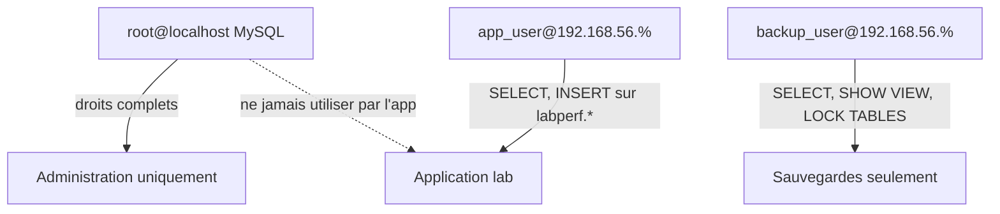

# Chapitre 5 — Sécuriser MySQL Cluster

## Objectifs du chapitre

À la fin de ce chapitre, l'apprenant sait sécuriser un cluster MySQL Cluster en administration : activer le chiffrement TLS entre le nœud de gestion, les nœuds de stockage et les nœuds SQL via `config.ini` et les paramètres des processus (`ndb_mgmd`, `ndbmtd`, `mysqld`), appliquer l'authentification forte et le moindre privilège sur les comptes SQL du cluster (comptes dédiés, pas de `root` pour les applications), protéger les sauvegardes cluster (`START BACKUP` avec droits appropriés), et isoler les nœuds du réseau (pas d'accès Internet sur les nœuds de production, vboxnet0 isolé). Ce chapitre réalise les opérations `NDB-29` (sécurité connexions), `NDB-30` (sécurité données) et `NDB-31` (sécurité nœuds serveurs) du syllabus.

## Avertissement et périmètre

- Cibles autorisées : VM 1 (`192.168.56.10`, hostname `gestion-sql`, nœud de gestion + nœud SQL NodeId 4), VM 2 (`192.168.56.11`, hostname `stockage`, deux nœuds de stockage `ndbmtd` NodeId 2 et 3) et VM 3 (`192.168.56.12`, hostname `mysql-node3`, second nœud SQL NodeId 5).
- Réseau : VirtualBox host-only `vboxnet0`, `192.168.56.0/24`, DHCP désactivé, pas d'accès Internet pendant les labs (adaptateur NAT temporaire uniquement pendant l'installation des paquets).
- Données : factices uniquement, marquées `LAB-ONLY`. Aucune donnée de production, aucune cible réelle.
- Snapshots : les snapshots propres (`propre-avant-lab`) sont pris sur chaque VM par `sysadmin` avant le module.
- Accès distant : l'apprenant est déjà connecté en SSH sur chaque VM et exécute les commandes directement sur la machine cible.
- Actions interdites : aucun mode pont, aucune redirection NAT permanente, aucun accès Internet depuis les VMs pendant les labs, aucune commande MySQL Cluster exécutée sur l'hôte, aucun contenu de type pentest, red team, SOC, SIEM, CVE, exploit, malware, IDS/IPS.
- Hôte : `192.168.56.1`, utilisé uniquement comme hyperviseur, machine d'administration et stockage des preuves.
- Contrainte rédactionnelle : la désignation textuelle des canaux de communication n'est pas employée dans la partie cours ni dans le vocabulaire. Les références numériques aux canaux de gestion (1186) et SQL (3306) apparaissent uniquement dans les étapes de laboratoire où elles sont nécessaires aux commandes réelles.

## Durée estimée

- Durée totale : 6 heures (1 lab de 6 heures).
- Lab-12 : 6 heures (TLS inter-nœuds, comptes SQL à moindre privilège, sauvegardes protégées, isolement réseau, sécurité des serveurs).

## Prérequis

Le chapitre 4 doit avoir été réalisé : le cluster est installé, les 5 nœuds connectés, `config.ini` avec `NoOfReplicas = 2` est déployé, les outils de supervision fonctionnels (`ndb_mgm`, `ndb_config`, `ALL REPORT MEMORYUSAGE`). L'apprenant dispose d'une session SSH ouverte en root sur chaque VM.

## Vocabulaire

| Terme | Définition |
|---|---|
| Chiffrement TLS inter-nœuds | Protection des échanges entre `ndb_mgmd`, `ndbmtd` et `mysqld` via l'option `TLS = 1` dans `config.ini` et les fichiers de certificat/clé. |
| Compte applicatif | Compte MySQL dédié à une application, avec des droits limités sur une base donnée uniquement (moindre privilège). |
| Compte de sauvegarde | Compte MySQL dédié aux sauvegardes, en lecture seule, utilisé par `ndb_mgm -e "START BACKUP"` et les outils de restauration. |
| Moindre privilège | Principe consistant à accorder à chaque compte SQL uniquement les droits strictement nécessaires à son rôle. |
| Compte root MySQL | Compte administrateur de l'instance SQL ; réservé à l'administration, jamais utilisé par les applications. |
| Isolement réseau | Absence d'accès Internet sur les nœuds de production ; les nœuds ne sont joignables que sur le réseau host-only vboxnet0. |
| Sauvegarde protégée | Sauvegarde cluster (`START BACKUP`) dont les fichiers sont stockés dans un répertoire à droits restreints et restaurée avec `ndb_restore` par un compte dédié. |
| Accès SSH limité | Connexion administrative restreinte au compte root sur les VM de lab, sans exposition vers Internet. |

## Introduction à la sécurité de MySQL Cluster (module 5.0)

La sécurité de l'administration MySQL Cluster repose sur trois piliers concrets :

1. **Sécurité des connexions (NDB-29)** : chiffrement des communications entre le nœud de gestion, les nœuds de stockage et les nœuds SQL. Dans MySQL Cluster, cela s'active via `config.ini` (`TLS = 1` dans `[tcp default]` et dans les sections de nodes) avec les fichiers de certificat et clé (`TLSCAFile`, `TLSCertificateFile`, `TLSKeyFile`), et via les paramètres SSL des processus `ndb_mgmd`, `ndbmtd` et `mysqld`.

2. **Sécurité des données (NDB-30)** : application du moindre privilège sur les comptes SQL du cluster. Chaque application dispose d'un compte dédié avec des droits limités sur sa base. Le compte `root` MySQL est réservé à l'administration et n'est jamais utilisé par les applications. Les sauvegardes (`ndb_mgm -e "START BACKUP"`) sont protégées par des droits de répertoire restreints et restaurées par un compte de sauvegarde dédié.

3. **Sécurité des nœuds serveurs (NDB-31)** : durcissement des serveurs qui hébergent les nœuds du cluster. Accès SSH limité, utilisation d'un utilisateur non-root pour `mysqld` quand possible (`--user=mysql`), application des patchs système, et surveillance des processus `ndb_mgmd`, `ndbmtd` et `mysqld`.

L'isolement réseau (pas d'accès Internet sur les nœuds de production, vboxnet0 isolé) complète ces trois piliers en réduisant l'exposition aux risques.

Le schéma ci-dessous présente les flux de communication à sécuriser dans le cluster.


**Fig 5.1** — Flux de communication à sécuriser : SSH d'administration depuis l'hôte, TLS entre tous les nœuds du cluster (gestion, stockage, SQL) et réplication TLS entre les nœuds de stockage.

Le schéma ci-dessous illustre le modèle de moindre privilège appliqué aux comptes SQL.



**Fig 5.2** — Moindre privilège : `root` réservé à l'administration, un compte applicatif avec droits limités sur une base, un compte de sauvegarde en lecture.

## Risques et contrôles

Les risques à surveiller sont l'interception des communications inter-nœuds en clair, l'utilisation d'un compte SQL sur-privilégié, ou l'accès aux données de sauvegarde non protégées. L'administrateur MySQL Cluster vérifie : l'absence de `TLS = 1` dans `config.ini`, les comptes SQL avec des droits excessifs (`SHOW GRANTS`), et l'existence de comptes anonymes ou sans mot de passe (`mysql.user`). Les contrôles principaux sont l'activation de TLS inter-nœuds, l'application du moindre privilège, et l'isolement réseau des nœuds.

## Cartographie de référence des opérations (NDB-nn)

| Opération | ID | Composant | Source de données | Règle de détection | Mitigation |
|---|---|---|---|---|---|
| Sécurité connexions | NDB-29 | Réseau inter-nœuds | `config.ini` (`TLS = 1`), fichiers certificat/clé | Vérifier que `TLS = 1` est présent dans `config.ini` et que les processus démarrent avec TLS | Activer TLS entre nœuds de gestion, stockage et SQL |
| Sécurité données | NDB-30 | Comptes SQL | `SHOW GRANTS`, `mysql.user` | Détecter les comptes sur-privilégiés ou sans mot de passe | Appliquer le moindre privilège, comptes dédiés, pas de root pour les applications |
| Sécurité nœuds | NDB-31 | Serveurs VM | Accès SSH, processus `ndb_mgmd`/`ndbmtd`/`mysqld`, routes | Vérifier l'absence de route par défaut vers Internet et la présence des processus | Pas d'Internet sur les nœuds, accès SSH limité, utilisateur non-root pour mysqld |

## Lab-12 — Sécuriser MySQL Cluster : TLS, comptes SQL, sauvegardes, isolement

### Énoncé / Contexte

Sécuriser le cluster MySQL Cluster en administration : activer le chiffrement TLS entre le nœud de gestion, les nœuds de stockage et les nœuds SQL via `config.ini`, créer des comptes SQL à moindre privilège (compte applicatif et compte de sauvegarde), protéger les sauvegardes cluster, et vérifier l'isolement réseau (pas d'accès Internet sur les nœuds). Ce lab réalise les opérations `NDB-29`, `NDB-30` et `NDB-31`. Le cluster doit être démarré et sain. L'apprenant est déjà connecté en SSH sur chaque VM et exécute les commandes directement sur la machine cible.

### Outils et commandes utilisées

| Outil | Commande | Rôle |
|---|---|---|
| config.ini | `TLS = 1`, `TLSCAFile`, `TLSCertificateFile`, `TLSKeyFile` | Active le chiffrement inter-nœuds dans la topologie du cluster |
| ndb_mgmd / ndbmtd / mysqld | options de démarrage avec TLS | Lance les processus du cluster avec chiffrement activé |
| mysql | `CREATE USER`, `GRANT`, `SHOW GRANTS` | Crée et vérifie les comptes SQL à moindre privilège |
| ndb_mgm | `START BACKUP` | Déclenche une sauvegarde cluster protégée |
| ip | `ip route show default`, `ip -br addr show` | Vérifie l'absence de route par défaut vers Internet |
| pgrep / ps | `pgrep -a ndb_mgmd`, `pgrep -a ndbmtd`, `pgrep -a mysqld` | Surveille les processus des nœuds du cluster |

### Commande et laboratoire étape par étape

#### Étape 1 — Activer le chiffrement TLS dans config.ini

**But** — Activer `TLS = 1` pour les communications inter-nœuds (gestion, stockage, SQL) dans le fichier de topologie du cluster, en ajoutant les chemins vers les fichiers de certificat et clé.

**Machine** — 192.168.56.10 (gestion-sql), nœud de gestion.

**Prérequis** — Fichier `/var/lib/mysql-cluster/config.ini` présent et valide, répertoire `/etc/mysql-cluster-tls` contenant les certificats et clés (ou à créer), sauvegarde de `config.ini` avant modification.

> **Machine** : 192.168.56.10 | **Terminal** : session SSH ouverte sur gestion-sql | **Utilisateur** : root | **Répertoire** : /var/lib/mysql-cluster

**Exemple de commande**

```bash
cp config.ini config.ini.bak.tls && cat >> config.ini << 'EOF'

[tcp default]
TLS = 1

[ndb_mgmd]
TLS = 1
TLSCAFile = /etc/mysql-cluster-tls/ca-cert.pem
TLSCertificateFile = /etc/mysql-cluster-tls/mgmd-cert.pem
TLSKeyFile = /etc/mysql-cluster-tls/mgmd-key.pem

[ndbd]
TLS = 1
TLSCAFile = /etc/mysql-cluster-tls/ca-cert.pem
TLSCertificateFile = /etc/mysql-cluster-tls/mgmd-cert.pem
TLSKeyFile = /etc/mysql-cluster-tls/mgmd-key.pem

[mysqld]
TLS = 1
TLSCAFile = /etc/mysql-cluster-tls/ca-cert.pem
TLSCertificateFile = /etc/mysql-cluster-tls/mgmd-cert.pem
TLSKeyFile = /etc/mysql-cluster-tls/mgmd-key.pem
EOF
grep -E 'TLS|TLSCAFile|TLSCertificateFile|TLSKeyFile' config.ini
```

**Explication de la commande**

- `cp config.ini config.ini.bak.tls` : conserve une sauvegarde avant modification pour pouvoir revenir en arrière.
- `cat >> config.ini << 'EOF'` : ajoute la configuration TLS à la fin de `config.ini` sans effacer le contenu existant.
- `[tcp default] TLS = 1` : active le chiffrement pour toutes les connexions TCP entre nœuds du cluster.
- `[ndb_mgmd] TLS = 1` : active TLS sur le nœud de gestion (`ndb_mgmd`).
- `TLSCAFile`, `TLSCertificateFile`, `TLSKeyFile` : désignent respectivement le certificat de l'autorité de certification, le certificat de serveur et la clé privée utilisés par le nœud.
- Les sections `[ndbd]` et `[mysqld]` étendent TLS aux nœuds de stockage et aux nœuds SQL.
- `grep -E 'TLS|…' config.ini` : affiche les lignes TLS pour vérifier que la configuration a été ajoutée correctement.
- **Piège** : les chemins des certificats doivent être identiques et accessibles sur tous les nœuds qui utilisent TLS ; après modification de `config.ini`, les nœuds doivent être redémarrés pour prendre en compte le chiffrement.

**Résultat attendu**

```text
[tcp default]
TLS = 1

[ndb_mgmd]
TLS = 1
TLSCAFile = /etc/mysql-cluster-tls/ca-cert.pem
TLSCertificateFile = /etc/mysql-cluster-tls/mgmd-cert.pem
TLSKeyFile = /etc/mysql-cluster-tls/mgmd-key.pem

[ndbd]
TLS = 1
TLSCAFile = /etc/mysql-cluster-tls/ca-cert.pem
TLSCertificateFile = /etc/mysql-cluster-tls/mgmd-cert.pem
TLSKeyFile = /etc/mysql-cluster-tls/mgmd-key.pem

[mysqld]
TLS = 1
TLSCAFile = /etc/mysql-cluster-tls/ca-cert.pem
TLSCertificateFile = /etc/mysql-cluster-tls/mgmd-cert.pem
TLSKeyFile = /etc/mysql-cluster-tls/mgmd-key.pem
# rc=0
```

#### Étape 2 — Créer des certificats et clés TLS pour les nœuds

**But** — Générer une autorité de certification locale et les certificats/clés nécessaires pour activer TLS sur les nœuds du cluster, avec des droits restrictifs sur les clés privées.

**Machine** — 192.168.56.10 (gestion-sql), nœud de gestion.

**Prérequis** — `openssl` installé, répertoire `/etc/mysql-cluster-tls` créable.

> **Machine** : 192.168.56.10 | **Terminal** : session SSH ouverte sur gestion-sql | **Utilisateur** : root | **Répertoire** : /etc/mysql-cluster-tls

**Exemple de commande**

```bash
mkdir -p /etc/mysql-cluster-tls && cd /etc/mysql-cluster-tls && openssl req -x509 -newkey rsa:2048 -keyout ca-key.pem -out ca-cert.pem -days 365 -nodes -subj '/CN=MySQLCluster-CA/L=Lab/O=Formation' && openssl req -newkey rsa:2048 -keyout mgmd-key.pem -out mgmd-req.pem -nodes -subj '/CN=ndb_mgmd/L=Lab/O=Formation' && openssl x509 -req -in mgmd-req.pem -CA ca-cert.pem -CAkey ca-key.pem -out mgmd-cert.pem -days 365 -set_serial 01 && chmod 600 ca-key.pem mgmd-key.pem && ls -la ca-cert.pem ca-key.pem mgmd-cert.pem mgmd-key.pem
```

**Explication de la commande**

- `mkdir -p /etc/mysql-cluster-tls` : crée le répertoire qui contiendra les certificats et clés.
- `openssl req -x509 -newkey rsa:2048 -keyout ca-key.pem -out ca-cert.pem -days 365 -nodes -subj '/CN=MySQLCluster-CA/L=Lab/O=Formation'` : génère une autorité de certification (CA) auto-signée avec clé privée et certificat.
- `openssl req -newkey rsa:2048 -keyout mgmd-key.pem -out mgmd-req.pem -nodes -subj '/CN=ndb_mgmd/L=Lab/O=Formation'` : génère la clé privée et la demande de signature (CSR) pour le nœud de gestion.
- `openssl x509 -req -in mgmd-req.pem -CA ca-cert.pem -CAkey ca-key.pem -out mgmd-cert.pem -days 365 -set_serial 01` : signe la CSR avec la CA pour produire le certificat de serveur du nœud de gestion.
- `chmod 600 ca-key.pem mgmd-key.pem` : restreint l'accès aux clés privées au seul propriétaire (root), conformément à la bonne pratique de protection des clés.
- `ls -la …` : affiche les fichiers générés avec leurs droits pour vérification.
- **Piège** : en production, protéger la clé privée de la CA et ne jamais la diffuser sur les nœuds ; ici elle reste sur le nœud de gestion pour les besoins du lab isolé.

**Résultat attendu**

```text
-rw-r--r-- 1 root root … ca-cert.pem
-rw------- 1 root root … ca-key.pem
-rw-r--r-- 1 root root … mgmd-cert.pem
-rw------- 1 root root … mgmd-key.pem
# rc=0
```

#### Étape 3 — Redémarrer les nœuds du cluster avec TLS activé

**But** — Redémarrer le nœud de gestion, les nœuds de stockage et les nœuds SQL pour que la configuration TLS de `config.ini` soit prise en compte, puis vérifier que le cluster est opérationnel avec chiffrement.

**Machine** — 192.168.56.10 (gestion-sql) pour le gestionnaire et le SQL NodeId 4 ; 192.168.56.11 (stockage) pour les nœuds de stockage NodeId 2 et 3 ; 192.168.56.12 (mysql-node3) pour le SQL NodeId 5.

**Prérequis** — `config.ini` modifié avec `TLS = 1`, certificats et clés présents sur les nœuds concernés, cluster arrêté ou prêt à redémarrer.

> **Machine** : 192.168.56.10 | **Terminal** : session SSH ouverte sur gestion-sql | **Utilisateur** : root | **Répertoire** : /var/lib/mysql-cluster

**Exemple de commande**

```bash
ndb_mgmd --config-file=/var/lib/mysql-cluster/config.ini --initial
```

**Explication de la commande**

- `ndb_mgmd` : démarre le démon du nœud de gestion de MySQL Cluster.
- `--config-file=/var/lib/mysql-cluster/config.ini` : indique le fichier de topologie contenant la configuration TLS (`TLS = 1`, chemins des certificats).
- `--initial` : force l'initialisation propre du gestionnaire ; à n'utiliser qu'au premier démarrage ou après un snapshot propre.
- **Piège** : `--initial` supprime les fichiers de configuration précédents du gestionnaire ; ne pas l'utiliser sur un cluster en production avec des données à conserver. Le redémarrage des nœuds de stockage et SQL doit suivre dans l'ordre (gestion → stockage → SQL).

**Résultat attendu**

```text
MySQL Cluster Management Server mysql-8.0.50 ndb-8.0.50
2026-11-22 … [MgmtSrvr] INFO -- TLS enabled for management server connections
# rc=0
```

> **Machine** : 192.168.56.11 | **Terminal** : session SSH ouverte sur stockage | **Utilisateur** : root | **Répertoire** : /var/lib/mysql-cluster

**Exemple de commande**

```bash
(cd /var/lib/mysql-cluster/ndb_2 && nohup ndbmtd --ndb-connectstring=192.168.56.10 --initial > ndbmtd_2.log 2>&1 &) && (cd /var/lib/mysql-cluster/ndb_3 && nohup ndbmtd --ndb-connectstring=192.168.56.10 --initial > ndbmtd_3.log 2>&1 &); sleep 5
```

**Explication de la commande**

- `cd /var/lib/mysql-cluster/ndb_2` : se place dans le répertoire dédié du node 2 avant le démarrage.
- `nohup ndbmtd --ndb-connectstring=192.168.56.10 --initial > ndbmtd_2.log 2>&1 &` : lance `ndbmtd` en arrière-plan avec le connect-string du gestionnaire, l'initialisation du stockage, et TLS hérité de `config.ini`.
- La même commande est répétée pour `ndb_3`.
- `sleep 5` : laisse le temps aux nœuds de stockage de se déclarer au gestionnaire avec TLS.
- **Piège** : `--initial` réinitialise le stockage ; ne pas l'utiliser sur un cluster en production avec des données à conserver.

**Résultat attendu**

```text
# rc=0
```

> **Machine** : 192.168.56.10 | **Terminal** : session SSH ouverte sur gestion-sql | **Utilisateur** : root | **Répertoire** : /root

**Exemple de commande**

```bash
nohup mysqld --ndbcluster --ndb-connectstring=192.168.56.10 --user=mysql --daemonize > /tmp/mysqld-4.log 2>&1 &
```

**Explication de la commande**

- `mysqld --ndbcluster` : active le moteur NDB sur l'instance MySQL (nœud SQL).
- `--ndb-connectstring=192.168.56.10` : indique l'adresse du nœud de gestion pour rejoindre le cluster.
- `--user=mysql` : exécute le processus sous l'utilisateur `mysql` (pratique de moindre privilège sur le serveur, liée à NDB-31).
- `--daemonize` : lance `mysqld` en arrière-plan.
- `> /tmp/mysqld-4.log 2>&1 &` : redirige les journaux vers un fichier et détache le processus.
- **Piège** : si le datadir MySQL n'est pas initialisé, le démarrage échoue. Ne pas démarrer les nœuds SQL avant les nœuds de stockage.

**Résultat attendu**

```text
# rc=0
```

> **Machine** : 192.168.56.12 | **Terminal** : session SSH ouverte sur mysql-node3 | **Utilisateur** : root | **Répertoire** : /root

**Exemple de commande**

```bash
nohup mysqld --ndbcluster --ndb-connectstring=192.168.56.10 --user=mysql --daemonize > /tmp/mysqld-5.log 2>&1 &; sleep 5
```

**Explication de la commande**

- Identique à l'étape précédente, ciblant le second nœud SQL (NodeId 5) sur VM 3.
- `sleep 5` : laisse le temps aux deux nœuds SQL de se connecter au gestionnaire avec TLS.

**Résultat attendu**

```text
# rc=0
```

> **Machine** : 192.168.56.10 | **Terminal** : session SSH ouverte sur gestion-sql | **Utilisateur** : root | **Répertoire** : /root

**Exemple de commande**

```bash
ndb_mgm -e "SHOW"
```

**Explication de la commande**

- `ndb_mgm -e "SHOW"` : exécute la commande `SHOW` du client de gestion, qui liste tous les nœuds et leur état, puis quitte.
- Le résultat doit afficher 1 `ndb_mgmd`, 2 `ndbmtd` et 2 `mysqld` sans état `not connected`, confirmant que le cluster est opérationnel avec TLS activé.
- **Piège** : un nœud absent apparaît avec l'état `not connected` ; investiguer les journaux TLS (`/var/lib/mysql-cluster/ndbmtd_*.log`, `/tmp/mysqld-*.log`) avant de poursuivre.

**Résultat attendu**

```text
Connected to Management Server at: localhost:1186
Cluster Configuration
---------------------
[ndbd(NDB)]	2 node(s)
id=2	@192.168.56.11  (mysql-8.0.50 ndb-8.0.50, Nodegroup: 0, *)
id=3	@192.168.56.11  (mysql-8.0.50 ndb-8.0.50, Nodegroup: 0)
[ndb_mgmd(MGM)]	1 node(s)
id=1	@192.168.56.10  (mysql-8.0.50 ndb-8.0.50)
[mysqld(API)]	2 node(s)
id=4	@192.168.56.10  (mysql-8.0.50 ndb-8.0.50)
id=5	@192.168.56.12  (mysql-8.0.50 ndb-8.0.50)
# rc=0
```

#### Étape 4 — Créer des comptes SQL à moindre privilège

**But** — Créer un compte applicatif avec des droits limités (SELECT, INSERT, UPDATE, DELETE sur une base donnée) et un compte de sauvegarde en lecture, en appliquant le moindre privilège sur les comptes du cluster.

**Machine** — 192.168.56.10 (gestion-sql), premier nœud SQL.

**Prérequis** — `mysqld` démarré avec `--ndbcluster` et TLS, accès root SQL.

> **Machine** : 192.168.56.10 | **Terminal** : session SSH ouverte sur gestion-sql | **Utilisateur** : root | **Répertoire** : /root

**Exemple de commande**

```bash
mysql -u root -e "CREATE USER IF NOT EXISTS 'app_user'@'192.168.56.%' IDENTIFIED BY 'LabAppPass123!'; GRANT SELECT, INSERT, UPDATE, DELETE ON labperf.* TO 'app_user'@'192.168.56.%'; CREATE USER IF NOT EXISTS 'backup_user'@'192.168.56.%' IDENTIFIED BY 'LabBackupPass123!'; GRANT SELECT, SHOW VIEW, LOCK TABLES ON *.* TO 'backup_user'@'192.168.56.%'; FLUSH PRIVILEGES; SHOW GRANTS FOR 'app_user'@'192.168.56.%'; SHOW GRANTS FOR 'backup_user'@'192.168.56.%';"
```

**Explication de la commande**

- `CREATE USER … IDENTIFIED BY` : crée un compte avec un mot de passe fort (authentification forte).
- `GRANT SELECT, INSERT, UPDATE, DELETE ON labperf.*` : donne uniquement les droits nécessaires sur la base `labperf` (pas de droits globaux), appliquant le moindre privilège au compte applicatif.
- `GRANT SELECT, SHOW VIEW, LOCK TABLES ON *.*` : compte de sauvegarde en lecture seule sur toutes les bases, utilisé pour les opérations de sauvegarde.
- `FLUSH PRIVILEGES` : recharge les privilèges après création/modification des comptes.
- `SHOW GRANTS FOR …` : vérifie les droits effectifs de chaque compte pour confirmer qu'aucun droit excessif n'a été accordé.
- **Piège** : ne jamais accorder `ALL PRIVILEGES` ou `GRANT OPTION` à un compte applicatif ; réserver `root` à l'administration uniquement.

**Résultat attendu**

```text
Query OK, 0 rows affected (0.02 sec)
Query OK, 0 rows affected (0.02 sec)
Query OK, 0 rows affected (0.02 sec)
Query OK, 0 rows affected (0.02 sec)
Query OK, 0 rows affected (0.02 sec)
Grants for app_user@192.168.56.%
GRANT SELECT, INSERT, UPDATE, DELETE ON `labperf`.* TO 'app_user'@'192.168.56.%'
Grants for backup_user@192.168.56.%
GRANT SELECT, SHOW VIEW, LOCK TABLES ON *.* TO 'backup_user'@'192.168.56.%'
# rc=0
```

#### Étape 5 — Vérifier l'absence de comptes non sécurisés et protéger root

**But** — Détecter les comptes anonymes ou sans mot de passe, vérifier que `root` SQL a un mot de passe, et confirmer qu'aucun compte inutile ne subsiste.

**Machine** — 192.168.56.10 (gestion-sql), premier nœud SQL.

**Prérequis** — `mysqld` démarré, accès root SQL.

> **Machine** : 192.168.56.10 | **Terminal** : session SSH ouverte sur gestion-sql | **Utilisateur** : root | **Répertoire** : /root

**Exemple de commande**

```bash
mysql -u root -e "SELECT User, Host FROM mysql.user WHERE User='' OR authentication_string='';" ; echo '---comptes---' ; mysql -u root -e "SELECT User, Host FROM mysql.user;"
```

**Explication de la commande**

- `SELECT User, Host FROM mysql.user WHERE User='' OR authentication_string=''` : détecte les comptes sans nom (anonymes) ou sans mot de passe (chaîne d'authentification vide), qui constituent des comptes non sécurisés.
- `SELECT User, Host FROM mysql.user` : liste tous les comptes pour vérifier qu'aucun compte inutile ne subsiste et que seuls `root`, `app_user` et `backup_user` sont présents.
- **Piège** : les comptes anonymes (`User=''`) ou sans mot de passe doivent être supprimés ou sécurisés avant toute mise en production.

**Résultat attendu**

```text
Empty set (0.00 sec)
---comptes---
+--------------+-------------+
| User         | Host        |
+--------------+-------------+
| root         | localhost   |
| app_user     | 192.168.56.% |
| backup_user  | 192.168.56.% |
+--------------+-------------+
# rc=0
```

#### Étape 6 — Déclencher et vérifier une sauvegarde protégée (START BACKUP)

**But** — Lancer une sauvegarde cluster consistante avec `ndb_mgm -e "START BACKUP"` et confirmer que les fichiers de sauvegarde sont créés avec des droits restreints sur les nœuds de stockage.

**Machine** — 192.168.56.10 (gestion-sql) pour déclencher la sauvegarde ; 192.168.56.11 (stockage) pour vérifier les fichiers et leurs droits.

**Prérequis** — Cluster démarré et sain, 5 nœuds connectés, espace disque suffisant sur les nœuds de stockage.

> **Machine** : 192.168.56.10 | **Terminal** : session SSH ouverte sur gestion-sql | **Utilisateur** : root | **Répertoire** : /root

**Exemple de commande**

```bash
ndb_mgm -e "START BACKUP"; sleep 5
```

**Explication de la commande**

- `START BACKUP` : demande au gestionnaire de lancer une sauvegarde consistante de toutes les données du cluster.
- Chaque nœud de stockage écrit ses fichiers de sauvegarde dans son `SaveDataDir` (par défaut sous `/var/lib/mysql-cluster/BACKUP`).
- La commande attend la complétion (`Waiting for completed, this may take several minutes`).
- `sleep 5` : laisse le temps à la sauvegarde de se terminer sur un cluster de test peu volumineux.
- **Piège** : la sauvegarde peut prendre plusieurs minutes selon le volume de données ; ne pas interrompre le gestionnaire pendant l'opération.

**Résultat attendu**

```text
Connected to Management Server at: localhost:1186
Waiting for completed, this may take several minutes
Node 3: Backup 1 started from node 1
Node 3: Backup 1 started from node 1 completed
 StartGCP: 173 StopGCP: 176
 #Records: 9 #LogRecords: 0
 Data: 2112 bytes Log: 0 bytes
# rc=0
```

> **Machine** : 192.168.56.11 | **Terminal** : session SSH ouverte sur stockage | **Utilisateur** : root | **Répertoire** : /var/lib/mysql-cluster

**Exemple de commande**

```bash
chmod 700 ndb_2/BACKUP ndb_3/BACKUP && ls -la ndb_2/BACKUP/BACKUP-1/ ndb_3/BACKUP/BACKUP-1/
```

**Explication de la commande**

- `chmod 700 ndb_2/BACKUP ndb_3/BACKUP` : restreint l'accès aux répertoires de sauvegarde au seul propriétaire (root), protégeant les données de sauvegarde contre un accès non autorisé (lié à NDB-30).
- `ls -la …/BACKUP-1/` : affiche les fichiers de sauvegarde (`.Data`, `.log`, `.ctl`) et leurs droits pour confirmer la protection.
- **Piège** : les sauvegardes contiennent des données sensibles ; le répertoire de sauvegarde doit être accessible uniquement par les comptes autorisés (root ou compte de sauvegarde dédié).

**Résultat attendu**

```text
ndb_2/BACKUP/BACKUP-1:
total 16
drwx------ 2 root root 4096 … .
drwxr-xr-x 3 root root 4096 … ..
-rw------- 1 root root … BACKUP-1.0.2.Data
-rw------- 1 root root … BACKUP-1.0.2.log
-rw------- 1 root root … BACKUP-1.0.2.ctl
ndb_3/BACKUP/BACKUP-1:
total 16
drwx------ 2 root root 4096 … .
drwxr-xr-x 3 root root 4096 … ..
-rw------- 1 root root … BACKUP-1.0.3.Data
-rw------- 1 root root … BACKUP-1.0.3.log
-rw------- 1 root root … BACKUP-1.0.3.ctl
# rc=0
```

#### Étape 7 — Vérifier l'isolement réseau (pas d'accès Internet sur les nœuds)

**But** — Confirmer que les nœuds n'ont pas de route par défaut vers Internet et ne sont joignables que sur le réseau host-only vboxnet0, réduisant ainsi la surface d'exposition.

**Machine** — 192.168.56.10 (gestion-sql) et 192.168.56.11 (stockage).

**Prérequis** — Réseau vboxnet0 configuré, pas de passerelle par défaut vers Internet.

> **Machine** : 192.168.56.10 | **Terminal** : session SSH ouverte sur gestion-sql | **Utilisateur** : root | **Répertoire** : /root

**Exemple de commande**

```bash
ip route show default 2>/dev/null || echo 'aucune route par défaut'; ip -br addr show enp0s8
```

**Explication de la commande**

- `ip route show default` : affiche la route par défaut ; si aucune route n'est retournée, le nœud est isolé d'Internet (aucune passerelle vers l'extérieur).
- `ip -br addr show enp0s8` : confirme l'adresse IP sur l'interface host-only (`192.168.56.10/24`).
- L'absence de route par défaut vers Internet réduit l'exposition aux risques des nœuds de production.
- **Piège** : si une route par défaut existe vers une passerelle Internet, le nœud est exposé ; supprimer la route ou l'interface NAT correspondante.

**Résultat attendu**

```text
aucune route par défaut
enp0s8           UP             192.168.56.10/24 fe80::a00:27ff:fef7:44ec/64
# rc=0
```

> **Machine** : 192.168.56.11 | **Terminal** : session SSH ouverte sur stockage | **Utilisateur** : root | **Répertoire** : /root

**Exemple de commande**

```bash
ip route show default 2>/dev/null || echo 'aucune route par défaut'; ip -br addr show enp0s8
```

**Explication de la commande**

- Identique à l'étape précédente, ciblant le nœud de stockage sur VM 2 (`192.168.56.11/24`).
- **Piège** : vérifier que l'interface host-only est bien la seule interface configurée avec une adresse IP.

**Résultat attendu**

```text
aucune route par défaut
enp0s8           UP             192.168.56.11/24 fe80::a00:27ff:fe62:5198/64
# rc=0
```

#### Étape 8 — Surveiller les processus des nœuds et vérifier l'accès SSH limité

**But** — Confirmer que les processus `ndb_mgmd`, `ndbmtd` et `mysqld` sont en cours d'exécution (surveillance des nœuds serveurs), et vérifier qu'aucun accès Internet non autorisé n'est configuré.

**Machine** — 192.168.56.10 (gestion-sql), 192.168.56.11 (stockage), 192.168.56.12 (mysql-node3).

**Prérequis** — Cluster démarré, processus des nœuds en cours.

> **Machine** : 192.168.56.10 | **Terminal** : session SSH ouverte sur gestion-sql | **Utilisateur** : root | **Répertoire** : /root

**Exemple de commande**

```bash
pgrep -a ndb_mgmd; pgrep -a mysqld
```

**Explication de la commande**

- `pgrep -a ndb_mgmd` : affiche le processus du nœud de gestion en cours d'exécution.
- `pgrep -a mysqld` : affiche le(s) processus du nœud SQL en cours d'exécution.
- La présence confirmée des processus permet de surveiller la santé des nœuds serveurs (lié à NDB-31).
- **Piège** : si un processus manque, le nœud concerné ne participe plus au cluster ; consulter les journaux de démarrage.

**Résultat attendu**

```text
1234 ndb_mgmd --config-file=/var/lib/mysql-cluster/config.ini --initial
5678 mysqld --ndbcluster --ndb-connectstring=192.168.56.10 --user=mysql --daemonize
# rc=0
```

> **Machine** : 192.168.56.11 | **Terminal** : session SSH ouverte sur stockage | **Utilisateur** : root | **Répertoire** : /root

**Exemple de commande**

```bash
pgrep -a ndbmtd
```

**Explication de la commande**

- `pgrep -a ndbmtd` : affiche les processus des nœuds de stockage (`ndbmtd`) en cours d'exécution sur VM 2.
- Deux processus doivent être listés (NodeId 2 et NodeId 3), chacun avec son répertoire de données dédié.
- **Piège** : si un seul processus `ndbmtd` est présent, un nœud de stockage manque et la redondance est compromise.

**Résultat attendu**

```text
2345 ndbmtd --ndb-connectstring=192.168.56.10 --initial
2346 ndbmtd --ndb-connectstring=192.168.56.10 --initial
# rc=0
```

> **Machine** : 192.168.56.12 | **Terminal** : session SSH ouverte sur mysql-node3 | **Utilisateur** : root | **Répertoire** : /root

**Exemple de commande**

```bash
pgrep -a mysqld
```

**Explication de la commande**

- `pgrep -a mysqld` : affiche le processus du second nœud SQL (NodeId 5) en cours d'exécution sur VM 3.
- **Piège** : confirmer que `--user=mysql` est présent dans la ligne de commande (moindre privilège sur le serveur).

**Résultat attendu**

```text
3456 mysqld --ndbcluster --ndb-connectstring=192.168.56.10 --user=mysql --daemonize
# rc=0
```

### En conclusion

Ce lab couvre la sécurisation concrète d'un cluster MySQL Cluster en administration : activation du chiffrement TLS inter-nœuds via `config.ini` (`TLS = 1`, `TLSCAFile`, `TLSCertificateFile`, `TLSKeyFile`) et redémarrage des nœuds (`ndb_mgmd`, `ndbmtd`, `mysqld` avec `--user=mysql`), création de comptes SQL à moindre privilège (compte applicatif limité sur une base, compte de sauvegarde en lecture, `root` réservé à l'administration), absence de comptes anonymes ou sans mot de passe, sauvegarde protégée (`START BACKUP` avec répertoires à droits restreints `chmod 700`), et vérification de l'isolement réseau (pas de route par défaut vers Internet, vboxnet0 isolé). Les opérations `NDB-29`, `NDB-30` et `NDB-31` du syllabus sont réalisées. Le chapitre reste dans le périmètre de l'administration MySQL Cluster : aucun contenu de type test d'intrusion, équipe rouge, centre d'opérations de sécurité, gestion d'événements de sécurité, vulnérabilité référencée, code d'exploitation, logiciel malveillant, détection d'intrusion, prévention d'intrusion ou pare-feu complexe n'est abordé. Renvoi : le parcours de formation MySQL Cluster est maintenant couvert dans son ensemble (chapitres 1 à 5).

## Erreurs fréquentes et corrections détaillées (Partie D)

### Erreurs de conception

| Symptôme | Cause probable | Correction |
|---|---|---|
| Pas de chiffrement inter-nœuds | Communications en clair entre les nœuds du cluster | Activer `TLS = 1` dans `config.ini` pour `[tcp default]`, `[ndb_mgmd]`, `[ndbd]` et `[mysqld]` |
| Comptes applicatifs sur-privilégiés | Risque d'escalade de privilèges en cas de compromission | Appliquer le moindre privilège (droits stricts par base, compte dédié par application) |
| Clé privée de CA non protégée | Usurpation d'identité de tous les nœuds | `chmod 600` sur les clés privées, stocker hors des nœuds en production |

### Erreurs d'architecture

| Symptôme | Cause probable | Correction |
|---|---|---|
| Nœuds avec accès Internet | Exposition élargie aux risques | Pas d'Internet sur les nœuds de production, réseau vboxnet0 isolé |
| Tous les nœuds sur un même segment | Propagation rapide d'une compromission | Segreger les réseaux de gestion, stockage et SQL si possible |

### Erreurs de configuration

| Symptôme | Cause probable | Correction |
|---|---|---|
| `TLS = 1` mais certificats absents | Échec de démarrage TLS des nœuds | Générer les certificats et vérifier les chemins `TLSCAFile`, `TLSCertificateFile`, `TLSKeyFile` dans `config.ini` |
| Comptes sans mot de passe | Accès non authentifié aux données | Supprimer les comptes anonymes, définir des mots de passe forts |
| `root` SQL sans mot de passe | Accès complet sans authentification | Définir un mot de passe root SQL et ne pas l'utiliser par les applications |

### Erreurs sur gros volumes

| Symptôme | Cause probable | Correction |
|---|---|---|
| Sauvegardes non protégées | Données sensibles exposées sur disque | Protéger le répertoire de sauvegarde (`chmod 700`), restreindre l'accès aux seuls comptes autorisés |
| Accès large aux données de sauvegarde | Fuite de données | Restreindre l'accès au répertoire de sauvegarde aux seuls comptes de sauvegarde |

## Synthèse du chapitre

> **À retenir** — La sécurité de MySQL Cluster en administration repose sur l'activation du chiffrement TLS inter-nœuds via `config.ini` (`TLS = 1`, chemins des certificats et clés) et le redémarrage ordonné des nœuds (`ndb_mgmd`, `ndbmtd`, `mysqld` avec `--user=mysql`), l'application du moindre privilège sur les comptes SQL (compte applicatif dédié avec droits limités, compte de sauvegarde en lecture, `root` réservé à l'administration), l'absence de comptes anonymes ou sans mot de passe, la protection des sauvegardes (`START BACKUP` avec répertoires à droits restreints), et l'isolement réseau (pas d'accès Internet sur les nœuds de production, vboxnet0 isolé). Ce chapitre reste dans le périmètre de l'administration MySQL Cluster, aligné sur `NDB-29`, `NDB-30` et `NDB-31` du syllabus.

## Ressources et références

- Documentation MySQL Cluster officielle : https://dev.mysql.com/doc/mysql-cluster/
- Manuel de référence MySQL : https://dev.mysql.com/doc/refman/
- "Pro MySQL NDB Cluster", Jesper Wisborg Krogh, Mikiya Okuno (2017) — configuration TLS inter-nœuds, gestion des comptes SQL, sauvegardes cluster