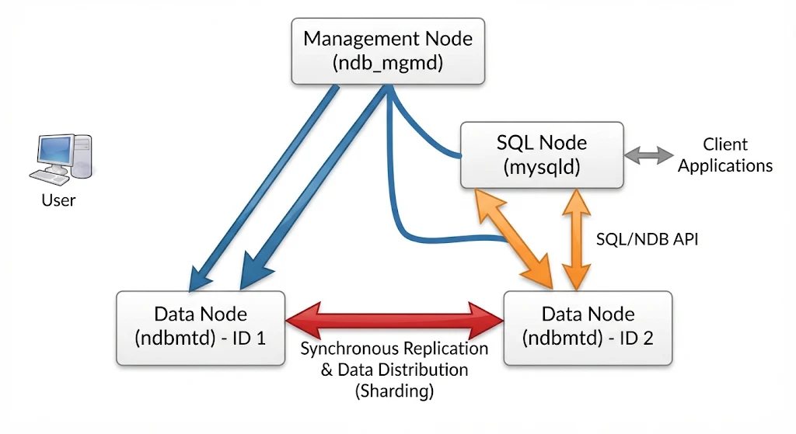
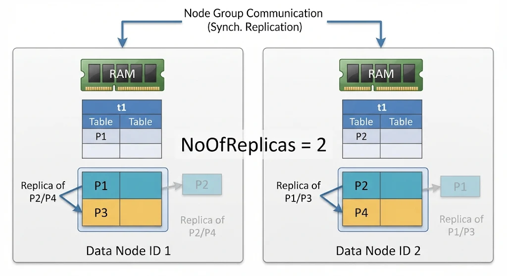

Voici la partie théorique détaillée pour le Jour 1 de la formation MySQL Cluster, illustrée par des descriptions d'images conceptuelles.

---

# Jour 1 : Introduction à MySQL Cluster – Partie Théorique

## 1. Introduction à MySQL Cluster

### Présentation et Architecture

MySQL Cluster, basé sur le moteur de stockage NDB (Network Database), est une technologie de base de données distribuée qui fournit une haute disponibilité et une scalabilité horizontale. Son architecture unique, connue sous le nom d'"architecture Shared-Nothing", répartit les données et les traitements sur plusieurs serveurs (ou machines virtuelles), éliminant tout point de défaillance unique (SPOF).

Dans le contexte de votre lab isolé sur 2 VMs, cette architecture est déployée comme suit :

* **VM1 (192.168.56.10)** : Héberge le **nœud de gestion** et le **nœud SQL**.
* **VM2 (192.168.56.11)** : Héberge **deux nœuds de stockage** (processus ndbmtd), simulant physiquement la distribution des données sur deux entités distinctes malgré l'hébergement sur le même hôte physique.

L'architecture globale pour ce lab est illustrée ci-dessous :

![Image 1 : Architecture globale du cluster à 2 VMs]
*Description de l'image : Un schéma montrant la topologie logique du cluster. À gauche, VM1 (192.168.56.10) contient deux boîtes : 'ndb_mgmd' (Nœud de Gestion) et 'mysqld' (Nœud SQL). À droite, VM2 (192.168.56.11) contient deux autres boîtes : 'ndbmtd ID 1' et 'ndbmtd ID 2' (Nœuds de Stockage). Des flèches bidirectionnelles connectent VM1 et VM2 via une interface réseau commune (vboxnet0), soulignant que le nœud SQL communique avec les nœuds de stockage pour accéder aux données, tandis que le nœud de gestion coordonne l'ensemble.*

### Les Composants Principaux

MySQL Cluster repose sur trois types de nœuds distincts qui communiquent entre eux via le réseau :

1. **Nœud de Gestion (Management Node - `ndb_mgmd`)** :
* **Rôle** : Gère la configuration du cluster. Il charge et distribue le fichier de configuration (`config.ini`) à tous les autres nœuds au démarrage. Il coordonne également les opérations de démarrage progressif et l'arbitrage en cas de partitionnement réseau.
* **Caractéristiques** : Il ne stocke aucune donnée utilisateur et n'est pas sollicité pour le traitement des requêtes SQL. Un seul nœud de gestion est suffisant pour le fonctionnement, mais il est le premier composant à démarrer.

2. **Nœud de Stockage (Data Node - `ndbd` / `ndbmtd`)** :
* **Rôle** : Héberge et gère les partitions de données réelles (fragments). C'est ici que réside le moteur NDB. Il assure également la réplication synchrone de ces fragments avec d'autres nœuds de stockage.
* **Caractéristiques** : Les données sont principalement stockées en **mémoire** (RAM), mais elles sont persistées sur disque (checkpoints) pour garantir leur durabilité. Dans votre lab à 2 VMs, VM2 exécute deux instances `ndbmtd` simultanément.

3. **Nœud SQL (SQL Node - `mysqld`)** :
* **Rôle** : Offre l'interface standard de MySQL. Il agit comme une passerelle entre les applications clientes (utilisant le protocole MySQL) et le moteur de stockage NDB. Il reçoit les requêtes SQL, les optimise et les traduit en opérations NDB pour les transmettre aux nœuds de stockage appropriés.
* **Caractéristiques** : Ce n'est pas un serveur MySQL classique avec InnoDB ; il utilise un plugin spécifique pour NDB. Il ne stocke pas de données utilisateur NDB. Une application peut se connecter à n'importe quel nœud SQL pour accéder aux mêmes données du cluster.

Ces composants interagissent de manière coordonnée, comme le montre l'illustration suivante :

![Image 2 : Communication interne et rôles des nœuds]
*Description de l'image : Un diagramme de séquence conceptuel montrant le flux de communication. Une application externe envoie une requête SQL à 'mysqld' sur VM1. 'mysqld' traite la requête, identifie les données nécessaires et envoie des instructions NDB à 'ndbmtd ID 1' et 'ndbmtd ID 2' sur VM2. Parallèlement, 'ndbmtd ID 1' et 'ndbmtd ID 2' communiquent entre eux pour la réplication synchrone des données. 'ndb_mgmd' sur VM1 supervise l'ensemble des interactions via des signaux de contrôle.*

### Pourquoi MySQL Cluster est-il adapté aux applications critiques ?

MySQL Cluster est conçu pour répondre aux exigences les plus élevées en matière de disponibilité et de performance :

* **Haute Disponibilité (HA) Zéro SPOF** : La redondance des nœuds de stockage et la réplication synchrone garantissent que si un nœud de stockage tombe en panne, les données restent accessibles via son ou ses répliques. Le cluster continue de fonctionner sans interruption de service.
* **Scalabilité Horizontale (Scale-Out)** : Pour augmenter les performances ou la capacité de stockage, il suffit d'ajouter de nouveaux groupes de nœuds de stockage (Data Nodes) au cluster existant. MySQL Cluster redistribue automatiquement les données (rebalancement) pour tirer parti des nouvelles ressources.
* **Performance en Temps Réel** : La conception en mémoire du moteur NDB permet une latence très faible pour les opérations de lecture et d'écriture, ce qui est critique pour les applications transactionnelles à haute concurrence.

### Études de Cas et Exemples d'Utilisation

Les caractéristiques uniques de MySQL Cluster en font une solution privilégiée dans plusieurs secteurs :

* **Télécommunications** : Utilisé pour les systèmes HLR (Home Location Register) et HSS (Home Subscriber Server) qui gèrent des millions d'abonnés et nécessitent un accès aux données en temps réel et une disponibilité extrême.
* **Finance et Paiements** : Utilisé pour les plateformes de traitement des transactions qui exigent une intégrité transactionnelle (ACID) et aucune perte de données, tout en supportant une charge élevée.
* **Web et Services à Haute Concurrence** : Utilisé pour les systèmes de gestion de sessions, les catalogues de produits en ligne ou les infrastructures de messagerie où la performance et la scalabilité sont primordiales.

---

## 2. Installation de MySQL Cluster (Partie Théorique)

### Pré-requis Matériels et Logiciels (Lab Isolé)

La mise en place d'un cluster MySQL nécessite une planification rigoureuse, en particulier dans un environnement de lab isolé avec des ressources limitées.

* **Système d'Exploitation** : Ubuntu Server 24.04 LTS (ou 22.04 LTS) est recommandé pour sa stabilité et la prise en charge des packages récents. Chaque VM doit avoir une configuration réseau statique sur l'interface Host-Only (`vboxnet0`, réseau `192.168.56.0/24`).
* **Réseau** : Le DHCP doit être désactivé sur l'interface Host-Only. L'accès à Internet n'est pas disponible pendant les labs, ce qui nécessite de disposer des paquets d'installation hors ligne. La résolution de noms locale via `/etc/hosts` est cruciale pour éviter la dépendance à un serveur DNS.
* **Ressources** : Avec seulement 1 Go de RAM par VM, la configuration du cluster doit être très conservatrice. Il est impératif de calculer soigneusement les paramètres de mémoire (comme `DataMemory`, `IndexMemory`, et les buffers du nœud SQL) pour éviter que le système ne soit saturé et que le démon OOM (Out-of-Memory) Killer de Linux ne tue les processus du cluster.

### Le Processus d'Installation

L'installation de MySQL Cluster implique l'installation de paquets spécifiques sur les VMs appropriées, ainsi que la création des répertoires nécessaires pour les données et les logs.

1. **Installation des Paquets** :
* Sur **VM1 (mgm+sql)** : Installer le package de gestion (`ndb-mgmt`) et le package du serveur SQL (`mysql-server` avec support NDB).
* **Sur VM2 (data nodes)** : Installer le package du nœud de données (`ndb-data`) et les outils clients (`ndb-mgm`) pour permettre l'administration locale si besoin.
* *Note : Les noms de paquets exacts peuvent varier légèrement selon la méthode d'installation (dépôts officiels MySQL ou packages fournis).*

2. **Configuration Initiale et Démarrage des Services** : L'ordre de démarrage est critique pour le succès du déploiement.
* **Étape 1 : Démarrage du Nœud de Gestion (`ndb_mgmd`) sur VM1**. Il doit être lancé en premier pour charger la configuration définie dans `/etc/mysql-cluster/config.ini` et devenir le maître du cluster.
* **Étape 2 : Démarrage des Nœuds de Stockage (`ndbmtd`) sur VM2**. Ils doivent être lancés en spécifiant l'adresse IP du nœud de gestion et, **uniquement lors du premier démarrage** ou d'une réinitialisation, avec l'option `--initial` pour initialiser leurs espaces de données respectifs. Dans votre lab, les deux instances `ndbmtd` doivent être configurées avec des ports et des répertoires de données distincts.
* **Étape 3 : Démarrage du Nœud SQL (`mysqld`) sur VM1**. Il doit être configuré dans son fichier de configuration (`/etc/mysql/my.cnf` ou équivalent) pour activer le moteur `ndbcluster` et se connecter au nœud de gestion (`ndb-connectstring=192.168.56.10`). Une fois démarré, il s'enregistre auprès du nœud de gestion.

### Vérification de l'Intégrité de l'Installation

Après le démarrage de tous les services, il est essentiel de vérifier l'état du cluster pour s'assurer que tous les nœuds sont correctement connectés et opérationnels.

* **Utilisation de la Console de Gestion (`ndb_mgm`)** : Exécuter la commande `SHOW` dans la console de gestion interactive. Cela affichera une vue d'ensemble hiérarchique de tous les nœuds et de leur état.
* **État des Nœuds** : Tous les nœuds (`ndb_mgmd`, les deux `ndbmtd`, et `mysqld`) doivent apparaître comme "connected". Les nœuds de stockage doivent être indiqués comme "started".
* **Vérification Côté SQL** : Se connecter au serveur SQL via le client `mysql` et exécuter la commande `SHOW ENGINES;`. Le moteur `NDBCLUSTER` (ou `NDB`) doit être listé et marqué comme `YES` (disponible) ou `DEFAULT`.

---

## 3. Architecture de MySQL Cluster (Partie Théorique Approfondie)

### Le Moteur de Stockage NDB

Le moteur de stockage NDB est le cœur de MySQL Cluster. Contrairement à InnoDB qui stocke les données principalement sur disque avec des caches en mémoire, NDB privilégie le stockage des données en **mémoire vive (RAM)** pour des performances d'accès extrêmement élevées.

La durabilité des données est assurée par :

* **Checkpoints Locaux (LCP)** : Périodiquement, les données modifiées en mémoire sont écrites sur disque.
* **Checkpoints Globaux (GCP)** : Assurent la cohérence transactionnelle entre tous les nœuds du cluster.
* **Redo Logs** : Enregistrent toutes les transactions pour permettre la reconstruction en cas de panne.

### Types de Nœuds et Groupes de Nœuds (Node Group)

Le cluster est structuré autour de **Groupes de Nœuds (Node Group)**. Un groupe de nœuds est constitué d'un ensemble de nœuds de stockage qui contiennent les mêmes fragments de données. Chaque fragment est répliqué sur chaque nœud du groupe.

Dans une configuration avec `NoOfReplicas=2` (la valeur par défaut et recommandée pour la haute disponibilité), chaque groupe de nœuds contient deux nœuds de stockage.

Dans le cadre de votre lab à 2 VMs, la VM2 contient deux processus `ndbmtd` (Node ID 1 et Node ID 2). Ces deux processus doivent appartenir au même groupe de nœuds afin d'assurer la réplication synchrone. Si la VM2 tombe en panne, les deux nœuds de stockage sont perdus, et le cluster ne peut plus traiter les écritures tant qu'ils ne sont pas redémarrés et resynchronisés.

### Partitionnement (Sharding) et Réplication Synchrone

Pour assurer scalabilité et disponibilité, MySQL Cluster utilise deux mécanismes fondamentaux :

1. **Partitionnement (Sharding)** : Les tables `NDB` sont automatiquement divisées en partitions (fragments). Ces partitions sont distribuées entre les différents groupes de nœuds de stockage disponibles. Par défaut, le partitionnement est basé sur la valeur de la clé primaire, assurant une distribution uniforme et une recherche rapide.
2. **Réplication Synchrone (`NoOfReplicas`)** : Chaque partition est répliquée sur tous les nœuds d'un groupe de nœuds. Lorsqu'une transaction valide une écriture, cette écriture doit être confirmée avec succès par TOUS les nœuds de stockage du groupe avant que le nœud SQL ne puisse confirmer la réussite de la transaction à l'application cliente. Cela garantit que toutes les répliques sont cohérentes à tout moment.

L'illustration suivante montre comment ces concepts sont appliqués sur la VM2 de votre lab :

![Image 3 : Réplication synchrone et Sharding sur la VM2]
*Description de l'image : Un schéma détaillé de la VM2 montrant comment les données sont organisées. La mémoire de la VM2 est divisée entre deux processus ndbmtd : 'ndbmtd ID 1' (à gauche) et 'ndbmtd ID 2' (à droite). Une table NDB nommée 't1' est divisée en quatre partitions logiques : P1, P2, P3, P4. Le schéma montre que P1 et P3 sont stockées dans 'ndbmtd ID 1', tandis que P2 et P4 sont stockées dans 'ndbmtd ID 2'. Simultanément, des flèches bidirectionnelles épaisses entre 'ndbmtd ID 1' et 'ndbmtd ID 2' illustrent la réplication synchrone de P1/P3 vers 'ndbmtd ID 2' et de P2/P4 vers 'ndbmtd ID 1'. La légende 'NoOfReplicas=2' souligne que chaque partition existe en deux exemplaires dans ce groupe de nœuds.*

### Redondance et Résilience

La combinaison du sharding et de la réplication synchrone offre une excellente résilience :

* **Tolérance aux Pannes de Nœud** : Si `ndbmtd ID 1` tombe en panne, `ndbmtd ID 2` continue de servir les données, y compris celles qui étaient originellement sur `ndbmtd ID 1` mais qui ont été répliquées.
* **Règles de Quorum / Arbitrage** : En cas de perte de connectivité entre les nœuds, le mécanisme d'arbitrage (souvent géré par le nœud de gestion ou un nœud désigné) permet de décider quel ensemble de nœuds peut continuer à fonctionner pour éviter le phénomène de *split-brain* (scission du cluster) et préserver l'intégrité des données.

En résumé, pour votre lab à 2 VMs, bien que les nœuds de stockage soient hébergés sur la même machine physique, la logique de MySQL Cluster les traite comme des entités distinctes, permettant d'illustrer parfaitement les concepts de partitionnement, de réplication synchrone et de distribution des rôles.

Voici les images 1 et 3, générées selon vos contraintes.

### Image 1 : Architecture Logique du Cluster

Cette image représente l'architecture conceptuelle du cluster, en se concentrant uniquement sur les composants logiciels et leurs rôles, sans montrer les frontières physiques des machines virtuelles. On visualise clairement la séparation des responsabilités entre le nœud de gestion, les nœuds de stockage et le nœud SQL.

### Image 3 : Mécanismes Internes des Nœuds de Données

Cette image se concentre sur la couche de stockage (correspondant logiquement à la VM2). Elle illustre comment une table est partitionnée et répliquée entre les deux processus `ndbmtd`. Le contexte purement logiciel est maintenu : on voit la mémoire des nœuds et les fragments de données, sans référence à une machine physique sous-jacente.

Les images sont cohérentes entre elles et respectent strictement la contrainte d'exclure les VMs. Vous pouvez les utiliser pour illustrer la théorie. Si vous souhaitez générer l'Image 2 (le flux de communication) sans les VMs, demandez-le explicitement.
